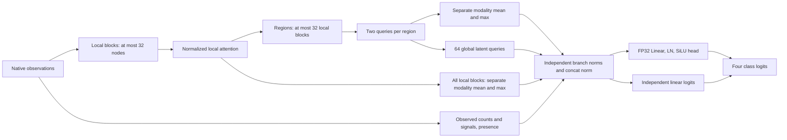

# S3架构修复、重新训练与重新评价

2026-11-14后续更新：S4定位并修复了空响应零占位节点引起的异常反向梯度。新18项Scratch/MAE3分类采用revision 3、`empty_response_bypass=true`，已完成重训及完整validation，见[阶段145](../workbook/2026-11-14_stage145_s4_empty_repair_final.md)和[S4合同](11_s4_pretraining.md)。本页及原冻结配置保留S3历史口径，新路由的分类比较以S4新矩阵为依据。

2026-11-13：S3 revision 2已完成20模型修复重训及完整validation评价，18项严格检查通过，见[阶段87](../workbook/2026-11-13_stage87_s3_repair_final_results.md)和[完整数值](results/s3_repair_summary.json)。原25模型只保留为架构/训练故障诊断，原方法结论撤回；它们不能判断局部编码、context、latent fusion或native信息是否有效。本轮止于S3，calibration/test继续冻结。

修复后Head整层失活消失，8,020次计划健康采样齐全，全部模型具有有效学习。Multiscale+tracker相对不加tracker的三seedΔmacro AP=+0.02496，CI95=[0.01984,0.02999]，该候选通过本轮质量晋级；相同pixel+bar输入下fresh ParT仍更强。Native/1mm、region8/32的净收益区间均含零。Global latent仍弱利用，ντ AP/工作点未见明确改善，不将整体学习作为所有融合分支充分工作的证明。累计S3设备时上界42.084102011/120，全部allocation已结束。

## 已确认问题与排除项

旧主模型best checkpoint在8个固定validation事件的CPU FP32诊断中，local pool RMS约101–129，context最后输出RMS约4.97，Head Linear输出约[−79.89,−13.98]；GELU全零，input/local/module/latent梯度全零。零AMP skips及参数finite不能排除这一故障。GELU在有限精度下的严格零与其数学导数不同，不能概括为所有x<−5都严格零。

残差仅做Pre-LN，local projection、embedding相加、module/context/global连接及最终concat缺少统一尺度约束。三个modality pools都加同一个latent context，连缺失模态也收到context，产生重复分支和模态存在性歧义。4个module queries没有根据占用扩展，全局仅24 latents；旧Head同时保留module pools，不能把它误写成唯一24-token路径。已确认其压缩边界，具体信息损失仍需稳定学习后的控制。

实测旧epoch0采样器20,016 batch中393个单类（1.9634%）、四类齐全1,786个、最长主导类别连续9 batch，整轮四类事件计数[20011,20010,20011,20008]。未发现先前怀疑的长时间单类流；本轮保留同一局部I/O采样器，改变batch/更新预算时明确记录。

## 论文依据与选择

2026-11-13联网检索并读取正式页/全文，缓存保存在新results根的`literature/`。

| Source | Verified status and link | Design used / scope |
|---|---|---|
| Peri-LN: Revisiting Normalization Layer in the Transformer Architecture | [ICML 2025](https://proceedings.mlr.press/v267/kim25u.html), [full text](https://arxiv.org/html/2502.02732) | 子层输入/输出归一化，控制残差分支方差；将LLM经验作为本探测器实验的依据，收益需实测 |
| Going Deeper With Image Transformers | [ICCV 2021](https://openaccess.thecvf.com/content/ICCV2021/html/Touvron_Going_Deeper_With_Image_Transformers_ICCV_2021_paper.html) | LayerScale，可学习小残差权重；不直接照搬极深ViT的初始化尺度 |
| Scaling Vision Transformers to 22 Billion Parameters | [paper](https://arxiv.org/abs/2302.05442), ICML 2023 | Q/K normalization，限制attention logits受投影范数漂移的影响 |
| NormFormer | [paper](https://arxiv.org/abs/2110.09456) | 额外归一化及梯度尺度诊断；本表不赋予未经核对的会议发表标签 |
| Point Transformer V3 | [CVPR 2024](https://openaccess.thecvf.com/content/CVPR2024/html/Wu_Point_Transformer_V3_Simpler_Faster_Stronger_CVPR_2024_paper.html) | 完整点集的局部处理与可扩展分区，避免过早把所有局部结构合成固定少量queries |
| Point Transformer V2 | [NeurIPS 2022 paper](https://arxiv.org/abs/2210.05666) | partition-based pooling，多级局部表示；本轮不声称复现其grouped vector attention |
| LitePT | [2025-12全文](https://arxiv.org/html/2512.13689v1) | 补读局部处理/低分辨率attention分工，不引入未验证custom sparse kernels |
| Transformers without Normalization | [CVPR 2025](https://openaccess.thecvf.com/content/CVPR2025/html/Zhu_Transformers_without_Normalization_CVPR_2025_paper.html) | 已评估DyT备选；本轮优先明确可监控的LN，不同时引入额外饱和函数 |
| FASERCal foundation-style framework | [2026 v2](https://arxiv.org/html/2604.07037v2), local source in docs | module-aware+Perceiver-IO的多尺度融合；监督修复先于预训练，未运行S4 |
| Stabilizing Transformer Training by Preventing Attention Entropy Collapse | [ICML 2023](https://proceedings.mlr.press/v202/zhai23a.html) | 将attention entropy作为不稳定诊断；本文的spectral reparameterization不与本轮QK-LN同时新增，避免引入无对照的额外变量 |
| Attention is not all you need: pure attention loses rank doubly exponentially with depth | [ICML 2021](https://proceedings.mlr.press/v139/dong21a.html) | 检查token同质化，保留FF/残差与local旁路；其纯attention理论不能直接证明本模型的queries已塌缩 |
| mHC: Manifold-Constrained Hyper-Connections | [2026-01 v2 preprint](https://arxiv.org/html/2512.24880v2) | 残差连接的可控信号传播与实际内存开销；本轮浅层网络采用小LayerScale与明确LN，不扩宽为多残差流/Sinkhorn网络 |
| Gradient Starvation: A Learning Proclivity in Neural Networks | [NeurIPS 2021 official paper](https://proceedings.neurips.cc/paper_files/paper/2021/hash/0987b8b338d6c90bbedd8631bc499221-Abstract.html) | 已补读正式全文；交叉熵可能只学到一部分预测特征，说明“总体NLL下降”不能证明每条分支均被充分学习。其线性化理论不直接诊断本模型，Spectral Decoupling未加入当前冻结训练 |
| Balanced Multimodal Learning via On-the-Fly Gradient Modulation; On-the-Fly Modulation for Balanced Multimodal Learning | [CVPR 2022](https://openaccess.thecvf.com/content/CVPR2022/html/Peng_Balanced_Multimodal_Learning_via_On-the-Fly_Gradient_Modulation_CVPR_2022_paper.html), [TPAMI online 2024](https://doi.org/10.1109/TPAMI.2024.3468315), [extended full text](https://arxiv.org/html/2410.11582) | 已补读OPM/OGM优化不均衡分析、非线性classifier扩展及missing-modality实验；作为弱分支的后续对照依据，未在本轮中途增加dropout/gradient modulation |

## Revision 2架构

实现于`analysis.flavour.s3.models_repair`，旧`models.py`仍精确加载旧checkpoint。

1. 每≤32个observation nodes的局部attention保留完整覆盖；local pooling projection后LayerNorm。
2. 每个attention/FF子层输入与输出归一化，残差逐通道LayerScale初值0.1；Q/K每head无可学习scale的LayerNorm。线性/embedding使用std0.02初始化。
3. `fixed`控制保留每module4 queries和24 latents，以稳定化版本测量原压缩边界。
4. `multiscale`按每module最多32个局部块生成一个region、每region2 queries；region总数随真实占用增长，无事件token cap。所有region供64 latents跨模态读取，复杂度不对全部原始节点做二次attention。
5. 全部local block另有独立mean/max读出，直接进入分类，不经过module/global固定瓶颈。Region/modal pools与global pool分别归一化，缺失模态分支归零并加入presence bit，不把同一context重复加到三模态。
6. Head concat再归一化，Linear后独立LayerNorm+SiLU，另有直接linear logits路径。Head使用FP32，encoder可BF16。归一化及线性路径共同避免所有梯度依赖一个饱和激活。

区域划分只使用现有硬件module和canonical空间顺序；绝不截断原始节点。全局分类最终仍须聚合，不能称可逆编码；用同输入的fixed/multiscale/no-direct控制测量瓶颈，而非仅凭token数量断言性能。

图对应multiscale+direct模型。Fixed控制使用module queries和24 latents、无direct local分支；no-direct仅去除D分支；region8将每region最大local blocks从32改为8。Multiscale将hardware ID/type/z加入region tokens，未运行fixed中的二次module-context attention或显式global pair-bias；不能把配置继承的旧开关误读成这些运算实际存在。Fresh ParT保留独立的4 mm local blocks和全block pair attention，其容量、窗口与修复模型不同，跨模型收益不是单一组件的因果效应。

### 因果解释与尚未回答的问题

残差方差满足 `Var(x+αf)=Var(x)+α²Var(f)+2αCov(x,f)`，因此仅有Pre-LN不控制残差流的累积幅度。多模态concat还受协方差影响，Head投影方差为`WΣWᵀ`；把相关context重复加入三模态会重复放大某些方向。修复同时约束分支尺度、残差增量和Head隐藏尺度，不能把效果归于单独更换GELU。GELU数学上在x<−5不是恒等零；旧checkpoint中全零来自具体数值范围及实现精度。

最大train事件下fixed读取124个module query tokens和24个latents；multiscale region32/region8分别读取958/3,690个regional tokens和64个latents，另有14,597个local blocks的mean/max直接读出。完整节点覆盖证明未进行事件截断；局部池化与全局汇聚仍非可逆，不能据此声称全部微观信息均已无损编码。Region8/32、direct/no-direct、native/1 mm控制分别测量更细区域、独立读出与原生粒度的净影响。

已观察到同region的query向量cosine偏高，但分组平均、BF16舍入和共同region内容均可造成这一现象；单独cosine高不等于训练失败。用FP32 cosine、query variation、采样attention entropy、上游梯度、完整validation和压缩控制共同判断。若完整学习结果显示latent或module路径弱而旁路承担大部分分类，明确记录路径贡献，不把旁路的有效学习当作所有attention层均充分工作的证明。

针对已观测的global弱依赖，后续假设分开检验：query同质化、局部/summary捷径的优化竞争，以及全局表示的真实冗余。先比较train-only上独立拟合的local/regional/global probes与完整模型分支梯度，再冻结“无global”“分支dropout或OPM”“query位置/多样性”中的单变量重训。OPM/OGM主要针对不同输入模态；同一encoder的多尺度分支共享参数，迁移为path modulation须另行定义控制，不能直接宣称原算法适用。自然缺失的硬件读出始终保留presence，不将训练dropout解释为真实硬件缺失。本轮20模型已完成稳定性、压缩和硬件增量评价，未运行这些后续实验。

## 训练与内部健康要求

先在32个非空train事件（每类8个，pixel+bar occupancy20–3000）执行balanced memorization；不使用validation挑选结构。768 updates，定期记录NLL/accuracy、多样性及input/local/module/head激活和梯度。正式训练前必须同时达到accuracy≥0.95、NLL<0.25、至少24组分数及非零encoder梯度。仅四步finite smoke不再作为有效学习的证据。

正式训练沿用accepted 80k train/10k validation，四类全量，包括空响应，best按validation NLL选择。AdamW独立no-decay norm/bias组，warmup+逐update cosine、clip1，保存实际曝光/更新/LR/optimizer/seed和健康轨迹。Batch8与同配方重训基线/稳定控制相比较；不能把旧batch4更新预算下的故障归为纯架构效应。

每100 updates及每轮完整validation检查内部健康：nonfinite立即留证；连续3次采样所有局部encoder精确零梯度，或完整validation输出单一向量，标记`internal_health_failed`并停止该错误配方。小batch的相同分数可能来自空响应，单次ties不直接否决。异常必须审查架构/数值精度/optimizer/data过程并以新版本修复；不得把故障模型作为物理或架构无效的结论。弱学习但未触发精确零的模型仍需查看NLL、梯度和分数方差后才能通过科学验收。

## 调度与评价

新根为`/eos/home-x/xcheng/FASER/Pinpoint/results/flavour/s3_repair_2026-11-13`。GPU通过Kubeflow或HTCondor，按实获配选择，允许一个MIG内多个独立训练，测量峰值显存和利用率后调整并发。沿用[CERN flavor表](https://ml.docs.cern.ch/#available-flavors)的H100 47GB `nvidia.com/mig-3g.47gb:1`及product selector；CPU/RAM由平台注入。修复campaign上界10.845833333、旧S3上界31.238268678，累计S3上界42.084102011 device-hours，120预算内余额下界77.915897989；修复、先导和失败尝试均计入，预算不自动扩大。

Pilot通过后冻结独立科学矩阵，至少覆盖稳定fixed、multiscale native/1 mm、tracker增量、无direct旁路及同配方重训ParT，并对主比较追加seeds17/2026。四分类macro AP/NLL、逐类AP/F1/precision/recall、混淆矩阵、相同FPR/purity、条件域和token/资源/内部健康共同评价。物理事件CI与training seed spread分开，使用原128块/400次配对bootstrap；calibration/test不动。旧结果只作故障对照，新结论以健康重训结果为准。

## 全量执行版本与最终验收

8个screen、12个确认任务及其合并入口分别为`configs/s3_repair_screen.json`、`configs/s3_repair_confirmation.json`、`configs/s3_repair_all.json`。每个screen结构/表示均有独立32-event拟合gate，`s3_repair_all_pilots.json`；全量训练同时要求匹配执行版本的完整占用压力测试。未因validation改变确认候选。

实测局部编码以2048个blocks为计算chunk并使用`torch.compile(dynamic=True)`可显著减少高占用尾部的launch开销，不改变每block至多32节点、窗口、region或latent定义。当前执行版本2在编译区外观测local pool，健康采样与普通训练使用同一编码器计算路径；每worker scratch安装匹配Torch2.7.1的Triton3.3.1及EL9编译支持。workers1，所有配置使用同一执行方式，全部从头拟合。第一次尚未完成epoch的eager输出移入`audit/eager_execution_before_compile`，只作执行诊断并照常计费。编译先导版本1曾在健康采样切换eager路径，fixed末次拟合失败；已保留证据并修复，不用失败gate启动正式训练。

最终入口`analysis.flavour.s3.finalize_repair`先执行14项CPU读回、所有采样内部健康和独立best-checkpoint FP32 backward，再完成四分类、条件域、工作点、token census与英文图。`accept_repair`要求实际validation NLL优于constant class-prior NLL、完整validation分数非常数、encoder连通、所有计划健康采样齐全，同时检查冻结矩阵、三seed对照、400次128块bootstrap、终态allocation与累计120预算。只通过checkpoint读回不足以验收；故障模型必须修复重训。共享/混合backend allocation成本不直接用于声称模型本体加速，质量晋级仍遵守原四分类阈值。

调度补充：确认任务同时进入HTCondor，实际获配后才以原子`claims/<experiment>`领取；Kubeflow后续确认波也使用同一领取机制，已有writer不重复启动。允许H100（含47GB MIG）与A10040GB原生BF16执行，同Torch2.7.1和模型/更新预算；硬件作为实测元数据保留，跨设备allocation不称模型加速。未获配任务可由另一backend先领取。完整验收还报告NLL相对constant prior的400次物理块bootstrap差值区间，区间支持学习后才通过有效学习项；这是固定validation checkpoint的诊断，仍不是冻结test结论。

中途首轮6个模型的有效学习证据见[阶段85](../workbook/2026-11-13_stage85_s3_learning_and_path_diagnostics.md)，最终20模型结果见[阶段87](../workbook/2026-11-13_stage87_s3_repair_final_results.md)。17个修复模型均完成64个跨occupancy非空validation事件的固定checkpoint诊断，相同模态presence内置换regional/global/local/summary分支，并记录token谱；用于解释路径依赖，不能等同重训消融或总体性能。12并发资源尝试已归档，保留成本及观察到的退出信息；后续MIG总并发上限8，通过共享名额补入冻结确认任务，全部训练和allocation现已结束。

恢复经验见[阶段86](../workbook/2026-11-13_stage86_s3_incremental_completed_model_checks.md)：`condor_ssh_to_job`只用于短检查，长期训练必须由正式batch入口管理。此次独立session和忽略SIGHUP仍未保住SSH控制进程族中的writer；源campaign在一个child被停止后非零退出，又连带中断同Pod的确认任务。后续接续改为正式Kubeflow Job及现有A100队列，使用已提交epoch的模型/optimizer/scheduler/RNG恢复，重算未提交updates，并保留全部尝试费用。不能把短暂启动当作成功迁移，也不能用未观测的Pod phase或exit code填充终态证据。
