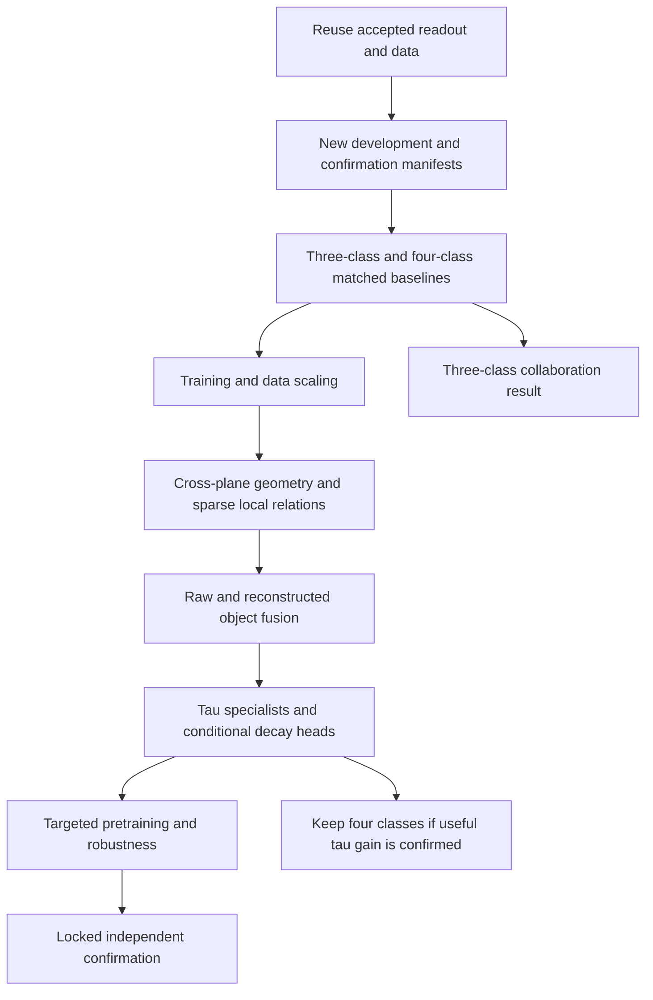

# PINPOINT 下一轮模型优化路线图（v2）

更新：2026-11-15。最初独立审查基线为Git `37dd763`、workbook stage236的S0–S6；新R1最终评价源码为`4567ab8`。旧计划已归档，新版设计、R0和R1已完成；R2首批六模型正在执行，R3–R7尚未启动。先读[研究结论与下一批决策](v2/09_decisions_and_handoff.md)，再按下表进入详细证据。

**当前结论：保留四类研究，同时交付真实三类基线；先优化训练配方和数据规模，再检验几何关系与局部信息损失。现有模型取得了可复核改进，尚未达到已知最佳效果。**

R1的41/41模型、133项配对、21项三seed平均配对、11个评价域和55条压力路径已交付，452项最终验收全部通过。独立概率/计数、核心区间和压力读回分别通过2,557/2,512/5,666项。完整证据见[最终报告stage274](../workbook/2026-11-15_stage274_r1_final_results.md)与[最终结果JSON](v2/r1_results.json)。Cal-A/Cut-B/Confirm继续封存。

| Family | Seeds | T3 BA3 (%) | T4 conditional BA3 (%) | T4 BA4 (%) | Tau efficiency at 1% FPR (%) |
| --- | ---: | ---: | ---: | ---: | ---: |
| B0 HGB | 3 | 54.5900 | 54.5300 | 43.1025 | 2.8300 |
| B1 ResNet | 3 | 56.5633 | 56.3044 | 44.5733 | 5.0200 |
| B2 ParticleNet adaptation | 3 | 55.0689 | 55.3911 | 43.3658 | 2.9933 |
| B3 Geometry ParT | 1 | 55.0600 | 55.2900 | 43.2775 | 2.7000 |
| B4 revision3 Scratch | 3 | 54.3922 | 54.4867 | 42.3217 | 2.5967 |
| B4-MAE reference | 1 | — | 54.7200 | 43.0325 | 2.4100 |

表为单模型指标的seed均值，使用新Tune40k；共同三类使用相同30k非τ事件。不是ensemble，也不是独立Confirm结果。B1相对B4的τ效率增加2.423 pp [1.941,2.977]，满足预设τ研究门槛；绝对效率仍低。B1 T3相对HGB增加**1.973333 pp**，精确值低于2 pp实用门槛；相对B4虽高2.171 pp，μ argmax recall低2.410 pp，逐类非劣未通过。

简化为三类没有稳定改善共同任务。同allocation等时预算下，B1 compute T3−T4 conditional的BA3为+.064 pp [−.179,+.302]，B2为−.313 pp [−.514,−.113]；两者NLL3均更差。B1/B2的μ recall改善同时伴随e/NC损失。四pass末轮NLL仍下降，不能把当前排名当作收敛上限；B2−B3排名差+.220 pp的区间也跨零。μ分数排序与argmax取舍不同，见[专项读回](v2/r1_muon_decision_review.json)。

R2正在执行B1一族：fresh **D0=100k×4、D1=100k×12、D2=300k×4**，匹配实际精度和明确的update-normalized schedule，分开检验更多unique事件与更多重复曝光。六项updates、尾批及LR轨迹已实算，300k数据准备与BF16真实学习/恢复门槛已通过；Kubeflow四并行、HTCondor双并行使用异构MIG。批次状态见[r2_execution.json](v2/r2_execution.json)，最新只读快照见[r2_progress_review.json](v2/r2_progress_review.json)和[stage278](../workbook/2026-11-15_stage278_research_synthesis_and_r2_progress.md)。低occupancy μ不仅argmax随训练波动，该域目前的AUROC也只有约.50–.57；全域排序改善不能替代局部信息检查。完成真实终点评价后再决定第二族或容量；R3检验stride/相位、高分辨局部残差和显式跨层关系。完整工单与验收见[04](v2/04_execution_plan.md)。

R1终态122条allocation共**45.708889个异构device-hours、307.181111 CPU core-hours**，包含失败、探针和迁移，超过原18 h规划；所有batch allocation均终态。历史SSL .635321 h单列，交互操作另有.325533 h已记录下界。原80 h总规划须按实际成本重新分批，不能直接执行剩余完整矩阵。

资源安排采用**尽快启动、兼容即可**的原则：HTCondor 与 Kubeflow 并用，接受不同 GPU、平台提供的共享设备和 MIG。当前 LCG108/Torch2.7.1 包含 SM75 起的内核，T4 使用 FP32，A100/H100 可使用 BF16；V100 的 SM70 启动失败属于本构建兼容性问题。具体操作、同计算比较口径和失败恢复见[资源执行说明](v2/07_resources_and_operations.md)。

以下为新版设计形成时的S6历史证据，与本次R1开发集结果分别解释。

独立 test 上，MAE3 ensemble 的四类 balanced accuracy 为 **43.5226%**，相对同为 100k 监督标签的 Scratch 增加 **0.3354 个百分点**；τ 在冻结 validation 1% 背景阈值下效率 **3.5556%**，实际 test FPR **1.2080%**。这些结果支持预训练收益，绝对性能仍不足以支持高纯 τ 分析。两者监督协议匹配，MAE 另有预训练成本。当前所有 accepted samples、split 和 detector-proxy 继续作为有效研究基础。

本次重新读取六个最终 revision 3 模型的训练记录和已有 validation 预测，发现：

- 六模型均以第 4/4 轮为 best，末轮 NLL 继续下降 **0.00203–0.00779**，训练饱和未建立。
- 100k 监督标签、100k SSL 语料和约 0.898M 参数构成当前主模型规模；没有完成 300k/1M 监督训练的饱和研究。
- 从固定四类 ensemble 删除真 τ 并重归一化，三类 validation BA 为 **54.6933%**；pixel-centered 为 **74.4517%**。这是S6条件诊断；R1实际三类重训及最终预算配对见stage274，不能将两批不同评价事件直接解释为净增益。
- 记录中的 data-wait/总耗时为 **31.16%–46.64%**。先提升数据供给，可把更多计算用于长训练和有效模型比较。

数值、统计口径和代码证据见[独立评估](v2/01_evidence_review.md)及[复核 JSON](v2/current_results_review.json)。

## 阅读顺序

| Document | Purpose |
| --- | --- |
| [01：结果、资料与系统性不足](v2/01_evidence_review.md) | 回答改进是否成立、哪些比较尚不公平、哪些故障已修复、哪些瓶颈仍是假设 |
| [02：类别选择与评价合同](v2/02_tasks_and_evaluation.md) | 三类、四类、条件六类的并行方式；新独立确认集、尾部统计与晋级规则 |
| [03：模型与物理设计](v2/03_models_and_physics.md) | 跨层稀疏关系、raw/object 双路径、异构融合、τ/charm 与方向任务 |
| [04：执行路线与实验工单](v2/04_execution_plan.md) | R0–R7 依赖、最小实验矩阵、资源安排、首批具体工作和交付标准 |
| [05：文献依据](v2/05_literature.md) | 本地资料及本次联网核对的论文、采用理由、适用边界 |
| [06：完整工作记录索引](v2/06_workbook_index.md) | S0–S6的236份历史记录与v2追加至stage278的入口 |
| [07：GPU 与后端执行](v2/07_resources_and_operations.md) | 减少排队、共享/MIG、实际软件兼容性、单任务写入与成本 |
| [08：R1 合作组三类对照](v2/08_r1_collaboration.md) | 已测量域表、输入/训练差异及原研究复现所需具体资料 |
| [09：研究结论与下一批决策](v2/09_decisions_and_handoff.md) | 对已有改进、最优性和类别数的判断；R2分流、R3–R7顺序、τ两条物理路径与资源安排 |
| [实验规格](v2/experiment_plan.json) | 可解析的设计合同；需实现对应 runner 后才能提交，不能直接传给旧 CLI |

## 研究路线与决策

三类输出为 `CC νe / CC νμ / NC`；四类输出为 `CC νe / CC νμ / CC ντ / NC`。三类模型训练时排除 τ，部署时仍须评价 τ 污染。四类模型必须在同一非 τ 样本上给出条件三类结果；两者由同样的输入、样本和计算预算比较。τ 子通道优先作为条件辅助头或 specialist，不直接把全部训练改成六类均衡 softmax。

| Stage | Main question | Deliverable / decision |
| --- | --- | --- |
| R0（已完成） | 哪些事件仍可用于新的独立确认？现有训练瓶颈在哪里？ | 分区冻结、真实结构、同事件缓存等价、32-event fit及10k profile通过 |
| R1（已完成） | 三类任务做到什么程度？四类是否损害共同三类任务？ | 41模型完整交付；B1本轮最强，三类化未稳定改善共同任务，保留四类研究 |
| R2 | 数据、曝光、容量中哪个限制性能？ | 100k→300k→1M 条件扩展；4→12→收敛的学习曲线 |
| R3 | 显式跨层关系能否把细粒度转为有效收益？ | 几何稀疏图、边界通信、原生/粗粒度配对和三 seed 确认 |
| R4 | 能否重建有用对象，而不是引入大量假关联？ | Track/vertex/association 的效率–fake–coverage 与 raw/object 分类对照 |
| R5 | τ 是否值得保留为主类别，细分是否有用？ | Flat4、3+τ、条件 τ decay 头；固定 FPR、分支及 charm 对照 |
| R6 | 预训练和鲁棒训练能否超过强监督基线？ | 定向 MAE/局部监督、同总计算监督控制、held-out 条件 |
| R7 | 候选是否在新事件和系统变化下保持收益？ | 冻结独立确认、概率与工作点、物理条件和完整报告 |

R2是下一步首要交付；R3是优先架构改进；R4–R6由前序证据触发。R0表明短训练宜先用native、2 workers、共享local staging与bounded decoded LRU；H100编译模式的packed+bucket虽有8.20%热态吞吐收益，构建成本约需13个pass摊平，不直接作为4-pass默认值。局部32-slot利用率仅8.83%，后续单独检验变长执行和窗口设计。原6–10周及80 device-hours为规划建议，R1实际超出阶段额度；后续采用一族优先、问题驱动的小批次，按实测重新计时。

## 历史计划与结果

旧路线的 **14 份完整文档**归入 [archive/2026-11-14_v1](archive/2026-11-14_v1/README.md)，旧01–13全文由该入口访问，归档说明见[archive 索引](archive/README.md)。原 `configs/`、`results/`、`tools/` 路径继续服务已有脚本和报告。旧路线中“下一阶段”“尚未测量”等文字反映各记录形成时点，S0–S6 的最终状态以 stage236 及各阶段最终报告为准。

关键证据：[S2 stage55](../workbook/2026-11-12_stage55_s2_final_acceptance.md)、[修复 S3 stage87](../workbook/2026-11-13_stage87_s3_repair_final_results.md)、[S4 stage181](../workbook/2026-11-14_stage181_s4_final_results.md)、[S5 stage203](../workbook/2026-11-14_stage203_s5_final_results.md)、[S5 补充 stage205](../workbook/2026-11-14_stage205_s5_scope_completion_audit.md)、[S6 stage236](../workbook/2026-11-14_stage236_s6_final_results.md)、[本次 stage237](../workbook/2026-11-14_stage237_independent_review_and_roadmap_v2.md)。
