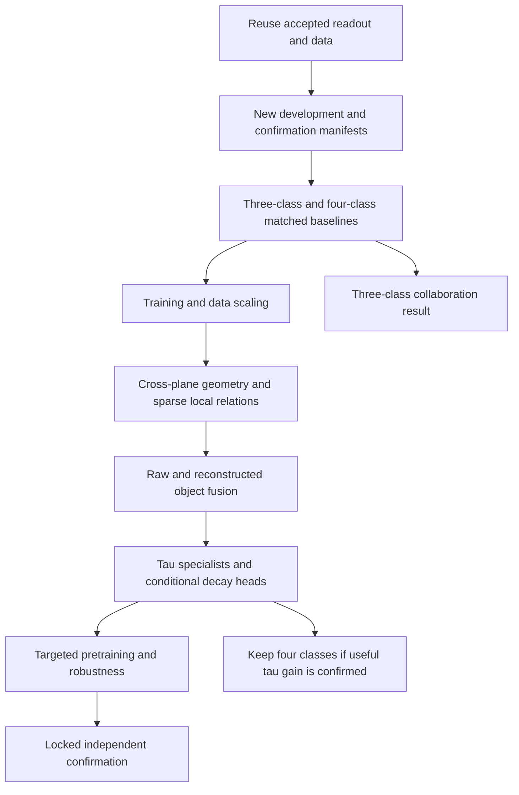

# PINPOINT 下一轮模型优化路线图（v2）

日期：2026-11-14。审查基线：Git `37dd763`，截至 workbook stage236 的 S0–S6。独立审查与新版设计已完成；R0 完成，R1 短预算筛查完成，完整训练和配对比较正在执行。R2–R7 的效果尚未测量。

**当前执行状态：R0 完成，R1 正在执行。**已冻结100k/300k/1M嵌套Train、40k Tune、40k Cal-A、160k Cut-B和200k Confirm，排除1,560,122个历史使用family。R0验收完成；R1八项真实学习门槛、B0三seed、16项screen和seed42四pass主任务完成。冻结排名为B1、B2、B3、B4，平均共同BA3分别为56.5567%、55.3950%、55.1750%、54.5133%；B1/B2与参考B4扩三seed。55条压力路径的400次统计及5,666项独立读回完成，完整nominal比较仍在执行。见[stage258](../workbook/2026-11-15_stage258_r1_ranking_and_training_tradeoffs.md)、[排名](v2/r1_architecture_ranking.json)与[B1同结构控制](v2/r1_b1_compute_controls.json)。Cal-A/Cut-B/Confirm继续封存。

B1同结构计算控制在更多曝光与wall-based schedule下，μ recall提高11.28 pp，同时e/NC下降6.46/6.30 pp，BA3下降0.493 pp。训练、决策和表示机制需要分别检查。四pass排名没有建立收敛；B2/B3仅相差0.220 pp，不作已确认的架构优势解释。03:31 UTC尚未关闭的R1 allocation已达33.1022 device-hours，超过18 h规划，最终成本待所有作业终态。

[B1三seed结果](v2/r1_b1_three_seed.json)进一步支持保留四类主线：相对B4的τ1%效率增益为2.423 pp [1.941,2.977]；真实T3相对T4 conditional的BA3增益为0.259 pp [0.042,0.479]，但NLL更差且有e/NC取舍。B1 T3相对HGB平均增加1.973 pp，未达预设2 pp实用值，对B4则未满足μ非劣。见[stage259](../workbook/2026-11-15_stage259_r1_three_seed_task_evidence_and_scheduling.md)；完整同计算和B2重复尚未完成。

资源安排采用**尽快启动、兼容即可**的原则：HTCondor 与 Kubeflow 并用，接受不同 GPU、平台提供的共享设备和 MIG。当前 LCG108/Torch2.7.1 包含 SM75 起的内核，T4 使用 FP32，A100/H100 可使用 BF16；V100 的 SM70 启动失败属于本构建兼容性问题。具体操作、同计算比较口径和失败恢复见[资源执行说明](v2/07_resources_and_operations.md)。

**结论：已经取得可复核的小幅改进，尚无证据表明现有方法达到最佳效果。下一步先建立可与合作组对齐的三类强基线，并行保留四类主线；优先解决同输入架构比较、跨层几何关系和训练规模问题，再决定扩大预训练或采用更多类别。**

独立 test 上，MAE3 ensemble 的四类 balanced accuracy 为 **43.5226%**，相对同为 100k 监督标签的 Scratch 增加 **0.3354 个百分点**；τ 在冻结 validation 1% 背景阈值下效率 **3.5556%**，实际 test FPR **1.2080%**。这些结果支持预训练收益，绝对性能仍不足以支持高纯 τ 分析。两者监督协议匹配，MAE 另有预训练成本。当前所有 accepted samples、split 和 detector-proxy 继续作为有效研究基础。

本次重新读取六个最终 revision 3 模型的训练记录和已有 validation 预测，发现：

- 六模型均以第 4/4 轮为 best，末轮 NLL 继续下降 **0.00203–0.00779**，训练饱和未建立。
- 100k 监督标签、100k SSL 语料和约 0.898M 参数构成当前主模型规模；没有完成 300k/1M 监督训练的饱和研究。
- 从固定四类 ensemble 删除真 τ 并重归一化，三类 validation BA 为 **54.6933%**；pixel-centered 为 **74.4517%**。这是S6条件诊断；R1实际三类重训的首组结果见stage246，完整三seed与同计算结论仍待完成。
- 记录中的 data-wait/总耗时为 **31.16%–46.64%**。先提升数据供给，可把更多计算用于长训练和有效模型比较。

数值、统计口径和代码证据见[独立评估](v2/01_evidence_review.md)及[复核 JSON](v2/current_results_review.json)。

## 阅读顺序

| Document | Purpose |
| --- | --- |
| [01：结果、资料与系统性不足](v2/01_evidence_review.md) | 回答改进是否成立、哪些比较尚不公平、哪些故障已修复、哪些瓶颈仍是假设 |
| [02：类别选择与评价合同](v2/02_tasks_and_evaluation.md) | 三类、四类、条件六类的并行方式；新独立确认集、尾部统计与晋级规则 |
| [03：模型与物理设计](v2/03_models_and_physics.md) | 跨层稀疏关系、raw/object 双路径、异构融合、τ/charm 与方向任务 |
| [04：执行路线与实验工单](v2/04_execution_plan.md) | R0–R7 依赖、最小实验矩阵、资源安排、首批具体工作和交付标准 |
| [05：文献依据](v2/05_literature.md) | 本地资料及本次联网核对的论文、采用理由、适用边界 |
| [06：完整工作记录索引](v2/06_workbook_index.md) | S0–S6的236份历史记录与v2追加记录入口 |
| [07：GPU 与后端执行](v2/07_resources_and_operations.md) | 减少排队、共享/MIG、实际软件兼容性、单任务写入与成本 |
| [08：R1 合作组三类对照](v2/08_r1_collaboration.md) | 已测量域表、输入/训练差异及原研究复现所需具体资料 |
| [实验规格](v2/experiment_plan.json) | 可解析的设计合同；需实现对应 runner 后才能提交，不能直接传给旧 CLI |

## 研究路线与决策

三类输出为 `CC νe / CC νμ / NC`；四类输出为 `CC νe / CC νμ / CC ντ / NC`。三类模型训练时排除 τ，部署时仍须评价 τ 污染。四类模型必须在同一非 τ 样本上给出条件三类结果；两者由同样的输入、样本和计算预算比较。τ 子通道优先作为条件辅助头或 specialist，不直接把全部训练改成六类均衡 softmax。

| Stage | Main question | Deliverable / decision |
| --- | --- | --- |
| R0（已完成） | 哪些事件仍可用于新的独立确认？现有训练瓶颈在哪里？ | 分区冻结、真实结构、同事件缓存等价、32-event fit及10k profile通过 |
| R1（执行中） | 三类任务做到什么程度？四类是否损害共同三类任务？ | 16项screen完成；完整同输入强基线、合作组对照、τ 混入矩阵待交付 |
| R2 | 数据、曝光、容量中哪个限制性能？ | 100k→300k→1M 条件扩展；4→12→收敛的学习曲线 |
| R3 | 显式跨层关系能否把细粒度转为有效收益？ | 几何稀疏图、边界通信、原生/粗粒度配对和三 seed 确认 |
| R4 | 能否重建有用对象，而不是引入大量假关联？ | Track/vertex/association 的效率–fake–coverage 与 raw/object 分类对照 |
| R5 | τ 是否值得保留为主类别，细分是否有用？ | Flat4、3+τ、条件 τ decay 头；固定 FPR、分支及 charm 对照 |
| R6 | 预训练和鲁棒训练能否超过强监督基线？ | 定向 MAE/局部监督、同总计算监督控制、held-out 条件 |
| R7 | 候选是否在新事件和系统变化下保持收益？ | 冻结独立确认、概率与工作点、物理条件和完整报告 |

R1 和 R2 是下一步首要交付；R3 是优先架构改进；R4–R6 由前序证据触发。R0表明短训练宜先用native、2 workers、共享local staging与bounded decoded LRU；H100编译模式的packed+bucket虽有8.20%热态吞吐收益，构建成本约需13个pass摊平，不直接作为4-pass默认值。局部32-slot利用率仅8.83%，后续单独检验变长执行和窗口设计。预计主线6–10周及80 device-hours仍是排期/预算建议，各新架构需重新计时，见[执行计划](v2/04_execution_plan.md)。

## 历史计划与结果

旧路线的 **14 份完整文档**归入 [archive/2026-11-14_v1](archive/2026-11-14_v1/README.md)，旧01–13全文由该入口访问，归档说明见[archive 索引](archive/README.md)。原 `configs/`、`results/`、`tools/` 路径继续服务已有脚本和报告。旧路线中“下一阶段”“尚未测量”等文字反映各记录形成时点，S0–S6 的最终状态以 stage236 及各阶段最终报告为准。

关键证据：[S2 stage55](../workbook/2026-11-12_stage55_s2_final_acceptance.md)、[修复 S3 stage87](../workbook/2026-11-13_stage87_s3_repair_final_results.md)、[S4 stage181](../workbook/2026-11-14_stage181_s4_final_results.md)、[S5 stage203](../workbook/2026-11-14_stage203_s5_final_results.md)、[S5 补充 stage205](../workbook/2026-11-14_stage205_s5_scope_completion_audit.md)、[S6 stage236](../workbook/2026-11-14_stage236_s6_final_results.md)、[本次 stage237](../workbook/2026-11-14_stage237_independent_review_and_roadmap_v2.md)。
