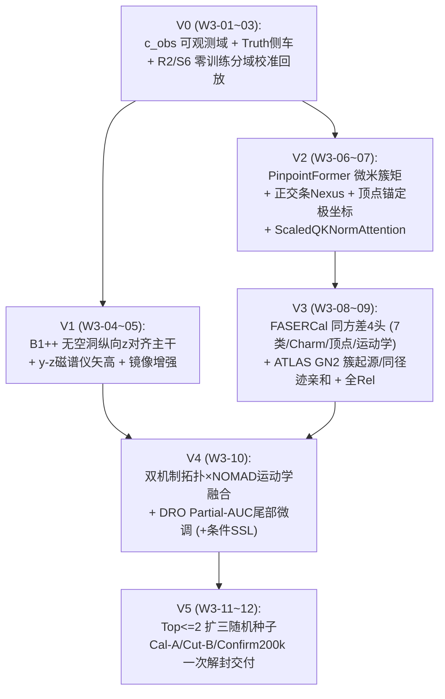

# PINPOINT 中微子反应过程分类研究路线图（v3 总入口）

更新：2026-11-15（Stage 307）。**当前模型性能尚未达到探测器物理上限：`All` 域三分类 `BA3 = 57.5%`、四分类 `BA4 = 45.8%`、`1% FPR` 下 $\tau$ 效率 `6.05%`。v3 继承 `v2` 的分区隔离与统计协议，正式终止将脆弱硬规则追踪（`v2 R4`）作为分类前置的路线，重构为“可观测包容度分域校准 + `B1++` 传感器原生强基线 + 顶点锚定混合架构 `PinpointFormer` + `ATLAS GN2 / FASERCal` 训练期密集多任务监督 + 双机制 $\nu_\tau$ 低本底发现”六阶段方案（`V0–V5`）。**

- 核心执行入口：**[v3 路线图总览](v3/README.md)**（代码结构、`W3-01`–`W3-12` 工单、晋级门禁与资源预估）
- 历史入口快照：[v2 总入口快照 (2026-11-15)](archive/2026-11-15_v2_entry.md) | [v1 全集归档 (2026-11-14)](archive/2026-11-14_v1/README.md) | [归档索引](archive/README.md)
- 阶段审查报告：[stage307 ML 审查与 v3 规划](../workbook/2026-11-15_stage307_ml_audit_and_roadmap_v3.md)

---

## 前序阶段实测基准与根因结论（Stages 01–306）

| 证据来源 | 关键实测数值 | v3 审查定性 |
| --- | --- | --- |
| `R1 Tune` 细粒度 vs 树模型 | `Pixel-centered` 域：`B0 HGB (41标量)` `BA4 = 55.92%`、`τ@1% = 4.36%`；`B2/B3/B4` 仅 `55.08%–55.75%`、`1.59%–2.51%` | 原生细粒度模型（`B2–B4`）在像素中心区反输无坐标树模型，亚百微米拓扑完全未生效 |
| `R1` `All` 域与包容区对比 | `R1 B1 T3`: `Large scintillator (46.2%)` `BA3 = 68.89%`，其余 `53.8%` 非包容区仅 `45.92%`（$\mu$ 召回仅 `28.25%`） | 过半非包容/边缘事例混入无条件训练与评价，严重稀释全域表现并掩盖物理结构 |
| `S6 MAE3` 独立 Test (`72.4万`) | 全局 `1% FPR` 阈值 `p(τ)>0.4467`：`Target envelope` 效率 `6.13%`，黄金 `Pixel-centered` 暴跌至 **`0.35% (17/4,882)`**；`1000–10000` 击中箱暴跌至 **`0.29%`** | ① 无条件全局单阈值诱发跨区域概率倒挂；② `StableAttention` 无可学习温度（$z_{ij}\in[-4.90,+4.90]$）在长序列发生 $O(1/N)$ 弥散 |
| `B1 / B2 / B3 / R3 C1` 结构核查 | `B1` 1mm 网格令 `10.5mm` 条留 9 列零空洞且 `GlobalPool` 抹除 $z$；`B2/B3` `dz` 压缩 `63.9:1` 且正交 X/Y 条 `common=[0,0]` | 三大主干均存在物理/数学编码硬伤；`R2` 仅 `4–12` passes 欠收敛且缺乏对称增强与正确 $y$-$z$ 谱仪矢高特征 |
| `S5 / R3 G2` 规则追踪评估 | `s5/objects.py` 丢弃 `width>0.5mm`/`n>64` 簇，段纯度 `2.0%–5.4%`；`G2` 同 `trackID` 召回 `10.15%–27.53%` | $1.43\,X_0/\text{层}$ 钨靶簇射中启发式硬连线难以兼顾纯度与覆盖，**决定终止 `v2 R4` 作为分类前置门槛** |

---

## v3 阶段依赖图与执行顺序（`V0–V5`）

| 阶段 | 工单 | 核心产出与科学问题 | 状态 / 退出条件 |
| --- | --- | --- | --- |
| **V0** | `W3-01`–`W3-03` | 纯观测域 $c_{\text{obs}}$ (`D_pix/D_scint/D_edge`)、$E_\nu\le 2.3\,\text{TeV}$ 对齐切片、事件/簇侧车、既有 `D2`/`S6` 零训练回放 | **立即可启动**；先验证分域似然比 $S_\tau$ 消除 `0.35%` 阈值反转 |
| **V1** | `W3-04`–`W3-05` | `B1++` 强基线与合作组 `Wu (2026)` M1 口径对齐，充足收敛 `16–24 passes` | 32-event 健康拟合通过；`large_scintillator` `BA3 >= 73%` |
| **V2** | `W3-06`–`W3-07` | `PinpointFormer` 单因素验证顶点锚定极坐标与可学习温度 `QK-Norm` | **探针 A**（消除高占据度塌陷）+ **探针 B**（微米比 `1mm` 量化 `ΔBA4 >= +2 pp`） |
| **V3** | `W3-08`–`W3-09` | 同方差 4 头（7 类 + Charm + 顶点 + 运动学）+ `GN2` 簇起源/亲和 + 全探测器 `Rel` | `Pixel-centered` 域 `BA4` 超 `B0` $\ge +4\text{–}6\,\text{pp}$；Charm 误报显著下降 |
| **V4** | `W3-10` | 纯闪烁体区 NOMAD 运动学 + `B1++`×`PinpointFormer-GN2` 集成 + 5-pass DRO Partial-AUC | 全域校准后 $\tau$ 效率 `@1% FPR >= 12%`（较 D2 翻倍）且三类非劣 |
| **V5** | `W3-11`–`W3-12` | 三随机种子稳定性 + 解封 `Cal-A40k -> Cut-B160k -> Confirm200k` 交付多域 Profile-Likelihood 显著性 | 新独立确认完整交付、英文图表、代码与可复现包归档 |

---

## 阅读导航与资产位置

| 文档 / 资产 | 用途与内容 |
| --- | --- |
| **[v3 总导览与包结构](v3/README.md)** | 一页查看 `src/analysis/flavour/v3/` 设计边界、门禁总表与各模块位置 |
| **[v3 01 取证与文献综述](v3/01_forensic_diagnosis_and_literature.md)** | 7 大代码/物理根因完整数学取证、`S4–S6` vs FASERCal 对照与文献落地映射 |
| **[v3 02 问题重构与 V0 规范](v3/02_problem_formulation_and_domains.md)** | `c_obs` 16 维定义、4 个互斥可观测校准域、能谱控制、`truth_sidecar` 与分域校准 |
| **[v3 03 B1++ 强基线规范](v3/03_b1pp_strong_baseline.md)** | 无空洞传感器二维阵、`y-z` 偏转矢高与反向外推特征、纵向 $z$ 对齐主干与镜像增强 |
| **[v3 04 PinpointFormer 架构](v3/04_pinpointformer_architecture.md)** | 16 维亚毫米簇矩、`32×32` 微补丁、正交条立体交叉、可微顶点极坐标与 `ScaledQKNormAttention` |
| **[v3 05 多任务与 ντ 发现优化](v3/05_multitask_gn2_and_tau_discovery.md)** | 同方差 4 头、`GN2` 簇起源/亲和头、自预测次级顶点摘要、NOMAD 变量与 DRO Partial-AUC |
| **[v3 06 工单、探针与运维](v3/06_work_orders_probes_and_operations.md)** | `W3-01`–`W3-12` 分步命令/验收、两大物理诊断探针、反过度官僚化规范与 Condor/Kubeflow 调度 |
| **[v3 机读规格合同](v3/experiment_plan_v3.json)** | 供后续自动化训练/评估脚本读取的 v3 参数契约 |
| **冻结 `v2` 参考与 JSON 基线** | [R1 results](v2/r1_results.json)、[R2 results](v2/r2_results.json)、[R3 results](v2/r3_results.json)、[R3 总结](v2/10_r3_results_and_next_steps.md)（只读保留） |
