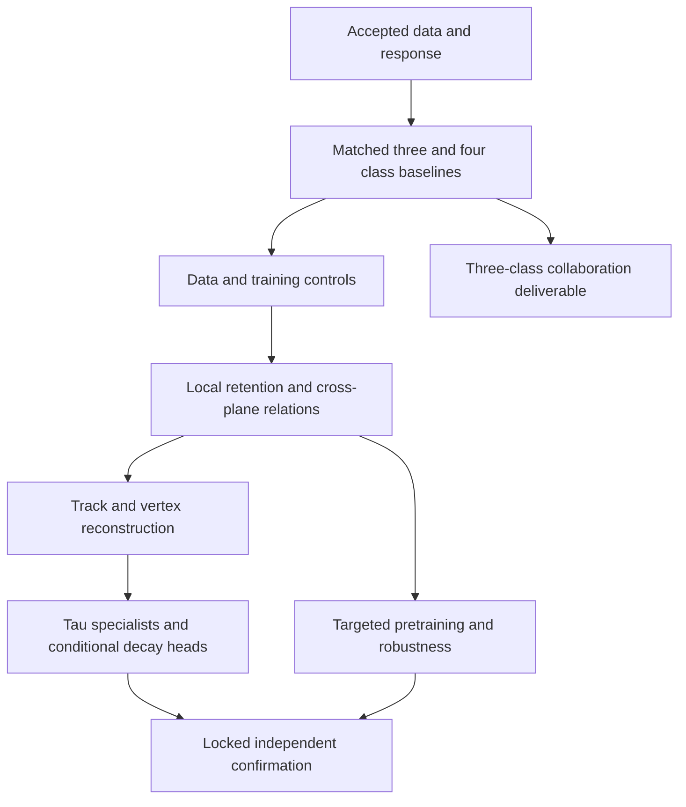

# PINPOINT 模型评估与下一轮完整路线图（v2）

更新：2026-11-15。**已有改进有数据支持，当前模型尚未达到已验证的最优效果。近期交付真实三类模型，研究主线保留四类；优先改善局部信息利用、跨层关系和对象重建，再检验 τ 分道与定向预训练。**

原计划的14份文档已完整归档至 [archive/2026-11-14_v1](archive/2026-11-14_v1/README.md)。本轮整理覆盖旧S0–S6的236份报告，追加研究记录见[完整索引](v2/06_workbook_index.md)。已读取5份本地报告共80页、FASERCal论文源码，并联网核对论文、方法和CERN资源文档；来源、采用理由和适用条件见[文献综述](v2/05_literature.md)。

## 对当前结果的判断

| Evidence | Measured result | Interpretation |
| --- | --- | --- |
| S6, independent test | MAE3 ensemble BA4=43.5226%；相对同100k监督标签的Scratch +0.3354 pp，配对区间支持正效应 | 预训练收益成立，另有预训练成本 |
| S6, frozen tau cut | validation 1%背景阈值下，test τ效率3.5556%，实际FPR=1.2080% | 当前绝对性能不足以支持高纯稀有τ选择 |
| R1, matched-input development comparison | 三seed的B1 ResNet T3 BA3=56.5633%，B4分层Scratch=54.3922%；B1的τ效率5.0200%，比B4高2.423 pp | 更复杂的当前backbone未在本轮预算下胜出，简单强基线必须保留 |
| R1, matched-time T3 vs conditional T4 | B1共同BA3差+0.064 pp，区间跨零；B2为−0.313 pp；两族T3 NLL3均更差 | 删除τ没有稳定改善共同任务，困难不限于第四类 |
| R2, data/exposure study | D2=300k×4的T3/conditional T4 BA3=57.0967%/57.1267%；T4 BA4=45.7650%，τ效率6.05% | 更多unique数据有益；相对D0的增量仍小，收敛和容量上限未建立 |
| R3 M0, full-pass reshuffling | 对D2，BA3 +0.383 pp，但μ recall −4.08 pp，稀疏μ −14.816 pp；τ无增益 | 不采用该采样替换，后续几何实验保留原采样 |

BA为balanced accuracy；pp为百分点。R1/R2/M0使用新Tune40k开发集，表中τ效率均在该开发集1% FPR处评价；它们与S6独立test分别解释。三seed数值为单模型指标均值；R2/M0为seed42，事件区间不代表训练seed总体波动。与合作组原研究完全匹配后的净增益仍未测量，已完成的同类方法对照及差异见[08](v2/08_r1_collaboration.md)。

主要不足有五项：局部窗口和投影降采样可能压缩短轨信息；显式跨层测量关系不足；旧对象重建fake较多；训练饱和、容量及更大数据收益尚未形成闭环；整体NLL/AUC与低背景τ目标不完全一致。各项的代码证据、已排除的故障和待检验假设见[01](v2/01_evidence_review.md)。目前没有证据可以据此判定探测器的四类信息上限。

## 类别和模型选择

三类为`CC νe / CC νμ / NC`，训练时排除τ，评价时单列τ污染。四类为`CC νe / CC νμ / CC ντ / NC`，同时在相同非τ事件上报告条件三类结果。共同输入、事件、曝光和计算分别控制，不能用删除真τ后的指标上涨替代三类重训。

τ先保留flat4，与`tau gate + conditional3`、条件`τ→e/μ/had`辅助头比较。更多类别由合并四类或τ工作点的实测收益决定。had1/had3须先核对最终charged-prong、可见轨与当前direct-daughter计数的关系。拓扑采用OPERA的分道思路，未分辨衰变点的事件另检验NOMAD式可见运动学；两条路径都先验证PINPOINT实际可测量的输入。

晋级标准在R1前冻结：三类候选ΔBA3至少2 pp并满足NLL和逐类质量约束；τ候选在1%背景工作点Δ效率至少1 pp、区间支持正效应且共同三类非劣。小幅正结果照实保留，不自动扩大实验矩阵。具体概率、损失、分母、先验和统计设计见[02](v2/02_tasks_and_evaluation.md)。

## 执行顺序与决策

| Stage | Question and minimum work | Status / exit |
| --- | --- | --- |
| R0 | 新分区、真实模型元数据、缓存等价和真实小样本学习 | 已完成；Cal-A40k/Cut-B160k/Confirm200k继续封存 |
| R1 | HGB、ResNet、ParticleNet、ParT、分层模型，同输入T3/T4和必要三seed/等时控制 | 已完成41模型；452项验收通过，四类继续研究 |
| R2 | 100k×4、100k×12、300k×4及有依据的正则化/顺序控制 | 已完成8模型和末轮控制；198项验收通过，D2为后续参考 |
| R3 | M0采样、G0相位、G1首层stride4→2、G2压缩前原生几何关系 | M0/G0/候选审计完成；G1训练、G2验证进行中。只对最有价值改变补seed/粒度 |
| R4 | 多候选tracking、vertex、tracker spacing/方向，raw/object双路径 | 先验收candidate recall和整轨fake–efficiency–coverage，再测全事件分类增量 |
| R5 | flat4、分解头、条件decay与τhad specialist；charm等背景 | 以inclusiveτ工作点和共同三类质量决定继续四类、细分或近期三类交付 |
| R6 | 胜出encoder上的一种定向局部监督/预训练，加held-out响应条件 | 与同总计算监督控制比较；实际下游或鲁棒性收益成立后再扩展 |
| R7 | 冻结至多两个主比较，Cal-A校准、Cut-B阈值、新Confirm和系统变化 | 新独立确认、物理条件、完整概率/工作点、代码与成本交付 |

R4–R6由前序证据触发，不要求先完成全部候选才能交付三类结果。未建立学习、对象覆盖或下游收益的分支先定位原因；有效负结果也形成明确决策。完整最小矩阵、实施工单、触发与停止条件见[04](v2/04_execution_plan.md)，当前科学判断集中在[09](v2/09_decisions_and_handoff.md)。

R3最新执行状态见[r3_execution.json](v2/r3_execution.json)。新增材料特征已按G4源码修正：silicon header的10使用μm，换算为0.010 mm；W/scintillator厚度使用mm。修正后的五项真实学习检查全部通过，正式G2分类收益尚未测量。候选图、M0与G1不依赖该厚度特征。单位修正见[stage289](../workbook/2026-11-15_stage289_r3_material_units_and_readability.md)，最终整理和学习读回见[stage290](../workbook/2026-11-15_stage290_roadmap_synthesis_and_corrected_learning.md)。

## 资源与阅读入口

**以预计完成时间选择资源，HTCondor和Kubeflow并用，接受异构GPU、共享设备及MIG。**不为同型号或整卡等待。并发数由真实吞吐、CPU/RAM、显存和完整validation峰值决定；同allocation共享一次输入staging，各模型独立checkpoint。当前LCG108构建包含SM75起的内核，T4用FP32，A100/H100可用BF16；不同精度需保留必要匹配控制。V100的既有失败属于软件构建兼容性问题。

R1/R2终态batch成本分别45.708889/7.475833异构device-hours；R3成本随运行更新。原80 h为规划估计，R1已经超出阶段估计，后续按实测小批次重排并保留确认资源。跨GPU/MIG的device-hours只用于记账，不等同于相同计算量。CERN flavor、配额、提交及恢复见[07](v2/07_resources_and_operations.md)与[归档Kubeflow说明](archive/2026-11-14_v1/08_kubeflow.md)。

| Document | Content |
| --- | --- |
| [01 证据审查](v2/01_evidence_review.md) | 改进幅度、资料对照、系统性不足与假设 |
| [02 任务与评价](v2/02_tasks_and_evaluation.md) | T3/T4/条件分道、分区、先验、尾部统计与晋级 |
| [03 模型和物理设计](v2/03_models_and_physics.md) | 几何关系、raw/object融合、τ、方向与定向预训练 |
| [04 执行计划](v2/04_execution_plan.md) | R0–R7矩阵、依赖、实施工单和交付 |
| [05 文献](v2/05_literature.md) | 本地与联网来源、采用理由和适用条件 |
| [06 工作记录索引](v2/06_workbook_index.md) | 全部阶段记录入口 |
| [07 计算资源](v2/07_resources_and_operations.md) | Condor/Kubeflow、混合GPU、共享与成本 |
| [08 合作组三类对照](v2/08_r1_collaboration.md) | 已测共同域结果、原研究差异与复现所缺输入 |
| [09 当前决策](v2/09_decisions_and_handoff.md) | 当前结论、下一批优先级与条件分流 |
| [实验规格](v2/experiment_plan.json) | 可解析研究合同；各阶段runner使用对应具体配置 |

S6旧独立结论以[stage236](../workbook/2026-11-14_stage236_s6_final_results.md)为准，新开发比较以[R1 stage274](../workbook/2026-11-15_stage274_r1_final_results.md)、[R2 stage284](../workbook/2026-11-15_stage284_r2_final_results.md)和[R3 stage288](../workbook/2026-11-15_stage288_r3_m0_and_candidate_results.md)为准。原`configs/`、`results/`、`tools/`路径继续服务历史结果；大型产物保留在仓库外的统一results目录。
