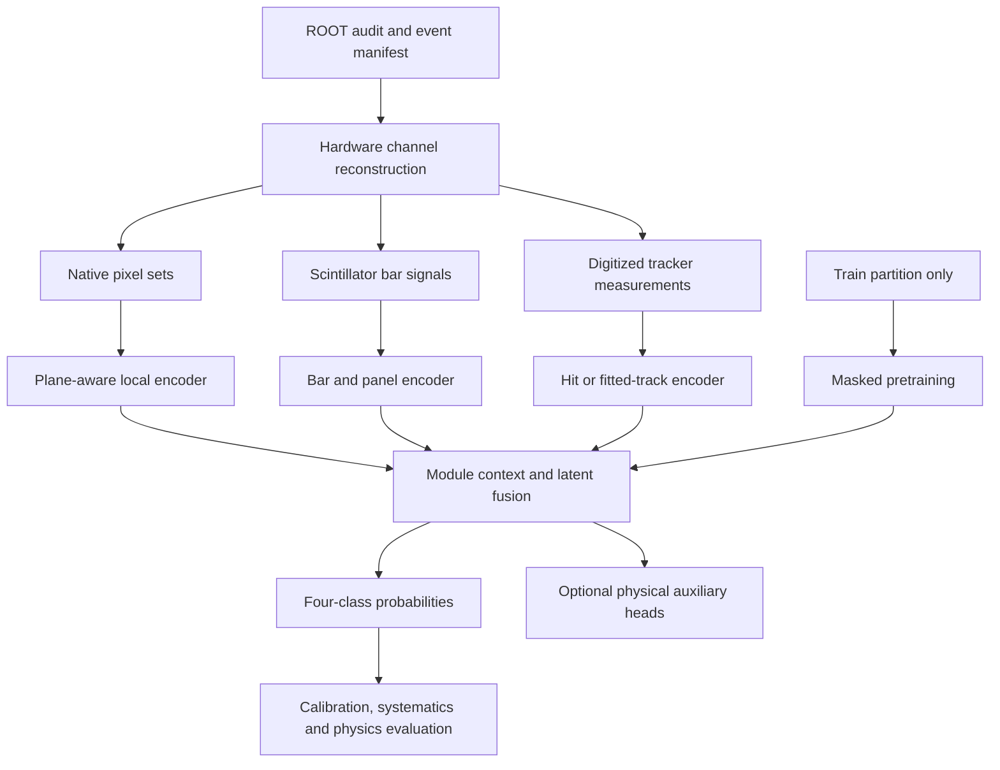

# PINPOINT 中微子反应分类研究路线图

日期：2026-11-11。目标输出顺序固定为 `CC νe / CC νμ / CC ντ / NC`，包含相应反中微子。本文是待执行的研究设计；本次已完成文献核查、源码检查与有界数据抽样，尚未训练新模型。

建议主线是：**原生 pixel 与 Scintillator bar 读出 → 保留细节的局部编码 → 按探测器结构组织的全局注意力 → 多探测器融合 → 四类概率与物理辅助任务**。先建立直接监督的 ParticleNet、Particle Transformer 和轻量分层模型，再在同一个编码器上比较 FASERCal 式 masked pretraining 与 relational supervision。这样可以分别回答“信息是否丢失”“模型是否适合”“预训练是否有效”，而不是把三种变化混在一次实验里。

## 阅读与执行入口

| Document | Content |
| --- | --- |
| [01_data_and_hardware.md](01_data_and_hardware.md) | 实测文件规模、ROOT schema、事件对应问题、硬件可观测量、digitization 与数据合同 |
| [02_literature.md](02_literature.md) | FASERCal 论文与汇报的具体方法、2025–2026 顶会检索、迁移判断及引用 |
| [03_models_and_experiments.md](03_models_and_experiments.md) | 输入表示、模型结构、预训练、τ/charm 任务、实验矩阵与统计评价 |
| [04_execution.md](04_execution.md) | 分阶段工单、资源预算、HTCondor、产物与验收标准 |
| [05_local_studies.md](05_local_studies.md) | 更新后四份 PDF 的逐项证据；fiducial、投影损失、FASER 工作点与重建覆盖率 |
| [06_s0_s1_operations.md](06_s0_s1_operations.md) | 新原生通道管线、实际运行命令、事件签名 split 与 detector-proxy 的适用状态 |
| [configs/study.yaml](configs/study.yaml) | 待实现的研究配置合同；尚不是现有训练脚本可直接读取的配置 |
| [tools/inspect_inputs.py](tools/inspect_inputs.py) | 本次数据抽样的可复现只读工具 |

## 1. 首先要回答的物理问题

分类对象是反应的 CC flavour/NC 类别。`ν/anti-ν`、DIS/QE/RES 等作为分层诊断，不混成新的主类别。NC 内不同入射 flavour 合并；若现有 NC 样本未覆盖 `ντ NC`，需要单列覆盖范围并补样或限定适用域。

主要难点是 `ντ→e` 与 `νe CC`、`ντ→μ` 与 `νμ CC`、`ντ→had` 与 NC 的相似性。τ 衰变中不可见中微子、次级顶点和 kink、末态轻子的隔离度、喷注与轻子的相对方向都可能提供信息，但必须先证明这些特征在当前层间距、材料、视场和读出响应下可分辨。不能把完整模拟中存在的顶点或动量直接视为测量量。

| Hypothesis | Controlled comparison | Evidence required |
| --- | --- | --- |
| H1: 原生 pixel 几何包含粗 rebin 丢失的分类信息 | 同一 split、相同模型族和读出，原生/100 μm/200 μm/1 mm 表示比较 | `ντ` PR-AUC、固定背景接受率下效率、各衰变道、资源曲线；配对置信区间 |
| H2: Scintillator 和 FASER 提供互补信息 | pixel、bar、pixel+bar、再加 digitized FASER；timing 单独消融 | 增益在能谱匹配和响应扰动后仍存在；给出各子系统的边际贡献 |
| H3: 局部与全局信息共同决定分类 | ParticleNet、几何版 ParT、分层局部编码+latent fusion | 与 token 数、参数、训练预算相关的精度/资源 Pareto 比较 |
| H4: FASERCal 式预训练改善困难通道 | 同编码器 Scratch / MAE / MAE+Rel；固定标签预算与总算力对照 | 除平均 AUROC 外，提高 `ντ` 工作点或减少所需标签/算力 |
| H5: 可分辨的衰变拓扑优于仅学习类别能谱 | 四类头与 τ 六子类方案、顶点/局部语义辅助任务对照 | 总体、能谱匹配、位置匹配三种评价；charm 背景的假 τ 率 |

## 2. 本次核对改变了哪些优先级

指定四类目录共 **7,240 个 ROOT 文件、2,386,015,012,744 bytes（约 2.386 TB）**。总事件数尚未逐文件统计；尾文件不足 1,000 事件，NC 的 chunk 编号还有 38 个缺口，不能用文件数直接换算总事件数。[数据证据](01_data_and_hardware.md)给出了抽样边界和复现命令。

直接开始训练前有三个实际问题要解决：

1. 每类 chunk 000 的前 32 个事件中，pixel 空事件的 `event_id` 与 `event/evtID` 分别有 6、7、11、8 条不一致；源码显示 pixel 的事件 ID 在 hit 循环内才更新。先验证逐行关系，再处理空事件关联，不能按错误 ID 合并。
2. `10081_000.root` 的 1,000 条反应元数据中有 3 条与名义类别不一致；旧代码的 `run % 4` 标签规则也不适用于本次四个 run。需要显式标签映射和独立元数据核查。
3. Scintillator 记录按模拟 track 拆分。此次 32 事件抽样中，合并为真实 bar 通道可减少约 9.3–34.4 倍记录；记录条数和 per-track timing 不能作为硬件信息直接喂给网络。

原生 pixel 抽样最大为 6,056 hits/event，Scintillator 原始记录最大为 174,535 records/event；这只是每类首 32 事件的结果，尚不能代表高占用尾部。先压缩不具有物理独立性的 bar 记录，再测量全样本占用分位数，是确定模型容量的首要依据。

用户所写的仓库内 `Pinpoint_G4` 路径本次不存在。实际检查的是同级 `/eos/home-x/xcheng/FASER/Pinpoint/Pinpoint_G4`，HEAD 为 `dbbdb5155a66f5329fd27ea5285d037bf8fb2f03`。当前源码与生产 ROOT 的几何默认值不同；生产版本和 macro 尚待追溯。使用每个 ROOT 自带的 `geometry`，再核对相匹配的模拟配置。

## 3. 文献综合后的技术选择

更新的本地资料显示：2026-09-16 的三类研究在 pixel-centered volume 中加入 pixel，νe/νμ/NC AUC 分别增加 0.026/0.064/0.075；2026-10-21 的 1 mm 双投影 CNN/ResNet 研究未见 pixel 明确增益。两者的 fiducial、样本、表示和评价条件尚未统一。S2 因而增加“原生/1 mm × 联合位置/双投影”的对照，并分别评价中心区域和全目标域；FASER 增量按相同 purity 或背景接受率比较。[本地汇报核对](05_local_studies.md)

FASERCal 的关键贡献是 **稀疏局部 token、module-aware attention、Perceiver 融合、MAE→Rel→joint fine-tuning**，以及对标签效率和 generator 变化的检验；其 1 cm scintillator voxel patch 不能直接搬到 20 μm pixel 与一维 bar 上。其方法已发表于 *Nature Machine Intelligence*，正式版在线日期为 2026-09-30；本地 arXiv v2 和 ICHEP 汇报均已阅读。[F1–F3](02_literature.md#f1)

2025-11-14 FASERCal workshop 补充了从 readout 到 voxel/track reconstruction 的链路和 τhad 初步工作点；它与 2026 论文分开引用。2026-10-07 的 PINPOINT/FORTVNE 运动学汇报则提示优先保留局部分量方向、检查泛化与 reconstruction coverage。vertex-centred 输入只用重建/预测 vertex，极角 θ 与方位角 φ 分开评价，质量选择同时报告保留效率。

2026 年 CVPR 的 LitePT 支持“高分辨率阶段用廉价局部编码，降采样后使用注意力”的设计原则；PTv3/Flash3D 提供高占用事件的稀疏邻域与 GPU 效率参考。对 PINPOINT，局部编码应尊重 sensor plane 和非均匀纵向间隔，压缩前保留精细位置残差，不复制自然场景的均匀三维体素化。[C2–C4](02_literature.md#c2)

Particle Transformer 提供 pairwise interaction attention 的思路；这里的 pair 变量来自测量几何、读出和跨层关联，不使用 jet tagging 中依赖真四动量的量。ParticleNet 是独立的局部关系基线。Sonata、NOMAE、Concerto、Point-PQAE 和 2026 PointINS 提供预训练目标候选；优先验证 occupancy/charge 重建和物理合理的跨模态预测，再考虑更复杂的语义与 instance 目标。[P1–P2、C5–C10](02_literature.md)

## 4. 主线结构

保留两条可比较的路线：第一条直接从硬件读出到事件分类；第二条增加可独立检验的 track/vertex/shower object 表示。对象路线只有在重建效率、错配率和分类收益都有证据时继续。两条路线都输出相同四类概率，并保留 all-event 的分母。

## 5. 阶段顺序与决策门槛

以下 12–16 周是单人主线、有可用单 GPU 的排期建议，不是实测耗时。大样本准备和长训练通过 HTCondor，另留排队、硬件校准与补模拟的时间。

| Stage | Proposed window | Question and deliverable | Gate |
| --- | --- | --- | --- |
| S0 | Week 1 | 冻结 label/readout/split 合同，完成 manifest 与异常说明 | 空事件关联、标签冲突、版本差异可复核；输入不含 truth 特征 |
| S1 | Week 2–3 | 硬件通道转换、数据流与可解释基线 | 守恒检查、真实空事件、mask、单位、占用与吞吐报告通过 |
| S2 | Week 4–5 | 原生 ParticleNet、ParT；分开量化粒度与投影损失 | 同预算、fiducial 分层；原生输入和截断策略的偏差有测量 |
| S3 | Week 6–7 | 轻量分层模型、多探测器融合 | 相对最强简单基线有统计支持的收益，或具有可量化资源优势 |
| S4 | Week 8–10 | MAE、自蒸馏、可行时 MAE+Rel | 同编码器、同标签与算力对照；无 test 参与 pretraining |
| S5 | Week 11–12 | τ 子通道、charm、对象重建与混淆解释 | 改善来自可测拓扑；各通道分母、重建覆盖率、校准与迁移稳定性可说明 |
| S6 | Week 13–16 | detector/generator 系统效应、加权物理评价 | 冻结测试；给出含 MC/系统不确定度的最终结论与产物 |

每阶段结束写中文 `workbook/YYYY-MM-DD_stageNN_*.md`，提交代码、配置、报告和小型表格；checkpoint、运行日志和图写入 `results`。每次只推进下一阶段需要的少量候选，具体工单见 [04_execution.md](04_execution.md)。

## 6. 成功的定义与分支规则

首先要交付可复现、仅使用硬件可观测量的四分类基线，报告 all-event 效率和 detector-active 条件效率。随后用冻结 split 上的配对比较说明每一项信息或训练方法的净贡献。最终成果是有系统效应说明的分类概率与选择效率，而不只是最大 overall accuracy。

方法晋级的预注册目标为：在预先指定的主要指标上，三随机种子均值提高且配对 95% 区间支持正增益；同时报告每类性能，若任一类明显退化须解释取舍。S3/S4 可先用 `ντ` PR-AUC 增加 0.01、或固定背景接受率下 `ντ` 效率相对提高 10%、或同等质量减少一半训练开销，作为值得扩大样本的工程门槛。这些是研究预算选择，不是预测性能或最终物理要求。

若收益来自能谱/顶点先验，保留它作为 nominal 条件性能，并明确独立报告 topology 对照；若原生与粗表示等效，则报告在已验证分辨率和统计精度下的等效区间。若 τ 困难通道仍混淆，先分析衰变位置、可见长度、缺失横动量的可测代理、charm 和接受度，再决定补模拟或改模型；少量离群事件不作为终止分支的依据。

本阶段尚未测量：新旧模型在这批样本上的 AUC/效率、硬件标定误差、generator 包络、全量事件数、GPU 吞吐/显存、训练 GPU-hours 和预期物理产额。相关测量已列入阶段验收。
