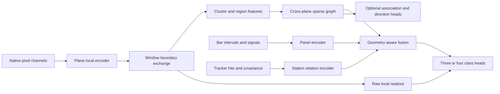

# 模型改进与物理信息利用设计

**首选改进是在现有有效编码器上增加真实几何邻接和跨层连续性，并建立简单而强的同输入基线。对象重建与预训练随后服务已识别的具体信息缺口。**

下列结构均为拟实施方案。论文编号见[文献表](05_literature.md)；性能需由 R1–R7 测量。

## 1. 应保留的现有成果

继续使用 accepted 原生 binary pixel、合并后的 bar 能量/PE proxy 和 tracker digitization；保留完整事件、真实空响应、坐标有效性与模态 mask。现有 revision 3 的尺度归一化、LayerScale、QK normalization、FP32 head、empty-response bypass 和真实小样本拟合检查继续复用。

现有模型已经有块内 attention、原生位置残差、多尺度 local/regional skip 和可学习的 global 表示。新实验只修改待回答的关系/压缩/融合因素，不把这些已实现机制重新包装成新增贡献。保留旧模型的 source/config/checkpoint，新增结构使用独立 revision。

## 2. 同输入基线：先证明复杂结构确有必要

| ID | Input representation | Model | Main purpose |
| --- | --- | --- | --- |
| B0 | 观测总量、纵向/横向形状、presence、可测方向/关联质量 | HistGradientBoosting 或小 MLP | 检验接受度、能量和形状能做到多少 |
| B1 | 合作组式 bar 双投影、1mm pixel 双投影、tracker 分支 | CNN/ResNet + late fusion | 对齐三类研究；隔离图像表示与训练协议差异 |
| B2 | 原生 pixel/bar + 独立 tracker set encoder | 当前 ParticleNet adaptation + late fusion | 局部图基线；fixed geometry graph 为默认，dynamic graph 单列 |
| B3 | 原生 pixel/bar + 独立 tracker set encoder | 几何 ParT adaptation + late fusion | 补齐此前 ParT 缺少 tracker 的公平比较 |
| B4 | 原生 pixel/bar/tracker | 现有 multiscale revision 3，Scratch / MAE3 | 共同对照；旧权重只作 warm-start/reference，新样本合同下重新训练 |

所有模型均做 T3/T4；screen 在 100k 四类池及其相同非 τ 子集上执行。B0/B1 的输入来自同一 accepted observations，额外 reconstructed tracker 特征按 R4 的质量合同单列，不能把新增物理重建与 backbone 效应混在一起。

各网络至少有相同调参额度；独立选择合适学习率和正则化。相同默认超参数并不保证公平，强制所有架构都只训四轮也不能回答其实际最佳效果。最终同时给相同计算预算结果和各自收敛结果。

## 3. 优先架构 G1：显式几何与跨层稀疏关系



### 3.1 局部表示与窗口边界

以现有 dim96、块内 attention 为起点，第一步只增加同 plane 相邻窗口的消息交换，避免短结构被固定窗口边界切断。两种低成本实现择一：plane 内 sparse 2D convolution；或基于 measured xy 的 local EdgeConv，邻居数从 8/16 起做 train-only profile。窗口平移只作为边界鲁棒性诊断；不把探测器整体平移、任意旋转视为普适物理不变性。

每个 block/cluster 显式保留 centroid、测量轴 mask、xy covariance/extent、channel count、signal summary、plane/module ID；raw local skip 继续存在。原生 residual 与 cluster moments 同时提供，但 binary pixel 不加入模拟 charge 或 per-track deposit。连接降采样前后的映射，以测量真实局部信号经过压缩的变化。

### 3.2 跨层候选图

节点先用 observation-only cluster 或高占用窗口 token，边连接相邻 1–3 个可见 plane，并允许越过无响应 plane。构图依赖已知 geometry、观测 hit/interval 与 uncertainty，不读取 trackID、PDG 或真 vertex。

候选边特征包括：

- `Δx, Δy, Δz`、`Δx/Δz, Δy/Δz`、距离和 measured-axis mask；pixel 斜率保留符号。
- 直线/已知名义场传播后的残差及测量协方差，材料厚度/辐射长度、plane 间距和相对 module。
- Cluster width、局部密度、可见 hit count、signal ratios、隔离度和候选歧义数。

bar 只在其测量轴比较相容性；另一维用区间/边界表示或边缘化距离。把 bar 的未测坐标中心当精确 hit position 会制造方向约束。Tracker 的 station ordinal 保留为 ID，另从 accepted G4 geometry 加入真实 station z 与 covariance；名义 field/material 是已知 detector context，不能用真粒子动量完成候选筛选。

先用固定物理 gate 和有限邻居的 sparse message passing，再考虑 learned edge score。图只表示候选关联，不要求每个节点立即归属于唯一粒子。测量 candidate-edge recall 与边数/事件尾部，控制 pruning 对短轨/高占用的偏差；不能只追求较高 edge precision 而丢掉 rare signal。

S2 已有 block 级跨层 attention/graph 及 plane-only 控制，τ AP 主区间跨零，见 [stage54](../../workbook/2026-11-12_stage54_s2_cross_plane_controls.md)。本轮从其代码复用候选计算，重点改变关系发生的层级、方向/uncertainty 特征和非均匀几何；将这些因素逐项消融，保留旧一般几何距离/attention 为控制。

### 3.3 Region/global 关系

将 region 从“按 canonical 序列每 32 blocks”改为明确的几何邻域，或在原序列 region 之上增加跨 region 边。region token 显式携带 xy/z anchor、extent、plane 和 measurement mask。全局 attention 的 relation bias 使用这些测量几何，先比较：

| Variant | Single change | Question |
| --- | --- | --- |
| G1a | 跨窗口/跨层 sparse edges，保留现有 fusion | 关系是否在进入压缩前增加可用信息？ |
| G1b | 原 backbone + geometry-anchored region/query | query 同质化和几何定位是否限制信息读取？ |
| G1c | 用 late fusion 替代 global latent 路径，保留相同输入 | global 路径是否值得其参数与计算？ |
| G1d | 最佳关系结构的 native / 100μm / 1mm | 新结构能否把原生粒度转为任务收益？ |

G1a/G1b 先单因素，只有二者各有价值才组合。G1c 是重训 ablation；置换 feature 只衡量固定权重依赖，不能替代它。Latent 数 64→128/256、queries 2→4 在 plateau 后做小范围扫描，单纯增加数量不视为关系问题的解决。

### 3.4 高占用执行

先用 packed/ragged blocks、occupancy bucket 和等价的 transform cache，减少旧固定 32 槽的 padding 开销。跨层图按候选边线性扩展，避免对三万余 hits 建全事件 N² attention。若需要 token budget，采用 coarse 全局覆盖 + fine 局部残差/候选路径，每个通道继续有聚合路径；不能仅保留最高能或最密集 tokens，因为孤立轻子/短轨可能是关键信号。

压缩质量应在全 occupancy 分位数、低 occupancy 短轨、高 occupancy shower 与空事件上评价，并记录实际丢弃/聚合信息、峰值显存、RAM 和吞吐。调用自定义 C++/CUDA、Flash3D 或 PTv3 serialization 之前，先证明现有邻域/内存算子是主要瓶颈。[P3–P4]

## 4. 优先物理分支：tracker 与 raw/object 双路径

### 4.1 Tracker 的信息增量

现有 tracker 已带来 μ/NC 收益，但主输入的 z 是 station ordinal。先在相同 digitized hits 上增加真实 station spacing、观测关联质量和方向；这些来自 detector 描述，不改变已接受的 resolution/efficiency。

关联从候选 triplet 的宽 gate 开始，分别检查非弯曲 x 与弯曲 y，利用名义磁场传播和 uncertainty。三站测量能定义弯曲代理，但不自动提供有自由度的可靠 momentum fit。若使用 momentum，需输出估计误差、有效区间及 high-momentum censoring/fit-failure mask；在 field/geometry 和少粒子闭环通过后加入分类。保留 hit-set 路径覆盖拟合失败事件。

### 4.2 Pixel tracking 与顶点

先实现多候选方向相容关联与 robust fit/RANSAC/Kalman 类控制，替代 mutual-nearest-only 的早期决策。对 shower 核心、孤立轨、缺层、散射和次级起点分别定义 eligible 对象。再比较 learned edge classification 或 Object Condensation [H3–H4]；观测候选图先固定，truth 只监督边/实例 labels。

对象评价至少包含：candidate recall、matched track efficiency、fake/duplicate rate、hit purity/completeness、direction residual、primary/secondary vertex residual、质量阈值下 coverage 和全事件成功率。按可见 plane 数、能量、occupancy、材料和粒子类别分层。首次贡献者 truth 的混合/不完整性作为 label-quality mask/soft target 处理，不能宣称为逐 hit 完美 ancestry。

raw/object 融合提供 object tokens（方向、起止位置、covariance、quality、association ambiguity），保留 raw local/global 输出。对象缺失是显式状态，不把无轨事件丢掉。对象统计 HGB 是低成本控制，learned object set encoder 是下一步。

“truth 关联替代重建”的实验仅作研究诊断：若 oracle association 有改善，说明重建是潜在限制；若没有，继续检查表示、任务和统计。它既不是可部署输入，也不是测得的硬件性能上界。正式晋级只接受 observation-only 重建结果。

## 5. τ：分离可见性、衰变拓扑与任务竞争

### 5.1 物理尺度

PDG 的 τ 寿命对应 `cτ≈87 μm`，质量约 `1.777 GeV` [H5]。高能近似平均飞行长度为：

```text
L_tau ≈ (E_tau / 1.777 GeV) * 0.087 mm
E_tau = 100 GeV  ->  L_tau ≈ 4.9 mm
E_tau = 1 TeV    ->  L_tau ≈ 49 mm
```

这是尺度估算，使用的是 τ 能量而非入射 ν 能量。细 transverse pixel pitch 并不保证沿 z 有足够采样点：需要同时考虑实际 plane 间距、材料、母 τ 可见长度、daughter 接受度和散射。S6 primary vertex 的 |Δz| 中位数约 53.6 mm，也提示当前 event-level vertex head 不能直接当精细 kink 重建使用。

R4/R5 分别研究：有可见母轨+daughter 的 kink；没有母轨但 daughter impact parameter/起点可测；多 prong secondary vertex；daughter 没有已标直接响应的事件。S5 的 `fromTau` 首贡献 flags 和 direct-prong matching 有各自定义，“无已标 daughter response”不等于没有任何由 τ 产生的间接测量信息。

### 5.2 τ specialist 的顺序

先训练 `τhad vs non-τ`，因为已有数据下 hadronic branch 贡献大；同时做 `τe vs prompt e`、`τmu vs prompt mu` 的局部判别和全非 τ 背景评价。专属 prompt 类对照可帮助诊断，但最终 FPR 的分母必须包含 e、μ、NC、charm 与全部拟部署背景。

specialist 输入优先使用观测 lepton/track candidate、shower start/width、longitudinal profile、相对方向、隔离度、DCA/impact parameter 与可用的缺失动量 proxy。只有在 visible-system 和接受度模型可验证时才引入 missing-pT；不能拿 generator 真能量、真 vertex 或真 pT balance 当测量。

gate 由观测质量和概率决定，允许 soft routing，使 poor-reconstruction 事件仍通过 raw expert。最终共同四类概率与 specialist 的合并方案在开发集拟合，完整模型重新校准。不要用真衰变 branch、真 decay-in-gap 或真 charm label 路由推理。

### 5.3 采样与损失

保留 coarse 四类总权重；τ 内部 conditional branch 可以分层采样或 inverse-frequency reweight，但需归一化 τ 的总质量，记录目标先验及校准修正。六子类均衡采样会把 τ 的总训练质量从 1/4 改成 1/2，是不同干预，不能与“细分类别”混为一谈。

先比较 CE/BCE 基线和单一 τ branch 权重。低 FPR specialist 若仍受整体 CE 目标限制，再用 pAUC 或 hard-negative replay [M2]：以训练集 prompt/charm/hadronic fake 为难背景，保持随机背景成分和重要性权重。小 batch 内不能稳定估计 0.1% 尾部，需跨 batch train-only buffer 或大批 score bank，按 epoch 更新；不能把 validation 失败事件回流训练。

charm 通过真 labels 做诊断和监督，通过观测 topology 做输入。条件 decay 与 charm/secondary 关联应优先落到 local/object tokens；每次只增加一种辅助，测共享梯度方向和分类负迁移。更多辅助 loss 未通过真实任务收益时，保留相应诊断，不继续堆叠。

## 6. 回归与方向目标的改造

当前 event-level signed px/py 改善弱，应先用冻结 raw/local/graph/object features 的同容量 probe 判别信息可读性，再选择新 head。

- 对 track/cluster direction 预测局部单位向量或 `(sinφ, cosφ)`，同时保留 magnitude 与可见性/不确定度；φ 的周期和低 pT 时不适定单独处理。
- 事件系统用分量标准化的 likelihood 或方向分布（例如 circular/von Mises head）表示不确定性；它可能减轻均值收缩，收益尚需测量。
- 主要验证是分量偏差、角度相关、resolution–coverage、likelihood calibration，以及对分类的实际增量。只优于常数一点的 MSE 不等于可靠重建。
- 依次比较 accepted-response 内的可见 deposit/profile target、可重建局部对象 target、旧 visible-primary proxy；推理输入不含任何 target。

## 7. 预训练与鲁棒性放在明确缺口之后

R2 得到强监督基线后，才在最佳 encoder 上追加：

1. **Topology-aware MAE**：遮蔽连续 plane/window 或整模态的一部分，让模型预测邻域 occupancy/方向连续性和实际可测 signal；负位置从已知 geometry 采样，避免只给 active 坐标泄漏 occupancy。
2. **局部监督**：可靠的 bar soft semantics、track continuity、primary/secondary 关系或 instance labels。Pixel 混合 contribution 不足时使用已验证的弱标签 mask，不硬造完整 soft fractions。
3. **跨模态预测**：用 pixel/bar 预测 tracker 的概率分布/观测摘要；缺失与 out-of-acceptance 分开，不能因本来不在接受度就要求精确命中。

每项与同总计算的继续监督训练比较，分别报告预训练数据量、精细 truth 标注和 continuation 成本。FASERCal 的完整 Rel 和当前 bar-only Rel 属于不同监督覆盖。

readout 采用已接受幅度下的 gain、inefficiency、noise、alignment 和 missing modality augmentation；先保留未参与训练的 pattern 作 held-out 条件。对 generator 变体做独立 hard-scatter 条件匹配，具体统计如旧 S6 保留。若存在稳定的最差域问题，再考虑 group-balanced sampling/GroupDRO [M3]；不强行消除 energy/occupancy 中真实的物理信号。

新模型必须持续保留真实小样本拟合、各分支激活/梯度/参数更新、概率方差及 loss-relative-to-constant 证据。出现已知学习失败时先修复和复训，再作架构/物理结论；这些健康检查服务于模型质量判断。
