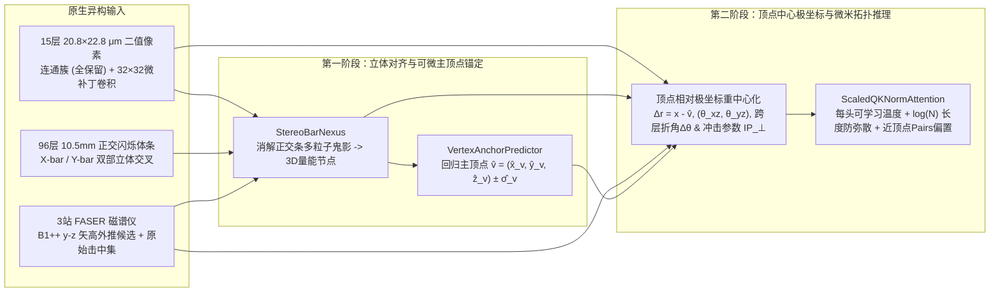

# 04 PinpointFormer 顶点锚定细粒度混合架构（Phase V2）

**架构目标**：彻底突破 `B2/B3/B4` 在 `Pixel-centered` 域性能不如 41 维树模型 `B0` 的瓶颈，让神经网络首次真正读取到 `20.8 × 22.8 μm` 硅像素传感器内“单径迹 MIP vs 双转换电子对 vs $50\text{–}300\,\mu\text{m}$ 偏离折角（Kink）与冲击参数（Impact Parameter）”的微米级几何信息。



---

## 1. 亚毫米像素连通簇形态学分词器（`src/analysis/flavour/v3/v2_pinpointformer/pixel_tokenizer.py`）

针对旧 `s3/dataset.py`（固定 $16\times 16$ 块压平坐标）与 `s5/objects.py`（硬丢弃 `width > 0.5 mm` 或 `n > 64` 大簇）的双重失误，制定以下分词规范：

### 1.1 全保留单平面连通聚类
- 在每一像素平面 $p \in \{0,\dots,14\}$ 上，对活跃像素坐标 $(x_k, y_k)$ 用 `scipy.spatial.cKDTree.query_pairs(r=0.06)`（即 $60\,\mu\text{m}$ 连通半径，覆盖相邻及对角像素与单像素空隙）做 `connected_components`。
- **绝不丢弃任何大簇**！任何簇不论像素数量或宽度，均进入统一表征流程。

### 1.2 16 维亚毫米连通簇几何形态特征向量
对第 $i$ 个连通簇（含 $n_i$ 颗击中像素，像素间距 $p_x = 0.0208\,\text{mm},\, p_y = 0.0228\,\text{mm}$），计算严格旋转与形状信息完备的 **16 维特征**：

| 维度区间 | 特征分量 | 计算定义与物理单位 | 物理意义 |
| --- | --- | --- | --- |
| `0..2` | 质心空间坐标 | $(\bar{x}_i, \bar{y}_i, z_{p,i})$（`mm`，先保留原始绝对坐标以喂给 Stage-1，Stage-2 后替换为 $\hat{\mathbf{v}}$ 相对坐标） | 微米级精细定位点 |
| `3..6` | 规模与致密填充率 | $\ln(1 + n_i)$、包围盒跨度 $\Delta x_i$、$\Delta y_i$、`fill_factor` $= n_i / \max(1, \frac{\Delta x_i}{p_x}\cdot\frac{\Delta y_i}{p_y})$ | 区分紧凑单径迹核心与松散簇射带 |
| `7..11` | **二维协方差解析本征特征** | 计算正定化协方差 $\Sigma_{xy} = \frac{1}{n_i}\sum (\mathbf{u}_k - \bar{\mathbf{u}})(\mathbf{u}_k - \bar{\mathbf{u}})^T + \text{diag}(\frac{p_x^2}{12}, \frac{p_y^2}{12})$ 的两本征值 $\lambda_1 \ge \lambda_2 > 0$，提取 $\sqrt{\lambda_1}$、$\sqrt{\lambda_2}$、偏心率 $\sqrt{1 - \lambda_2 / \lambda_1}$ 及主轴二倍方向 $(\cos 2\alpha, \sin 2\alpha)$（利用 $\tan 2\alpha = \frac{2\Sigma_{xy}}{\Sigma_{xx}-\Sigma_{yy}}$ 避免 $\pm 180^\circ$ 不连续） | **即使单簇内部只有两个尚未分离的微弱近距点，$\sqrt{\lambda_2}$ 与偏心率也能立即暴露“双粒子重叠/早期极窄 $\gamma$ 对”！** |
| `12..15` | 偏度与同层微环境 | 三阶中心矩偏度矢量范数（识别“蝌蚪型”非对称分叉或高能 $\delta$-ray 尾巴）、同层 $r \le 1.0\,\text{mm}$ 邻簇数、同层 $r \le 5.0\,\text{mm}$ 邻簇数、$5\,\text{mm}$ 内邻像素总数的 $\log(1 + \cdot)$ | 区分孤立斜穿 $\tau/\mu$ 径迹段与密集簇射中心 |

### 1.3 复合大簇内部微补丁卷积（零外部 C++ 依赖）
对包含复杂内部结构的簇（满足 `n_i > 8` 且 $\max(\Delta x_i, \Delta y_i) > 0.08\,\text{mm}$）：
- 不引入需要复杂 CUDA C++ 编译（极易在 LCG108/MIG/T4 上编译失败）的 `spconv` 第三方包，而是直接以该簇质心 $(\bar{x}_i, \bar{y}_i)$ 为中心，提取固定尺寸 **`32 × 32` 原生像素分辨率局部微补丁**（网格步长即为物理 $20.8 \times 22.8\,\mu\text{m}$，物理覆盖 $0.666 \times 0.730\,\text{mm}^2$，超过边界部分置零并计入第 2 通道饱和边界掩码）。
- 用极其轻量的 **3 层纯 PyTorch 2D ConvNet**（输入 `2` 通道：`[pixel_hit, out_of_patch_density]` $\to$ `16 -> 32 -> 64`，总参数量 `< 50k`）编码为 `64` 维局部纹理嵌入并与 16 维形态学 MLP 嵌入相加。即便单簇里包着两根相隔 `50 μm` 的高能近距次级径迹，微补丁卷积也能直接看到双峰值与“Y”型分叉轮廓！

### 1.4 极端高占据度事例的有界显存策略（`N_max_clusters = 1024`）
依据 [stage04](../../workbook/2026-11-11_stage04_flavour_inventory.md) 记录，极端高能簇射的原始像素高达 `46,154` 颗；经八邻域连通域聚类后，簇数量通常比像素数下降 5–20 倍（绝大部分事例总簇数 `< 512`）。为保障任何极端事例均不 OOM：
- 若总簇数 `N_c <= 1024`，**100% 全部保留**；
- 若 `N_c > 1024`，计算快速纯观测起爆深度 $z_{\text{start}}^{\text{obs}}$（前 5% 累积簇像素深度）：优先全额保留距 $z_{\text{start}}^{\text{obs}}$ 最近前 6 层内的所有连通簇（核心反应顶点与早期电磁转化区绝不截断！），剩余层按 `n_pix` 与孤立隔离度配额保留至上限 `1024`；所有未入选远端簇的能量/数量汇总到所在平面摘要 token 中。

---

## 2. `NuGraph2` 式正交闪烁体立体交叉模块（`src/analysis/flavour/v3/v2_pinpointformer/stereo_bars.py`）

彻底修复 `B2/B3` 中正交 $X$ 条与 $Y$ 条距离恒为零的致命设计，借鉴 `NuGraph2` (`arXiv:2403.11872`) 双部图机制构造原生 3D 量能表征：

1. **按硬件层组织立体配对单元（Stereo Doublet）**：
   - 将每一个物理闪烁体采样层（共 `48` 个紧邻的 `vertical X-bar` + `horizontal Y-bar` 面板对）内活跃的 $X$ 条（至多 `40` 根）编码为节点 $h^X_a \in \mathbb{R}^D$，活跃的 $Y$ 条编码为节点 $h^Y_b \in \mathbb{R}^D$。
2. **局部交叉 Nexus 候选与双部消歧注意力**：
   - 若某硬件层同时存在活跃 $X$ 条集合 $\mathcal{A}_X$ 与 $Y$ 条集合 $\mathcal{A}_Y$，构建候选二维网格交叉点（当 $|\mathcal{A}_X|\cdot|\mathcal{A}_Y| \le 64$ 全建，否则按能量各取 Top-8 活跃条形成最多 $64$ 个交叉 Nexus 节点）：
     $$\mathbf{n}_{ab} = \text{MLP}\Big(\big[\bar{x}_a,\; \bar{y}_b,\; \bar{z}_{\text{layer}},\; \ln(1+E_a),\; \ln(1+E_b),\; |\ln(1+E_a) - \ln(1+E_b)|\big]\Big)$$
   - 执行 2 层双向交互更新：**Bar $\to$ Nexus**（根据交叉点两端能谱一致性 $|\Delta \ln E|$ 抑制多径迹虚假“鬼影交叉点” Ghost Crossings）与 **Nexus $\leftrightarrow$ 相邻层 Nexus**（沿纵向强化真正贯通的物理簇射轴线）。
   - 对于仅有单侧条活跃的层，直接保留一维标定条 token（显式标定未知正交轴掩码 `measured_xy`，绝不把未测量维度赋伪零距离）。
3. 将 48 个立体模块的摘要与存活高能 Nexus 节点压缩拼接为量能器三维节点集（每事件典型 `64–192` 个 3D 量能节点）。

---

## 3. 两阶段可微主顶点锚定与极坐标几何变换（`src/analysis/flavour/v3/v2_pinpointformer/vertex_anchor.py`）

这是让 `PinpointFormer` 从根本上学会区分“来自同一主顶点的瞬发射线”与“发生于 $50\text{–}300\,\mu\text{m}$ 外的次级 $\tau$ / Charm 衰变产物”的最关键几何模块：

### Stage-1：多尺度主顶点估计器 `VertexAnchorPredictor`
- 接收量能器立体序列嵌入与像素平面前端质心特征，输出三维主反应顶点预测：
  $$\hat{\mathbf{v}} = (\hat{x}_v, \hat{y}_v, \hat{z}_v) \in \mathbb{R}^{B \times 3}, \qquad \ln\hat{\boldsymbol{\sigma}}_v^2 = (\ln\hat{\sigma}_{v,x}^2, \ln\hat{\sigma}_{v,y}^2, \ln\hat{\sigma}_{v,z}^2) \in \mathbb{R}^{B \times 3}$$
- 注：预测器在 `V3` 由真值主顶点 `vertex_xyz_mm` 强监督；在纯粹单独测试 `V2` 阶段（尚未启动 `V3` 全多任务时），`V2` 即可先启用这**唯一一个轻型三维主顶点监督头**作为几何锚定辅助，或对比“仅纯无真值观测质心起爆锚点”与“监督预测 $\hat{\mathbf{v}}$”的单因素消融！

### Stage-2：顶点相对极坐标与成对冲击参数特征构造
设锚点坐标 $\mathbf{v}_0$ 在前向中经过梯度混合门控（训练早期用 $\text{stop\_grad}(\hat{\mathbf{v}})$ 占比 `0.7` 防初始顶点噪音扰乱注意力，10k steps 后转为全可微 $\hat{\mathbf{v}}$）：
1. **逐节点极坐标与锥角变换**（同时作用于像素簇节点与 3D 立体量能节点）：
   $$\Delta x_i = x_i - v_{0,x}, \quad \Delta y_i = y_i - v_{0,y}, \quad \Delta z_i = z_i - v_{0,z}, \quad r_{\perp,i} = \sqrt{\Delta x_i^2 + \Delta y_i^2}$$
   $$\tilde{\Delta z}_i = \text{sign}(\Delta z_i) \cdot \max(|\Delta z_i|,\, 1.0\,\text{mm})$$
   $$\theta_{xz,i} = \frac{\Delta x_i}{\tilde{\Delta z}_i}, \qquad \theta_{yz,i} = \frac{\Delta y_i}{\tilde{\Delta z}_i}, \qquad \theta_{\text{rad},i} = \sqrt{\theta_{xz,i}^2 + \theta_{yz,i}^2}$$
   - **物理不变性**：无论两个像素层之间物理相隔 $10\,\text{mm}$（单钨块）还是 $100\,\text{mm}$（跨越 Fortune 模块），沿着主顶点射出的任何一条直线粒子在全部下游硅层上的极角 $(\theta_{xz,i}, \theta_{yz,i})$ **严格保持常数**！
2. **近顶点精细局部成对偏置（`K_vtx <= 128` 窗口）**：
   - 取满足 $-15\,\text{mm} \le \Delta z_i \le +250\,\text{mm}$ 的最近（按 $|\Delta z_i|$ 与顶点横向距排序）至多 $K_{\text{vtx}} = 128$ 个像素簇，计算每对同向跨层簇 $(i, j)$（$z_j > z_i$ 且 $|\Delta z_{ij}| \ge 1.0\,\text{mm}$）的**7 维物理关系向量**：
     1. 纵向间隔 $\ln(1 + |\Delta z_{ij}|) / 5.0$ 及辐射长度差 $\Delta X_{0,ij}$；
     2. 二簇在极角空间的夹角差 $\Delta \theta_{xz,ij} = \theta_{xz,j} - \theta_{xz,i}$、$\Delta \theta_{yz,ij}$ 及欧氏角距 $\ln(1 + 100\,\|\Delta \boldsymbol{\theta}_{ij}\|)$；
     3. **二簇连线反推至 $\hat{z}_v$ 主顶点平面的横向冲击参数（Transverse Impact Parameter）**：
        $$s_{x,ij} = \frac{x_j - x_i}{z_j - z_i}, \qquad s_{y,ij} = \frac{y_j - y_i}{z_j - z_i}$$
        $$\text{IP}_{x}(i,j) = \big(x_i + s_{x,ij}(v_{0,z} - z_i)\big) - v_{0,x}, \qquad \text{IP}_{y}(i,j) = \big(y_i + s_{y,ij}(v_{0,z} - z_i)\big) - v_{0,y}$$
        $$\text{IP}_{\perp}(i,j) = \sqrt{\text{IP}_x^2 + \text{IP}_y^2}, \qquad \text{signed\_IP\_norm} = \ln\left(1 + \frac{\text{IP}_{\perp}(i,j)}{0.050\,\text{mm}}\right)$$
     4. **径迹对主顶点方向折角（Kink Angle）**：局部斜率矢量 $(s_{x,ij}, s_{y,ij}, 1)$ 与顶点射线矢量 $(\theta_{xz,i}, \theta_{yz,i}, 1)$ 的三维夹角余弦与叉积模 $\theta_{\text{kink}}(i,j)$。
   - **无需手写任何聚类截断阈值**：直接将这 7 维物理对关系喂入轻量 `PairwiseBiasMLP (7 -> 32 -> n_heads)`，作为多头注意力的物理归纳偏置 $B_{\text{pair}} \in \mathbb{R}^{B \times H \times K_{\text{vtx}} \times K_{\text{vtx}}}$！对于主顶点直连径迹对，$\text{IP}_{\perp} \approx 0$；对于 $\tau$ 或 Charm 衰变子径迹对，$\text{IP}_{\perp} \sim 50\text{–}300\,\mu\text{m}$ 直接呈现截然不同的成对偏置特征。

---

## 4. 根治注意力弥散的 `ScaledQKNormAttention` 核心实现（`src/analysis/flavour/v3/v2_pinpointformer/attention.py`）

直接替代原 `s3/models_repair.py` 中的无温度 `StableAttention`，参考 Henry et al. (EMNLP 2020) 与 Veličković et al. (ICML 2025) 长度尖锐度补偿：

```python
import math
import torch
from torch import nn
from torch.nn import functional as F


class ScaledQKNormAttention(nn.Module):
    """L2-normalized QK attention with per-head learnable scale and log(N) sharpness factor."""

    def __init__(self, dim: int, heads: int = 8, init_scale: float = 12.0,
                 max_scale: float = 50.0, residual_init: float = 0.5):
        super().__init__()
        if dim % heads != 0:
            raise ValueError(f"dim ({dim}) must be divisible by heads ({heads})")
        self.dim = dim
        self.heads = heads
        self.head_dim = dim // heads
        self.max_scale = max_scale

        self.q_norm = nn.LayerNorm(dim)
        self.k_norm = nn.LayerNorm(dim)
        self.q_proj = nn.Linear(dim, dim, bias=False)
        self.k_proj = nn.Linear(dim, dim, bias=False)
        self.v_proj = nn.Linear(dim, dim, bias=False)
        self.out_proj = nn.Linear(dim, dim)

        # Learnable per-head inverse temperature gamma_h = exp(log_scale_h) in [1.0, max_scale]
        self.log_scale = nn.Parameter(torch.full((1, heads, 1, 1), math.log(init_scale)))
        # Learnable length sharpness compensation: 1 + softplus(beta) * log(N_valid)
        self.len_beta = nn.Parameter(torch.full((1, heads, 1, 1), -2.0))
        self.gamma_attn = nn.Parameter(torch.full((dim,), residual_init))
        self.ff_norm = nn.LayerNorm(dim)
        self.ff_up = nn.Linear(dim, 4 * dim)
        self.ff_down = nn.Linear(2 * dim, dim)
        self.gamma_ff = nn.Parameter(torch.full((dim,), residual_init))

    def forward(
        self,
        x: torch.Tensor,
        source: torch.Tensor,
        source_mask: torch.Tensor,
        pair_bias: torch.Tensor | None = None,
    ) -> torch.Tensor:
        b, nq, _ = x.shape
        nk = source.shape[1]
        q = self.q_proj(self.q_norm(x)).view(b, nq, self.heads, self.head_dim).transpose(1, 2)
        k_in = self.k_norm(source)
        k = self.k_proj(k_in).view(b, nk, self.heads, self.head_dim).transpose(1, 2)
        v = self.v_proj(k_in).view(b, nk, self.heads, self.head_dim).transpose(1, 2)

        q_hat = F.normalize(q.float(), p=2, dim=-1, eps=1e-6)
        k_hat = F.normalize(k.float(), p=2, dim=-1, eps=1e-6)

        valid_count = source_mask.sum(dim=-1, keepdim=True).clamp(min=2).float()  # (B, 1)
        scale = torch.clamp(self.log_scale.exp(), min=1.0, max=self.max_scale)
        len_factor = 1.0 + F.softplus(self.len_beta) * torch.log(valid_count)[:, None, None, :]

        # Compute explicitly in FP32 so sharp high-scale softmax stays numerically exact in BF16 runs
        logits = torch.matmul(q_hat, k_hat.transpose(-2, -1)) * (scale * len_factor)
        if pair_bias is not None:
            logits = logits + pair_bias.float()

        empty_row = ~source_mask.any(dim=-1)
        attn_mask = source_mask.clone()
        if empty_row.any():
            attn_mask[empty_row, 0] = True
        logits = logits.masked_fill(~attn_mask[:, None, None, :], float("-inf"))

        probs = torch.softmax(logits, dim=-1)
        if empty_row.any():
            probs = probs * (~empty_row)[:, None, None, None].to(probs.dtype)

        attended = torch.matmul(probs.to(v.dtype), v)
        attended = attended.transpose(1, 2).contiguous().view(b, nq, self.dim)
        h = x + self.gamma_attn * self.out_proj(attended)

        g, val = self.ff_up(self.ff_norm(h)).chunk(2, dim=-1)
        return h + self.gamma_ff * self.ff_down(F.silu(g) * val)
```

### 取消线性捷径饥饿机制
- 彻底删除原 `B4` 中的 `self.linear_readout` 及其与全局计数向量 `summary` 直接拼接到分类层的旁路；
- 事件级 `c_obs`（16 维）首先施加 `Dropout(0.35)`，再映射为 `1` 个与近顶点精细簇 token、立体量能 token 并列参与 Cross-Attention 读出的条件查询 token，**强制分类头只能通过深层几何注意力聚合出来的物理表征下降交叉熵**！

---

## 5. `PinpointFormer` 分层推理与规格汇总（`src/analysis/flavour/v3/v2_pinpointformer/models.py`）

- **近顶点精细局部编码器（`LocalVertexEncoder`）**：4 层 `ScaledQKNormAttention (dim=192, heads=8)` 作用在 $K_{\text{vtx}} \le 128$ 个近顶点像素簇上，挂载 7 维顶点相对 `pair_bias`。同时输出每个像素簇的隐表示 $\mathbf{u}_i \in \mathbb{R}^{192}$（供 Phase V3 的簇起源与亲和头直接预测！）。
- **全探测器异构立体主干（`GlobalDetectorEncoder`）**：将像素簇（压缩后含微补丁上下文）、量能器 3D Nexus 节点及磁谱仪拟合径迹 token 拼接后经 4 层 `ScaledQKNormAttention (dim=192, heads=8)` 与 Perceiver-style `16` 个物理查询槽交互融合（全事件总参数量约 **`4.2M–4.8M`**）。
- **单因素验证原则**：在 `W3-07` 中只切换 `vertex_recenter_and_ip_bias = True/False` 做同预算 `Train100k × 16 passes` 对照，即可干净测出“两阶段顶点锚定极坐标 + 冲击参数偏置”的净增量，同时配合“微米 vs `1 mm` 量化”和“高占据度注意力熵”两个必检探针验收架构是否真正解锁像素能力。
