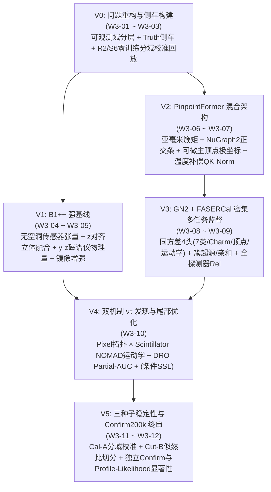

# PINPOINT 中微子味道分类研究路线图（v3：面向对象锚定、多任务密集监督与双机制 $\nu_\tau$ 发现）

> 版本：`v3`（基于 Git commit `d4aecc5`、`S0–S6` 及 `R0–R3` 共 306 个阶段实测数据的全面机器学习与高能物理审查重构）。更新日期：2026-11-15。
> 原 [v2 详稿目录](../v2/01_evidence_review.md) 与 JSON 结果原位冻结保留；历史入口快照见 [2026-11-15_v2_entry](../archive/2026-11-15_v2_entry.md)。

## 一句话核心裁决

**PINPOINT 区分 `CC νe / CC νμ / CC ντ / NC`（尤其是低本底提纯 $\nu_\tau$）在物理与算法上完全可行，远未触及探测器物理极限；前 306 阶段性能停滞（`All` 域 `BA3 ≈ 57.5%`、`BA4 ≈ 45.8%`、`1% FPR` 下 $\tau$ 效率仅 `6.05%`）的根本原因不是探测器信息不够，而是“过半数非包容事例混训导致全局阈值反转 + 5 处底层几何与注意力算子缺陷 + 4-epoch 欠拟合 + 忽略极强各向异性几何而机械照搬 FASERCal”。v3 正式终止 `v2` 中高风险低召回的手写规则径迹重建（`R4`）前置路线，转向“可观测包容度分域校准 + 纵向对齐强基线 `B1++` + 可微顶点锚定混合架构 `PinpointFormer` + `ATLAS GN2 / FASERCal` 训练期密集辅助监督 + 双机制 $\nu_\tau$ 似然判别”。**

---

## v2 遗产保留 vs v3 战略重构

| 维度 | 从 `v2 (R0–R3)` 原样继承 | `v3 (V0–V5)` 必须重构与纠偏 |
| --- | --- | --- |
| **样本与分区纪律** | `Train100k/300k/1M`、`Tune40k` 及封存的 `Cal-A40k / Cut-B160k / Confirm200k` 清单，同 family 零跨折分裂；`6,845` 物理块 bootstrap | 停止在混有 `53.8%` 靶外/边缘事例的 `All` 域上使用单一全局分数阈值；按**纯可观测包容度特征 $c_{\text{obs}}$** 显式条件化并分区域校准与切分；同步增设 $E_\nu \le 2.30\,\text{TeV}$ 同能谱切片核对 $\nu_\tau$ 截断偏置 |
| **物理基线 (`B1`)** | 物理白名单通道（像素二进制、条 edep/PE、3 站数字化磁谱仪）；无标签泄漏检查与分支梯度健康探针 | 淘汰 1mm 网格（`1322×420` 造成条行 `90%` 零空洞）与过早 `GlobalAvg/MaxPool`；新建传感器原生无空洞、**保留纵向 $z$ 序列对齐**的 `B1++`，显式注入正确的 **$y$-$z$ 偏转面矢高（Sagitta）与反向外推残差**，扩至 `2.8M` 参数与 `24–40` passes + 物理镜像对称增强 |
| **细粒度几何架构 (`B2/B3/B4`)** | 全通道覆盖思路（不预设过低像素上限截断正常事例） | 废弃丢失横向 $(x,y)$ 的 `16×16` 块压扁、无温度 `StableAttention`（$[-4.90,+4.90]$ 数学死锁）、`summary` 线性捷径以及 `63.9:1` 畸变/正交条零距离 kNN；构建**全保留亚毫米像素簇形态矩 + 正交条 `NuGraph2` 式交叉注意力 + 两阶段可微主顶点锚定极坐标架构 `PinpointFormer` + 可学习温度与 $\log N$ 补偿 `QK-Norm`** |
| **结构化重建与监督** | `v2` 原计划在 `R4` 先手写传统规则连线与双径迹顶点找回对象（`S5` 纯度 `2%–5%`、`R3 G2` 召回 `10%–27%`） | **直接终止把脆弱规则 `R4` 作为前置瓶颈**；改在训练期引入 **ATLAS `GN2` 风格像素簇 5 类物理起源 + 同径迹/同顶点亲和损失**，联合 **FASERCal 同方差 4 头（含 7 类细过程与 Charm 识别） + 全探测器像素与闪烁体条 `Rel`**，推理期零真值生成隐式次级顶点摘要 |
| **低 FPR $\nu_\tau$ 与 SSL** | `1% / 0.1% FPR` 工作点与多先验评估口径 | 结合微米拓扑（Pixel 域）与 NOMAD 横向运动学（Scintillator 域）双机制，微调期可选叠加 **DRO/CVaR One-Way Partial AUC**；自监督预训练退回“后置验证项”，仅当监督新主干已在 `Pixel-centered` 明显战胜 `B0` 后按条件触发 |
| **工程研发节奏** | 最终确认前的严格独立验收与零误差读回原则 | **取消早期开发阶段每次实验编写数百项冗余 JSON schema 验收**：`W3-01` 至 `W3-10` 固定 `seed=42`，主攻架构收益与物理探针；确认跃升后再扩三随机种子并启动 `V5` 全矩阵封存确认 |

---

## v3 总体执行路线图与阶段依赖

---

## v3 代码目录、工单总览与量化晋级门禁

### 1. 代码与产物目录约定

| 用途 | 路径 | 说明 |
| --- | --- | --- |
| 新研究 Python 包 | `src/analysis/flavour/v3/` | 下设 `common/`、`v1_b1pp/`、`v2_pinpointformer/`、`v3_multitask/`、`v4_tau/`、`v5_confirm/` |
| 单元测试 | `tests/test_v3_*.py` | 使用 `unittest`，覆盖真值隔离、坐标轴物理定义、注意力锐度与损失梯度 |
| 实验产物根目录 | `/eos/home-x/xcheng/FASER/Pinpoint/results/flavour/v3_2026-11-15/` | 按工单 `W3-01`–`W3-12` 建子目录，不覆盖 `v2_2026-11-14/` |
| HTCondor 提交目录 | `~/condor/Pinpoint/flavour_v3/<stage>/` | 保持小体积提交文件，按 `schedd` 空闲与 WRITE/EOS 兼容性调度 |
| 历史结果与已冻结合同 | `roadmap/v2/` | **严禁修改**，仅作只读对比基准 |

### 2. 分阶段工单、资源与量化验收门禁

> 注：表中 `v3` 新阶段的耗时为单人研发规划估计（**未测量**）；所有晋级阈值均为**先验设定的决策门槛**，并非预言模型性能。

| 阶段 | 工单 | 核心任务与核心变更 | 预计资源 | 量化验收门禁（不达标须定位根因） |
| --- | --- | --- | --- | --- |
| **V0** | `W3-01`–`W3-03` | 可观测域 $c_{\text{obs}}$ 分层、能谱检查、事件/簇真值侧车、对既有 `R2 D2`/`S6` 回放分区域校准 | `CPU 2–3 h` | ① `D_pix_contained` 对真值 `pixel_centered` 纯度 $\ge 75\%$；② 零泄漏静态+运行时单测全通过；③ 分域校准显著提升既有 `S6`/`D2` 在 `pixel_centered` 的 `1% FPR` $\tau$ 效率（消除 `0.35%` 崩溃） |
| **V1** | `W3-04`–`W3-05` | `B1++`（传感器原生矩阵 + 保留 $z$ 序列融合 + 正确 $y$-$z$ 矢高外推 + 镜像增强），`Train100k×16` 与 `Train300k×24` + 合作组 M1 口径对照 | `GPU ~7–9 h` | ① 32-event 小样本 100% 拟合通过；② `large_scintillator` 域 `BA3` 从 `R1 B1` 的 `68.89%` 提升至 $\ge 73\%$；③ `Train/Tune gap` 在长曝光下受控不崩坏 |
| **V2** | `W3-06`–`W3-07` | `PinpointFormer`（全保留 16 维亚毫米簇矩 + `32×32` 大簇微卷积 + `StereoBarNexus` + **两阶段可微主顶点极坐标** + **Scaled QK-Norm**） | `GPU ~9–11 h` | ① 高占据度 `1000–10000` 击中区间 $\tau$ 效率与低占据度同量级（不再 20 倍塌陷）；② **微米 vs `1 mm` 量化消融探针**在 `Pixel-centered` 呈现明确正增益（$\Delta\text{BA4} \ge +2\,\text{pp}$）；③ 相对 `B0 HGB` 打破“负增益”僵局 |
| **V3** | `W3-08`–`W3-09` | 同方差 4 头联合监督（7 类精细过程 + Charm 显式头 + 3D 顶点 + 运动学）+ **GN2 像素簇 5 类起源 / 同径迹亲和** + **全探测器 `Rel`** | `GPU ~16–18 h` | ① `Pixel-centered` 域 `BA4` 相对 `B0 (55.92%)` 取得 $\ge +4\text{–}6\,\text{pp}$ 净跃升；② `Pixel-centered` 分域 `1% FPR` $\tau$ 效率显著超越基准（$\ge +5\text{ pp}$）；③ Charm 本底误判率可测量下降 |
| **V4** | `W3-10` | `D_scint_contained` 显式 NOMAD 平面运动学融合 + `B1++`×`PinpointFormer` 跨模态集成 + 5-pass **DRO Partial-AUC** 尾部微调（+ 条件 SSL） | `GPU ~5 h` | ① `D_scint_contained` 与 `All` 域在 `1% / 0.1% FPR` 下 $\tau$ 效率相对 `R2 D2 (6.05%)` 至少翻倍（目标 $\ge 12\%\text{–}15\%$）且共同 `BA3` 非劣 |
| **V5** | `W3-11`–`W3-12` | 最强两候选扩 `seeds={17,42,2026}`；解封 `Cal-A40k` 校准、`Cut-B160k` 定阈值、一次性开启 `Confirm200k` 交付多域 Profile-Likelihood 显著性 | `GPU ~15–19 h` | `Confirm200k` 上与 `Tune` 一致性验证通过；所有图表、块 bootstrap 区间与可复现包归档 |

---

## v3 全套文档导航

| 文档 | 内容范围 |
| --- | --- |
| [01 前序审查取证与文献映射](01_forensic_diagnosis_and_literature.md) | 306 阶段实测证据总表、7 处代码与物理级根因数学取证、FASERCal 对比表与前沿文献映射 |
| [02 问题重构、可观测域与真值侧车（V0）](02_problem_formulation_and_domains.md) | $c_{\text{obs}}$ 纯观测域定义、能谱偏差控制、7 类/Charm/簇起源真值侧车规范与分域似然比校准 |
| [03 B1++ 强基线规范（V1）](03_b1pp_strong_baseline.md) | 无空洞紧凑传感器张量、纠正后的 $y$-$z$ 磁谱仪矢高外推特征、纵向 $z$ 对齐主干与物理镜像增强 |
| [04 PinpointFormer 细粒度混合架构（V2）](04_pinpointformer_architecture.md) | 16 维像素簇矩与 `32×32` 大簇微卷积、正交条双部立体交叉、可微主顶点极坐标重中心化、`ScaledQKNormAttention` 完整实现 |
| [05 GN2 多任务密集监督与 ντ 发现优化（V3–V4）](05_multitask_gn2_and_tau_discovery.md) | 同方差 4 头联合损失、簇起源与亲和度辅助监督、双机制运动学协同与 DRO Partial-AUC 尾部微调 |
| [06 分步执行工单、物理探针与工程纪律（W3-01–W3-12）](06_work_orders_probes_and_operations.md) | 12 张有序可执行工单、两大必检物理诊断探针、反过度官僚化规则与 HTCondor/Kubeflow 调度规程 |
| [v3 机器可执行规格 JSON](experiment_plan_v3.json) | 完整契约配置，含分区键、阶段门禁、工单清单与废弃分支记录 |

---

## 历史参考入口（只读）

- 顶层现状说明：[stage307 ML 审查与 v3 规划报告](../../workbook/2026-11-15_stage307_ml_audit_and_roadmap_v3.md)
- 已完成实测基线：[R1 stage274](../../workbook/2026-11-15_stage274_r1_final_results.md)、[R2 stage284](../../workbook/2026-11-15_stage284_r2_final_results.md)、[R3 stage306](../../workbook/2026-11-15_stage306_r3_final_results.md)、[S6 stage236](../../workbook/2026-11-14_stage236_s6_final_results.md)
- 冻结机读基线：[r1_results.json](../v2/r1_results.json)、[r2_results.json](../v2/r2_results.json)、[r3_results.json](../v2/r3_results.json)
- 历史路线图总览：[归档索引](../archive/README.md) 与 [v2 原始次级工单](../v2/10_r3_results_and_next_steps.md)
