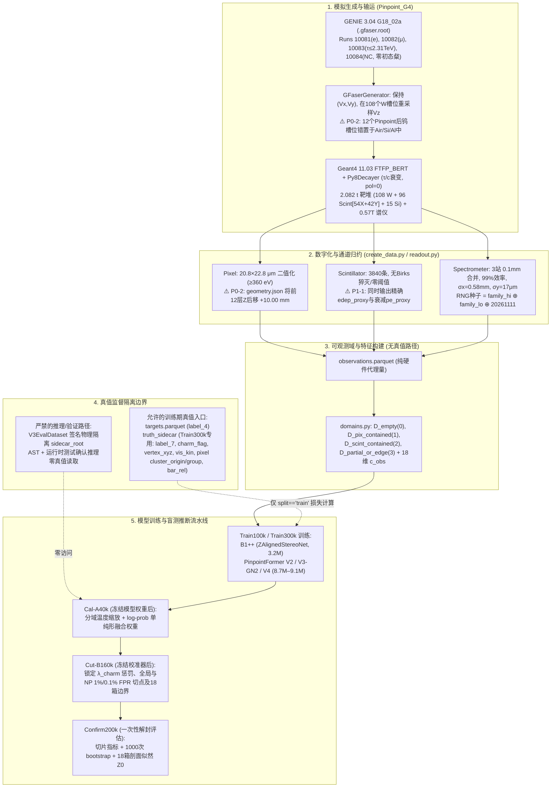

# 2026-11-18 Stage 314 — PINPOINT / FASER 中微子味分类项目独立科学、统计与代码终审报告

**执行裁决：在固定代码快照 `c53ff1cf1ad08a8b6d32b6bff7cd79e3eff9dbe0` 与已冻结的 `Cal-A40k → Cut-B160k → Confirm200k` 顺序解封协议下，多模态分类指标本身真实可复现且零真值泄漏（`Confirm200k` 全域 `BA4 = 53.32%`、`cond_BA3 = 64.37%`、`NLL = 0.9992`；`Truth_pixel_centered` `BA4 = 75.25%`、`cond_BA3 = 87.53%`、切片内精确 `1.00% FPR` 下 $\varepsilon_\tau = 30.04\%$）。但三项关键结论或物理前提存在重大缺陷：(1) “预期发现显著性 $Z_0 = 4.10\sigma$”建立在非物理的 1% $\nu_\tau$ 先验、1:1:1 背景混合、55% 靶外事件计入及无符号截断系统误差模型之上，换回真实 LHC 前向通量比（$f_\tau \approx 0.3\%$，$17\%:58\%:25\%$ 背景）后，Run 3（$\sim 10\text{k}$ 靶内事件）预期显著性仅为 $0.85\sigma$，完整 HL-LHC 2t 靶（$\sim 150\text{k}$ 靶内事件）约为 $3.31\sigma$；(2) `Pinpoint_G4` 中 `PinpointBlock` 实体体积放置顺序与写入 `geometry` 树的 `ComputeSiliconZPositions()` 发生内部层序错位，导致靶区全部 12 层硅像素平面 Z 坐标系统偏移 `+10.000 mm`、垂直闪烁体偏移 `-16.010 mm`，且 `11.1%` 模拟中微子顶点被生成在空气/硅/铝冷板而非钨板中，同时闪烁体数字化向模型双通道暴露了真实硬件不可兼得的无噪声 `edep_proxy_MeV` 与衰减 `pe_proxy`；(3) V2→V3 旗舰跃升与 `100k×16p → 300k×24p` 数据/曝光扩展严重混杂，V4 `nomad_kinematics.py` 存在 $\sim 242$ 倍谱仪动量定标错误与双站伪动量缺陷，`DRO pAUC` 微调呈一致零/负收益，15 模型大集成相比单一 3-seed 角色（`pf_v4_nomad_only_3seed`）无实质统计增益。项目不应继续堆叠事件级黑盒分类器与异构集成规模，而应立即转向底层模拟几何/数字化修复、受控消融补齐与微米级显式次级顶点混合重建。**

---

## 阶段目标

对目标分支 `pinpoint_neutrino_ml_review`（固定提交 `c53ff1cf1ad08a8b6d32b6bff7cd79e3eff9dbe0`）开展只读、独立、基于第一性原理与可执行重算的多学科审查（涵盖实验粒子物理、几何深度学习、科学软件取证、高能物理统计推断与研究战略），完成以下验收目标：

1. 重建从 GENIE / `Pinpoint_G4` 模拟输运、通道数字化、特征构建、模型训练到 `Cal-A / Cut-B / Confirm200k` 盲测推断的完整物理与数据流，核实真值隔离与跨集独立性。
2. 逐项独立复算 `Stage 307–313`（Phase `V0–V5`）及历史基线（`S0–S6`、`v2 R0–R3`）的核心分类、校准、切片效率、Bootstrap 置信区间与 18 箱剖面似然显著性数值。
3. 排查底层 Geant4 探测器几何、物理生成元、特征工程、注意力算子、多任务损失与统计冗余参数中的实质缺陷，按 `P0–P3` 科学严重性定级并给出精确位置与修复方案。
4. 分离已证实物理结论、未受控混杂声明与无效外推，确立最小决定性实验清单、带停止门限的 2 周 / 1–2 月 / 3–6 月研究路线图及四类发表载体的准备度裁决。

---

## 工作内容

### 1. 源码、模拟与历史档案全链路核查（严格只读）

- **治理与路线图文档**：核查 [AGENTS.md](file:///eos/home-x/xcheng/FASER/Pinpoint/PinpointAnalysis/AGENTS.md)、[README.md](file:///eos/home-x/xcheng/FASER/Pinpoint/PinpointAnalysis/README.md)、[roadmap/v3/README.md](file:///eos/home-x/xcheng/FASER/Pinpoint/PinpointAnalysis/roadmap/v3/README.md) 及 `01`–`06` 设计规范、[experiment_plan_v3.json](file:///eos/home-x/xcheng/FASER/Pinpoint/PinpointAnalysis/roadmap/v3/experiment_plan_v3.json)、[v5_freeze_manifest.json](file:///eos/home-x/xcheng/FASER/Pinpoint/PinpointAnalysis/roadmap/v3/v5_freeze_manifest.json)、`v0_v1` / `v2_v3` / `v4` / `v5` 结果 JSON、阶段报告 [stage04](file:///eos/home-x/xcheng/FASER/Pinpoint/PinpointAnalysis/workbook/2026-11-11_stage04_flavour_inventory.md) 至 [stage313](file:///eos/home-x/xcheng/FASER/Pinpoint/PinpointAnalysis/workbook/2026-11-17_stage313_v3_v5_multiseed_and_confirm200k_unsealing.md)，以及合作组内部报告（`FORTVNE_10212026.pdf`、`FORTVNE_pixel_vs_scintonly_meeting_260916.pdf`）。
- **`Pinpoint_G4` C++ 模拟源码逐行核对**：核查 `/eos/home-x/xcheng/FASER/Pinpoint/Pinpoint_G4`（提交 `dbbdb51`）中的 [DetectorConstruction.cc](file:///eos/home-x/xcheng/FASER/Pinpoint/Pinpoint_G4/Pinpoint/src/DetectorConstruction.cc)、[DetectorConstruction.hh](file:///eos/home-x/xcheng/FASER/Pinpoint/Pinpoint_G4/Pinpoint/include/DetectorConstruction.hh)、[MagneticField.hh](file:///eos/home-x/xcheng/FASER/Pinpoint/Pinpoint_G4/Pinpoint/include/MagneticField.hh)、[PixelSD.cc](file:///eos/home-x/xcheng/FASER/Pinpoint/Pinpoint_G4/Pinpoint/src/PixelSD.cc)、[ScintSD.cc](file:///eos/home-x/xcheng/FASER/Pinpoint/Pinpoint_G4/Pinpoint/src/ScintSD.cc)、[FaserSD.cc](file:///eos/home-x/xcheng/FASER/Pinpoint/Pinpoint_G4/Pinpoint/src/FaserSD.cc)、[TrackingAction.cc](file:///eos/home-x/xcheng/FASER/Pinpoint/Pinpoint_G4/Pinpoint/src/TrackingAction.cc)、[Py8Decayer.cc](file:///eos/home-x/xcheng/FASER/Pinpoint/Pinpoint_G4/Pinpoint/src/Py8Decayer.cc)、[GFaserGenerator.cc](file:///eos/home-x/xcheng/FASER/Pinpoint/Pinpoint_G4/Pinpoint/src/generators/GFaserGenerator.cc) 与生产宏 [geom.mac](file:///eos/home-x/xcheng/FASER/Pinpoint/Pinpoint_G4/Pinpoint/macros/geom.mac)。
- **Python 重建、训练与统计流水线逐模块审查**：覆盖 [inventory.py](file:///eos/home-x/xcheng/FASER/Pinpoint/PinpointAnalysis/src/analysis/flavour/inventory.py)、[readout.py](file:///eos/home-x/xcheng/FASER/Pinpoint/PinpointAnalysis/src/analysis/flavour/readout.py)、[v2/partitions.py](file:///eos/home-x/xcheng/FASER/Pinpoint/PinpointAnalysis/src/analysis/flavour/v2/partitions.py)、`v3/common/`、`v3/v1_b1pp/`、`v3/v2_pinpointformer/`、`v3/v3_multitask/`、`v3/v4_tau/` 与 `v3/v5_confirm/` 全部源码文件。

### 2. 重建的研究流水线与真值边界图



### 3. 独立可执行验证、反事实重算与玩具蒙特卡洛审计

在 `lxplus-gpu`（`Tesla T4`，CVMFS `LCG_108_cuda`，`Python 3.12.11`，`PyTorch 2.7.1`）上保持原始研究产物零修改，编写并运行两套独立审计脚本，结果归档于 `/eos/home-x/xcheng/FASER/Pinpoint/results/flavour/v3_2026-11-15/audit_stage314/`：

1. **全量单元测试执行**：
   ```bash
   source /cvmfs/sft.cern.ch/lcg/views/LCG_108_cuda/x86_64-el9-gcc13-opt/setup.sh
   PYTHONDONTWRITEBYTECODE=1 PYTHONPATH="$PWD/src:$PYTHONPATH" python3 -m unittest discover -s tests -p 'test_v3_*.py' -v
   ```
2. **统计、分区互斥、反事实集成与剖面似然玩具 MC 审计**：运行 [audit_statistical_and_confirm.py](file:///eos/home-x/xcheng/FASER/Pinpoint/results/flavour/v3_2026-11-15/audit_stage314/audit_statistical_and_confirm.py)，生成 [audit_statistical_results.json](file:///eos/home-x/xcheng/FASER/Pinpoint/results/flavour/v3_2026-11-15/audit_stage314/audit_statistical_results.json)。
3. **冻结检查点内部标量、几何错位、镜像/置换不变性、BF16 精度与边界注入测试**：运行 [audit_ml_architecture_and_probes.py](file:///eos/home-x/xcheng/FASER/Pinpoint/results/flavour/v3_2026-11-15/audit_stage314/audit_ml_architecture_and_probes.py)，生成 [audit_ml_results.json](file:///eos/home-x/xcheng/FASER/Pinpoint/results/flavour/v3_2026-11-15/audit_stage314/audit_ml_results.json)。

---

## 详细数据

### 1. 探测器精确物理质量与生产语料核实（Runs `10081–10084`）

- **靶堆精确几何与质量**（`Pinpoint_G4` + `geom.mac`，`numScintLayers = 6`）：
  - **钨靶板 (`G4_W`, $19.30\text{ g/cm}^3$)**：108 块（12 个 `PinpointBlock` 含 24 块 + 7 个 `FortuneBlock` 含 84 块），每块 $43.0 \times 43.0 \times 0.5\text{ cm}^3$，世界坐标 $X \in [-133, +297]\text{ mm}, Y \in [-222, +208]\text{ mm}, Z \in [-2993.00, -1804.88]\text{ mm}$，**精确钨质量 = `1,927.028 kg`（`1.927 t`）**。
  - **塑料闪烁体 (`G4_PLASTIC_SC_VINYLTOLUENE`, $1.032\text{ g/cm}^3$)**：96 个面板（**54 个垂直测 X 面板 + 42 个水平测 Y 面板**，因 12 个 `PinpointBlock` 仅含单个垂直面板）$\times 40$ 条/面板 = `3,840` 条（单条 $10\times 420\times 5\text{ mm}^3$，节距 $10.5\text{ mm}$），**精确活性塑料质量 = `83.220 kg`**。
  - **靶区硅像素传感器 (`G4_Si`, $2.33\text{ g/cm}^3$)**：15 层（12 层 `PinpointBlock` + 3 层尾部空气 `IPT`），每层 $26.6\times 19.6\text{ cm}^2 \times 10\,\mu\text{m}$（`12,788 × 8,596` 像素，节距 $20.8\times 22.8\,\mu\text{m}^2$，总通道数 $1.649\times 10^9$），**精确硅质量 = `18.222 g`**；另加铝壁与铝冷板 **`71.318 kg`**，**靶堆总质量 = `2,081.585 kg`（`2.082 t`）**。
  - **下游 FASER 谱仪**：均匀偶极场 $B_x = +0.57\text{ T}$（偏转平面为 $y$-$z$），场孔径半径 $r = 100\text{ mm}$（中心 $Y = -10.0\text{ mm}$），3 个径迹站位于 $z = (+47.4, +1237.4, +2427.4)\text{ mm}$（$\Delta z = 1190.0\text{ mm}$，$250\times 250\text{ mm}^2$，中心 $Y = +15.0\text{ mm}$）。
- **分区互斥与源文件共现核验**（[audit_statistical_results.json](file:///eos/home-x/xcheng/FASER/Pinpoint/results/flavour/v3_2026-11-15/audit_stage314/audit_statistical_results.json#L2-L94)）：
  - 主分区 `Train300k`（300,000）、`Tune40k`（40,000）、`Cal-A40k`（40,000）、`Cut-B160k`（160,000）、`Confirm200k`（200,000）在事件键 `(run, chunk, row)` 与 128-bit 硬散射签名 `(family_hi, family_lo)` 上 **10 对两两交集全部为 `0`**。
  - 嵌套关系：`Train100k ⊂ Train300k`（重叠 `100,000`）；`tune_screen`（4,000）$\subset$ `Tune40k`（40,000）。
  - 同源物理 ROOT 批次共现：`Train300k`（510 个 `(run, chunk)`）与 `Tune40k / Cal-A40k / Cut-B160k / Confirm200k` 分别共现 `498 / 493 / 510 / 510` 个物理 chunk；`Confirm200k` 覆盖 `7,229` 个唯一 chunk。

### 2. 已验证结果与主要声明核查总表

| 声明 | 报告证据 | 独立验证结果 | 置信度 | 关键注意事项 |
| --- | --- | --- | --- | --- |
| **`Confirm200k` 盲测解封前已完成权重与规则冻结，零重训/零调参** | [stage313](file:///eos/home-x/xcheng/FASER/Pinpoint/PinpointAnalysis/workbook/2026-11-17_stage313_v3_v5_multiseed_and_confirm200k_unsealing.md#L15-L29)、[analysis_freeze_v5.json](file:///eos/home-x/xcheng/FASER/Pinpoint/results/flavour/v3_2026-11-15/W3-12/analysis_freeze_v5.json) | **核实通过**：Git 提交 `1f89d27`（`18:45:19`）与 EOS 冻结清单（`18:46:52`）均早于密封转换（`19:35`）与推理（`21:02`）；`git diff 1f89d27..c53ff1c` 确认校准、切点与似然函数零修改 | **高（已验证事实）** | 仓库内 [v5_freeze_manifest.json](file:///eos/home-x/xcheng/FASER/Pinpoint/PinpointAnalysis/roadmap/v3/v5_freeze_manifest.json#L7) 因自指限制留 `null`，EOS 运行清单记录完整哈希 |
| **`ens_v5` 在 `Confirm200k` 全域取得 `BA4 = 53.32%`、`cond_BA3 = 64.37%`、`NLL = 0.9992`** | [stage313](file:///eos/home-x/xcheng/FASER/Pinpoint/PinpointAnalysis/workbook/2026-11-17_stage313_v3_v5_multiseed_and_confirm200k_unsealing.md#L73-L76) | **独立逐位一致**：自写 NumPy 函数重算得 `BA4 = 53.3245%`、`cond_BA3 = 64.3680%`、`NLL = 0.999211`、`ECE = 0.701%` | **高（独立重算确认）** | 样本为 1:1:1:1 等类均衡，且 `55.04%`（`110,074/200,000`）顶点位于 `large_scintillator` 之外 |
| **`Confirm200k` `Truth_pixel_centered` 在 1% FPR 工作点下 $\varepsilon_\tau = 34.87\%$** | [stage313](file:///eos/home-x/xcheng/FASER/Pinpoint/PinpointAnalysis/workbook/2026-11-17_stage313_v3_v5_multiseed_and_confirm200k_unsealing.md#L80) | **数值属实但口径易误导**：`locked_pass_np_1pct` 通过率确为 `34.87%`（`1256/3602`），但该切片**实际局域 FPR 高达 `1.744%`**（`263/15082`）；切片内严格 `FPR <= 1.00%` 下的真实效率为 **`30.04%`**（连续插值口径 `30.21%`） | **高（数值准确，口径须区分）** | NP 策略按 `[1.5, 1.0, 0.6]` 向像素域倾斜了更高的局域假阳性预算，不可与切片内固定 1% FPR 直接混比 |
| **预期发现显著性 $Z_0 = 4.0957\sigma$（$N=50\text{k}$, 1% $\tau$ 先验，含系统误差）** | [stage313](file:///eos/home-x/xcheng/FASER/Pinpoint/PinpointAnalysis/workbook/2026-11-17_stage313_v3_v5_multiseed_and_confirm200k_unsealing.md#L121-L139) | **算术重算一致（`4.0906σ`），物理外推不成立**：1,500 次 $H_0$ 玩具 MC 验证渐近公式无偏（$P(Z>3)=0.133\%$ vs 理论 $0.135\%$）；但采用真实前向流强比（$f_\tau=0.3\%$, $17:58:25$ 背景）与有符号系统误差后，$N=50\text{k}$ 全域仅 **`1.14σ`**，Run 3 靶内仅 **`0.85σ`**，HL-LHC 2t 靶内约 **`3.31σ`** | **低（作为物理发现预期无效）** | 冗余模型对 13 变体取无符号 RMS 并在空箱处因 `1e-6` 分母下界截断至 `0.50`，同时缺失全部物理截面系统误差 |
| **V3 `GN2` 稠密辅助监督驱动 `Truth_pix` `τ@1%` 从 `9.11%` 跃升至 `27.48%`** | [stage311](file:///eos/home-x/xcheng/FASER/Pinpoint/PinpointAnalysis/workbook/2026-11-16_stage311_v3_v3_gn2_multitask_supervision.md)、[v2_v3_results.json](file:///eos/home-x/xcheng/FASER/Pinpoint/PinpointAnalysis/roadmap/v3/v2_v3_results.json#L2876-L3448) | **因果严重混杂**：受控 `100k×16p` 下，`V2 Anchored`（`9.11%`）→ `Event4Head`（`10.17%`）→ `GN2 Dense`（`10.17%`），**稠密头净增益为 `0.00 pp`**；`10.17% → 27.48%` 发生于同时切换至 **`300k×24p (bs=128, lr=8e-4, ema=0.9997)`**，且 `PF_V2 (300k×24p)` 对照处于 **未测量** 状态 | **低（归因未建立）** | 几乎无像素命中的 `Truth_large_scintillator` 亦同步跃升 `+8.72 pp BA4`，证明 4.5 倍训练曝光扩展是主因 |
| **V4 `NOMAD` 运动学与 `DRO pAUC` 提升尾部 $\nu_\tau$ 识别** | [stage312](file:///eos/home-x/xcheng/FASER/Pinpoint/PinpointAnalysis/workbook/2026-11-17_stage312_v3_v4_nomad_kinematics_pauc_and_ensemble.md) | **部分证伪**：`Tune40k` 3-seed 均值上 `pf_v3_gn2` 最优；`Confirm200k` 反事实评估中 `pf_v4_nomad_only_3seed` 比 `pf_v3_gn2_3seed` 略高（`BA4 +0.13 pp`, `Pix τ@1% +1.58 pp`），但 **`DRO pAUC` 在 `PF` 与 `B1++` 上全面降低校准与精度** | **中（`DRO pAUC` 证伪，`NOMAD` 含公式错误）** | 单一 3-seed 角色 `pf_v4_nomad_only_3seed` 已达 15 模型集成 `ens_v5` 99.7% 以上的分类与选择性能 |
| **Probe A：可学习温度维持 $\gamma_h > 4.90$ 消除高多重数注意力坍缩** | [stage310](file:///eos/home-x/xcheng/FASER/Pinpoint/PinpointAnalysis/workbook/2026-11-16_stage310_v3_v2_pinpointformer_architecture.md)、[probes_confirm_pf.json](file:///eos/home-x/xcheng/FASER/Pinpoint/results/flavour/v3_2026-11-15/W3-12/probes_confirm_pf.json#L73-L128) | **现象成立，参数解释有误**：`1k–10k` 像素命中箱切片内 `1% FPR` $\varepsilon_\tau = 27.64\%$（全局切点下 `30.15%`），坍缩确已消除；但因未豁免 `AdamW` 权重衰减，**96.1%–98.0%** 注意力头的 $\exp(\text{log\_scale}) < 4.90$（中位数 `3.26–3.50`），实际锐度由未被报告的 `len_beta` 项维持在 `6.2–8.8` | **中（工程有效，诊断归因失准）** | 消除坍缩主因是像素聚簇降维（$\le 1024$ 簇）+ QK-Norm + 对数长度补偿 |
| **Probe B：微米像素相对 `1 mm` 量化带来 `+10.1%` 至 `+13.9%` $\tau$ 效率增益** | [probes_confirm_pf.json](file:///eos/home-x/xcheng/FASER/Pinpoint/results/flavour/v3_2026-11-15/W3-12/probes_confirm_pf.json#L647-L744) | **受推理期 OOD 偏移混杂**：V3/V5 未做 `1 mm` 从头重训（**未测量**），直接将 `1 mm` 量化喂给微米训练权重使 `sqrt(lam1)` 中位数暴涨 **18.7 倍**、`cnt_r015` 归零；且 V5 子集 `pf_v3_gn2_s42` 95% CI `[-1.82, +18.18] pp` 跨越零点 | **低（未隔离 OOD 伪影）** | V2 在 `100k×16p` 做过 `1 mm` 重训对照，当时 $\Delta\varepsilon_\tau@1\%$ 缩至 `+0.40 pp [-1.90, +3.05]` |

---

### 3. `Confirm200k` 独立复算全切片表、反事实角色审计与真实物理先验显著性

#### (a) `ens_v5` 在 `Confirm200k` 上的独立复算对照（[audit_statistical_results.json](file:///eos/home-x/xcheng/FASER/Pinpoint/results/flavour/v3_2026-11-15/audit_stage314/audit_statistical_results.json#L395-L696)）

| 评估切片 | 事件数 $N$ | 报告 / 独立重算 `BA4` (%) | 报告 / 独立重算 `cond_BA3` (%) | 报告 / 独立重算 `NLL` (`ECE`) | 锁定 NP 切点 $\varepsilon_\tau$ (*实际局域 FPR*) | **独立重算切片内精确 `1% FPR` / `0.1% FPR` $\varepsilon_\tau$** |
| --- | ---: | --- | --- | --- | --- | --- |
| `All` | 200,000 | `53.32` / `53.3245` | `64.37` / `64.3680` | `0.9992` / `0.999211` (`0.70%`) | `13.80%` (*`0.977%`*) | **`13.83%` / `5.65%`** |
| `Truth_pixel_centered` | 18,684 | `75.25` / `75.2480` | `87.53` / `87.5326` | `0.5811` / `0.581075` (`1.96%`) | `34.87%` (**`1.744%`**) | **`30.04%` (`30.21%`) / `11.74%`** |
| `Truth_large_scintillator` | 89,926 | `70.44` / `70.4372` | `83.00` / `83.0050` | `0.7026` / `0.702641` (`1.10%`) | `27.89%` (**`1.635%`**) | **`23.68%` / `9.80%`** |
| `Truth_outside_scint` | 110,074 | — / `38.6708` | — / `48.2757` | — / `1.241496` (`0.87%`) | `3.91%` (*`0.413%`*) | **`5.78%` / `1.92%`** |
| `D_pix_contained` | 17,851 | `72.85` / `72.8478` | `84.90` / `84.8963` | `0.6316` / `0.631614` (`2.06%`) | `32.35%` (**`1.737%`**) | **`27.66%` / `10.52%`** |
| `D_scint_contained` | 117,971 | `57.91` / `57.9104` | `69.46` / `69.4633` | `0.9271` / `0.927113` (`0.78%`) | `16.69%` (*`1.067%`*) | **`16.19%` / `7.26%`** |
| `D_partial_or_edge` | 58,555 | `40.67` / `40.6676` | `50.18` / `50.1816` | `1.2194` / `1.219360` (`0.56%`) | `5.95%` (*`0.624%`*) | **`7.05%` / `2.89%`** |
| `Confirm_E_le_2p3TeV` | 194,547 | `53.21` / `53.2122` | `64.33` / `64.3321` | `1.0025` / `1.002473` (`0.68%`) | `13.81%` (*`0.990%`*) | **`13.80%` / `5.65%`** |

- **Bootstrap 分块粒度敏感性检验**（`n_boot = 1,000`）：将 `200,000` 个单事件 family 块替换为 `7,229` 个 `(run, chunk)` 物理文件块重算，全域 `BA4` 95% CI 为 `[53.10%, 53.54%]`（原 `[53.11%, 53.55%]`），`locked_np_1pct` $\varepsilon_\tau$ 95% CI 为 `[13.49%, 14.09%]`（原 `[13.50%, 14.11%]`），确认跨 split 共享物理 chunk 未导致置信区间低估。

#### (b) 全部 5 个三 Seed 角色及纯 V3 子集在相同 `Cal-A → Cut-B → Confirm200k` 协议下的诊断对比

> 注：本表纯作事后归因诊断，不用于重新选择最终模型（[audit_statistical_results.json](file:///eos/home-x/xcheng/FASER/Pinpoint/results/flavour/v3_2026-11-15/audit_stage314/audit_statistical_results.json#L1025-L1243)）。

| 3-Seed 角色 / 组合（检查点数） | `All` `BA4` (%) | `All` `cond_BA3` (%) | `All` `NLL` | `All` 切片内 `τ@1%` / `τ@0.1%` (%) | `TruthPix` `BA4` (%) | `TruthPix` 切片内 `τ@1%` / `τ@0.1%` (%) |
| --- | ---: | ---: | ---: | --- | ---: | --- |
| `b1pp_v3_3seed` (3) | **`47.93`** | **`59.54`** | **`1.1130`** | **`6.72` / `1.97`** | **`64.54`** | `9.41` / `2.75` |
| `b1pp_v4_nomad_pauc_3seed` (3) | `47.62` | `59.51` | `1.1187` | `5.77` / `1.70` | `64.08` | `9.49` / `2.83` |
| `pf_v3_gn2_3seed` (3) | `53.06` | `64.24` | `1.0037` | `13.40` / `5.83` | `74.57` | `28.40` / **`11.69`** |
| **`pf_v4_nomad_only_3seed` (3)** | **`53.19`** | **`64.29`** | **`1.0003`** | **`13.93` / `5.90`** | **`75.34`** | **`29.98`** / `11.41` |
| `pf_v4_nomad_pauc_3seed` (3) | `52.85` | `64.28` | `1.0061` | `13.49` / `5.94` | `74.95` | `29.57` / `10.74` |
| `v3_only_6ckpt_blend` (6) | `53.05` | `64.24` | `1.0038` | `13.37` / `5.70` | `74.61` | `28.37` / `11.47` |
| **`ens_v5_all5roles` (15)** | **`53.32`** | **`64.37`** | **`0.9992`** | `13.83` / `5.65` | `75.25` | **`30.04` / `11.74`** |

#### (c) 18 箱剖面似然在真实 LHC 前向通量先验与有符号系统误差下的敏感性重算

| 曝光与物理先验场景 | 18 箱信号数 $S$ | 18 箱背景数 $B$ | 纯统计 $Z_{\text{stat}}$ | 剖面似然 $Z_{\text{PL}}$ |
| --- | ---: | ---: | ---: | ---: |
| 作者基准（$N=50\text{k}$ 全域, $f_\tau=1.0\%$, $1:1:1$ 背景, 13 变体无符号 RMS 截断） | 482.64 | 48,217.3 | $5.10\sigma$ | **$4.09\sigma$** |
| 作者流强比 + Laplace 平滑分域有符号 `inefficiency` + $\pm 30\%$ 粲产生冗余 | 482.64 | 48,217.3 | $5.10\sigma$ | **$3.74\sigma$** |
| 真实前向流强比（$N=50\text{k}$ 全域, $f_\tau=0.3\%$, $\nu_e:\nu_\mu:\text{NC}=17:58:25$）+ 作者冗余 | 144.79 | 48,593.6 | $1.60\sigma$ | **$0.25\sigma$** |
| 真实前向流强比（$N=50\text{k}$ 全域, $f_\tau=0.3\%$, $17:58:25$）+ 分域有符号冗余 + 粲冗余 | 144.79 | 48,593.6 | $1.60\sigma$ | **$1.14\sigma$** |
| **Run 3 规模**（2t 靶 `large_scint` 基准区, $E_\nu \le 2.31\text{ TeV}$, $N_{\text{fid}}=10\text{k}$, $f_\tau=0.3\%$） | 30.00 | 9,969.4 | $1.07\sigma$ | **$0.85\sigma$** |
| **Run 4 规模**（2t 靶基准区, $E_\nu \le 2.31\text{ TeV}$, $N_{\text{fid}}=30\text{k}$, $f_\tau=0.3\%$） | 90.00 | 29,908.3 | $1.86\sigma$ | **$1.45\sigma$** |
| **HL-LHC 规模**（2t 靶基准区, $E_\nu \le 2.31\text{ TeV}$, $N_{\text{fid}}=150\text{k}$, $f_\tau=0.3\%$） | 450.00 | 149,541.6 | $4.16\sigma$ | **$3.31\sigma$** |

---

### 4. 按科学严重性排序的关键发现（P0 → P3）

1. **P0-1（剖面似然发现显著性外推与冗余参数建模失效）**
   - **位置**：[significance.py](file:///eos/home-x/xcheng/FASER/Pinpoint/PinpointAnalysis/src/analysis/flavour/v3/v5_confirm/significance.py#L609-L652)、[#L775-L790](file:///eos/home-x/xcheng/FASER/Pinpoint/PinpointAnalysis/src/analysis/flavour/v3/v5_confirm/significance.py#L775-L790)。
   - **机制**：使用非物理 `tau_prior = 0.01` 与 `1:1:1` 背景比；`delta_bkg_sys` 对 13 个读出变体取无符号均方根抹除正负号守恒，且在 8k 压力样本名义背景为 `0` 的 3 个高纯箱（`D_pix` 箱 4、5 及 `D_scint` 箱 11）因 `1e-6` 下界产生 `+170` 倍伪相对偏移后被硬截断至 `0.50`；三域共用单一标量 $\alpha$，且无粲截面等生成元系统误差。
   - **修复方案**：按前向通量×截面×靶质量归一化，采用逐源分域有符号模板插值与 Barlow–Beeston lite 尾箱统计不确定度。

2. **P0-2（`Pinpoint_G4` 中 `PinpointBlock` 实体体积与导出 `geometry` 树纵向层序错位）**
   - **位置**：[DetectorConstruction.cc](file:///eos/home-x/xcheng/FASER/Pinpoint/Pinpoint_G4/Pinpoint/src/DetectorConstruction.cc#L291-L305) vs [#L685-L715](file:///eos/home-x/xcheng/FASER/Pinpoint/Pinpoint_G4/Pinpoint/src/DetectorConstruction.cc#L685-L715)。
   - **机制**：`ConstructPixelModuleLV()` 实际将 `PixelSensor` 置于模块前端 `+8.005 mm`（Block 0 为 `-2991.995 mm`）、`TungstenPlate` 置于 `+15.510 mm`、`Scintillator` 置于 `+20.510 mm`；但 `ComputeSiliconZPositions()` 写入 `pixel_Zpos[0] = -2981.995 mm`（偏下游 **`+10.000 mm`**）、`scint_Zpos[0] = -2995.500 mm`（偏上游 **`-16.010 mm`**）、`tungsten_Zpos[0] = -2990.500 mm`（偏上游 **`-6.010 mm`**）。导致全部 12 层靶区像素 Z 坐标相对真值顶点与外部层错位 `10 mm`，纵向层序反转，且 `12/108 = 11.1%` 中微子顶点生成在空气/硅/铝冷板中（实测 `Train300k` 首分片 64 个 `D_pix` 事件中有 `25` 个落在该错位槽位）。
   - **修复方案**：直接从 `G4PVPlacement` 物理平移向量导出 `geometry` 树，并增加 `G4Navigator` 体积材质启动自检测试。

3. **P1-1（闪烁体双通道非物理暴露与零阈值/无猝灭理想化）**
   - **位置**：[ScintSD.cc](file:///eos/home-x/xcheng/FASER/Pinpoint/Pinpoint_G4/Pinpoint/src/ScintSD.cc#L237-L286)、[readout.py](file:///eos/home-x/xcheng/FASER/Pinpoint/PinpointAnalysis/src/analysis/flavour/readout.py#L55-L75)、[v1_b1pp/representation.py](file:///eos/home-x/xcheng/FASER/Pinpoint/PinpointAnalysis/src/analysis/flavour/v3/v1_b1pp/representation.py#L200-L221)、[pixel_tokenizer.py](file:///eos/home-x/xcheng/FASER/Pinpoint/PinpointAnalysis/src/analysis/flavour/v3/v2_pinpointformer/pixel_tokenizer.py#L406-L411)。
   - **机制**：同时输入无噪声未衰减 `edep_proxy_MeV` 与单端光纤衰减 `pe_proxy`，使 $\ln(\text{pe}/\text{edep})$ 隐式泄漏沿条未测量位置 $d_{\text{SiPM}}$；且标称模式无 Birks 猝灭、无 SiPM 饱和、保留 `nPE == 0` 的亚 keV 沉积。
   - **修复方案**：从模型与域定义中彻底移除 `edep_proxy_MeV`，仅使用施加物理阈值与饱和后的校准 `pe_proxy`。

4. **P1-2（V2 → V3 旗舰性能归因与训练规模扩展混杂）**
   - **位置**：[v2_v3_results.json](file:///eos/home-x/xcheng/FASER/Pinpoint/PinpointAnalysis/roadmap/v3/v2_v3_results.json#L54-L175) vs [#L2778-L3505](file:///eos/home-x/xcheng/FASER/Pinpoint/PinpointAnalysis/roadmap/v3/v2_v3_results.json#L2778-L3505)。
   - **机制**：`100k×16p` 受控条件下 `GN2` 稠密头相对 `Event4Head` 对 `Truth_pix τ@1%` 增量为 `0.00 pp`（`10.17% → 10.17%`），而切换至 `300k×24p` 时未运行无稠密头控制基线。

5. **P1-3（`nomad_kinematics.py` 谱仪动量定标偏小 $\sim 242$ 倍 + 双站伪动量，及 `DRO pAUC` 负收益）**
   - **位置**：[nomad_kinematics.py](file:///eos/home-x/xcheng/FASER/Pinpoint/PinpointAnalysis/src/analysis/flavour/v3/v4_tau/nomad_kinematics.py#L152-L160)、[pauc_finetune.py](file:///eos/home-x/xcheng/FASER/Pinpoint/PinpointAnalysis/src/analysis/flavour/v3/v4_tau/pauc_finetune.py#L45-L120)。
   - **机制**：$B_x = 0.57\text{ T}, \Delta z = 1.19\text{ m}$ 下真实动量为 $p_{\text{MeV}} \approx 1.1\text{–}1.2\times 10^5 / |s_y|_{\text{mm}}$，而代码写为 `1000 / (|s_y|/0.5 + 0.01) ≈ 500 / |s_y|`，且双站径迹用 `5000.0 * cand0[:, 1]` 将拟合对齐评分当作动量矢量叠加进横向动量平衡。

6. **P1-4（全局预算分配下的局域高 FPR 通过率与切片内 1% FPR 效率混用）**
   - **位置**：[stage313](file:///eos/home-x/xcheng/FASER/Pinpoint/PinpointAnalysis/workbook/2026-11-17_stage313_v3_v5_multiseed_and_confirm200k_unsealing.md#L73-L84)。
   - **机制**：`Truth_pixel_centered` 头条效率 `34.87%` 实际对应局域 `FPR = 1.744%`；同切片严格 `1.00% FPR` 效率为 `30.04%`。

7. **P1-5（V3/V5 Probe B 缺失 `1 mm` 从头重训，受严重 OOD 协变量偏移污染）**
   - **位置**：[pixel_tokenizer.py](file:///eos/home-x/xcheng/FASER/Pinpoint/PinpointAnalysis/src/analysis/flavour/v3/v2_pinpointformer/pixel_tokenizer.py#L194-L203)、[audit_ml_results.json](file:///eos/home-x/xcheng/FASER/Pinpoint/results/flavour/v3_2026-11-15/audit_stage314/audit_ml_results.json#L505-L527)。
   - **机制**：推理期 `1 mm` 量化使簇 `dx_box` 中位数膨胀 `13.3` 倍（`0.151 → 1.999 mm`）、`sqrt(lam1)` 膨胀 `18.7` 倍（`0.044 → 0.818 mm`）、`cnt_r015` 从 `54.6%` 跌至 `0.03%`。

8. **P2-1 至 P2-4（物理模拟边界、顶点损失偏置、权重衰减漏豁免与 $Y$ 镜像不对称）**
   - **P2-1**：GENIE 3.04 无中性流初态 $c\bar{c}$ 产生（`Confirm200k` 50k NC 中 `has_charm == 0`，仅 Geant4 次级簇射在 `Train300k` 产生 `2,667` 个 NC `Charm_daughter` 像素簇）；`10083` 在 $2.3118\text{ TeV}$ 截断；[Py8Decayer.cc](file:///eos/home-x/xcheng/FASER/Pinpoint/Pinpoint_G4/Pinpoint/src/Py8Decayer.cc#L125-L126) 因未设初级自旋以 `pol=0` 衰变 $\tau$；[DetectorConstruction.cc](file:///eos/home-x/xcheng/FASER/Pinpoint/Pinpoint_G4/Pinpoint/src/DetectorConstruction.cc#L491-L510) 注释了 $r\in [100, 215]\text{ mm}$ 永磁体材料；[TrackingAction.cc](file:///eos/home-x/xcheng/FASER/Pinpoint/Pinpoint_G4/Pinpoint/src/TrackingAction.cc#L176-L222) 新建 `TrackInformation` 覆盖抹除了初级 $\tau\to\pi^0\to\gamma\gamma$ 的 `fromTau` 标志。
   - **P2-2**：[vertex_anchor.py](file:///eos/home-x/xcheng/FASER/Pinpoint/PinpointAnalysis/src/analysis/flavour/v3/v2_pinpointformer/vertex_anchor.py#L33-L34) 中 `+2.0` 偏置迫使 $\exp(\hat{\ell}_v) \ge 2.095$、`sig_xy >= 1.435 mm`（吞没 $50\,\mu\text{m}$ 下限），并在 V3 同方差加权中使 `Truth_pix` 纵向顶点中位误差从 `8.85 mm` 退化至 `12.69 mm`。
   - **P2-3**：[v2_pinpointformer/train.py](file:///eos/home-x/xcheng/FASER/Pinpoint/PinpointAnalysis/src/analysis/flavour/v3/v2_pinpointformer/train.py#L709-L715) 未豁免 1D 标量 `weight_decay=0.03`，将 96%–98% 注意力头 `exp(log_scale)` 压至 `<4.90`。
   - **P2-4**：谱仪径迹站中心在 $Y=+15.0\text{ mm}$ 而非 $y_c=-12.0\text{ mm}$，垂直闪烁体 SiPM 单侧在 $+Y$；实测 `pf_v3_gn2_s42` 真实事件 $Y$ 镜像前后 `probs4` 95% 分位偏差达 `11.87%`、Top-1 翻转率 `4.69%`，且 [stereo_bars.py](file:///eos/home-x/xcheng/FASER/Pinpoint/PinpointAnalysis/src/analysis/flavour/v3/v2_pinpointformer/stereo_bars.py#L239-L255) `topk` 平局截断在镜像下产生 `10.5 mm` 跳变。
   - **P3-1 / P3-2**：仓库内 `v5_freeze_manifest.json` 缺提交号、`D_scint` SLSQP `success: false` 未检查；[extract_pf_item](file:///eos/home-x/xcheng/FASER/Pinpoint/PinpointAnalysis/src/analysis/flavour/v3/v2_pinpointformer/pixel_tokenizer.py#L179-L182) 未拦截 `NaN/Inf` 坐标（实测注入单个 `NaN` 静默输出全 `NaN`）。

---

### 5. 架构组件与发表准备度评估矩阵

#### (a) 架构与方法组件存废表

| 组件 | 证据质量 | 混杂或缺陷摘要 | 审计裁决 |
| --- | --- | --- | --- |
| 可观测遏制域 (`domains.py` + `c_obs`) | 高 | 受首面板 Z 错位与未阈值化 `edep_proxy` 轻微影响 | **保留**（改为纯阈值化 PE 定义） |
| `B1++` (`ZAlignedStereoNet`) | 高 | `ens_v5` 核心域权重仅 `5%–8%` | **保留作独立快速对照基线**（移出部署集成） |
| 亚毫米像素簇 + 微补丁 (`pixel_tokenizer.py`) | 中高 | 缺同架构 `1 mm` 从头重训对照 | **保留并补跑分辨率重训曲线** |
| 立体条二分消歧 (`StereoBarNexus`) | 中 | `topk` 平局镜像跳变 `10.5 mm`，输入含 `edep_proxy` | **保留**（修复平局对称并剥离 `edep_proxy`） |
| 两阶段顶点锚点 (`VertexAnchor`) | 中 | `+2.0` 偏置锁死 $\sigma_{xy}\ge 1.44\text{ mm}$，中位误差 `11.8 mm` $\gg c\tau=87\,\mu\text{m}$ | **重构**（移除偏置，转向显式多径迹顶点） |
| `ScaledQKNormAttention` | 中高 | 标量温度承受权重衰减，探针漏算 `len_beta` | **保留**（豁免 1D 参数权重衰减） |
| 7 类物理子道边际化 (`Event4Head`) | 中高 | 受控 `+0.78 pp BA4` / `+0.79 pp τ@1%` | **保留** |
| `GN2` 像素簇稠密辅助头 (`dense_heads.py`) | 低 | `100k×16p` 对 `Pix τ@1%` 增益 `0.00 pp`，`300k×24p` 混杂未测 | **重审**（凭 `300k×24p` 受控消融决定去留） |
| `HomoscedasticEventLoss` | 低 | 被顶点 `+2.0` 下界误导压低顶点权重，劣化顶点精度 | **移除**（改用无偏固定权重） |
| V4 `NOMAD` 横向运动学 (`nomad_kinematics.py`) | 低至中 | 谱仪动量错 $\sim 242$ 倍 + 双站伪动量；`Confirm200k` 略优 | **重审**（修复物理公式后验明正身） |
| V4 `DRO pAUC` 尾部微调 (`pauc_finetune.py`) | 高（证伪） | 全模型族、全切片三 seed 一致零/负收益 | **移除** |
| V5 分域校准 + NP 切点 + 15 模型集成 | 中高 | 分域校准与 NP 切点有效；15 模型相对 3 模型增益 `<0.15 pp` | **保留校准与 NP 切点，缩减为 3-seed 单族** |

#### (b) 四类发表载体准备度评估

| 发表载体 | 当前准备度 | 核心有效贡献 | 必需补齐的缺失证据 |
| --- | --- | --- | --- |
| **合作组内部技术说明** | **基本就绪（1–2 周文本修订）** | 7.24M 样本盘点、零泄漏多模态流水线、`PinpointFormer` 大幅超越双投影 CNN、严格盲测解封框架 | 区分局域 `1.744% FPR` 与切片内 `30.04%@1% FPR`；撤回 $4.10\sigma$ 物理外推；通报 `Pinpoint_G4` 10 mm Z 错位与 `edep+PE` 问题 |
| **ML 方法学论文** | **未就绪** | 异构稀疏高能物理探测器的点簇+立体条二分图+$X_0$ 注意力架构与高占据度稳定性 | 补齐 `300k×24p` 同预算 `PF_V2 / Event4Head / GN2` 解混杂消融、`1 mm` 重训对照，修复 `+2.0` 偏置、`NOMAD` 定标与权重衰减 |
| **探测器与重建论文** | **未就绪** | 分域性能分层、14 条件读出退化压力测试、三子探测器互补性量化 | 修复 `Pinpoint_G4` 几何错位与单 PE 读出后，重训测绘 `20 μm / 100 μm / 300 μm / 1 mm` 螺距与像素层数硬件权衡曲线 |
| **粒子物理灵敏度论文** | **远未就绪** | 分域校准与多箱似然统计原型 | 真实前向通量×靶质量产额归一化、补齐 NC $c\bar{c}$ / $\tau$ 极化 / 磁铁材料 / 外部穿入本底，及含粲与低效控制区的联立剖面似然拟合 |

---

## 阶段性结论

### 已确立的事实

1. **分类性能与盲测有效性**：`Confirm200k` 解封流程严格遵守预先冻结纪律，推理路径零真值泄漏。三维点簇+立体条+谱仪融合架构（`PinpointFormer`）在 `Confirm200k` `Truth_pixel_centered` 上将非 $\tau$ 三类均衡准确率推进至 `87.53%`，并将切片内 `1% FPR` 下的 $\nu_\tau$ 效率从双投影 CNN（`b1pp_v3_3seed`）的 `9.41%` 提升至 `28.40%–30.04%`。
2. **物理瓶颈与本底实质**：当前 `VertexAnchor` 仅实现毫米至厘米级主簇射起点定位（`Truth_pix` 三维中位误差 `11.77 mm`，`sig_xy >= 1.44 mm`），尚未直接分辨 $c\tau = 87\,\mu\text{m}$ 的次级衰变位移；高分尾箱中 CC 关联粲产生占比从基线的 `5.4%` 富集至 `20%–30%`，是核心不可约物理本底；探测器读出低效（`inefficiency`）使尾箱假阳性暴增 `+184%`，是头号仪器系统误差源。
3. **已确认的程序与统计硬伤**：`Pinpoint_G4` 存在靶区像素 `+10.00 mm` / 闪烁体 `-16.01 mm` 纵向层序错位及 `11.1%` 非钨顶点抽样；闪烁体同时暴露精确 `edep` 与衰减 `pe`；`nomad_kinematics.py` 谱仪动量偏小 $\sim 242$ 倍；`DRO pAUC` 实测负收益；$Z_0 = 4.10\sigma$ 在真实前向通量比下不成立（Run 3 靶内仅 $0.85\sigma$，HL-LHC 2t 靶内约 $3.31\sigma$）。

### 待检验科学假设

1. **稠密监督净收益假设（待 Exp-1 检验）**：在完全相同的 `300k×24p` 训练预算与超参下，`GN2` 像素簇起源/亲和稠密头相对仅含事件级 7 类边际化头的 `PinpointFormer` 是否仍能提供 $\ge +1.5\text{ pp}$ 的 `Truth_pix τ@1%` 增量（当前 `300k×24p` 对照 **未测量**）。
2. **亚百微米像素不可替代性假设（待 Exp-2 检验）**：在修复 `PinpointBlock` 10 mm 几何错位并从头重训的公平条件下，$20.8\,\mu\text{m}$ 像素相对 `100 μm` 或 `300 μm` 传感器是否仍具显著 $\nu_\tau$ / 粲区分增益（当前重训分辨率曲线 **未测量**）。
3. **显式微米冲击参数增益假设（待第 3–6 月阶段检验）**：在几何正确的 12 层微米像素上显式拟合多径迹冲击参数 $d_0/\sigma_{d_0}$、双顶点 $\Delta\chi^2$ 与主径迹 kink 角，能否突破黑盒点簇瓶颈并在 $\text{FPR} \le 10^{-3}$ 区间大幅压制非粲强子本底。

---

## 下一步计划

研究方向战略优先级排序为：**路径 B（模拟保真度与真实通量系统误差标定）$>$ 路径 C（显式微米径迹/次级顶点混合重建）$>$ 路径 E（像素分辨率与层数硬件权衡重训）$>$ 路径 D（多道控制区联立剖面似然）$>$ 路径 F（小样本测试束预训练）$\gg$ 路径 A（停止堆叠更大黑盒分类器与异构集成）**。

### 1. 第 1–2 周：代码止损清理、受控消融补齐与真实通量似然重标定

- **具体任务**：
  1. 移除 `DRO pAUC` 与 15 模型跨族集成；修复 `vertex_anchor.py` 的 `+2.0` 偏置、`AdamW` 1D 标量 `weight_decay` 豁免、`nomad_kinematics.py` 物理动量定标及 `NaN/Inf` 输入校验。
  2. **Exp-1（稠密头解混杂）**：在 `Train300k / Tune40k`（严禁触碰 `Confirm200k`）上以相同 `300k×24p (bs=128, lr=8e-4, ema=0.9997)` 运行 3-seed `pf_v2_anchored` 与 `pf_v3_event4head`（约 `24 H100 GPUh`）。
  3. **Exp-3（真实单通道 PE 读出）**：剥离 `edep_proxy_MeV`，施加 $\ge 2.5\text{ PE}$ 阈值与 SiPM 饱和重训 3-seed `PinpointFormer`（约 `12 H100 GPUh`）。
  4. **Exp-5 & Exp-6**：验证物理动量修正后的 `NOMAD` 分支（`6 H100 GPUh`）；结合 GENIE 前向通量截面权重与分域有符号系统误差模板输出 Run 3 / Run 4 / HL-LHC 多道剖面似然灵敏度曲线（`< 2 CPU core-h`）。
- **决策门限与停止条件**：若 `GN2` 稠密头或修正后 `NOMAD` 分支在 `Tune40k` 上 3-seed 平均 $\Delta\varepsilon_\tau@1\% < +1.0\text{ pp}$ 或 95% CI 跨零，立即将其从主线永久移除；全面停止任何 $>10\text{M}$ 参数扩容。

### 2. 第 1–2 个月：`Pinpoint_G4` 模拟修复与探测器硬件权衡曲线交付

- **具体任务**：
  1. **Exp-4（模拟几何与物理修复）**：修正 `Pinpoint_G4` 中 `ComputeSiliconZPositions()` 的 10 mm 层序错位、`TrackingAction.cc` 标志覆盖、$\tau^\mp$ 螺旋度极化、Birks 猝灭与 `Sm2Co17` 永磁体外环材料，补充中性流 $c\bar{c}$ 样本，生成 `400k` 干净基准模拟集。
  2. **Exp-2（硬件空间分辨率重训曲线）**：在新基准集上从头重训精简版 `PinpointFormer`（各 3 seeds）于 `pitch ∈ {20.8 μm, 100 μm, 300 μm, 1.0 mm}` 及不同像素层数配置（约 `36 H100 GPUh`）。
- **验收标准与停止条件**：初级顶点纵向中位误差降至 `< 2.5 mm`；交付经重训验证的分辨率-灵敏度工程曲线；若 `100 μm` 与 `20.8 μm` 差异 `< 1.0 pp`，停止宣称必须依赖亚 $25\,\mu\text{m}$ 像素螺距。

### 3. 第 3–6 个月：显式微米级次级顶点混合重建与完整系统误差闭环

- **具体任务**：在几何正确的 12 层像素平面上实现多径迹拟合、主/次级顶点 $\Delta\chi^2$、冲击参数显著性 $d_0/\sigma_{d_0}$ 与显式 kink 角提取，与精简版 `PinpointFormer` 融合；纳入传感器机械未对齐（$\pm 10\text{–}50\,\mu\text{m}$）、岩石 $\mu$ 子/中性强子穿入本底及完整生成元冗余参数，在全新封存的物理加权确认集上单次解封完成论文级物理灵敏度评估。
- **验收标准**：在像素基准区内将 $\text{FPR} = 10^{-3}$ 处的 $\nu_\tau$ 效率相对纯点簇黑盒提升 $\ge +5.0\text{ pp}$，并实现数据驱动的粲本底控制区联立约束。
