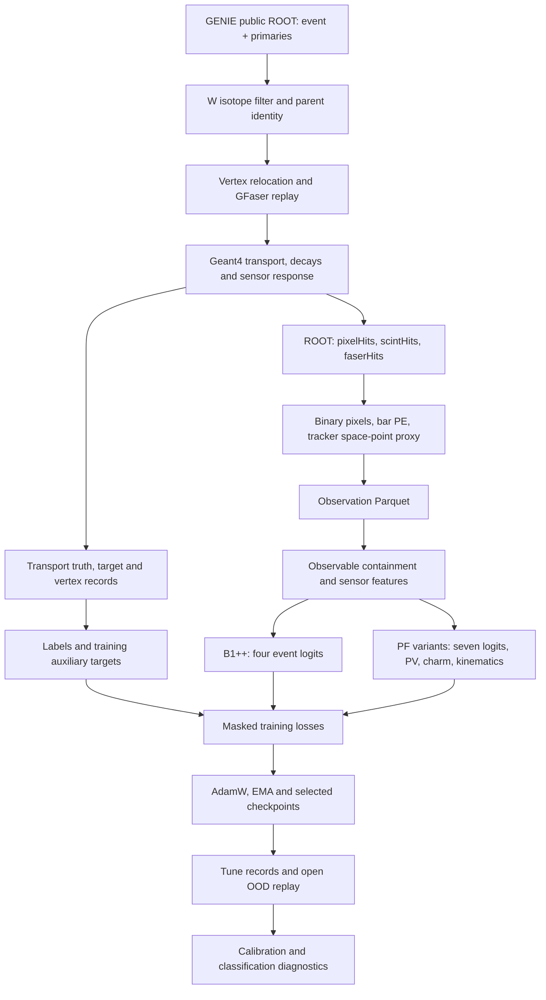

# Stage 324 · 独立科学审计 · PINPOINT Clean v3 / Stage 323

## A. 执行科学裁决

**现有检查点可以作为 Clean v3 合成 MC 分类基线。现有证据不足以将其作为真实探测器上的 ντ 选择、硬件分辨率决策或发现分析的基础。** 已独立回连 Train/Tune 的 40,000 个钨核父事例，确认 30 个冻结权重的身份和架构，使用逐事例预测重算了十组分类指标，并从实际权重重放了十个变体的 observation-only 前向。探测器敏感层在生产宏、冻结二进制和 Python 中的主要位置闭合。仍有已验证的训练比较、数字化、谱仪物理和冻结访问边界问题。

| 问题 | 裁决 |
| --- | --- |
| 1. 当前训练结果是否可信 | 对所选纯钨 MC 的分类结果可信度高。对独立生成器的迁移有小样本支持，真实探测器和低 FPR 外推证据不足。 |
| 2. 已验证的 P0 | 在可访问的 Stage 323 训练及其四分类数学结果范围内，未确立 P0。Stage 322 发现的 Clean v2 非钨父事件污染不能通过新的 Stage 323 检查点追溯消除。 |
| 3. 已验证的 P1 | 封存 provenance 预读、基于 microbatch 事例数的有掩码损失累加、能量匹配对照的不同任务权重、混合顶点的层间隔限制、探测器响应与实际测量之间的缺口、低 FPR 及 NC charm 外推均影响比较或解释。 |
| 4. 几何实现 | 名义 W、Target、IPT 与闪烁体位置闭合。谱仪近轴积分与输运闭合，近孔径边缘的模型近似需独立校准。 |
| 5. 推理 MC 真值 | 标签、辅助目标与无关标识的干预未改变观测模型输出。NOMAD 有意使用由观测重算的 domain。谱仪的 G4 交点涂抹属于理想化响应，几何与观测模型部署的验证范围见 D、E。 |
| 6. 是否学习 | 学到跨不同父事件的非恒定可复现模式。监督、能谱、占据率与相互作用拓扑的各自贡献尚未分解。 |
| 7. 因果架构收益 | PF 套件相对 B1++ 在 Tune 有小幅统计优势。硬件 pitch、Hybrid 关联及 NOMAD 的单机制收益缺乏稳健证据。 |
| 8. 无需再训练可做什么 | 现有权重适合只读 MC 诊断及校准方法开发。修改统计评估可复用权重。改动训练观测、算子或模拟后须按 J 做相应重训判断。 |
| 9. 可支持的主张 | 当前平衡 MC 上的 BA、NLL、主顶点残差、名义位置映射及抽检的真值隔离有实测支持。物理 NC charm、真实数据可迁移性、微米级次级顶点、独立固定工作点和发现显著性未建立。 |

阶段目标是验证现有模型的来源、训练完整性和结论适用域。审计包括 A 取证、B 几何和观测一致性、C 训练诊断、D 独立重算和 E 科学综合。事件级证据限定于 Train 000–079、Tune 080–099、新建小型 Geant4 探针、Stage 323 明确开放的四个 OOD 样本以及对应的原始源文件。冻结清单可用于查询文件身份和统计摘要。

## B. 问题登记表

严重性以受影响的主张为范围。验证状态描述表中所述观察或主张。详细证据、根因、最低修正、产物影响及验收见对应章节。

| ID | 严重性 | 验证 | 子系统 | 发现 | 证据 | 科学影响 | 所需行动 |
| --- | --- | --- | --- | --- | --- | --- | --- |
| 324-01 | P1 | 已验证 | 封存与溯源 | 训练加载器在筛选 split 前读取所有 shard 的 label 与 family，freezer 对全部名义观测做完整字节哈希 | C.2、合成 shard 探针 | 历史“零字节访问”主张失效。未发现封存标签进训练或前向 | 物理路径白名单、访问日志、独立数据访问审计 |
| 324-02 | P1 | 已验证 | 优化与公平比较 | 有掩码和权重的 microbatch 平均按事例数相加，梯度不等于同一完整 batch 的目标 | F.2、4 条 logit 反例、GPU 组记录 | 部分 PF 组使用不同有效目标，影响硬件和架构小差异的因果解释 | 按各任务完整窗口分母累加，匹配硬件和精度重训决定性对照 |
| 324-03 | P1 | 已验证 | 能量匹配 | 只给 process loss 加权，权重和仍随类别变化，零权重事例继续训练辅助头 | E.3、F.2、32,000 条权重 | 自然与 EMatch 分数接近无法排除能谱捷径 | 各类总权重相同，明确处理辅助损失并做匹配域验证 |
| 324-04 | P1 | 已验证 | 生成器与本底 | 现有钨验证域无观测到的 NC charm，诊断域为自由核子生成后置于 G4_W | E.2、G.4 | τ/NC charm 与真实钨靶稀有尾部缺证据 | 物理一致钨 NC charm，先验证生成器与权重 |
| 324-05 | P1 | 已验证 | 统计与适用域 | Tune 尾部用同批本底定秩，多数引用效率依赖 MC 真值切片，0.1% 只有数个本底决定阈值 | G.2、观察域与真值域、互斥 Tune 子样本检验 | 无独立达标证据，效率差异不能用于物理选型 | 用观测域和独立足量本底锁定，再评估 |
| 324-06 | P1 | 已验证 | 谱仪响应 | 从带电粒子真交点构造 0.1 mm 聚合及固定高斯响应，谱仪解析假设缺少孔径与真实组合条件 | D.2、D.3 | 模态和 NOMAD 贡献依赖模拟响应和占据率 | 以条级测量或参数化空间点做真实残差/效率闭合 |
| 324-07 | P1 | 已验证 | Hybrid 顶点 | 65 mm 链接上限使 150.01 mm 间隔的后部 Target 层无法形成层间 tracklet | D.2、F.3、同轨迹双布局反例 | 混合增益不能推广为全靶次级顶点重建 | 逐区域做对象级 truth-match，先限制物理表述 |
| 324-08 | P1 | 已验证 | 因果消融 | pitch 改变同一区域的聚类与 token 数，6T 对照同步修改 containment，shuffle 仅扰动 Hybrid 入口 | D.2、F.3、G.3 | 估计的是整个软件配置效应，硬件 pitch 与轨迹关联增益未分离 | 固定其他输入，做响应级与表示级配对对照 |
| 324-09 | P2 | 已验证 | 复现与精度 | 实际提交代码包并非都等于冻结 SHA，Tune 保存的概率经 BF16，开放回放是 FP32 | C.1、F.1 | 权重身份和数值可核验，跨 GPU 或推理精度不能假定逐位相同 | 逐产物记录执行包、环境、grad accumulation、推理精度和容差 |
| 324-10 | P2 | 部分验证 | 数字化 | 像素噪声只加到沉积像素，条信号简化且逆饱和在 98% 截断 | D.3、二进制/读出与 parquet 探针 | 二值通道与 PE 接口合理，真实密度、暗噪声及饱和尾仍未知 | 加独立响应测量和不同负荷的对照 |
| 324-11 | P2 | 已验证 | 训练质量 | 20 passes 时 Train NLL 继续降低，Tune NLL 从最佳值回升 | F.2、日志轨迹 | 已出现泛化差距，最终 exposure 与选中 EMA 不能互换 | 保留当前选择规则并另设盲验证时间点 |
| 324-12 | P2 | 部分验证 | 源域迁移 | 类别绑定源 run，能谱和反中微子比例不同，指纹对重新生成、近重复与生成种子无保证 | E.2–E.3 | OOD 只覆盖三组开放钨 MC 和一个诊断样本 | 绑定生成器事件 ID 与 tune、跨源做迁移和 nuisance 控制 |
| 324-13 | P2 | 部分验证 | 极化与辅助目标 | GFaser 回放使用固定纵向 helicity，PV 的 log variance 为 SmoothL1 尺度，运动学监督对 NC 大量缺失 | E.1、F.2 | 对精确 τ 拓扑与误差覆盖的解释需单独验证 | 极化/衰变闭合与 PV pull，按类别监测辅助目标 |
| 324-15 | P2 | 已验证 | 核靶 guard | 非离子 PDG 可由声明的 Z=74 绕过纯 W 类型校验 | D.4、实际二进制输入反例 | 名义 40k 独立证据仍成立，筛选外的 GFaser 输入可能被误收 | 在 guard 检查 ion PDG 编码及 Z/A 一致性 |
| 324-14 | P3 | 已验证 | 冻结产物 | PF 训练 manifest 的起止 UTC 连续获取，不能重建实际起止时间 | C.1、`v2_pinpointformer/train.py:1117` | 计算时序须以作业日志和 wall time 为证 | 分别记录入口与完成时间 |

## C. 实际流水线与产物取证

### C.1 固定快照

- 分析 checkout `17940777a8dd43709c9ae9130b288a3f9f97fe44`，冻结清单为 `58897f8ba9746cdb78069ae2d29c6abe0ee96ba7`。Geant4 checkout 与清单均为 `37fd44567acff810c53f60ae7809064fb7e78ae3`。起始工作区已有未跟踪的 `docs/` 和 Stage 320 Workbook。阶段 314、322、323 文档提供历史回归线索。Stage 323 生产修复涉及 `6bc1744`、`37fd445`、`c9c7e02`、`3000f22`、`58897f8`。 [冻结清单](../roadmap/v3/v8_clean_v3_freeze_manifest.json)
- 生产根为 `/eos/home-x/xcheng/FASER/Pinpoint/results/flavour/v6_clean_v3_2026-11-19`，下文称生产根。`clean_sim/stage323` 保存 30 个配置、实验 manifest 和最佳 EMA 权重。30/30 权重、30/30 Tune 预测和 30/30 配置 SHA-256 匹配。30/30 严格加载 state dict，参数均 finite，内部配置与磁盘配置一致。最优 pass 分布为 8/12/16 各 3/15/12 个。独立读取的七个非封存 observations shard 000、007、027、079、080、085、099 哈希均匹配。二进制、宏、geometry JSON、训练权重文件、Train/Tune sidecar 及其余可安全读取的全局摘要均匹配。混合分区的 planned manifest 只检查 Parquet schema、单 row group 和总行数。 [取证脚本][provenance] · [权重输出][model]
- 逐文件核对实际提交包中的 334 个 `src/analysis` 文件。模拟包有五文件差异，`produce_clean_v3.py` 的具体差异发生在 finalize 和 CLI，对生成及转换主路径一致。九个 GPU 训练包各一处差异，均为后改的 freezer 脚本。默认 PF 的 Kubeflow 包另有 `group.py` 并发逻辑及 `v2_pinpointformer/train.py` 梯度累加差异，实际该组是整批 128 的旧训练路径。其余训练组可由包和 GPU 记录识别。清单中的 Geant4 SHA 是仓库 HEAD，二进制 SHA 和实际行为均核验，编译过程未独立重建。冻结清单没有绑定代码 tar、每个 targets/provenance、OOD 权重和输入、或者系统运行环境。 [提交包核对][provenance] · [组配置](../src/analysis/flavour/v3/v6_clean_sim/run_stage323_clean_v3_training.py#L692)

### C.2 数据流与访问边界



| 环节 | 运行入口和实际数据契约 | 独立证据 |
| --- | --- | --- |
| 生成与选样 | `produce_clean_v3.py:301,699` 读源 `event` 与 `primaries`，由 `intType` 和有符号 `initPDG` 决定四类，依靶核 PDG 选 W。去重后按类定额。来源动量/能量 MeV，`gfaser.py:35` 写 GeV 和 m | 64 个 Train/Tune 源 ROOT 只读取 event 分支，按照原行与模型父键回连。 |
| 顶点重定位与输运 | `produce_clean_v3.py:776,948` 先定种子抽样 W 体积，重写顶点，调用冻结二进制。 `GFaserGenerator.cc:189,212,227,256,273` 还原世界 mm 与 GeV，走 Navigator，再生成 status=1 粒子。Geant4 过程与 Py8 decay 随种子随机，源四动量保留为输入元数据 | 二进制和 geom 宏的指纹闭合。G4 位置、实际 hit 和磁场实跑见 D。 |
| ROOT 与读出 | `AnalysisManager.cc:221,257,301,765` 写 pixel、scint/bar、tracker 树。`produce_clean_v3.py:1016,1053` 转换，`readout.py:20,39,114` 做二值像素、通道 PE 聚合和合成 tracker | 实际 observations schema 和冻结训练数据抽样。世界 x/y/z、误差和边界单位 mm，PE 为计数，时间 ns。 |
| 数据集与身份 | `produce_clean_v3.py:1066,1134,1215` 分开保存 observations、targets、provenance 和仅 Train/Tune 合并 sidecar。名义 shard 为 400 事例，行对齐依赖单线程 G4 subchunk 序列和转换 cursor。 `group.py:47,192` 建 mapped items，`train.py:771` 按 KEY 联接 sidecar/权重 | 预测表 KEY、family、标签在 30/30 文件的 8,000 行对齐。原始运输 ROOT 在转换后删除，原批所有逐步输运无法复盘。 |
| 模型输入 | `compute_observable_containment`、`extract_pf_item`、`extract_b1pp_item` 依几何、掩码和同组固定配置，坐标及输入尺度见 D、E | parquet→token→检查点回放，十个 seed17 模型各 32 Tune 事例。 |
| 训练与权重 | B1++ 走 `v1_b1pp.train`。八组 PF 走 `v3_multitask.train`，NOMAD 走 `v4_tau.train`，均共享 PF 训练循环。GPU 使用对应归档。无预训练配置，20 passes 后由 Tune screen 最佳 EMA 写 selected | 30 个严格 state-dict 回放，核对各组配置、学习轨迹和最佳 pass。 |
| 验证 | Tune 阶段先在 2,000 个事件筛权重，再在 8,000 个事件输出 BF16 分类表，Stage 323 以 family 分折做概率校准。开放 OOD 路径按样本直接读取并 FP32 打分 | G 节独立重算混淆、校准、区间和低 FPR 实际计数。 |
| 物理分析 | 历史 `v5_confirm/{freeze,infer_unsealed,significance,flux_significance}.py` 和 `run_stage321_clean_v2_campaign.py` 提供既有算法 | 此次只审读下游源码及文档，Stage 323 物理分析保持暂停。 |

**324-01 · 历史封存边界，置信度高。** 十个 group ledger 均只暂存 000–099 的 observations/targets。实际归档的 `group.py:173–184` 先遍历名义路径并读取 provenance 的 `split` 列，`_build_shared_split` 仍传入原始 EOS 根。`V3EvalDataset:20–21,116–132` 在设置本地 native 路径前，对每个原始 shard 读取 KEY、family、split、label，再以 split 筛选。使用三个空 observations 文件加虚拟 provenance 的反例，Train 构建访问了模拟封存 shard 100 的所有指定列，最终 native 只实例化 shard 000。freezer 的 `run_stage323_clean_v3_training.py:1151–1156` 对 150 个 observations 逐字节做 SHA，清单有相应 150 项。生产 finalize 本身另有合并 sealed 元数据步骤，见 `produce_clean_v3.py:1394–1436`。预期访问边界由分区级路径授权，运行时只访问允许路径和列。这里的影响是盲态审计与措辞失效，无法由这段路径推导封存事例进优化器，且训练键与日志均为 Train/Tune。最低修正是分区物理分离或构建前路径白名单，通过访问记录和合成 sealed sentinel 验证。此项本身无需再模拟或再训练，原封存协议能否用于独立研究须重新评定。 [加载器](../src/analysis/flavour/v3/common/datasets.py#L116) · [冻结哈希](../src/analysis/flavour/v3/v6_clean_sim/run_stage323_clean_v3_training.py#L1151) · [合成复现][seal]

## D. 探测器一致性

### D.1 从 C++ 放置独立推导

生产宏提供 6 个前部 Pinpoint、7 个 Fortune，每 Fortune 有 6 层 W/V/W/H，最后一个 Fortune 前插入共 6 个额外 Pinpoint，尾部有 3 个 IPT。Pinpoint 正向顺序是 Al 2 mm、air 6 mm、Si 0.010 mm、Al 冷板 5 mm、W 5 mm、V 5 mm、W 5 mm、Al 2 mm，长度 30.010 mm。Fortune 厚 120 mm。装配先从世界 z = −3000 mm 推进至 −1799.880 mm，IPT 前净空 50 mm。由此独立构造 276 行体积与副本映射表，含被动层与磁体。 [体积级 CSV][geometry-csv] · [几何脚本][geometry-test]

| 子探测器 | 逻辑体积与通道 | 世界坐标、尺寸与取向 | 实现来源 |
| --- | --- | --- | --- |
| W 靶 | `G4_W`，24 Pinpoint + 84 Fortune，z 排序 plate 0–107。Pinpoint 内 `TungstenPlate` 与 `TungstenPlate_Front` 各 copy 0，Fortune 内 `TungstenPlate` 与 `TungstenPlate_Mid` copy 0–5 | 430 × 430 × 5 mm，中心 (82, −7) mm，z 中心 −2984.490 至 −1807.380 mm，XY 面。边界 x [−133, 297]、y [−222, 208] mm。按 19.3 g/cm³ 为 1,927.03 kg W | `DetectorConstruction.cc:110–120,249–250,317–321,388–397` |
| Target 像素 | `PixelSensor/G4_Si`，父 copy 0–11 | 266 × 196 × 0.010 mm，中心 (0, −12)。前 6 个 z 为 −2991.995 + 30.010·j mm，中间 6 个 z 为 −2691.935 + 150.010·j mm | `DetectorConstruction.cc:137,313,463–475`，`PixelSD.cc:89–99` |
| IPT 像素 | `IPTPixelModule/G4_Si`，父 copy 0–2，读出层 12–14 | 同 Target 截面与取向，z = −1734.875、−1704.865、−1674.855 mm | `DetectorConstruction.cc:413–421,486–490` |
| 像素分割 | 12,788 列 × 8,596 行。唯一 ID = `(plane*8596+row)*12788+col` | X 原点 −133 mm，Y 原点 −110 mm，pitch Δx 0.0208 mm、Δy 0.0228 mm。末端未分割覆盖约 9.6 和 11.2 μm | `DetectorConstruction.cc:435–436,944–959`，`readout.py:20–36` |
| 塑料闪烁体 | G4_PLASTIC_SC_VINYLTOLUENE，BC-408 响应近似，96 panel，54 V + 42 H，40 条/面。V 测 X，H 测 Y。V/H 复用分层副本，panel ID 区分 | 面 420 × 420 × 5 mm，中心 (77, −12)，面 z −2979.49 至 −1802.38 mm。条宽 10 mm、间距 10.5 mm、间隙 0.5 mm，长度 420 mm | `DetectorConstruction.cc:161–218,319,391–397,967–989`，`ScintSD.cc:138` |
| 被动层 | 两 Al 壁、Al 冷板与空气 | 壁各 550 × 600 × 2 mm，冷板 420 × 420 × 5 mm。空气 6 mm。横向偏心由宏与世界装配叠加 | `DetectorConstruction.cc:128,151,239–266,311–323` |
| 磁体和 bore | bore 空气，Sm₂Co₁₇ 壳，copy 0–2 | 中心 x=0、y=−10 mm，z 分别 −815.3、637.4、1837.4 mm。有效 z 区间 [−1565.3,−65.3]、[137.4,1137.4]、[1337.4,2337.4] mm，半径 100 mm。壳内外半径 100.010/215 mm。均匀 +X、0.57 T 仅在 bore | `DetectorConstruction.hh:198–214`，`DetectorConstruction.cc:509–549,649` |
| Tracker | 三个单层 `G4_Si` truth crossing，copy 0、1、2 | 250 × 250 × 0.010 mm，中心 x=0、y=15 mm，z=47.4、1237.4、2427.4 mm，XY 面 | `DetectorConstruction.cc:560–581`，`FaserSD.cc:26–52` |

关键历史比对在 `dbbdb51:Pinpoint/src/DetectorConstruction.cc:660,685–689`。旧表采用不同层序，首部 Si 为 −2981.995 mm，V 为 −2995.500 mm，当前放置为 −2991.995 mm 和 −2979.490 mm，旧元数据分别偏 +10.000 与 −16.010 mm。当前独立重建与生产 JSON、独立 GPS 探针 ROOT 全部数组的 z 最大差 $2.73\times 10^{-12}$ mm。ROOT `geometry.silicon_thickness=10.0` 使用 μm，`domains.py:306` 除以 1000，其他位置与厚度按 mm，不能整体按一种单位解析。 [上游构建](../../Pinpoint_G4/Pinpoint/src/DetectorConstruction.cc#L311) · [探针输出][geometry-log]

### D.2 几何与反例

- 在 (0, −12, −3001) mm 发射两条 100 GeV 正负 μ。首层二值像素中心 (0.0056, −11.9942, −2991.9951) mm，与独立通道计算一致。首层 z 的约 0.00012 mm 差来自 Python float32。对 float32 世界坐标使用 0.0003 mm 容差，低于两轴 pitch。x=132.991 mm 的四条边缘 μ 在首层均无击中，相邻未分割边界从 x=132.9904 mm 开始。观测中的 `xyz_mm` 由 ID 重建，无原始亚像素交点。邻接像素的共享与 centroid 可产生亚 pitch 估计，其精度须由数据确定。 [二值读出](../src/analysis/flavour/readout.py#L20) · [探针输出][geometry-log]
- 对中心与边缘的 GPS 探针 ROOT 闪烁条输出比较 panel 和取向，0 个不符。Python 构造 42 个 XY doublet，V/H 实际纵向差 10 mm，中间有 5 mm W。Nexus 把每侧最多 8 条做笛卡尔积，再全局截断，用 doublet 中点作 z。两条粒子分别命中 `(x1,y1)`、`(x2,y2)` 时四种组合均可进入 token，交叉的两个是候选 ghost。NOMAD 亦用两侧 PE 乘积形成伪 3D 分布。其拓扑能力取决于上下游条心证据，单条、空侧、宽簇射不提供唯一 3D 点。 [双面候选](../src/analysis/flavour/v3/v2_pinpointformer/stereo_bars.py#L232) · [NOMAD](../src/analysis/flavour/v3/v4_tau/nomad_kinematics.py#L104)
- 近轴 +X 场中，世界坐标有 $d^2y/dz^2 = 0.299792458 q B_x / p_{\rm MeV}$。分段积分得到 $s_y=-590000\,\kappa$ mm，100 GeV 时预期 $|s_y|=1.0082$ mm。各 8 条从 z=−1640 mm 发射的正负 μ 的全部三站 sagitta 分别约 −1.010 至 −1.003、+1.005 至 +1.015 mm。ROOT 交点在 tracker 进入面，z 比中心小约 0.005 mm。手动保持 0/1/2/3 站时分别为 0/1/2/3 个原始点，候选类别依次为无、无、双站、三站。三站可估 sagitta，物理模式 NOMAD 对双站关掉动量估计。 `spectrometer.py` 的常数基于全 bore，三站点本身无法保证穿过 bore，见 D.3。 [谱仪积分](../src/analysis/flavour/v3/v1_b1pp/spectrometer.py#L9) · [探针输出][geometry-log]
- **324-07。** 将三条直线输入同一 C++ 微顶点核。四面 z=0、30、60、90 mm 时，同一点真值 z=−5 mm 的重建为 −4.9819 mm，拟合标记 true。第三线施加 0.20 mm 横向位移后，估计 PV 为 (0.0669, −0.0398, −10.0) mm，多个位移 proxy 变化。保持轨迹等几何参数并把层间距改为 150 mm 时，两例拟合标记都变为 false，仅给启发式 PV。根因是 tracklet 接受 5–65 mm，且 p0 选择硬编码最多 12 个 Target 层。该缺陷在活跃 Hybrid、Shuffled、NOMAD 中存在，置信度高。最低修正是用真实层间几何描述候选与覆盖，在每个模块和角度分别检查掉层、PV/SV 残差及假率。改动模型输入后需重训相关变体，现有 MC 可用于对象级检验。 [C++ 阈值](../src/analysis/flavour/v3/common/_fast_kernels.cpp#L646) · [反例][geometry-log]
- **324-08。** 64 个 Tune 事例中只粗化 Target 时，IPT 位置、逐簇属性和 patch 逐元素一致 64/64，反向粗化也为 64/64。原生 hit/原生 token/粗 Target token 的样本中位数为 233.5/122/104.5，90% 分位 5034.8/840.4/563.3。原生 19,161 hits 的样本最多保留 1,024 个 token。粗化同时改变该区域的离散化、合并半径和 patch 物理尺度。6T 会重算 `c_obs` 和域，Stage 323 共同按原始观测域校准是完整探测器共同参照，若声称硬件移除，推理端需要以可取得的 6T 域定义重新评估。最低修正是保留两个正交问题，固定物理响应的坐标信息量测试，以及重新模拟实际 pitch、扩散和层材料的硬件测试。 [量化与筛层](../src/analysis/flavour/v3/v2_pinpointformer/pixel_tokenizer.py#L373) · [反例][geometry-log]

历史几何导出已随物理放置更正。Stage 323 宏的尺寸、通道与 G4 内部闭合。Fortune 4 的替代宏已另行实跑。几何 CSV 是模拟构建的独立计算。合作组 CAD、安装公差、Si 有效层厚、对准、磁场图与最终计划的材料配置尚未取得独立比对。FASER 谱仪的公开设计使用 silicon microstrip stations，可用于比对层、分辨率和通道结构。 [FASER tracker](https://arxiv.org/abs/2112.01116)

### D.3 数字化与可建造性

**324-06 · Tracker。** `FaserSD.cc:26–50` 仅记录带电真粒子过边界位置。 `readout.py:114–160` 对世界坐标每轴以 0.1 mm 分箱合并，保留真交点质心，乘 99% 效率并加 σx=0.58 mm、σy=0.017 mm 的独立 Gaussian。死区和随机噪声的配置默认均为零。对孤立空间点该程序可复现设定分辨率，真实条簇位置、组合 ghost、死条、S/N、共享材料、对准和关联质量需实证。谱仪表示用原始空间点与 triplet/doublet 启发，按 x 残差、粗 shower apex 与 sagitta 排序，每站最多 14 个入候选、保留 4 条。解析模型的全场假设适用近轴轨迹，孔径和多次散射的效应需按观测质量及位置验收。误差向量无独立 per-hit 测量，解析常数与生产几何硬绑定。当前权重保留作 MC 基线。实测响应有实质差异时，应在 G4 crossing 加真实数字化或重建空间点，再训相关基线。 [Tracker digitization](../src/analysis/flavour/readout.py#L114) · [候选构造](../src/analysis/flavour/v3/v1_b1pp/spectrometer.py#L102)

**324-10 · 硅与闪烁。** PixelSD 对带电 step 中点做 3 μm Gaussian 3×3 扩散，按物理像素先合并电荷，3.6 eV/电子、对有沉积的像素加 10 e⁻ 噪声，100 e⁻ 阈值后仅交付击中通道。缺少噪声触发、真实掩码、深度/入射角依赖的电荷收集、sensor tile 与实际材料层数据。ScintSD 用带 Birks 的可见沉积、传播及衰减、Poisson PE、14,400 microcell 饱和及通道级 3 PE 时间。输入只用 PE 和几何，逆饱和 capped occupancy 为 0.98，PE→能量只是模型 proxy。通道阈值 ≥2.5 PE，实际整数 3 PE。读出的 `hit_time_ns` 未进活跃模型，抽验 87,171 通道中 520 条零 PE，0 条携带非负时间。该项时间修复在当前样本闭合，waveform、真 track 拆分压力和电子学时间标定未做独立重放。实际衰减、光产额、SiPM recovery/串扰、噪声、死道和高占据度需要台架或束流参照。最低修正是对真实工作点参数化并用常规跨阈值测试验证。误差达到模型敏感程度才需要重新数字化与重训。 [PixelSD](../../Pinpoint_G4/Pinpoint/src/PixelSD.cc#L114) · [ScintSD](../../Pinpoint_G4/Pinpoint/src/ScintSD.cc#L337) · [PE 读出](../src/analysis/flavour/v3/common/domains.py#L126)

### D.4 生产二进制反例

**324-06 · 磁场适用域。** 用 8 条近轴 100 GeV μ⁺ 关闭场，三站 sagitta 的最大绝对值 0.00487 mm。在世界 x=112 mm、y=−10 mm，从第一站前发射 12 条 100 GeV μ⁺ 并开启 0.57 T，12/12 都有三站，三个站的所有 x 均大于 100 mm，实测 sagitta −0.884 至 +0.593 mm，3 个事例符号与近轴 μ⁺ 相反。近轴同能粒子的预期是 −1.008 mm。厚磁壳引入散射，穿越实际 bore 要依轨迹判断，三站全响应的可观测判据不足。预期对有近轴完整场路径提供动量，并以 acceptance 或质量标记处理边缘候选。最低修正是以观测外推作 bore-aware 质量控制并校准，先测真正 Train/Tune 的候选占比及敏感性。反例确立存在这种几何条件，当前样本的物理偏差大小未测。 [二进制探针][geometry-log] · [动量分支](../src/analysis/flavour/v3/v4_tau/nomad_kinematics.py#L163)

**324-15 · 纯钨 guard 的异常输入。** 用冻结二进制的 GFaser 一次一例，指定 `PINPOINT_REQUIRE_W_TARGET=1` 与 `PINPOINT_REQUIRE_W_MATERIAL=1`。W-184 置入钨通过。C-12 置入钨触发 `GeneratorTargetMismatch`，W-184 置入空气触发 `VertexMaterialMismatch`。输入自由质子 `tgtPDG=2212` 且误标 `Z=74,A=1` 时运行成功。根因是 `GFaserGenerator.cc:264` 对非离子 PDG 以输入 `fTgtZ` 代替核编码，guard 因此接受两次来自同一字段的比较。实际名义 Python 输入先验证离子编码，40k 父样本均真实 W。此单元缺陷对现有权重没有已知影响，修正 guard 后无需追溯重产。最低验收是对自由核子、未知 PDG、Z/A 错配、有效同位素及错误材料逐项测试。切换 Fortune 7→4 的实跑为 108/15/96 → 66/12/57（W/Si/Scint），确认配置联动。 [guard 复现][g4guard] · [C++ guard](../../Pinpoint_G4/Pinpoint/src/generators/GFaserGenerator.cc#L256)

## E. 数据集、生成器与真值

### E.1 活跃特征级溯源

| 特征 | 来源与单位 | 真实可测性及真值依赖 | 训练 / 推理 | 风险 |
| --- | --- | --- | --- | --- |
| pixel channel、世界 xyz | ROOT col/row/layer ID，几何查表 mm | 二值像素可测，xyz 为已知几何的中心。G4 亚像素步仅用于模拟扩散 | 全模型 / 全模型 | 击中低效、边缘和占据率仿真。 |
| 像素网格、纵向摘要、cluster/patch | B1++ 的传感器投影，PF 的同面聚类、微米矩与 patch，位置 mm 或按尺度归一，计数与 log | 观测派生，分层截断与池化 | 全模型 / 全模型 | 控制改变合并和 token 分布，几何对称性不能自动推广。 |
| 条 PE、panel/orientation/bounds | G4 PE、几何表，PE 与 mm。B1/PF 由修正 PE 生成 log 能量和 hit pattern | PE 可标定，模拟响应理想化。coarse X/Y 合并含 ghost | 全模型 / 全模型 | 稠密簇射饱和、实际电子学和响应不均匀。 |
| `edep_proxy_MeV`、hit_time | 前者是历史模拟沉积，后者是通道 ns | 沉积无法直接同时观测。当前 schema 缺前者，时间存档 | 均未用于当前模型 | 单时间阈值只对相应探针/样本成立。 |
| tracker raw hits、候选、signed sagitta | G4 交点经 Gaussian，station、mm、rad 及量纲归一 proxy | 真实 tracker 可独立重建，但当前 MC 用过边界真位置作为响应起点 | 全模型 / 全模型 | 理想化测量，3 站可用性与离轴场。 |
| `c_obs`、`cal_start`、domain | 16 个观测字段含模态、深度、边缘、veto、计数、PE，apex 用 mm | 可从观测和配置全重算，domain 是 NOMAD 的有意输入 | 全模型侧信息 / 同 | 不同配置会改变域及分布。 |
| AVR PV、micro `tracklet`/SV/impact 部件 | C++ 核的几何候选，mm、rad 和纯数尺度 | 观测计算，真实对象质量未知 | Hybrid/Shuffled/NOMAD / 同 | 硬切、重叠、错配、低多重数。 |
| NOMAD 10 维 | 观测条、谱仪和 domain 的横向形状、动量 proxy | 可计算，没有独立的真横向能标或强子关联 | 仅 NOMAD / 同 | 全孔径假设、高动量 noise floor、V/H ghost。 |
| flavour/CC/NC、tau branch、charm、PV、visible kin | GENIE 和 G4 parent/decay 记录，PV mm、运动学 log / 角 | 训练监督和诊断，MC 真值 | B1 四类、PF 各 mask / 推理干预无效 | 类先验、衰变建模、辅助任务支持。 |
| `E_ν`、geom_weight、父键、真值域 | 生成器 GeV、体积分层权重、provenance | 真值与溯源，tracker 随机响应由 family 派生 seed，不给网络 family | EMatch 分类权重，geom_weight 评估 / 前向不使用 | 训练目标、域和 MC 先验需明确。 |

独立实验证明移除 label、给正确/置换/随机 label 及扰动 auxiliary 真值、family、index 与能量元数据，不改变十个 seed17 模型的未校准前向。另用仅包含 32 个 observations、缺 targets/provenance/sidecar/屏幕文件的临时目录经过公开 API，最大概率差约 $1.2\times10^{-7}$。NOMAD 若将 `obs_domain_id` 伪造为 77，32 例最大概率差 0.04683，logit 最大差 0.47364。根因是 `NomadFusionBlock` 使用 `is_scint` 和 `active`，API 通过 `compute_observable_containment` 重算 domain。此观测依赖与真值隔离一致，实际数据原始读取到 observations 的电子学与 track building 未验证。 [推理入口](../src/analysis/flavour/v3/common/observation_inference.py#L33) · [域融合](../src/analysis/flavour/v3/v4_tau/models.py#L35) · [权重干预][model]

### E.2 生成器、核靶与划分

| 样本 | 事例 / 父路径数 | 核靶与材料 | 独立性证据 |
| --- | --- | --- | --- |
| Train | 32,000 / 48 | 源 event 逐一核对 W-180/182/183/184/186 = 39/8,366/4,518/9,854/9,223。四类与 `intType,initPDG` 对齐。生产摘要记录 Navigator 约束 | Train / Tune 的共享父文件、family、量化运动学数均 0。 |
| Tune | 8,000 / 16 | W-180/182/183/184/186 = 8/2,161/1,166/2,387/2,278。生产逐事例元数据全部 `G4_W`。源能量差≤0.00020 GeV，由 float32 解释 | 四类均 2,000，8,000 个不同 family。 |
| OOD 10085–88 | 1,600 | 保存为五种 W 同位素，材料 `G4_W` | 和 Train/Tune family、量化运动学相交为 0，独立训练种子信息未获得。 |
| OOD Pythia6 std/nux | 各 1,200 | 保存为 W 同位素及 `G4_W` | 与 Train/Tune 的 family/指纹相交为 0。std/nux 成对共用重新采样的顶点，不把这两组视为独立几何集。 |
| Pythia8 诊断 | 800 | 456 n、344 p，自由核子生成后放在 `G4_W`，800/800 charm | 与名义 family、运动学标识相交为 0，不是钨 NC charm 的物理模板。 |

源回连只用 `10081–10084` 的源 chunk 000–015、event 分支、BLAKE2b(label-free source tag + row) 及最终 Train/Tune 父键。原始来源文件/行独立已验证，重复改名的父文件、位置重放、重加权和生成系统改变以 round(E/1 MeV,Q²/10⁻⁴,y/10⁻⁵) 加 PDG 对照。源 metadata 的 `xs` 在 40,000 例 finite 且无负值，未用作训练物理先验。公开 ROOT 常量和父指纹无法恢复完整 GENIE run card、真实 seed、母粒子树与同位素核模型。Train 的运输端核靶一一交叉证据由生产守卫和摘要支持，原批 ROOT 已清理。Stage 322 的碳、铝和自由质子重定位问题在所审 Stage 323 父样本中被证伪。另取 8 个明确开放源 chunk 中每个前 40 个匹配父事例，核对 8,944 个源 G4 primaries 的四动量均 finite，320/320 记录的末态 lepton PDG 出现在源 primaries 中，分布为 240 CC、80 NC。原始事例 GHEP 的核 remnant 与跨输运四动量的完整闭合仍需保留生成记录。 [末态抽检][primaries]质量采样 1 μm dxyz 边距覆盖 $(1-0.002/430)^2(1-0.002/5)=99.95907\%$ W 体积。质量重权来自分层采样几率，真实通量几何/方向相关性未模拟为真实接受度。 [父回连][parents] · [抽样和 guard](../src/analysis/flavour/v3/v6_clean_sim/produce_clean_v3.py#L211) · [GENIE tunes](https://arxiv.org/abs/2106.09381)

**324-04、324-12、324-13。** Tune 各类 charm 为 210/175/190/0，三组开放钨 OOD 各自 NC charm 也为 0。名义和 OOD 的零数支持当前生产机制的有限覆盖。原始 NC 权重与 charm 稀有比例需要独立 GENIE 运行，并在可比较的 (E_ν,Q^2,y) 与事件选择下核对。Pythia8 自由核子诊断不能替代核内级联、束谱与过程混合。GFaser 把源 G4 primaries 全转为 status 1，再对 τ 按电荷指定固定纵向 helicity，Py8 读取该极化。源发生器的逐事例 τ spin density、退激与宇称敏感分布仍需交叉。最小修正是有记录的物理生成器和衰变验证，若新域有重要性能变化，重产相应样本再判断训练更新。 [诊断源](../src/analysis/flavour/v3/v6_clean_sim/produce_clean_v3.py#L535) · [GFaser 极化](../../Pinpoint_G4/Pinpoint/src/generators/GFaserGenerator.cc#L273) · [Py8 解码](../../Pinpoint_G4/Pinpoint/src/Py8Decayer.cc#L133)

### E.3 生成器捷径与负对照

Train Eν 中位数从 e/μ/τ/NC 分别为 517.71/535.15/669.10/518.77 GeV，反中微子数为 3005/1678/2035/2147，各分母 8000。Tune 对应中位数 526.03/536.68/664.09/494.24 GeV。只用真 Eν 的独立小型 HistGradientBoosting 分类器在 Tune 达到 31.89% BA4，均匀四类基线 25%。源 run 在名义样本完全识别类别，但它仅存在于 provenance 及生成过程。类相关生成环境或 detector response 仍可通过物理观测间接表现。 [生成谱与训练清单](../src/analysis/flavour/v3/v6_clean_sim/produce_clean_v3.py#L699) · [独立指标][metrics-result]

**324-03。** 训练 20 个能量 bin 的权重先裁剪到 [0.1,10] 再在各类 in-range 事例归一。总权重等于各类 in-range 事例数，依 e/μ/τ/NC 为 7846/7428/7962/7476。类有效样本量为 7370/7292/7561/7351。154/572/38/524 个零权重事例仍进入批次。训练 `FixedWeightEventLoss` 只将 `sample_weight` 用于 process loss，三辅助目标继续用原谱，亦可改变共享表示。比较对应实际处方可以复现，但“已隔离所有能谱捷径”被证伪。最低修正是固定共同支持、每类总权重及明确的辅助目标域，在同训练预算下建立配对对照，改变训练目标需重训 EMatch，底层 MC 可复用。 [权重](../src/analysis/flavour/v3/v6_clean_sim/produce_clean_v3.py#L670) · [实际目标](../src/analysis/flavour/v3/v3_multitask/losses.py#L175)

独立占据率 HistGradientBoosting 仅使用像素数、有效面数、过阈值条数、tracker 点与站数、IPT 及前哨面计数。用预先按 shard stride 选定的 1,280 Train 与 640 Tune，BA4 为 40.63%。这说明粗响应已携带类别信息，仍无法区分相对于拓扑的能谱与接受度贡献。该抽样基线的训练样本小于完整 Stage 323 BDT。 [小样本基线与输出][diag]

## F. 活跃架构与训练

### F.1 架构、张量与可部署前向

| 当前家族或对照 | 实际前向与优化目标 | 参数及限制 |
| --- | --- | --- |
| B1++ `s323-b1pp-clean` | X/Y 传感器投影经横向卷积，沿 z 对齐后经局部纵向混合、窗口注意力，和谱仪与 `c_obs` 融合，T4 cross-entropy | 3,124,023，细粒度像素在较早投影，多对一压缩。AdamW、固定 128、无镜像。 |
| PF `s323-pf-20um` 及三个 pitch、6T、EMatch 对照 | `PinpointFormerMultitask`，192 宽、8 heads、4 local/4 global、patch CNN、pixel/条 Nexus 和观测量聚合、PV anchor 与相对位置 local attention、Perceiver latent 融合。7 logits 边缘化为 4 类，另监督 charm、PV、可见运动学 | 每个 8,881,436。代码强制启用 `use_vertex_anchor` 并将 V2 head 换成 Identity。这里的原版/vanilla 指无 Hybrid 的 Stage 323 PF，旧 V2 纯分类头不活跃。 |
| Hybrid 和 Shuffled | 与 PF 主干相同，增加 C++ microvertex 特征的 token、PV anchor 入参及融合残差。打乱只对多簇面围绕面质心旋转 Hybrid 输入 | 每个 8,923,677。保留原 PF 几何、计数、占据率等，单簇面未旋转。相对几何变化可能改善或破坏候选选择。 |
| NOMAD | `PinpointFormerV4` 在 Hybrid 上加条和谱仪 10 维变量，经 domain-gated MLP，给 7 logits 和 charm 加残差。固定损失，物理尺度模式 | 9,038,718，pAUC disabled，未从历史权重初始化。NOMAD 仍使用 fixed-scale calorimetric proxy。 |
| GN2 dense / pAUC / 历史发现集成 | Stage 323 冻结配置明确关闭 dense GN2、cluster sidecar、pAUC。Train-time 固定损失只保留事件级四头 | 对此批权重贡献不适用。OOF 只是三个 seed 的 Tune 概率再校准，不是历史发现模型复跑。 |

`ScaledQKNormAttention` 显式做 fp32 Q/K 归一、最后一轴 source softmax、对 source mask 用 −∞。全空 source 用 dummy 解除 NaN，再将注意权重置零。FP32 单样本与同一事件处于 32 例 batch 的最大概率差约 $7.5\times10^{-8}$，三 PF 代表模型在清空全部传感器后结果有限。32 例的八个注意层平均归一熵范围 0.260–0.504。该样本覆盖实际正常前向及空输入，未检验全数据熵、每头饱和、高占据度极端值或所有 padding 形态。Layerdrop 的训练随机性与 BF16 数值舍入影响严格等价比较。当前 y mirror 关闭，固定 Bx 下随意镜像会反转弯曲，保持符号与几何的物理条件应固定在设计中。 [注意力](../src/analysis/flavour/v3/common/layers.py#L65) · [PF 融合](../src/analysis/flavour/v3/v2_pinpointformer/models.py#L282) · [模型探针][model]

**324-09 · 验证精度。** 实际 Tune 预测通过 `predict_pf_loader(..., use_bf16)`，接着把 logits 和概率写为浮点值。CPU/GPU FP32 observation-only 与原始表抽样差可达 0.00692。相同模型、批次用 BF16 再跑，三个代表 PF 的 FP32–BF16 最大差 0.00313、0.00603、0.00373，量级相符。这里核验的是产物来源、容差和输出稳定性，不把 FP32 API 当 BF16 逐位重放。需要比较低 FPR 尾时应冻结输出精度、batch 契约并单独验证临界样本。 [预测调用](../src/analysis/flavour/v3/v2_pinpointformer/train.py#L1101) · [精度探针][diag]

### F.2 优化、损失及分支健康

PF warm-up 6%、cosine schedule、base/min LR 8e−4/1e−5、AdamW betas (0.9,0.98)、weight decay 0.03、clip 2、EMA 0.999，20 × 32,000 事例、每次 250 步。B1++ 的 base LR 9e−4、clip 1、AdamW 默认 betas、独立 EMA 更新细节和不同的模型损失。各组名义预算 5,000 步，seed 为 17/42/2026。PF 使用 stochastic depth 与 head dropout，EMA 以 screen NLL 选最佳。恢复文件保存 optimizer、scheduler、原始及 EMA state、global step 和历史，未保存完整 CUDA/RNG 状态，断点续跑逐位等价未验证。 [PF 优化](../src/analysis/flavour/v3/v2_pinpointformer/train.py#L850) · [B1++ 优化](../src/analysis/flavour/v3/v1_b1pp/train.py#L734)

过程头 CE 对已知七类计算逐例 log loss，对 τ 分支未知用 $-\log(p_{\tau e}+p_{\tau\mu}+p_{\tau h})$。charm 是 valid-mask focal BCE，正类权重 3，γ=1.5。PV 是轴尺度后的 SmoothL1、clamp log uncertainty 与归一，系数 0.20，charm 和 visible kin 为 0.25、0.15，process 为 1。Train 的七类记录为 8000 e、6322 μ⁻、1678 μ⁺、1450 τe、1352 τμ、5193 τhad、8000 NC、5 个未指定 τ。PV valid 为 31,997/32,000，visible kin valid 为 23,990/32,000。NC 缺可见运动学标签的设计需按类监测。单个 `log_var_v` 是所实现 robust loss 的尺度，真实三轴误差覆盖需以残差、pull 和多区域样本校准。 [活动损失](../src/analysis/flavour/v3/v3_multitask/losses.py#L150) · [PV loss](../src/analysis/flavour/v3/v2_pinpointformer/vertex_anchor.py#L18)

**324-02 · 不等价的梯度累加。** 使用 64×2 的组包括低显存 MIG 上的两项单区 pitch、Hybrid 及 NOMAD。默认 PF 的 47 GB Kubeflow 实际包只有 128 整批版本。设每 microbatch 的分子 (S_j) 与有效权重分母 (D_j)，数目加权的 $\sum_j n_j S_j/D_j \,/\, \sum_j n_j$ 只有在 $D_j\propto n_j$ 时等于完整窗口 $\sum S_j/\sum D_j$。不等价的分母包括 focal charm 的正类权重、visible kin 和 PV 的 valid mask，以及启用样本权重时的 process。实际 focal charm 损失的反例 `logits=[−2,0,0,2], charm=[1,1,0,0]`，完整梯度约 [−0.39093,−0.13522,+0.04507,+0.13031]，两个等长累加为 [−0.26062,−0.09014,+0.09014,+0.26062]。梯度差 0.13031，即使这组反例的标量碰巧相同。完整窗口/末尾均存在同一逻辑。代码层面置信度高，现有指标偏差幅度未测。需累加每任务的 numerator/denominator 或使用统一 batch，并在关闭随机增强时比较每层梯度及一次 AdamW 更新。对要求极小差异的比较至少须在同精度、同 batch 下重训受影响对照，现有权重可作为合成 MC 基线。 [累加](../src/analysis/flavour/v3/v2_pinpointformer/train.py#L950) · [不同分母](../src/analysis/flavour/v3/v3_multitask/losses.py#L61) · [反例][diag]

三份 seed17 PF 权重在同 32 个 Tune 事件回算完整训练目标，梯度有限。基线的 charm/kin 范数为 0.0690/0.2376，Hybrid microvertex 全 13 个 tensor 有梯度，组 L2 0.0783，NOMAD 全 21 个 tensor 有梯度，组 L2 1.6591。纯四类 NLL 的 charm 与 kin 头梯度为零，符合它们在 dense 禁用时只由各自辅助损失训练的设计。少数 tensor 的梯度为零，例如 stereo 124/128 活跃，未由一次 batch 确定其结构性或事件性原因。三模型去除像素、条、tracker 的平均 TV 分别为 PF 0.076/0.228/0.093，Hybrid 0.095/0.277/0.104，NOMAD 0.118/0.316/0.094。扰动重做 containment 并产生分布偏移，只说明依赖程度。 [完整损失调用](../src/analysis/flavour/v3/v3_multitask/train.py#L25) · [小样本诊断][diag]

**324-11。** seed17 PF 的 screen EMA NLL 从 pass 1 的 1.3455 降至 12 的 0.9792，pass 20 回到 1.0439，训练子样本 NLL 从 1.0904 降到 0.5954。Hybrid 的 screen 最优 16/0.9690，末轮 1.0159。B1++ 8/0.9896，末轮 1.4699，末轮 Train 0.4727。选中的模型仍有真实非恒定输出，外推瓶颈至少包括有限训练多样性与晚期过拟合。证据不足以单独归因于容量、表示或不可约物理混淆。 [训练轨迹][metrics-result]

另从 Train shard 000 首 row group 每类取八个有像素或条响应的事例，使用随机初始化、FP32、固定 32 例、64 次 AdamW 更新及活跃训练目标复算拟合能力。B1++、PF、Hybrid、NOMAD 最终都正确 32/32，初始 NLL 分别 1.4032、1.5152、1.5021、1.4993，64 步后为 0.0000079、0.01530、0.000692、0.002922。此诊断用独立临时模型和较短优化设置，表明小样本优化可行，适用范围由批次的预选条件限定。 [拟合记录][fit32]

### F.3 微顶点与模型比较的物理条件

C++ 核用层索引、占据、角度和短距离窗口拼接 triplet、doublet，做带权稳健 PV 和次级候选、impact、kink、thrust 等统计。首面 MIP 占比本身就是 shower/占据特征，rotation control 保留此类粗统计，且保留主干的物理像素几何。细粒度 C++ 输出能影响网络，实测梯度与顶点反例表明功能路径已启用。只有加入逐对象效率、purity、误差与真假顶点的对照，才能量化学到的几何机制。尤其 150.01 mm Target 间隔处的显式 tracklet 受 65 mm 截断。使用 target XY 真值域的 PV 中位残差，不能证明局部 μm 关联或可部署域已验证。 [Hybrid 核](../src/analysis/flavour/v3/common/_fast_kernels.cpp#L508) · [控制旋转](../src/analysis/flavour/v3/v2_pinpointformer/pixel_tokenizer.py#L630)

## G. 独立结果验证

### G.1 8,000 Tune 分类与概率指标

按 (run, chunk, row) 联接事件，对照 family、标签、行数和数值范围，另从 7 logits 独立 softmax 加总复核 4 类概率。用 NumPy/SciPy 独立实现 BA4、条件 BA3、NLL、Brier、15 均宽概率箱 top-label ECE 和 5-fold OOF 校准。折分复用仓库的确定性 `grouped_folds` 以复刻已报告样本，概率拟合及指标算法独立。Stage 323 的条件 BA3 排除真 τ，以 e、μ、NC 三维概率取 argmax。另算 CC-only BA3，在真实标签属 CC 时用 (p_e,p_μ,p_τ) 重取 argmax。原始三种子等权平均与 OOF 分域几何概率池可能改变排名。D0 两事例 OOF 设均匀，D1/D2/D3 分别 1,748/4,567/1,683。重做 Stage 323 全部十组 All BA4 与条件 BA3 一致，NLL 最大差为 $5.90\times10^{-9}$。剔除筛权重子样本后的 6,000 例用原始 ensemble 比较，避免在这些事件上再拟合分类校准。表中 BA 单位为 %。 [独立实现][metrics-script] · [完整分域与混淆数据][metrics-result]

| 变体 | 原始 BA4 | 6k 原始 BA4 | OOF BA4 | OOF BA3 e/μ/NC | OOF BA3 CC-only | OOF NLL | ECE | OOF 真值 Pinpoint BA4 |
| --- | ---: | ---: | ---: | ---: | ---: | ---: | ---: | ---: |
| PF 20/20 μm | 57.86 | 57.96 | 57.83 | 72.25 | 66.92 | 0.96123 | 0.01754 | 61.33 |
| PF 1 mm Target | 57.71 | 57.95 | 57.93 | 72.37 | 67.13 | 0.96187 | 0.01063 | 61.04 |
| PF 1 mm IPT | 57.63 | 57.72 | 57.78 | 72.08 | 67.10 | 0.96361 | 0.02158 | 60.91 |
| PF 1 mm both | 57.66 | 57.85 | 57.90 | 72.38 | 66.78 | 0.96165 | 0.01515 | 61.46 |
| PF 6T + 3IPT | 57.24 | 57.16 | 57.39 | 72.07 | 66.83 | 0.96732 | 0.01582 | 60.39 |
| Hybrid | 58.21 | 58.19 | 58.24 | 73.02 | 67.70 | 0.95428 | 0.01489 | 61.43 |
| Hybrid Shuffled | 57.71 | 57.71 | 57.93 | 72.33 | 67.12 | 0.96166 | 0.01194 | 61.45 |
| Hybrid + NOMAD | 58.44 | 57.99 | 58.01 | 72.70 | 67.42 | 0.95533 | 0.01467 | 61.68 |
| PF EMatch | 57.95 | 57.99 | 57.89 | 71.87 | 67.05 | 0.97154 | 0.01749 | 61.28 |
| B1++ | 57.04 | 57.15 | 57.23 | 71.72 | 66.68 | 0.98351 | 0.00956 | 60.37 |

PF 20/20 OOF 的四类行列顺序 e/μ/τ/NC。混淆矩阵为 `[[1501,45,344,110],[148,1149,379,324],[416,305,886,393],[258,151,501,1090]]`。精确率依次 64.6/69.6/42.0/56.9%，召回 75.1/57.5/44.3/54.5%。D1/D2/D3 的 BA4 为 62.22/57.24/54.66%，NLL 为 0.8681/0.9827/0.9993，Brier 全域为 0.5271。数值显示真实类别 prior 与工作点识别需要另做研究。固定已拟合预测、按类别重抽 1,500 次，family 在 Tune 一例一个，得到原始 PF BA4 95% CI [56.74,58.91]%，Hybrid [57.11,59.24]%，NOMAD [57.32,59.47]%，B1++ [55.98,58.10]%。CI 条件于固定权重及校准，未包含训练随机性、阈值估计、生成与系统误差。

### G.2 低 FPR 与科学外推

**324-05。** 先在同一 Tune 的真值 Pinpoint 域进行可复现秩诊断，(N_τ=1075,N_b=3264)。以下采用拒绝第一个未允许背景分数的严格阈值，保留背景计数由经验分布约束。Stage 323 用与最后一个允许背景同分数的 inclusive 阈值，两者可有不同信号通过数。FPR 的 Clopper–Pearson 区间用于说明有限计数尺度。在同集构造阈值时，该区间无法替代未来独立样本的覆盖。 [阈值实现](../src/analysis/flavour/s6/calibration.py#L62) · [独立秩诊断][metrics-result]

| 真值域，OOF pτ | 1% 档 FP/B，TP/τ | 0.1% 档 FP/B，TP/τ |
| --- | --- | --- |
| PF 20/20 | 32/3264，66/1075，6.14% [4.78,7.75]% | 3/3264，13/1075，1.21% [0.65,2.06]% |
| Hybrid | 32/3264，91/1075，8.47% [6.87,10.29]% | 3/3264，26/1075，2.42% [1.59,3.52]% |
| Hybrid + NOMAD | 32/3264，98/1075，9.12% | 3/3264，28/1075，2.60% |
| B1++ | 32/3264，46/1075，4.28% | 3/3264，13/1075，1.21% |
| 经验 FPR 和 CI | 0.980% [0.672,1.381]% | 0.0919% [0.0190,0.2684]% |

复刻 Stage 323 inclusive 工作点时，PF 20/20 的 τ 通过数为 65 和 9，Hybrid 为 91 和 19，NOMAD 为 97 和 18，B1++ 为 45 和 9，分母均 1075。两档背景计数均为 32 和 3。十组 inclusive 效率均与冻结报告一致。

对未参与权重选择的六千 Tune 事例，以 KEY 确定散列二分，第一半只定阈值，第二半只计数。使用 raw 三种子平均，无额外域校准。全域 held 为 2,955 条，e/μ/τ/NC 分母 740/749/753/713。PF 1% 档实到 33/2202 FPR = 1.499% [1.034,2.098]%，τ 38/753。0.1% 档为 9/2202 = 0.409% [0.187,0.774]%，τ 11/753。Hybrid 分别 27/2202、45/753 与 7/2202、17/753。NOMAD 分别 21/2202、44/753 与 5/2202、20/753。观测 D1 held 背景 496，τ 154，固定 1% / 0.1% 档，PF 分别 8/496、5/154 与 4/496、3/154。Hybrid 分别 10/496、11/154 与 3/496、7/154。D1 中拟定 0.1% 的阈值只能依赖最高分背景的位置，工作点估计明显离散。 [互斥子样本][diag]

`PinpointBlock_PixXY`、`FrontPinpoint_PixXY` 依赖真值顶点，`D_pix_contained` 由观测重算。`D1` 可用于实测域定义验证，仍需控制触发、前哨 veto 和域迁移。0.1% 若希望有约 100 个背景通过量级，先需要约 $10^5$ 个相关未加权等效本底事件，这仅给 Poisson 相对统计量级 10%。加权、测量选区和源相关性会进一步减少有效规模。

历史 `flux_significance.py` 与 Stage 321 有冻结后阶段的投影逻辑。外部率与物理 exposure、统一 veto、有限 MC 空箱、校准/切选独立性、生成系统和结构零都需要单独证据。当前不具备从 balanced MC 后验、分域效率或早期 Asimov 配置推出发现显著性的条件。该限制不改变训练损失的数学核查。 [历史物理分析入口](../src/analysis/flavour/v3/v6_clean_sim/run_stage321_clean_v2_campaign.py#L1376) · [有限 MC 与似然](../src/analysis/flavour/v3/v5_confirm/flux_significance.py#L300)

### G.3 公平性与效果大小

| 比较 | 独立配对证据 | 科学解释 |
| --- | --- | --- |
| PF vs B1++ | 全 Tune raw +0.825 pp，配对 95% CI [+0.10,+1.49]。真值域 OOF +0.959 pp [+0.12,+1.83] | 支持当前整套 PF 程序的小幅收益。参数 2.84 倍、目标、LR、剪裁和预处理不同，无法隔离 Transformer 贡献。 |
| 20 μm vs 1 mm Target / IPT | 全域 raw 两个差为 +0.150/+0.238 pp，CI [−0.39,+0.66] / [−0.23,+0.71]。双粗对照 CI [−0.33,+0.73] | 缺乏单 pitch 效应，软件 token 与真正分割变化属不同干预。 |
| 12T vs 6T | 全域 raw +0.625 pp [+0.10,+1.14]，真值域 OOF +0.940 pp [+0.24,+1.59] | 支持当前删输入操作导致的影响。6T 同时丢层、重算 containment，材料仍是原仿真。 |
| Hybrid vs PF | 全域 raw +0.350 pp [−0.14,+0.88]，真值域 OOF +0.101 pp [−0.64,+0.79] | 权重可使用 Hybrid 特征，分类增益的数量与机制尚不稳健。 |
| Hybrid vs Shuffled | 全域 raw +0.500 pp [+0.04,+0.99]，真值域 OOF −0.015 pp [−0.75,+0.74] | 受域、校准与计算预算影响，无法归因于次级几何。 |
| NOMAD vs Hybrid | 全域 raw +0.225 pp [−0.28,+0.74]，真值域 OOF +0.252 pp [−0.41,+0.90] | 额外特征有梯度。现有精度与误差支持的分类收益未建立。 |
| Natural vs EMatch | 全域 raw −0.0875 pp [−0.64,+0.49] | 该对照定义下接近。权重和域差异使能谱贡献仍未知。 |
| 观测 BDT vs PF | Stage 323 BDT 文件列 All 53.64%、条件 BA3 67.77%、真值区域 BA4 56.50%。仓库无 BDT 冻结预测或拟合权重可逐事例配对 | 这是历史汇总值。本次仅复算神经网络和小型占据率对照，无法独立复核整批 BDT，在两者使用的 e/μ/NC 定义下，冻结 PF 的条件 BA3 更高。 |

误差为条件于保存预测的逐事例配对区间，未做十组多重推断校正，数值边缘的显著性仅描述 Tune。若比较面向硬件或物理机制，应匹配优化器、实际微批、训练精度、seed、家族 source split 及预处理。固定 5,000 步和三 seed 仅闭合部分公平性。

独立 PV 重算基于保存的三 seed `v_hat` 取均值。真值域 4,339 事件的 median $|\Delta z|$ 为 PF 5.422、Hybrid 4.632、Shuffled 5.002、NOMAD 4.631、6T 6.796 mm。3D 中位数依次 7.320、6.062、6.509、5.982、8.859 mm。该直接观测支持同批模拟的 PV 误差差异。次级顶点残差、track 模态及基于真 τ/粲衰变的 purity 与效率未测量。 [PV 复算][diag]

### G.4 开放 OOD 回放

独立从保存权重 FP32 重放 seed17 的四组代表模型。每个钨 OOD 取 parquet 顺序每类前 24 条，共 96 条。Pythia8 取前 24 条 NC charm，仅报 `argmax=τ` 数。此确定性小样本能反驳常数预测并确认跨源仍有分类，顺序与能谱可能有关，不能代替 Stage 323 的三 seed 全域数据。

| 模型 | Pythia6 std BA4 / NLL | Pythia6 nux BA4 / NLL | 10085–88 BA4 / NLL | Pythia8 NC charm 判为 τ |
| --- | --- | --- | --- | --- |
| B1++ | 59.38% / 0.940 | 60.42% / 1.021 | 52.08% / 1.060 | 7/24 |
| PF 20/20 | 54.17% / 0.945 | 59.38% / 0.968 | 50.00% / 1.078 | 3/24 |
| Hybrid | 56.25% / 0.989 | 55.21% / 0.986 | 50.00% / 1.120 | 5/24 |
| NOMAD | 53.13% / 1.013 | 54.17% / 0.997 | 47.92% / 1.101 | 5/24 |

最稳健独立证据是开放异源钨 MC 上的非恒定超机会水平、删真值闭合及父事例独立。域之间真实分辨率、增加占据、掉道、beam 方向、共同运动学匹配与 real-data 迁移尚未量化。 [OOD 分类][model]

## H. 历史修复回归矩阵

| 原始缺陷 | 修复证据 / 当前产物 | 独立回归测试 | 当前状态 |
| --- | --- | --- | --- |
| Stage 314 几何元数据 x/z 序列失配 | `6bc1744` → `37fd445` 的 placement-derived z，Stage 323 冻结二进制和 JSON | C++ 放置独立重建，名义 ROOT 与模型通道闭合，历史 z 差可重建 | 已验证。实际硬件 CAD 比对未验证。 |
| 322-01 非钨核事件置换到 W | `c9c7e02` 源 PDG 选择、`37fd445` 双 guard、Clean v3 Train/Tune/OOD | 40k 源回连、8k 运输元数据、真实二进制 guard 小样本 | 修复覆盖名义样本。guard 的异常输入处理见 D.4。 |
| 322-03 Target/IPT 耦合 | `c9c7e02` 分开 pitch、聚类、patch 和配额，Stage 323 四分支重新训练 | 双向真实 64 例逐元素闭合。粗化显著改变目标子系统 token 数 | 已验证特征级隔离，硬件因果解释仍有限。 |
| 322-05 NC charm 假 W、能谱混杂 | `c9c7e02` 启用纯 W 主域和自由核子独立诊断，EMatch PF | 开放 NC charm 逐事例核靶诊断，Train 权重/损失重算 | 诊断身份已修复，真实 W NC charm 未验证，能量隔离部分验证。 |
| 322-07 GPU 输入缺响应细节 | `37fd445` 像素扩散噪声，`c9c7e02` tracker 质心，实际 Clean v3 输入 | ID、边缘、tracker 三站和孔径反例。固定噪声属于模型参数 | 部分验证。观测接口改善，真实读出和磁场边缘适用性未建立。 |
| 322-09 产物与冻结边界 | `3000f22` stages 训练 shard，`58897f8` 概率名一致，v8 哈希 | 权重/预测/配置 90/90，提交包非同 SHA，合成读取轨迹识别 label 预读 | 部分验证。实际暂存范围闭合，零字节断言被证伪。 |
| 322-11 无标签接口失败 | `c9c7e02` `V3ObservationDataset` 与 obs API，Stage 323 10 组 | 10 组各 32 个真实 held，缺任意目标和附表，FP32 闭合 | 已验证到观测 parquet 前向。真实原始读出 adapter 未验证。 |
| 322-12 0 PE 与真值按 track 定时 | `37fd445` 通道 PE/timing，`c9c7e02` 聚合规则 | 87,171 通道中 520 零 PE，0 个不兼容时间，活跃没有时间特征 | 已验证零 PE 规则。波形与逐轨迹重分组未复跑。 |
| 322-13 未覆盖 W 边缘 | `c9c7e02` 名义 1 μm 体积边距和质量权重 | 独立 430×430×5 mm 乘积，99.95907%，Tune Navigator 全 W | 已验证名义采样契约，真通量与真实几何未验证。 |
| 322-15 架构及有效学习 | Stage 323 30 个权重和 matching nominal budgets | 回放、梯度、低预算拟合、配对比较。现有 dense GN2 被关闭 | 学习已验证。微顶点因果、pitch、NOMAD 增益及完全同目标声明未建立。 |
| 322-16 变更 Fortune 后计数滞后 | `37fd445` 同步中间层和 overlap flag | 生产 7 和改为 4 的几何探针 | 名义闭合，替代宏的观测见 D.4。 |
| 322-02/04/06/08/10/14 | Stage 323 将后训练分析列为 paused，本次评估只用 Tune 与开放 OOD | 复核源码、统计定义、有限支持与当前可观察域。封存结果未独立测量 | 未验证当前物理投影。324-05 与 324-07 提供开放数据的新证据。 |

## I. 最小决定性实验

下表为基于此次结果的后续实验设计。计算成本为数量级估计，硬件和输入依赖列明。

| 优先级 | 可反驳假设与试验 | 输入与成本 | 接受 / 失败标准及解释 | 再训练 |
| --- | --- | --- | --- | --- |
| 1 | 同一有效目标可跨不同显存运行。对四任务构造 128 例含极端 masks/权重，比较整批与 64×2 的分子、分母、梯度和一次更新 | 128 个 Train，CPU/单卡数分钟 | FP32、关闭 stochastic 层及固定 padding 时相对梯度约 $10^{-5}$ 内，一次更新误差符合浮点容差。错误仍在时比较为不同目标 | 算子单测无需。用于因果比较的少数组需要匹配重训。 |
| 1 | 封存路径在训练及提交包中不可读。使用复制的 train/tune metadata 和诱饵 sealed 路径，记录 Python 与系统访问 | 合成样本、运行脚本、归档哈希。几分钟 CPU | 任何未许路径访问失败即拒绝，正常训练 loader 仍产同 Train/Tune KEY。对真正的 independent analysis 另核实历史盲态 | 无。 |
| 1 | 谱仪和条输入在模拟到实际之间稳定。比较近轴、孔径边缘、低/高占据、单/双/三站的残差，重建能量和 charge/momentum pull | 约 100–1000 个开放单粒子/束流或详细 MC，单卡分析，束流数据依赖 | 各站效率、pull、假候选按传感器规格闭合。离轴无测量时应输出 invalid/quality。覆盖不闭合限制部署 | 若测得变化传递至性能，重数字化并重训。 |
| 1 | NC charm 是真实钨 NC 背景代表。取严格钨靶可配置生成器的 NC inclusive 和 charm-enriched、τ 样本，跟踪截面、核内模型、知情/未知相干 | 数百相互作用验证生成器，至少约 $10^5$ 等效相关本底用于 0.1% 级尾部精度，分批生产 | 核靶和生成记录一一闭合、NC charm 有确定的归一与生成系统范围，再评估真实 observation domain 的固定阈值 | 使用现有模型做开放压力测试。分布差异显著时重训。 |
| 2 | 微顶点特征传达位移物理。保留 hit 数和 Layer ID，对可分辨 SV、共点、掉层、前后模块做受控直线/kink，最后做对象级 truth matching | 小型合成与数百开放 τ/charm 事例，CPU 分钟至小时 | 按部件报告 PV/SV efficiency、purity、残差及假率，在相当本底和接受度下几何增益置信区间排除零 | 对象诊断无需，修改连接尺度或有物理设计变化后再训。 |
| 2 | 单区 pitch 改变可解释分类收益。冻结条、tracker、训练目标和批次，分别做固定聚类的坐标抖动、完整粗数字化 | 20/20 与一个 1 mm 开放对照，同批 Mc 与 seed，先 token 探针后有界训练 | 另一子探测器逐项不变，控制闭合。报告多种子配对差和 spectral matching | 硬件估计需要重数字化并重训匹配组。 |
| 2 | 能量不是主要区分来源。独立 Energy-only、occupancy-only、强 BDT 和神经网络，用相同观测、钨、共同 (E_ν,Q^2,y,arν) 支持比较 | 现有开放样本可筛出可比重叠，并补一个独立 generator source，低计算 CPU/有限 GPU | AUC/BA 明确按域持平或迁移，残余提升的 CI 在响应扰动下稳定，比较共域保留量与有效样本 | 首轮匹配评估无需。重新定义训练权重需重训 EMatch。 |
| 3 | 固定工作点达到指定 FPR。准备独立观测可定义控制域，先锁定模型、阈值和系统，再做外部检验 | 开放或全新独立背景控制样本，包含 NC charm、外部中性强子与 μ。前两项未闭合前不作为发现分析 | FPR 上限满足预设目标，按过程给有效背景规模、覆盖和信号选择效率。控制域匹配确认后才有物理外推 | 工作点验证本身可复用既有 MC 权重。 |

## J. 修复与再训练决策

以下以现有训练输出用于下一阶段的含义为基准。部署涉及真实探测器响应的方案须先满足 I 节。

| 当前模型 | 决策 | 依据及剩余门槛 |
| --- | --- | --- |
| Stage 323 B1++ 三 seed | **保留并附限定** | 可复现轻量 MC 基线。比较限定于当前响应和选出的 EMA。对真实 detector 用独立响应验证。 |
| Stage 323 PF 20/20 三 seed | **保留并附限定** | 当前主布局软件基线。可用于观测 MC、校准对照和轻量诊断，不以 0.1% 档证明物理选择。 |
| Stage 323 PF 1 mm Target、PF 1 mm IPT、双 1 mm | **再训练**，适用于硬件因果结论 | 原模型可记录已有软件配置结果。若测试硬件，需要同优化、统一响应仿真、尽量固定非研究变量。 |
| Stage 323 PF 6T | **修复并重新评估** | 可用现有权重复算缺层条件的 observed-domain 指标。若论证实际删除材料/传感器，需要另模拟和训练。 |
| Stage 323 Hybrid + Shuffled | **保留并附限定** | 现有权重做分类及对象级反例。若推广至全 Target 的次级顶点，需要修改有效层关联并重训比较。 |
| Stage 323 Hybrid + NOMAD | **保留并附限定** | 物理特征已激活，所选数据上相较 Hybrid 的增益未建立。改变谱仪重建后要重训。 |
| Stage 323 EMatch | **再训练**，适用于隔离能谱的声明 | 以正确定义的相同共同支持和任务权重重做。原配置的分数仍可复查。 |
| Stage 323 70d BDT | **证据不足**，作为冻结比较 | 只有报告级汇总，需独立保存该基线的预测、模型及同域 comparison。 |
| Clean v2 的纯钨或物理成果 | **重新模拟并再训练** | 历史父核错配使该主张失效。Stage 323 是新模拟基线，旧权重不会因此获得纯钨含义。 |
| 历史 S0–S6、v2、V2/V4/pAUC 早期模型 | **证据不足**，针对当前部署 | 代码属于前序链路，当前归档的有源模块与数据以本报告 C/F 为准，旧冻结分割未接触。 |

## K. 最终科学建议

1. 用可审计的路径白名单封存，给实际训练 tar、输入、环境和保存精度建立逐产物关联。修正 microbatch 分母并用固定梯度作验收，再进行匹配训练比较。
2. 冻结一套共域基准，保留 B1++、PF 20/20 与可复现的仅观测强 BDT。报告训练曝光、差值与跨 seed/交叉来源不确定性。用能谱、反中微子比例、几何域和占据率做负对照，未证实容量不足前保持现有复杂度。
3. 以谱仪实测响应与 τ/NC charm 生成真实性为部署前优先级，先核对磁孔径、真实站 digitization、材料和光学响应，再检查位移机制和低 FPR。以共点、掉层、低占据与后部几何做便宜反证。
4. 推进物理统计验证时使用可测域与统一选择，分过程定量空尾、外部背景、归一和控制区。单独验证未来固定工作点的覆盖，将真实可探测性与当前 MC 样本中的数学正确性区分开。现代 GENIE tune 可提供生成系统比较，FASER 硅微条公开性能可用作 tracker 独立测量的起点。 [GENIE v3](https://arxiv.org/abs/2106.09381) · [FASER tracker](https://arxiv.org/abs/2112.01116)

## 必答问题 Q1–Q15

| 问题 | 具体答案及证据 |
| --- | --- |
| Q1 · 观测还是隐藏捷径 | 像素二值、条 PE、谱仪合成空间点均由模拟响应得到。10 个冻结模型对标签和附件干预不变。tracker MC 交点涂抹和能谱/占据相关性仍可能产生乐观结果。 |
| Q2 · 坐标与几何 | 冻结二进制、独立放置与 JSON 的名义 z 最大差 $2.73\times10^{-12}$ mm，实跑几何和通道闭合。三站解析动量的 bore 条件、Hybrid 150 mm 间隔存在验证过的物理适用限制。 |
| Q3 · 生成核靶与材料 | 40,000 个 Train/Tune 父核均为钨，8,000 Tune 运输记录为 G4_W。自由核子 NC charm 的运输材料是 W，须维持诊断含义。 |
| Q4 · 数字化真实性 | 二值阈值和 PE 契约正确。密集硅击中与真实条、空间点和硬件损失的精度覆盖未建立。 |
| Q5 · 无真值推理 | 仅观测 parquet、几何与权重可复现十组前向至 $1.2\times10^{-7}$。NOMAD 域由观测重算。真实 DAQ 到 parquet 尚无证据。 |
| Q6 · 架构数学和活跃分支 | 已测试的掩码、batch、空模态、梯度均有限。事件级辅助头训练，dense GN2/pAUC 不活跃，Hybrid 的层间阈值限制其几何。 |
| Q7 · 训练优化 | 基本优化有效，存在晚期过拟合。microbatch loss 的不同分母和 EMatch 局部加权是已验证的目标差异。 |
| Q8 · 伪影可否解释性能 | Energy-only BA4 31.89%，小样本 occupancy-only 40.63%，均含类别信息。异源结果与全模型更高水平支持额外信息，但未因果隔离拓扑与模拟 nuisance。 |
| Q9 · 分割独立性 | Train/Tune 64 源文件父键及运动学相交均为零。开放 W OOD 指纹相交为零。完整原始事例 ID、随机种子、改名重放及封存分割未独立测量。 |
| Q10 · 历史修复是否进入权重 | 核靶选择、名义几何、Target/IPT 簇隔离、移除 edep 与 observation-only 均在实际数据和权重路径核验。冻结、统计解释及探测器真实性只部分闭合。 |
| Q11 · PF/Hybrid 公平改进 | PF 套件配对略优于 B1++。Hybrid/Shuffle 比较对切片和校准敏感，且有微批与软件混杂，尚无稳健因果证据。 |
| Q12 · 精细像素与顶点 | 观测物理信息可传递至模型。pitch 对照 CI 跨零，Hybrid 在同一真值域的 PV 改善到约 4.63 mm，不建立 μm 次级重建。 |
| Q13 · 最强学习证据 | 四个冻结模型在 288 条开放异源钨事例的分域回放均超机会水平，Train/Tune 父事例独立，给标签干预时概率保持稳定，固定 MC 的神经模型整体超过占据率诊断。 |
| Q14 · 最严重剩余假设 | 钨 NC charm、τ 极化和 detector 响应在模拟到真实背景尾部的联合迁移。现有开放验证没有真实钨 NC charm 样本，0.1% 支持只有个位数背景，无法排除排名翻转。 |
| Q15 · 是否信任进入物理分析 | 信任所审检查点用于 Clean v3 基准、校准开发和新开放数据压力测试。现有证据不足以据其做真实 ντ 选择、硬件决策或发现声明，原因见 Q7/Q9/Q11/Q14。 |

## 复现和覆盖范围

证据目录 `/eos/home-x/xcheng/FASER/Pinpoint/results/flavour/stage324_independent_audit` 包含只读诊断脚本、机器可读结果、几何 CSV、Geo probe logs 与英文统计图。所有代码、几何常数和已使用的路径都由脚本列出。分析使用 lxplus Tesla T4，LCG_108_cuda Python 3.12、PyTorch 2.7.1、PyArrow 20.0.0，Geant4 二进制使用 LCG_107。随机种子包括指标配对 `3242026`、几何探针 `3242026/3242045`、guard `32499/32518`、小样本优化 `32417`、占据率模型 `324`。光学和 tracker probes 使用固定已知输入，不依赖生产评估事例。

```bash
mkdir -p /tmp/pinpoint_stage324_audit
audit=/eos/home-x/xcheng/FASER/Pinpoint/results/flavour/stage324_independent_audit
cp "$audit"/{env.sh,run_g4.sh,probe_separate.mac,spectrometer.mac,*.py} /tmp/pinpoint_stage324_audit/
source /tmp/pinpoint_stage324_audit/env.sh
python3 -u /tmp/pinpoint_stage324_audit/provenance.py
python3 -u /tmp/pinpoint_stage324_audit/parents.py
python3 -u /tmp/pinpoint_stage324_audit/primaries.py
python3 -u /tmp/pinpoint_stage324_audit/metrics.py
python3 -u /tmp/pinpoint_stage324_audit/model_probe.py
python3 -u /tmp/pinpoint_stage324_audit/diagnostics.py
python3 -u /tmp/pinpoint_stage324_audit/control_shapes.py
python3 -u /tmp/pinpoint_stage324_audit/fit32.py
python3 -u /tmp/pinpoint_stage324_audit/make_guard_inputs.py
bash /tmp/pinpoint_stage324_audit/run_g4.sh guards
bash /tmp/pinpoint_stage324_audit/run_g4.sh gps
python3 -u /tmp/pinpoint_stage324_audit/geometry.py
python3 -u /tmp/pinpoint_stage324_audit/plot.py
python3 -m unittest discover -s tests -p test_stage323_remediation.py
```

六项 Stage 323 专项单测在本机通过。独立优先验证名义几何、实际权重、开放样本和已知软肋。仍未测量全开放 OOD 三 seed 再推理、生产源每事例 GHEP 四动量闭合、全新 G4 optical 源、真实 CAD/DAQ、物理 NC charm、真实阈值和系统覆盖。真实封存分区及暂停似然保持独立审查边界。 [证据目录][artifacts] · [审计图][figure]

[artifacts]: /eos/home-x/xcheng/FASER/Pinpoint/results/flavour/stage324_independent_audit
[provenance]: /eos/home-x/xcheng/FASER/Pinpoint/results/flavour/stage324_independent_audit/provenance.log
[model]: /eos/home-x/xcheng/FASER/Pinpoint/results/flavour/stage324_independent_audit/model_probe.json
[seal]: /eos/home-x/xcheng/FASER/Pinpoint/results/flavour/stage324_independent_audit/control_shapes.log
[geometry-csv]: /eos/home-x/xcheng/FASER/Pinpoint/results/flavour/stage324_independent_audit/geometry.csv
[geometry-test]: /eos/home-x/xcheng/FASER/Pinpoint/results/flavour/stage324_independent_audit/geometry.py
[geometry-log]: /eos/home-x/xcheng/FASER/Pinpoint/results/flavour/stage324_independent_audit/geometry.log
[parents]: /eos/home-x/xcheng/FASER/Pinpoint/results/flavour/stage324_independent_audit/parents.json
[metrics-script]: /eos/home-x/xcheng/FASER/Pinpoint/results/flavour/stage324_independent_audit/metrics.py
[metrics-result]: /eos/home-x/xcheng/FASER/Pinpoint/results/flavour/stage324_independent_audit/metrics.json
[diag]: /eos/home-x/xcheng/FASER/Pinpoint/results/flavour/stage324_independent_audit/diagnostics.json
[figure]: /eos/home-x/xcheng/FASER/Pinpoint/results/flavour/stage324_independent_audit/stage324_validation_and_tail.png
[g4guard]: /eos/home-x/xcheng/FASER/Pinpoint/results/flavour/stage324_independent_audit/guard_summary.log
[fit32]: /eos/home-x/xcheng/FASER/Pinpoint/results/flavour/stage324_independent_audit/fit32.json
[primaries]: /eos/home-x/xcheng/FASER/Pinpoint/results/flavour/stage324_independent_audit/primaries.json
