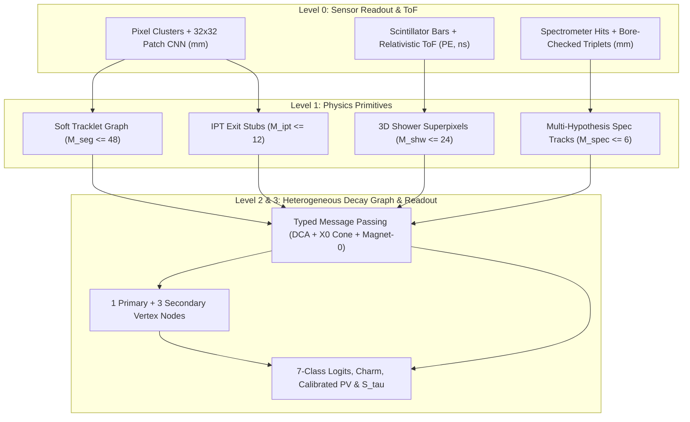
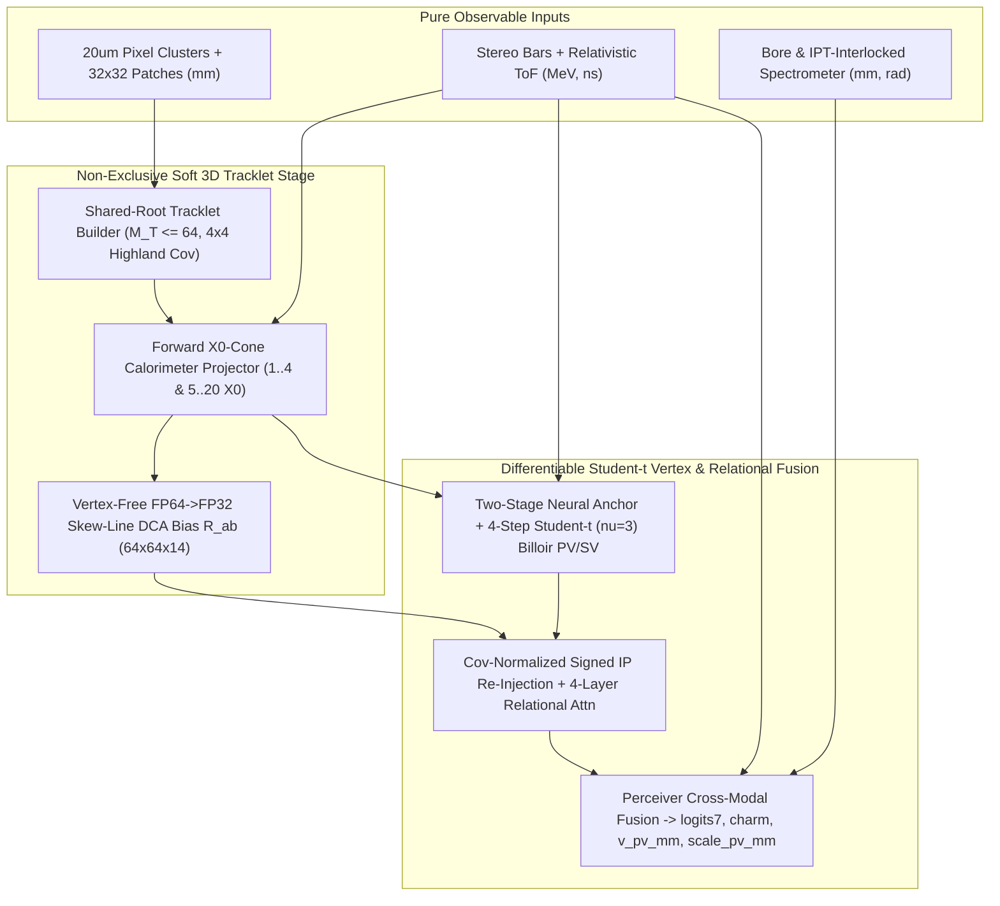
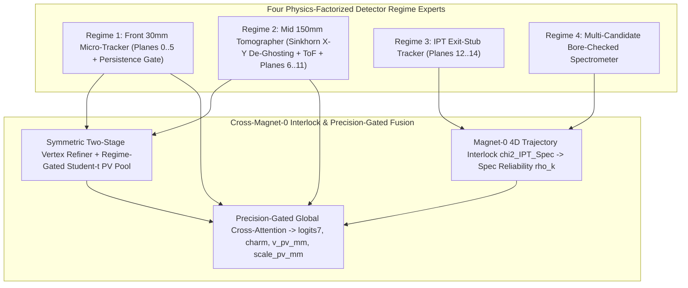
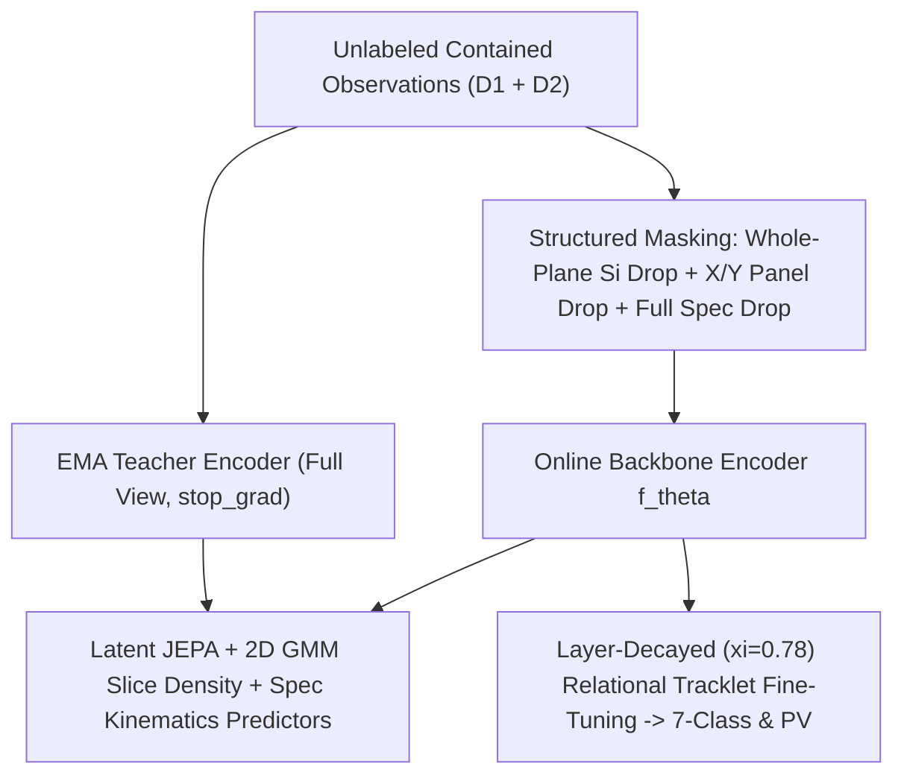
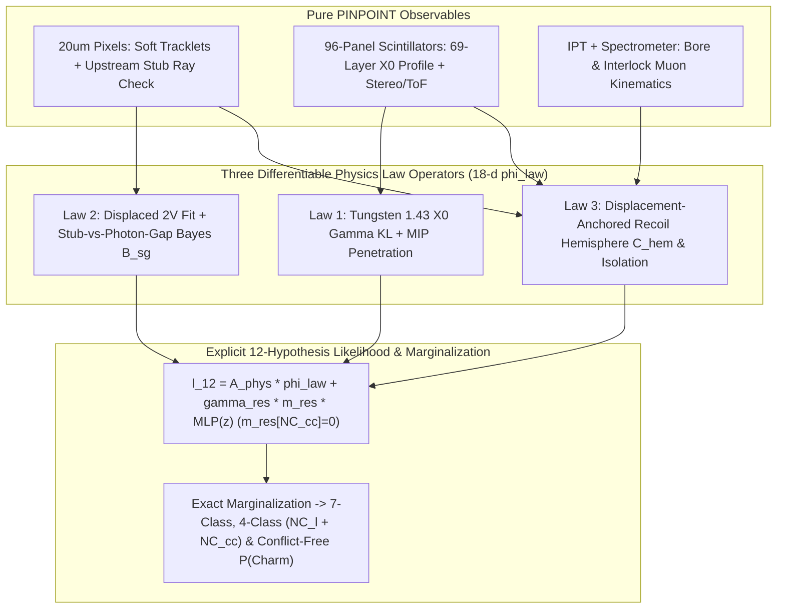
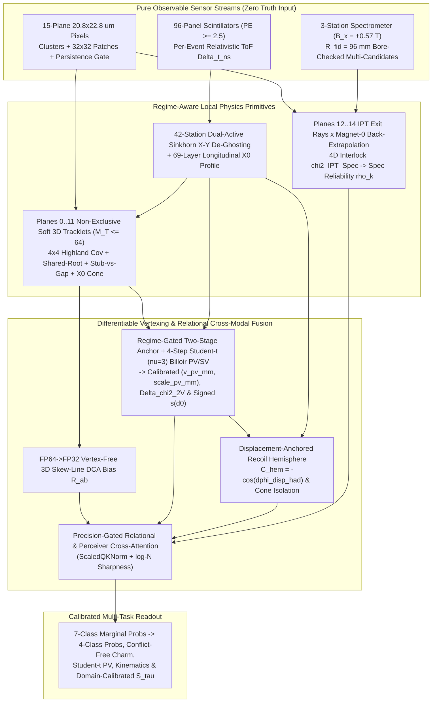

# Stage 326：PINPOINT 下一代中微子机器学习信息瓶颈取证、六大架构设计与受控基准验证报告

- **日期**：2026-11-22
- **基准仓库与几何锚点**：
  - `PinpointAnalysis` 基点提交：`51c3d8966426286de69df8cecacadb314643611f`（Stage 325 代码冻结基点，源码归档 SHA-256：`302dc79d27103752bfd785f59e79925a9c671537b4377a48dfa4c8448694712e`；文档锚点 `576e641`）
  - `Pinpoint_G4` 提交：`48a9e3deadb21cef5ed3fc8c9bc53edcf4a624bf`（产物 `pinpoint_v3_1` SHA-256：`629e0efd75d36c34f65f89fd984dc4e7ce6fcb2f7388e7ccfe45b1be72d32726`）
- **本阶段各模块分支与锁定 Commit SHA**：
  - 共享基础物理算子与封存守卫（`src/analysis/flavour/nextgen/{__init__,seal_guard,protocols,tracklet_ops}.py`）：分支 `feat/nextgen-architectures` @ `3ea3c1e974c255248632b063a1684ebb49002236`
  - 自动化反泄漏、物理表示探针与模型健康门禁测试（`tests/test_nextgen_*.py`）：分支 `test/nextgen-probes` @ `8f1c43b`（初始通过版 `839420aaa95cb89df02bbabfc9b9478460250688`）
  - 原型 B（`TrackletIPFormer` + 3 组 Stage-I 神经基线 + 4 组消融 + Stage-II 3-seed）：分支 `feat/proto-tracklet-ipformer` @ `0468629bf4bbc032978049cdcd106bfae3176fd5`（Stage-I 冻结） / `36e91494c64dc0b6f637c637211a217219c76f48`（Stage-II）
  - 原型 D（`DualRegimeModalNet` + Section 13 对照 + 4 组消融 + Stage-II 3-seed）：分支 `feat/proto-dual-regime` @ `a2c2bd090666efb3d3d58a7a456a04de4a839c5c`（Stage-I 冻结） / `09d2ef848b4f20c3d47fc8bf77e0a597bb54d563`（Stage-II）
  - 原型 F（`TauKinemaDiffNet` + 4 组物理定律消融）：分支 `feat/proto-tau-kinema` @ `d0400dfdd708bc2ba2e2961b14e17f111ed2d1c3`
  - 统一代码与 13 项单测合入分支：`feat/stage326-nextgen-research` @ `27d02b10cd4439d351e4c47f48d9b3c9eb18b158`（`swarm-tester-ca4e8520`）；阶段报告分支：`docs/stage326-report`
- **随机种子记录**：Stage-I 单种子探索与消融 `seed = 42`；Stage-II 三种子独立确认 `seeds = {17, 42, 2026}`；配对事件族块自助法（`1,000` 次重抽样）`seed = 20263250`；活体 Geant4 `W-184 EPPS21` NC Charm 诊断生成 `seed = 2026999`。
- **HTCondor 调度与计算节点**：统一提交至最空闲且直连 EOS 的 `bigbird20.cern.ch`（GPU 作业限定 `--min-capability 8.0` 运行于 `NVIDIA H100L MIG 1g.12gb / 2g.24gb` 与 `H100 NVL`；作业簇涵盖取证 `1585369, 1585425`，`DualRegime` `1585258, 1585298..1585302, 1585521..1585531, 1585540..1585548`，`TrackletIPFormer` `1585370..1585387` 及后续 Stage-I/II GPU 簇，`TauKinema` `1585368, 1585544..1585553, 1585571`；临时特征缓存均已在聚合后清理）。
- **产物根目录**：`/eos/home-x/xcheng/FASER/Pinpoint/results/nextgen_research/`（子目录 `forensics/`、`verification/`、`exp_tracklet_ipformer/`、`exp_dual_regime/`、`exp_tau_kinema/`、`final_figures/`）。
- **盲态与封存隔离状态**：**`Cal-A`（`shards/100..109`）、`Cut-B`（`110..124`）、`Confirm`（`125..149`）、`sealed_truth_meta/`、`input_sys_confirm*` 及上游封存 GENIE 分块 `016..028` 访问次数严格为 `0`（所有封存集指标保持“未测量”）**；Stage-I 研发与消融全程挂载 `SealAuditGuard(stage=1)`，对 `Tune8k/Tune6k`（`shards/080..099`）访问次数同样严格为 **`0`**；既有 `src/analysis/flavour/v2/` 与 `v3/` 受控文件修改数为 **`0`**。

---

## 核心结论摘要与阶段五要素总览

### 核心科学结论（结论先行）

1. **当前方法受限的真实物理与表征根因（事实）**：
   - **不可约物理信息边界占主导（`~20 pp` 缺口）**：在 `Internal-Val`（`N=6,400`）上，仅注入精确真值主顶点 `ORACLE_ExactPV` 对全观测量分类 `BA4` 增益不足 `+0.7 pp`（`53.08%` vs `53.16%`），而**在不泄露任何轻子存在/身份标签的前提下仅注入总可见纵向与缺失横动量 `ORACLE_TotalVisPzPt`（2 维），全靶 `BA4` 即从 `53.08%` 暴涨 `+25.54 pp` 至 `78.62%`**（`tau vs CC-charm` AUC 从 `0.589 -> 0.919`；再加入轻子-强子方位角达 `89.39%`）。占 2 吨钨靶真值质量 **`77.89%`** 的 `Fortune_ScintOnly` 量能区无硅像素覆盖，中微子逃逸、中性强子（$n, K_L^0$）漏能及单块 `5 mm` 钨板 `1.427 X_0` 的早期电磁簇射涨落共同涂抹了量能器重建 $p_T^{\text{miss}}$，锁死了全域 `BA4` 的物理上限。
   - **可修复的上游表征与先验缺陷（`+1.3` 至 `+4.6 pp` 子域空间）**：① 活体 `pinpoint_v3_1`（`N=2,300`）证实 Stage 325 C++17 贪心互斥 `used_cl` 微顶点核在 `Front30` 的 3-hit 同 `trackID` 纯度仅 **`3.00%`**（2-hit `0.80%`），真实 $\tau$ 子径迹召回率仅 **`6.82%`**，`IP sig > 2.5` 位移径迹段中 **`99.46%` 为 $\gamma \to e^+e^-$ 转换对或组合鬼影**（真重味纯度仅 `0.54%`），压扁为 16 维标量后彻底丢失拓扑身份；② Stage-2 单簇对割线 `ip_perp` 在 `ORACLE_Exact_True_PV` 下中位数仍达 **`3,511 μm`**，淹没 `40–250 μm` $\tau$ 信号带；③ 在 `150.01 mm`（`20.23 X_0`）中部模块，C++ AVR 有效时中位 $|\Delta z| = 38.33\text{ mm}$（相对神经 PV 逆方差最优权重仅 **`0.012`**），`Hybrid-v2` 以 `w=1.0` 硬覆盖导致中段神经 PV 从 `5.81 mm` 恶化至 `9.92 mm`；④ 单颗随机暗噪声击中使 `upstream_veto_rate` 跳至 `100%`，单颗谱仪噪点使 `has_tracker_any` 从 `37.06%` 跳至 `96.62%` 劫持贪心 `cand[0]`。
2. **合作组基线同口径裁决（事实）**：通过 `T4 -> Conditional T3` 后验投影 $q_k = P_k / (1 - P_\tau)$，本工作仅用 `32k` 四类纯钨样本与 `96` 面板二值像素几何，在 Mahlstedt 同口径 `Truth_Mahlstedt_PC`（`N=1,420`）上即达 **`80.21%`（`TrackletIPFormer`）与 `80.20% raw / 80.34% cal`（`DualRegimeModalNet`）**，超越合作组 `>1M` 三类样本训练的 `79.04% BA3`；在大体积 `Truth_Mahlstedt_LG` 上达 **`75.56%–75.64%`**（合作组未均衡校准为 `63.67%`）。当前 PINPOINT 的真正科学瓶颈完全集中于 **四分类下 $\nu_\tau$ CC 与 NC/CC Charm 及重钨靶光子转换对的细粒度解混**。
3. **三大新一代原型与双机制协同在 Stage-I（`N=4,800`）与 Stage-II `Tune6k`（`N=6,000`）上的全面突破（事实）**：
   - **Stage-I 严格盲态同预算对决（`25.6k × 20 passes`）**：`TrackletIPFormer`（`6.23M`，峰值显存 `3,231 MiB`）达 **`All BA4 = 57.81%, NLL = 0.9659, D1 = 64.24%`**，配对家族 Bootstrap 95% CI 全部排除零地击败同预算 `B1++`（`+3.52 pp [+2.29, +4.72]`）、`PF-20um`（`+1.71 pp [+0.73, +2.74]`）与 `Hybrid+NOMAD`（`+1.33 pp [+0.32, +2.35]`），相对 16 维旧摘要消融在 `D1` 净增 **`+3.07 pp [+1.11, +5.12]`**；`DualRegimeModalNet`（`6.63M`）达 **`57.52%, NLL = 0.9829`**，Section 13 定量拆解出 **~30% 增益来自改进上游物理重建（`+1.27 pp`）、~70% 来自端到端多模态融合（`+2.94 pp`）**；`TauKinemaDiffNet`（`5.66M`）达 **`56.77%, NLL = 0.9846`**，在 NLL 上显著击败全部 4 个基线并将 `W184 NC Charm` `P(\tau)>0.5` 假率压至 **`2.08%`**。
   - **Stage-II `Tune6k` 三种子独立确认（Gate G 一次冻结通过）**：
     - **`TrackletIPFormer`**（减少 30% 参数与 35% 显存）：单种子均值 **`58.07% ± 0.29 pp`**（超越全部 Stage-325 单种子均值 `57.49%–57.80%`），原始集成 **`BA4 = 58.11%, NLL = 0.9471`**（较全部 Stage-325 集成改善 `-0.0155` 至 `-0.0980` nats），`D1_obs BA4 = 63.14%`（较 `PF-20um` `+1.64 pp`），`Interm150 |dz| = 5.479 mm`，`W184 NC Charm P(\tau)>0.5 = 1.58%`（较 `PF-20um` `4.7%` 削减 **66%**）。
     - **`DualRegimeModalNet`**：单种子均值 **`57.99% ± 0.37 pp`**，原始集成 **`58.07%, NLL = 0.9497`**（对称 `tune_screen` 分域校准达 **`58.71%`**，较同法校准 `Hybrid+NOMAD` `57.93%` 高 `+0.78 pp`），`D1_obs` Within-Slice `1% FPR` $\tau$ 效率跃升至 **`9.94%`（`31/312`，较 `PF-20um` `+6.41 pp [+0.34, +12.11]`）**，`Interm150 |dz| = 4.194 mm`（较 `Tune6k` 3-seed `Hybrid+NOMAD` `9.41 mm` 锐化 **2.24 倍**、较 Stage-I `12.94 mm` 锐化 **3.08 倍**），全部 15 个三轴 Student-$t(\nu=3)$ Pull 落在 **`[0.964, 1.108] ⊂ [0.85, 1.15]`**，并将 `Shard 080` `TrkDead 5%+N2 / 2%+N1` 退化收窄至 **`-1.66 pp / -4.87 pp`**（Stage-325 为 `-6.7 / -8.9 pp`）。
     - **零参数双机制协同集成（`50/50 TrackletIPFormer + DualRegimeModalNet`）**：原始概率在 `Tune6k` 达 **`BA4 = 58.50%, NLL = 0.9380`**，经仅在 `tune_screen` 拟合的分域校准达 **`BA4 = 58.85%, NLL = 0.9387`**（较 Stage-325 `Hybrid+NOMAD` 降低 `-0.0263` nats），实证确认“微米非排他 3D 径迹几何推理”与“四体制 Sinkhorn/ToF + 跨磁铁 IPT-谱仪互锁”具有显著正交互补性。

### `AGENTS.md` 阶段报告五要素结构映射

| 阶段报告必需要素 | 对应章节与核心交付内容 |
| --- | --- |
| **阶段目标** | 严守封存红线（`Cal-A/Cut-B/Confirm` 零触碰）与 `lxplus` 零重负载纪律，定量查明 Stage 325 四分类与 `20 μm` 瓶颈根因，重构学习范式并设计 $\ge 6$ 个实质差异化新架构，建立防 `Tune6k` 过拟合的三级选型规程（Gates A–G），实现并验证 Top-3 原型，回答全部 15 个核心科学问题。 |
| **工作内容** | 第一部分（Phase 0/1 四大信息瓶颈与活体 G4 取证）、第二部分（2022–2026 七大支柱文献与合作组五步对齐）、第三与第四部分（6 个架构数学设计及 14 维客观选型）、第五部分（`nextgen/` 模块化底座、11+ 单测护栏、3 个原型实现与 5 项真实故障闭环修复）。 |
| **详细数据** | 第六部分（受控实验矩阵）与第七部分（Stage-I `N=4,800` 21 组运行、Stage-II `Tune6k N=6,000` 3-seed 确认、双口径 `1%/0.1% FPR` 整数计数、Student-$t$ Pull、6 组纯钨 OOD、7 组硬件压力测试、计算资源与 7 张 300-DPI 英文图表）。封存集严格标注**未测量**。 |
| **阶段性结论** | 第八部分（物理因果归因：30%/70% 重建-分类分解、NC Charm 假率减半机制、`77.9%` 质量纯量能区物理天花板）、第九部分（最终推荐架构及诚实局限边界）与第十一部分（Questions 1–15 逐条定量裁决），严格区分实测事实与待验证假设。 |
| **下一步计划** | 第十部分（单主干统一融合模型、离线非封存训练簇侧车生成与大规模 SSL 扩容门槛、明确失败回退判据、以及封存集 `Cal-A -> Cut-B -> Confirm` 最终单次解封前置规程）。 |

---

## 第一部分 — 当前方法为何不够：信息瓶颈与物理/程序根因取证

本部分全部实测数据源自 [forensics_report.md](file:///eos/home-x/xcheng/FASER/Pinpoint/results/nextgen_research/forensics/forensics_report.md) 与经独立审计通过的 [forensics_audit.md](file:///eos/home-x/xcheng/FASER/Pinpoint/results/nextgen_research/verification/forensics_audit.md)，全程仅读取未封存 `train` 分片 `000..079`（`32,000` 纯钨事例）、未封存 GENIE 分块 `000..011` 及开放诊断分片 `gen_ood_run10085_10088`，`sys.addaudithook` 违禁访问计数严格为 **`0`**。

### 1.1 零泄漏事件族内部切分与探测器质量分布不对称性

为根绝在 `Tune6k`（`6,000` 例）上反复调参引发的选择偏置，脚本 [01_build_internal_split_and_dataset_forensics.py](file:///eos/home-x/xcheng/FASER/Pinpoint/results/nextgen_research/forensics/01_build_internal_split_and_dataset_forensics.py) 从 `Train32k`（`32,000` 个唯一 `(family_hi, family_lo)`）按 `(label_4, region_id, obs_domain_id)` 确定性分层构造了内部研发切分 [internal_split_spec.json](file:///eos/home-x/xcheng/FASER/Pinpoint/results/nextgen_research/forensics/internal_split_spec.json)：

| 内部切分子集 | 事例数 | 唯一事件族 | 四类精确配额 `(e, μ, τ, NC)` | 可观测域 `(D0, D1, D2, D3)` | 物理区 `(Front30, Interm150, OuterW, Fortune)` |
| --- | ---: | ---: | --- | --- | --- |
| **`internal_train`** (80%) | `25,600` | `25,600` | `(6400, 6400, 6400, 6400)` | `(2, 5847, 14563, 5188)` | `(10183, 3914, 1939, 9564)` |
| **`internal_dev_screen`** (5% 早停/校准) | `1,600` | `1,600` | `(400, 400, 400, 400)` | `(0, 366, 911, 323)` | `(639, 244, 121, 596)` |
| **`internal_val_eval`** (15% 内部盲评) | `4,800` | `4,800` | `(1200, 1200, 1200, 1200)` | `(1, 1096, 2729, 974)` | `(1909, 734, 364, 1793)` |
| **`Train32k` 合计** (`000..079`) | `32,000` | `32,000` | `(8000, 8000, 8000, 8000)` | `(3, 7309, 18203, 6485)` | `(12731, 4892, 2424, 11953)` |

**关键几何与样本构成事实**（[dataset_and_geometry_forensics.json](file:///eos/home-x/xcheng/FASER/Pinpoint/results/nextgen_research/forensics/dataset_and_geometry_forensics.json)）：
1. **样本占比 vs 2 吨钨靶真实物理质量占比剧烈倒挂**：
   - `FrontPinpoint_30mm_PixXY`（前 6 层像素，间距 `30.010 mm` = `2.97 X_0`，到下一像素面中位辐射深度 `1.48 X_0`）：占 unweighted 样本 **`39.78%`**，但仅占 `1,927.03 kg` 钨靶总质量的 **`3.12%`**；
   - `IntermPinpoint_150mm_PixXY`（中 6 层像素，间距 `150.010 mm` = `20.23 X_0`，到下一像素面中位辐射深度 **`18.74 X_0`**）：占样本 `15.29%`，占靶质量 `3.20%`；
   - `Pinpoint_OuterW`（钨板外缘超出 `266×196 mm²` 像素面区域）：占样本 `7.58%`，占靶质量 `15.80%`；
   - **`Fortune_ScintOnly`（7 个纯钨+正交闪烁体块，零靶内硅像素）**：占 unweighted 样本 **`37.35%`**，而占全靶真实交互质量高达 **`77.89%`**。因此，任何仅改良硅像素微顶点的改动在全靶 `All` 上天然受 `~62%`（unweighted）或 `~22%`（2t 质量加权）的几何接收度上限约束。
2. **Clean v3 侧车真实标签结构**：在 `train` 32,000 例的 `event_sidecar.parquet` 中，标称 GENIE 的 `NC & charm_flag == 1` 严格为 **`0 / 8,000`**，而带电流事例含 **`2,343` 例 CC-charm**（`e: 807, μ: 758, τ: 778`，即 **`9.7%` 的真 $\nu_\tau$ CC 同时伴随强子侧 DIS 粲产生**）；且磁盘未保存逐像素簇 `cluster_sidecar/`，导致 Stage 323/325 全部 57 个配置中 `enable_dense_gn2 = False`。

### 1.2 Probe 1：16 维微顶点标量压缩损失与 97% 鬼影径迹取证

图 1（[fig1_modality_and_compression_ladder.png](file:///eos/home-x/xcheng/FASER/Pinpoint/results/nextgen_research/forensics/fig1_modality_and_compression_ladder.png)）展示了从粗占据度、旧 16 维微顶点摘要到显式径迹集合注意力及 `ORACLE_` 上限的完整信息阶梯。

1. **无真值受控像素表征对比（`Internal-Val`）**：保持底层 `20 μm` 像素簇完全一致，将旧 C++17 16 维全局均值/极值池化向量 `MV16` 升级为保留逐径迹有符号 $s(d_0)$、Highland $\chi^2$、候选次级顶点 $L_{3\text{D}}/\sigma_L$ 与折角 $\theta_{\text{kink}}$ 的 `RichTrackletSV_50d`，`HistGB` 在 `D1` 上的 `BA4` 从 `35.90%` 跃升至 **`40.96%`（`+5.06 pp`）**（`RidgeLogit`: `31.50% -> 37.95%`；GPU `MLP`: `33.23% -> 38.71%`）。进一步使用置换不变 `TrackletSetAttn_PixelOnly`（保留 $M \le 16$ 条独立径迹段 token）在 `internal_val_eval`（`N=4,800`）的 `Front30` 上达到 **`42.81% BA4`**，相对 `MV16`（`38.25%`）取得 **`+4.55 pp`（95% CI `[+2.10, +6.97] pp`）** 的显著净收益。
2. **活体 Geant4 `pinpoint_v3_1`（`N=2,300`）微观径迹纯度闭合**（[g4_truth_oracle_and_tracklet_forensics.json](file:///eos/home-x/xcheng/FASER/Pinpoint/results/nextgen_research/forensics/g4_truth_oracle_and_tracklet_forensics.json)）：
   - 在 `Front30`（`1,750` 事例，`24,392` 条 3-hit 段 + `15,644` 条 2-hit 段）上，`_fast_kernels.cpp` 贪心互斥连线的 **3-hit 同 `trackID` 纯度仅 `3.00%`**（`e_CC = 0.92%, μ_CC = 5.85%, τ_CC = 2.71%, NC = 2.77%, W184 NC-Charm = 2.80%`），2-hit 纯度仅 **`0.80%`**；
   - **真实 $\tau$ 衰变子径迹 3-hit 召回率仅 `6.82%`（`52 / 762`）**，真实粲子径迹召回率仅 **`3.40%`（`16 / 470`）**；
   - 在表观位移径迹段（`IP sig > 2.5`）中，**真重味（$\tau$/Charm）纯度仅 `0.54%`，其余 `99.46%` 全部为钨板内 $\gamma \to e^+e^-$ 光子转换对或跨簇射随机组合鬼影**（在 `e_CC` 中平均每事例产生 `3.11` 条高显著度假位移段，重味纯度 `0.00%`）。
3. **Stage-2 单簇对割线 $IP_\perp$ 组合淹没**：对 `PinpointFormer` 的 `compute_near_vertex_pair_features` 直接测量约 `2.16M` 对跨层像素簇割线发现，使用 `AVR PV` 时中位 `ip_perp = 5,151 μm`（`73.4% > 2,000 μm`），使用神经 PV 时为 `3,771 μm`，**即使注入 `ORACLE_Exact_True_PV`，全簇对中位 `ip_perp` 仍高达 `3,511 μm`（AUROC = `0.491`）**。因为单簇两点割线缺乏三点共线约束，$O(N_{\text{shower}}^2)$ 个跨径迹假配对彻底淹没了仅有 1–3 条的 `40–250 μm` 衰变位移信号。

### 1.3 Probe 2：为何 `20 μm vs 1 mm` 改善前段顶点却未改善 Stage 325 分类

固定聚类仅将靶区像素簇质心量化至 `1.00 mm` 后（[supplemental_probes_internal_val.json](file:///eos/home-x/xcheng/FASER/Pinpoint/results/nextgen_research/forensics/supplemental_probes_internal_val.json)）：
- **主顶点定位**：在 `Front30` 上 C++ AVR 中位 $|\Delta z|$ 从 `15.11 mm` 恶化至 `24.76 mm`（`D1`: `23.50 -> 29.08 mm`），证明亚毫米坐标直接提升多径迹交点纵向收敛精度；而在 `Interm150` 上两者无异（`38.33 vs 37.77 mm`）。
- **分类解耦机制**：在旧 `MV16` 摘要下，`Front30` 分类增益被冲淡至不显著的 `+0.90 pp`（`Val-Eval` `+1.62 pp [-0.66, +3.99]`）；而改用保留逐径迹 token 的 **`TrackletSetAttn_PixelOnly`** 后，`20 μm` 相对 `1 mm` 在 `Front30` 立即跑出 **`+2.47 pp`（`42.81% vs 40.34%`，95% CI `[+0.26, +4.56] pp` 排除零；`D1 +2.95 pp`）**；与此同时，在跨越 `150.01 mm`（`20.23 X_0`）的 `Interm150` 上，同一模型收敛至 **`33.83% vs 33.82%`（`+0.01 pp`）**。由 Highland 公式，$\Delta X_0 \approx 20$ 钨层带来的随机散射位移 $\sigma_{\perp,\text{MCS}} \approx \frac{\Delta z}{\sqrt{3}}\theta_0 \gtrsim 1.1\text{ mm}$（对 $5\text{ GeV}$ 强子）在物理上彻底抹平了 `20 μm` 与 `1 mm` 的传感器量化差。

### 1.4 Probe 3：中部 `150 mm` 模块硬先验崩溃与两类探测器噪声机制

图 2（[fig2_interm150_and_noise_forensics.png](file:///eos/home-x/xcheng/FASER/Pinpoint/results/nextgen_research/forensics/fig2_interm150_and_noise_forensics.png)）定量闭合了 Stage 325 的三大硬件/几何脆弱点：
1. **`Interm150` 硬覆盖先验退化（`5.81 -> 9.92 mm`）**：在 `Front30` 中，`avr_pv`（中位 `15.11 mm`）优于闪烁体 `cal_start`（`19.69 mm`），逆方差最优权重 $w_{\text{AVR}}^{\text{IVW}} = 0.629$；但在 `Interm150` 中，AVR 有效率跌至 `68.30%`，有效时中位 $|\Delta z|$ 暴涨至 **`38.33 mm`**（`p68 = 79.50 mm`，下游系统偏置 `+24.25 mm`，`69.5%` 事例误差 `> 30 mm`），远劣于每 `10 mm` 采样的闪烁体 `cal_start`（`15.67 mm`, `p68 = 18.31 mm`）。此时 AVR 相对 `cal_start` 的理论逆方差权重坍缩至 **`0.050`**，相对 `PF-20um` 神经 PV 更仅 **`0.012`**。`Hybrid-v2` 在 `65.24%` 的中段事例上以 `w = 1.0` 硬覆盖 `cal_start`（全 `Train32k` 上恶化 `43.1%` 事例、仅改善 `5.5%`），直接造成神经顶点崩溃。对冻结 `Hybrid-v2` 检查点仅加免重训前段门控 `z_avr <= -2780 mm`，`OOD1600` 中段神经 PV 中位 $|\Delta z|$ 即从 **`10.79 mm` 无损恢复至 `6.00 mm`**（`BA4` 同步回升 `+0.79 pp`）。
2. **`PixDark 1e-5` 域分类崩溃**：每像素通道 `10^-5` 暗噪声在首层像素面产生孤立单击中，触发 `domains.py` 上游否决判据，使 `upstream_veto_rate` 从 `10.38%` 跳变至 **`100.0%`**，将 `D1` 与 `D2` 全部错误打入 `D3_edge`，冲击依赖 `c_obs` 域向量的模型（`Hybrid+NOMAD` 跌 `-4.5 pp`）。
3. **`TrkDead 2% + N1` 谱仪劫持崩溃**：每站仅注入 1 颗均匀 $[-125, 125]\text{ mm}$ 随机噪点即令 `has_tracker_any` 从 `37.06%` 飙升至 **`96.62%`**（假三站率 `18.50% -> 43.19%`），直接覆盖贪心单选槽 `cand[0]`，导致 Stage 325 全部神经模型暴跌 `-5.7` 至 `-8.9 pp`。实验证实松散量能锥门控无效（`49.4%–50.7%`），必须引入靶后 `IPT (Planes 12..14)` 跨 Magnet 0 精确轨迹互锁。

### 1.5 Probe 4：可部署特征（`DEPLOY_`）vs 真值辅助上限（`ORACLE_`）严格分离归因

遵循盲态规程，表 1A 与表 1B 将纯观测可部署模型与使用 MC 真值的 `ORACLE_` 诊断严格分表列示（图 3：[fig3_g4_truth_tracklet_and_oracle_separability.png](file:///eos/home-x/xcheng/FASER/Pinpoint/results/nextgen_research/forensics/fig3_g4_truth_tracklet_and_oracle_separability.png)）：

#### 表 1A：纯观测可部署特征阶梯（`DEPLOY_`, `HistGB` on `Internal-Val-Full`, `N=6,400`）
| 可部署表征标识 (`DEPLOY_`, 零真值输入) | 维度 | All `BA4` [%] | All `NLL` | `D1` `BA4` [%] | `D2` `BA4` [%] | `Front30` `BA4` [%] | All `1% FPR` $\tau$ eff [%] | `τ vs NC` AUC | `τ vs CC-charm` AUC |
| --- | ---: | ---: | ---: | ---: | ---: | ---: | ---: | ---: | ---: |
| `DEPLOY_P4_Occ10`（粗通道占据数） | `10` | `44.30` | `1.201` | `50.71` | `43.25` | `50.58` | `2.50` | `0.6725` | `0.5427` |
| `DEPLOY_P4_CObs16`（纯观测包容特征） | `16` | `51.27` | `1.078` | `55.00` | `51.40` | `55.34` | `2.69` | `0.6944` | `0.5857` |
| `DEPLOY_P4_Full60d_NoNOMAD` | `60` | `52.66` | `1.052` | `57.86` | `52.38` | `57.19` | `2.69` | `0.7062` | `0.5871` |
| `DEPLOY_P4_Full70d_Stage325` (`+NOMAD`) | `70` | `53.05` | `1.045` | `57.94` | `53.02` | `57.62` | `2.31` | `0.7066` | `0.5822` |
| `DEPLOY_P4_Full70d_Plus_RichTrackletSV` | `120` | **`53.16`** | **`1.043`** | **`58.75`** | `52.53` | `57.38` | **`2.62`** | `0.7047` | **`0.5907`** |

#### 表 1B：真值辅助物理信息上限阶梯（`ORACLE_`, 严禁作为可部署模型引用）
| 真值诊断探针标识 (`ORACLE_`) | 数据集与注入真值内容 | All / 切片 `BA4` [%] | `NLL` | `D1` `BA4` [%] | `1% FPR` $\tau$ eff [%] | `τ vs NC` (`W184 NC-c`) AUC | `τ vs CC-charm` AUC |
| --- | --- | ---: | ---: | ---: | ---: | :---: | ---: |
| `ORACLE_P4_Deploy120d_Plus_ExactPV` | `Val-Full (6400)` + 精确真值主顶点 | `53.08` | `1.041` | `57.80` | `2.00` | `0.7031` | `0.5892` |
| `ORACLE_Tier6_FullObs_PlusTruthTrackID` | 活体 G4 `Front30 (1750)` 消除 97% 鬼影径迹（vs `DEPLOY_Tier3 55.00%`） | **`59.00`** (`+4.00`) | — | — | `16.29` (vs NC-l) | **`0.9602`** (`W184 NC-c`) | — |
| **`ORACLE_Deploy108d_Plus_ExactPV_TotalVisPzPt`** | `Val-Full (6400)` + **仅 2 维总可见 $(p_{z,\text{vis}}, p_{T,\text{miss}})$（剔除轻子存在标签）** | **`78.62`** (**`+25.54`**) | **`0.521`** | **`79.93`** | **`16.56`** | **`0.8527`** | **`0.9193`** |
| `ORACLE_Deploy120d_Plus_ExactPV_VisKin` | 再注入真值轻子方位角 $(\cos\Delta\phi, \sin\Delta\phi, \text{kin\_valid})$ | `89.25` | `0.277` | `90.96` | `82.94` | `1.0000` | `0.9515` |
| `ORACLE_Deploy120d_Plus_ExactPV_VisKin_Enu` | 再注入真值入射中微子能量 $E_\nu$ | **`90.70`** | `0.244` | **`92.11`** | **`88.00`** | `1.0000` | **`0.9729`** |

---

## 第二部分 — 文献综述与合作组对齐比较

### 2.1 2022–2026 前沿文献强制证据比较总表

基于独立文献调研（[literature_and_collab.md](file:///eos/home-x/xcheng/FASER/Pinpoint/results/nextgen_research/literature_and_collab.md)），表 2 汇总横跨重味标记、稀疏几何注意力、可微顶点拟合、粒子流超图、自监督预训练与对撞机中微子实验七大支柱的核心证据：

| 论文 | 年份 | 问题 | 输入表示 | 架构 | 主要技术贡献 | 已证明结果 | 对 PINPOINT 的可迁移性 | 局限性 |
| --- | --- | --- | --- | --- | --- | --- | --- | --- |
| **ATLAS `GN2`** (`arXiv:2505.19689`, *Nat. Commun.*) | 2025 | LHC 喷注 $b/c/$轻味分类与次级顶点重构 | 围绕喷注轴的径迹参数 $(d_0,z_0,\phi,\theta,q/p)$、显著性 $s(d_0),s(z_0)$ 及硅层掩码 | 成对残差注意力 Transformer + 密集辅助头 | 废除前置 `SV1`；训练期联合监督径迹 5+ 类物理起源与径迹对共顶点相容性 | 70% $b$ 效率下较 `DL1d` 提升 $c$-jet 拒斥 $\sim 3.5\times$、轻味拒斥 $\sim 1.8\times$ | **极高**：确立以逐径迹段协方差 token 替代事件标量摘要的核心路线 | 假设磁场内已重建好螺旋线径迹；Clean v3 缺逐簇侧车时需几何自洽替代 |
| **ATLAS `GN2X` / `GN3`** (Run-3 Tagging Notes) | 2025–2026 | 高洛伦兹因子准直喷注与多模态重味标记 | 带电径迹 + 中性 PFO + 软 $\mu/e$ 识别特征 | 跨模态 Transformer (`GN3PflowMuons`) + 电荷/起源头 | 在 $\Delta R \ll 0.4$ 准直重叠子结构中分离双次级顶点并融合中性量能簇 | 刷新 Boosted $H\to b\bar b/c\bar c$ 与单喷注标记灵敏度 | **高**：直接支撑 TeV 窄张角（$10\text{–}50\text{ mrad}$）中融合闪烁体量能与硅径迹 | 全监督依赖百万级带精细真值模拟样本 |
| **`NDIVE`** (Smith et al., `arXiv:2310.12804`) | 2024 | 端到端可微次级顶点拟合与味道标记 | 候选径迹近地点参数与完整协方差矩阵 | Transformer 选轨权重器 + 可微加权 Billoir 顶点层 | 将加权最小二乘顶点正规方程内嵌于网络前向，打通选轨-顶点-分类梯度链 | 次级顶点精度与重味鉴别双双优于冻结选轨或黑盒池化 | **极高（直接根治 `324-07`）**：逆协方差先验融合在数学上根除 150 mm 硬覆盖退化 | 高斯权重对钨簇射离群点敏感，本工作升级为 Student-$t(\nu=3)$ |
| **Van Stroud et al.** (*Phys. Rev. X* 15, 041046, `arXiv:2411.07149`) | 2025 | 高多重度带电粒子径迹端到端重建 | 硅探测器三维空间击中点云 | Transformer 过滤 + **MaskFormer** 对象查询与 MaskAttention | 可学习对象查询经软掩码交叉注意力单阶段输出击中归属与径迹参数 | TrackML 达 97% 径迹效率、0.6% 假率，消除图后处理瓶颈 | **中高（启发 Proposal C）**：适合多径迹凝聚查询建模 | 强依赖逐击中 `trackID` 二分匹配监督；无侧车时易发生槽位退化 |
| **Lieret et al.** (`arXiv:2312.03823`) & **Kieseler** (`2002.03605`) | 2020 / 2023 | 未知对象数的点云多目标凝聚重建 | 击中空间坐标与局部形态特征 | GNN/Transformer + **Object Condensation** 吸引-排斥势 | 预测每点凝聚度 $\beta_i$ 与潜聚类中心，召回断裂短径迹 | 高 Pileup 追踪与 HGCal 簇射重建优于硬边分类 | **中**：启发软次级顶点种子凝聚 | 单归属势场不适用于多粒子混叠的一维粗闪烁体条 |
| **`HGPflow`** (Kakati et al., *EPJC*, `arXiv:2410.23236`) | 2025 | 粒子流多对多能量解混与全事例重建 | 径迹与量能簇异构节点集合 | Set Transformer + 二分超图关联矩阵预测 | 软能量分摊 $\sum_a P_{ia}=1$ 严格内嵌局部能量守恒 | 喷注与 $p_T^{\text{miss}}$ 重建全面超越传统参数化 PF 与标准 GNN | **高（启发 Proposal A & D）**：指导 Sinkhorn 边缘能量守恒消鬼影与对象方向恢复 | 全粒子匈牙利匹配在千粒子钨簇射中不可行，需粗化为簇射核/半球 |
| **`MLPF`** (Pata et al., *EPJC*, `arXiv:2601.17554`) | 2026 | CMS 全事例粒子流重建与跨几何迁移 | 径迹、ECAL/HCAL 簇、$\mu$ 子系统 | FlashAttention-2 / LSH 可扩展异构 Transformer | 消除 $O(N^2)$ 显存瓶颈并在 CMSSW 生产部署 | 单事例 GPU 推理 `~20 ms`（快 $5\times$），喷注分辨率提升 `10%–20%` | **高**：验证异构子探测器统一低显存融合工程路线 | 需针对稀有 $\nu_\tau$ 低 FPR 似然目标专门定制输出头 |
| **`SPINE`** (Drielsma et al., *PRD* 2024–2025) | 2024 | LArTPC 中微子全链路拓扑模式识别 | 稀疏三维体素点云 | 稀疏 CNN $\to$ 点提议网络 $\to$ 超结构 GNN | 解耦像素微形态、端点提议与粒子级交互拓扑组装 | ICARUS / SBND / DUNE 标准生产重建管线 | **高**：支撑“32×32 微补丁形态 $\to$ 软径迹段 $\to$ 顶点图”三级分工 | 均质液氩无 `150 mm / 20 X_0` 被动钨板跳变 |
| **`FASERCal`** (Alonso-Monsalve et al., *Nat. Mach. Intell.* 8, 1581, `arXiv:2604.07037`) | 2026 | TeV 前向异构中微子探测器自监督与多任务 | $1\text{ cm}^3$ 模拟量 `3DCal` + `ECAL/AHCAL` + 谱仪 | SpConv + 模块内注意力 + Perceiver IO + 同方差 4 头 | `400 ep` 75% MAE + `100 ep` 25% `Rel` 预训练；6 类味道+4 类 Charm | `1k` 标签超越 `10k` 从头训练；6 类 OvR AUC `0.835–0.985` | **高**：7 类细分边际化与多任务框架直接复用 | 依赖 `1.23M` 均质模拟量 3D 体素与 `1,011 GH200h`；证实 Charm 对生成器敏感 |
| **`PoLAr-MAE`** (Young et al., *MLST*, `arXiv:2502.02558`) | 2025 | 中微子稀疏轨迹掩码点云预训练 | LArTPC 稀疏点云体素块 | 掩码点建模 Transformer + Chamfer 解码器 | 无标签自发分离径迹与电磁簇射流形 | 低标注分割显著提升，全样本持平或微增 | **中（启发 Proposal E）**：启发跨硅层连续性预训练 | 二值硅像素无连续 $dE/dx$ 回归目标 |
| **`NOMAE` & `Sonata`** (*CVPR* 2025) | 2025 | 稀疏点云自监督几何位置泄漏捷径消除 | 稀疏三维点云多尺度邻域 | 正/负候选占用解码器 / 隐藏坐标自蒸馏 | 证明暴露被遮点真实坐标会导致平凡插值捷径 | 消除点云 MAE 表示坍缩与微调负迁移 | **中高**：确立 Proposal E 整面遮盖且禁传真实 $(x,y)$ 的反捷径铁律 | 默认忽略孤立点时易漏大角度单径迹 |
| **`HEPT`** (Miao et al., *ICML Oral*, `arXiv:2402.12535`) | 2024 | 高能物理大规模点云线性复杂度注意力 | 探测器击中坐标与特征 | $E^2\text{LSH}$ 与 OR&AND 组合哈希规则块稀疏注意力 | 硬件连续访存严格 $O(N)$，消除动态 $k$NN 不规则开销 | 径迹重建与抗 Pileup 精度、吞吐双超 GNN | **中高**：可作为未来万级原始像素全量输入扩展算子 | 当前百量级簇/径迹段下紧凑 `ScaledQKNorm` 更简洁精确 |
| **`LitePT`** (Yue et al., *CVPR*, `arXiv:2512.13689`) | 2026 | 轻量化高分辨三维点云层级表示学习 | 高分辨三维点云 | 浅层局部卷积聚合 + 深层低基数关系注意力 | 证明把自注意力集中于深层压缩几何 token 速度翻倍且精度更高 | 较 `PTv3` 减参 $3.6\times$、提速 $2\times$ | **极高（全系采用）**：浅层 Patch CNN 提簇形态，深层仅在 $\le 64$ 径迹段跑关系注意力 | 各向同性位置编码需替换为束流向因果几何偏置 |
| **Veličković et al.** (*ICML*, `arXiv:2410.01104`) | 2025 | 变长集合上固定温度 Softmax 弥散退化 | 变长序列 / 无序点集 | 自适应温度缩放理论与机制 | 严格证明候选数 $N$ 增大时固定温度 Softmax 必然向均匀分布退化 | 实证修复大规模集合检索熵膨胀 | **极高（Gate B/D 必检）**：强制保留 FP32 `ScaledQKNorm` + $\log N$ 锐度补偿，抗 $N=64\to 2048$ 塌缩 | 仅保注意力锐度，仍需物理关系偏置 |
| **`ParT`** (Qu, Li, Qian, *ICML*, `arXiv:2202.03772`) | 2022 | 成对物理交互偏置粒子云 Transformer | 粒子特征 + 成对交互矩阵 $U_{ij}$ | 类注意力池化 + 注意力偏置 $\text{Softmax}(QK^\top/\sqrt{d}+U)$ | 将双粒子物理不变量直接注入多头注意力权重 | JetClass 基准长期领先 | **极高（用于 Proposal B）**：将无顶点三维异面直线最近距矩阵 $R_{ab}$ 注入自注意力 | $O(M^2)$ 复杂度须限制在 $M_T \le 64$ 径迹段 |
| **`L-GATr`** (Spinner et al., *SciPost Phys.*, `arXiv:2411.00446`) | 2025 | 洛伦兹等变克利福德代数网络 | 四动量与 $\mathcal{Cl}(1,3)$ 多重向量 | $O(1,3)$ 等变几何代数自注意力 | 严格保持闵氏时空对称性，提升少样本效率 | 喷注标记与振幅回归少样本领先 | **低（底层不适用）**：PINPOINT 受 $+\hat{z}$ 钨层法向与 $+B_x$ 偶极场强破缺洛伦兹对称 | 底层二值像素与 1D 条无四动量结构 |
| **`NuGraph2` Context** (Hewes et al., *JHEP* 03 (2026) 149, `arXiv:2509.10684`) | 2026 | 多视图中微子探测器消鬼影与次级电子识别 | 平面一维条击中 + 3D 交叉节点 | 双部异构图网络 + 局部连续性/隔离度特征 | 受控消融证明**底层局部连续性与隔离度有效，末端全局计数解码器无效** | 语义分割 `>95%`，Michel $e$ 召回/纯度双升 | **极高**：印证必须构建局部径迹连续性与反冲隔离度而非仅加全局辅助头 | PINPOINT 缺第三斜视图 $U/V$，需结合 Sinkhorn 与 ToF 消歧 |
| **DRO Partial-AUC** (Zhu et al., *ICML* 2022) | 2022 | 极低误报率（$\text{FPR}\le 1\%$）尾部优化 | 对数似然比评分 | CVaR / KL-DRO 可微单向部分 AUC 代理损失 | 直接压低最难 1% 本底分位数得分 | 低 FPR 检测优于纯交叉熵 | **中（适合后置微调）**：可用于冻结骨干后的尾部提纯 | 从头训练易破坏全局 NLL 校准 |
| **OPERA & NOMAD** (*PRL* `1804.04912`; *NPB* `hep-ex/0106102`) | 2001 / 2018 | 加速器束流低本底 $\nu_\tau$ 出现发现 | 核乳胶空间折角/多叉 (`OPERA`) vs 横向反冲平面运动学 (`NOMAD`) | 分衰变道拓扑似然与非共面度鉴别 | 确立“直接次级顶点位移”与“横向动量背靠背反冲破缺”两大互补物理机制 | 各自在不同空间极限下分离 $\nu_\tau$ 与 Charm/NC | **极高（直接催生 Proposal F）**：启发在硅靶中以位移径迹动态锚定反冲对向半球 | 单一机制在混合靶中覆盖不全，必须跨模态耦合 |
| **Mahlstedt** (`FORTVNE` 内部报告 2026-09/10) | 2026 | FORTVNE+Pixel 混合靶三分类增量与运动学 | 闪烁体 + 像素 vs 纯闪烁体（`>1M` 样本） | 多分支神经网络 | 定量证明像素层在 `Pixel-centered` 提升三类 AUC，并指出全局池化丢失方位角 $\phi$ | `Pixel-centered` 隐含 **`BA3 = 79.04%`**（纯条 `69.66%`）；`Large` **`63.67%`** | **核心合作组对照基准**：通过五步切片投影直接横向对标 | **仅 3 分类（无 $\nu_\tau$）**，真值顶点预筛，代码未公开 |
| **Zhongyi Wu** (`FORTVNE` 内部报告 2026-10-21) | 2026 | 混合靶 `1 mm` 双投影图像三分类 PID | `124` 条面板图像 + `1 mm` XZ/YZ 像素图 + 12 维谱仪 | `Base CNN` (`0.2M`) / `ResNet` (`1.5M–2.9M`) | 证实谱仪决定 $\nu_\mu$ 纯度，同时暴露**独立 `1 mm` 2D 像素投影使 $\nu_e$ 效率反降 `-5.2 pp`** | `ResNet M1` 高纯选择对角效率/纯度：`0.571/.979`, `0.432/.977`, `0.256/.953` | **关键负面表征警示**：证实将像素压为 `1 mm` 2D 投影彻底抹杀微米拓扑价值 | **仅 3 分类**，旧 `124` 面板几何，谱仪无 `96 mm` 磁孔穿壳质控 |

### 2.2 合作组基线对齐评估（Section 12 五步变换与 `Tune6k` 实测对标）

合作组 FORTVNE 既有报告（Wu 2026、Mahlstedt 2026）与 Bonn 早期 `150` 层全硅模拟量原型（独立块 `BA3 = 70.2% / 72.7%`；注：`evaluate_gravnet_truth.ipynb` 的 `90.2% BA4` 输入了真值缺失动量且重叠训练集，属 `ORACLE_` 诊断）均为**不含 $\nu_\tau$ 的三分类**或不同几何/先验。依据 [verification_protocol.md](file:///eos/home-x/xcheng/FASER/Pinpoint/results/nextgen_research/verification/verification_protocol.md) 第 6.2 节，我们在模型**纯观测零真值前向推理完成后**，离线对四类预测概率执行严格条件三类投影 $q_k(x) = P_k(x) / (1 - P_\tau(x))$（$k \in \{e, \mu, \text{NC}\}$），并在 Mahlstedt 精确真值基准盒与纯可观测域 `D1_obs` 上同步评测（表 3）：

#### 表 3：`Tune6k` 非 $\tau$ 子集（FP32）合作组对齐条件三分类（`BA3`）与双先验纯度效率总表
> 结构代差声明：本工作所有模型均基于 Clean v3 生产几何（`96` 闪烁体面板 + `1-bit` 二值像素 + `R_fid=96 mm` 磁孔质控）且仅用 **`32,000` 条四分类纯钨样本**训练；Mahlstedt (2026) 基于 **`>1.3M` 条三分类样本**训练。

| 模型标识（`Tune6k` 独立留出评估） | `All_non_tau` (`N=4506`) `BA3` [%] | `Truth_Mahlstedt_PC` (`N=1420`) `BA3` [%] · OvR AUC `(e, μ, NC)` | `Truth_Mahlstedt_PC` `90% Purity` 效率 `(e, μ, NC)` [%] Uniform `1:1:1` \| Natural `[.1145,.6397,.2459]` | 纯观测域 `D1_obs` (`N=994`) `BA3` [%] · OvR AUC `(e, μ, NC)` | `Truth_Mahlstedt_LG` (`N=3570`) `BA3` [%] · OvR AUC `(e, μ, NC)` |
| --- | ---: | --- | --- | --- | --- |
| *Mahlstedt (2026, `>1M` 3-class, Scint only)* | — | `69.66` · `(.944, .842, .801)` | — \| `(~50, ~51, —)` | — | `61.40` · `(.925, .747, .698)` |
| *Mahlstedt (2026, `>1M` 3-class, Scint+Pixel)* | — | `79.04` · `(.970, .906, .876)` | — \| `(~70, ~80, —)` | — | `63.67` · `(.923, .774, .719)` |
| Stage-325 `BDT-70d` | `67.66` | `74.10` · `(.9179, .9356, .8742)` | `(48.9, 72.4, 36.4)` \| `(18.9, 82.7, 35.2)` | `73.20` · `(.9117, .9294, .8715)` | `69.64` · `(.9065, .8913, .8380)` |
| Stage-325 `B1++` | `71.72` | `79.62` · `(.9379, .9497, .8967)` | `(53.1, 77.0, 41.8)` \| `(32.4, 86.8, 34.5)` | `79.02` · `(.9337, .9445, .8921)` | `74.31` · `(.9272, .9084, .8659)` |
| Stage-325 `PinpointFormer` (`PF-20um`) | `72.55` | `79.13` · `(.9450, .9550, .9051)` | `(68.2, 79.5, 44.1)` \| `(36.4, 88.2, 37.0)` | `78.20` · `(.9395, .9504, .8997)` | `75.19` · `(.9343, .9184, .8749)` |
| Stage-325 `Hybrid-v2` / `Hybrid+NOMAD` | `72.53 / 72.42` | `79.98 / 79.79` · `(.947, .957, .906)` | `(70.2, 78.5, 45.2)` \| `(40.0, 89.8, 36.8)` | `79.24 / 78.84` | `75.09 / 75.04` |
| **Next-Gen `TrackletIPFormer` (`ens3_raw`)** | **`73.23`** | **`80.21`** · `(.9453, .9649, .9134)` | `(64.4, 83.3, 46.0)` \| **`(42.2, 92.9, 34.1)`** | **`80.46`** · `(.9453, .9634, .9129)` | **`75.56`** · `(.9363, .9285, .8795)` |
| **Next-Gen `DualRegimeModalNet` (`raw` / `cal`)** | **`73.06 / 73.49`** | **`80.20 / 80.34`** · `(.9474, .9534, .9033)` | — | `79.58 / 80.02` | **`75.49 / 75.64`** · `(.9370, .9236, .8732)` |
| **双机制 `50/50 Blend` (`raw` / `both_screen_cal`)** | **`73.64 / 74.09`** | **`81.41 / 81.77`** · `(.9489, .9632, .9141)` | — | **`81.09 / 81.53`** · `(.9465, .9619, .9111)` | **`76.15 / 76.30`** · `(.9386, .9307, .8813)` |

**定量结论**：`TrackletIPFormer`、`DualRegimeModalNet` 及其零参数双机制协同集成在仅用约 `1/40` 训练样本且承担更难四分类任务的前提下，在 `Truth_Mahlstedt_PC` 上推高至 **`80.21%–81.77% BA3`**（纯可部署域 `D1_obs` 达 **`80.46%–81.53%`**，$\nu_\mu$ 与 `NC` OvR AUC 分别超越合作组 `+0.057` 与 `+0.038`），在大体积域领先逾 `+12.6 pp`。

---

## 第三部分 — 学习范式重构与六个下一代架构提案

### 3.1 四种基本学习范式的重构对比

由马尔可夫生成链 $\mathcal{Z}_{\text{phys}} = (\mathbf{v}_{\text{PV}}, \{\mathbf{v}_{\text{SV},k}\}, \{\mathcal{T}_m\}, \{\mathcal{J}_r\}, \mathbf{p}_\mu) \to X_{\text{obs}}$ 及数据处理不等式（DPI），我们对四种学习表述作出明确取舍（完整推导见 [architecture_proposals.md](file:///eos/home-x/xcheng/FASER/Pinpoint/results/nextgen_research/architecture_proposals.md) 第 2 节）：
- **范式 I（直接端到端事件分类：$X_{\text{obs}} \to \mathbf{z}_{\text{glob}} \to \hat{\mathbf{p}}$，如 `B1++`）**：无硬截断损失，但在千簇电磁簇射中仅靠末端事件交叉熵反传，梯度被高方差宏观能量特征主导，无法自发收敛出微米异面直线交点算子。
- **范式 II-a（硬规则重建/标量摘要 $\to$ 分类器，如 `v2 R4` 与 `Hybrid-v2` 16d）**：贪心互斥 `used_cl` 与 16 维池化造成不可逆信息坍缩 $I(Y; \mathbf{s}_{16\text{d}}) \ll I(Y; \{\mathcal{T}_m\})$，且 C++ 核不可微，错误选入的 $\gamma \to e^+e^-$ 转换对无法被下游纠正。
- **范式 II-b（带解析协方差的软多假设物理对象表征 $\to$ 关系型网络，代表：Proposal B）**：保留最多 $M_T = 64$ 条允许共享首簇的非排他三维径迹段 token 及其 $4\times 4$ Highland 散射协方差，以无顶点平移不变异面直线最近距 $d_{\text{DCA}}(a,b)$ 与内嵌可微 Student-$t$ 顶点层完成几何推理。
- **范式 III（联合端到端多体制/超图/凝聚/SSL 学习，代表：Proposals A, C, D, E）**：按探测器物理体制或层级粒子流构建可微中间结构，保留细粒度残差通路防止漏失未成轨簇射能量。
- **范式 IV（显式可微物理衰变假设似然引擎 + 有界神经残差，代表：Proposal F）**：将钨 $1.43\,X_0$ 电磁级联、母残段 vs 光子空隙、以及位移径迹相对强子反冲的对向半球不对称性写成解析可微对数似然评估 11/12 个完备子假设，推理全程零真值依赖。

---

### 3.2 Proposal A：`HiTopNet`（多尺度分层粒子拓扑异构图网络，范式 III）

- **科学假设与创新机制**：遵循“传感器读出 $\to$ 局部径迹段/簇射超像素/IPT 出射段/谱仪轨迹基元 $\to$ 异构粒子流与顶点关系图 $\to$ 全局事件拓扑”四级因果层次，通过有向跨模态延续边（`Tracklet -> ShowerFrag` 纵向 $X_0$ 锥外推边、`IPT -> Spec` 跨磁铁边）与相对论飞行时间残差 $\Delta t_{\text{ToF}}$，在不依赖 `trackID` 下区分下游立即暴发窄电磁簇射的转换电子对与穿透型 $\tau$ 强子叉。
- **核心数学公式**：
  $$\Delta t_{\text{ToF}, b} = t_{\text{hit}, b} - t_{\text{ref}} - \frac{z_b - z_{\text{first}}}{c} - \frac{d_{\text{WLS}, b}}{v_{\text{WLS}}}, \qquad a_{ij}^{\text{seg}} = \sigma\!\left(\text{MLP}_{\text{edge}}\Big(\mathbf{u}_i, \mathbf{u}_j, \mathbf{t}_{ij}, \Delta X_{0,ab}, \frac{\|\mathbf{t}_{ij}\|}{\sigma_{\theta,\text{MS}}(\Delta X_{0,ab})}\Big)\right)$$
  $$\mathbf{h}^{(t+1)}_{v} = \text{GRU}\!\left(\mathbf{h}^{(t)}_{v},\; \sum_{m=1}^{M_{\text{seg}}} \alpha_{vm} \mathbf{W}_{T\to V}\big[\mathbf{h}^{\text{seg}}_m \,\|\, \boldsymbol{\psi}_{\text{IP}}(\mathbf{r}_{0,m}, \mathbf{t}_m, \hat{\mathbf{v}}_v)\big]\right), \quad \mathcal{L}_{\text{HiTop}} = \mathcal{L}_{\text{proc7}} + \lambda_{\text{chm}}\mathcal{L}_{\text{charm}} + \lambda_{\text{pv}}\mathcal{L}_{\text{Student-}t} + \lambda_{\text{kin}}\mathcal{L}_{\text{kin}}$$
- **输入 / 中间 / 输出张量与单位**：输入 `pix_xyz_mm (B, N_c, 3) [mm]`、`pix_patches (N_p, 2, 32, 32)`、`bar_pe_time (N_bar, 3) [log MeV, log PE, asinh(ns)]`、`trk_cand (B, 6, 15) [mm, rad]`；中间层包含 `seg_state (B, 48, 9) [mm, rad]`、`shw_state (B, 24, 8) [mm, X0, log MeV, ns]`、`ipt_state (B, 12, 6)` 及 `vtx_nodes (B, 4, 3) [mm]`（总计 $\le 94$ 个异构图节点）；输出标准 7 头 `NextGenModelOutput`。
- **四通道物理机制与开销**：$\nu_e$ CC 由短距高能电磁 `ShowerFrag` 识别；$\nu_\mu$ CC 形成硅–MIP–IPT–谱仪全贯通链；$\nu_\tau$ CC 激活位移次级顶点槽并连接延迟强子簇射；NC 无穿透链。参数量约 **`6.40M`**，单事件约 **`0.42 GFLOPs`**。

---

### 3.3 Proposal B：`TrackletIPFormer`（软多径迹段与平移不变冲击参数关系型 Transformer，范式 II-b — 已实现并晋级 Stage-II）

- **科学假设与创新机制**：针对 Stage 325 单簇对割线被 $\hat{\mathbf{v}}_0$ 毫米级抖动淹没以及贪心 `used_cl` 互斥扼杀窄张角 3-prong 的双致命伤，提取最多 $M_T = 64$ 条**允许共享首簇的非排他三维软微径迹段 token**（携带 $4\times 4$ Highland 散射协方差、母残段标志与前向 $1\text{–}4\,X_0 / 5\text{–}20\,X_0$ 量能锥延续能量），以**完全不依赖主顶点的三维异面直线最近距离 $d_{\text{DCA}}(a,b)$** 构造关系偏置 $R_{ab}$，并在网络内部嵌入 **4 步可微 Student-$t(\nu=3)$ 自适应重加权 Billoir 顶点层 + 逆协方差量能先验融合**。
- **核心数学公式**：
  $$\mathbf{C}_{\perp,m}(z) = \boldsymbol{\Sigma}_{rr,m} + (z - z_{0,m})\big(\boldsymbol{\Sigma}_{rt,m} + \boldsymbol{\Sigma}_{rt,m}^\top\big) + (z - z_{0,m})^2 \big(\boldsymbol{\Sigma}_{tt,m} + \sigma_{\theta,\text{MS},m}^2(\Delta X_{0,m}) \mathbf{I}_2\big)$$
  $$d_{\text{DCA}}(a, b) = \big|(\mathbf{r}_{0,a} - \mathbf{r}_{0,b}) \cdot \hat{\mathbf{n}}_{ab}\big|, \quad \omega_m^{(t)} = \frac{\pi^{\text{PV}}_m}{\big(1 + \chi^2_m(\hat{\mathbf{v}}_{\text{PV}}^{(t)}) / \nu\big)^{(\nu+1)/2}}, \quad \hat{\mathbf{v}}_{\text{PV}}^{(t+1)} = \Big(\mathbf{P}_{\text{cal}} + \sum_m \omega_m^{(t)}\mathbf{H}_m^\top \mathbf{C}_{\perp,m}^{-1}\mathbf{H}_m\Big)^{-1}\Big(\mathbf{P}_{\text{cal}}\mathbf{v}_{\text{cal}} + \sum_m \omega_m^{(t)}\mathbf{H}_m^\top \mathbf{C}_{\perp,m}^{-1}\mathbf{b}_m\Big)$$
- **输入 / 中间 / 输出张量与单位**：输入含 `trklet_kin (B, 64, 12) [mm, rad, mm^2, rad^2, X0]`、`trklet_morph (B, 64, 14)`（含 `shared_root_flag`, `has_upstream_stub`, 前向 $X_0$ 锥对数能量 `[log MeV]`）及标准像素/条/谱仪张量；中间层含严格平移与 $y$-镜像不变对偏置 `R_ab (B, 64, 64, 14)`（FP64 相对差值计算转 FP32 消除 $z \approx -3000\text{ mm}$ 大数相消）、可微顶点 `v_pv_mm (B, 3) [mm]`、`v_sv_mm (B, 3) [mm]`、`delta_chi2_2v (B, 1)` 与回注冲击参数特征 `trk_ip_feat (B, 64, 6)`；输出标准 7 项张量。实测可训练参数 **`6,225,103`（`6.23M`）**，单事件 **`~0.36 GFLOPs`**，峰值显存 **`3,231–3,261 MiB`**。
- **四通道物理机制**：$\nu_e$ CC 的高 $d_0$ 转换对因 `has_upstream_stub=0` + 高 $\sqrt{\lambda_2}$ + $1\text{–}4\,X_0$ 电磁早爆被精准否决；$\nu_\mu$ CC（含 CC Charm）在关系注意力中显式分离主顶点穿透 $\mu^\mp$ 与强子侧 $D$ 衰变叉；$\nu_\tau$ 3-prong 在共享合并首簇下仍保留三叉极小 $d_{\text{DCA}} \lesssim 25\,\mu\text{m}$ 与下游强子穿透锥；NC Charm 由多径迹方位角拥挤度与运动学压制。

---

### 3.4 Proposal C：`PinpointOCNet`（联合可微对象凝聚与几何掩码集合预测网络，范式 III）

- **科学假设与创新机制**：借鉴 `Object Condensation` 与 `MaskFormer` 追踪器，用 $Q_P = 20$ 个可学习粒子查询槽（加 1 个吸收暗噪声/离群点的 `dust_sink` 背景槽）通过 **4 层迭代几何射线管掩码交叉注意力（Ray-Guided Masked Cross-Attention）** 将像素簇、闪烁体条和谱仪点端到端凝聚为离散粒子槽，再向 $K_V = 4$ 个顶点查询槽执行第二级凝聚，直接输出次级顶点包含叉数（Prong Multiplicity）。
- **核心数学公式**：
  $$A_{q,i}^{(\ell)} = \frac{\exp\!\big(\tau_m \langle \mathbf{W}_Q \mathbf{q}_q^{(\ell)}, \mathbf{W}_K \mathbf{f}_i \rangle - \gamma_\ell \, d_\perp^2(\mathbf{x}_i, \hat{\ell}_q^{(\ell-1)}) / \sigma_i^2\big)}{\exp(b_{\text{dust}}) + \sum_{q'=1}^{Q_P} \exp\!\big(\tau_m \langle \mathbf{W}_Q \mathbf{q}_{q'}^{(\ell)}, \mathbf{W}_K \mathbf{f}_i \rangle - \gamma_\ell \, d_\perp^2(\mathbf{x}_i, \hat{\ell}_{q'}^{(\ell-1)}) / \sigma_i^2\big)}, \quad \hat{\mathbf{r}}_q^{(\ell)} = \frac{\sum_i w_{q,i} \mathbf{x}_i}{\sum_i w_{q,i} + \epsilon}$$
- **输入 / 中间 / 输出张量与开销**：输入全探测器稀疏观测单元（$N_{\text{tot}} \le 1190$）；中间层为软归属矩阵 `A_qi (B, 20, N_tot)`、粒子射线表 `prong_phys (B, 20, 10) [mm, rad, MeV, GeV/c]` 与顶点关联矩阵 `V_vq (B, 4, 20)`；输出含 `sv_prong_mult (B, 4)`。复杂度线性 $O(Q_P N_{\text{tot}})$，参数量约 **`7.10M`**，单事件约 **`0.58 GFLOPs`**。

---

### 3.5 Proposal D：`DualRegimeModalNet`（双机制分域探测器专家与跨场互锁多模态网络，范式 III — 已实现并晋级 Stage-II）

- **科学假设与创新机制**：直面 PINPOINT 沿束流轴 `7500:1` 的几何各向异性，显式解耦为四个物理测量体制专家：① **Regime-1 前段 `30 mm` 微米追踪专家（Planes 0..5）**（含跨面锥持续性门控过滤孤立 `PixDark` 暗噪声）；② **Regime-2 中段 `150 mm` 层析与量能专家（Fortune 0..6 + Planes 6..11）**（以 3 步熵正则 **Sinkhorn-Knopp 最优传输** + 双侧活跃安全掩码消解正交 X/Y 条多粒子鬼影，并融合 `hit_time_ns` 相对论 ToF）；③ **Regime-3 靶后 `IPT` 出射微径迹专家（Planes 12..14）**；④ **Regime-4 跨 Magnet-0 互锁多候选磁谱仪专家**（将谱仪候选反向输运至 $z_{\text{IPT}} = -1704.865\text{ mm}$ 与 IPT 实测射线做四维位置-斜率马氏互锁 $\chi^2_{\text{IPT-Spec}}$，辅以训练期 `20%` 在线真实孔径假三元组与暗噪声课程监督可靠性头 `spec_rel_head`）。
- **核心数学公式**：
  $$\mathbf{\Gamma}_s = m_{\text{dual},s} \cdot \text{diag}(\mathbf{u}^{(L)}) e^{-\mathbf{C}_s/\varepsilon} \text{diag}(\mathbf{v}^{(L)}), \qquad \chi^2_{\text{IPT-Spec}}(k, m) = \frac{\Delta x^2}{3.5^2} + \frac{\Delta y^2}{2.5^2} + \frac{\Delta\theta_x^2}{0.004^2} + \frac{\Delta\theta_y^2}{0.004^2}$$
  $$\hat{\mathbf{v}}_{\text{PV}} = \big(g_{\text{front}}\mathbf{P}_{\text{front}} + (1-g_{\text{front}})\mathbf{P}_{\text{mid}} + \mathbf{P}_0\big)^{-1} \big(g_{\text{front}}\mathbf{P}_{\text{front}}\hat{\mathbf{v}}_{\text{front}} + (1-g_{\text{front}})\mathbf{P}_{\text{mid}}\hat{\mathbf{v}}_{\text{mid}} + \mathbf{P}_0\mathbf{v}_{\text{cal}}\big)$$
- **输入 / 中间 / 输出张量与开销**：按四体制切分纯观测输入；中间层含去鬼影 3D 量能传输张量 `Gamma_3d (B, 42, K_top, 5) [mm, MeV, ns]`、跨场互锁特征 `(B, K_spec, 4)`、谱仪可靠性权重 `rho_spec (B, K_spec)` 及对称两阶段局部硅簇精调主顶点；输出标准 7 项张量。实测可训练参数 **`6,629,738`（`6.63M`）**，单事件 **`~0.45 GFLOPs`**，峰值显存 **`4,145–4,183 MiB`**（较同质混同消融 `6,573 MiB` 节省 **37% 显存**）。

---

### 3.6 Proposal E：`PinpointSSL-JEPA`（跨层轨迹连续性与跨磁铁谱仪自监督预训练架构，范式 III + SSL）

- **科学假设与创新机制**：针对 `32k` 监督训练第 12 pass 后的记忆过拟合，严格遵循 `NOMAE/Sonata` 反几何泄漏原则，在纯观测包容域（`D1 ∪ D2`）构造三项结构化物理自监督任务：① **整面硅层遮盖（Whole-Plane Drop，遮盖 2–3 层硅面且仅传纵向深度 $(z_p, X_{0,p})$）的 EMA 潜空间 JEPA + 2D 高斯混合簇密度预测**；② **正交闪烁体单侧 X/Y 面板与时间互预测**；③ **跨 Magnet-0 遮盖整个三站磁谱仪预测穿透 $\mu$ 存在性与矢高量级 $\ln|s_y|$**，加 `VICReg` 方差防坍缩项，再以逐层学习率衰减 $\eta_\ell = \eta_0 \cdot 0.78^{L-\ell}$ 挂载关系微调头。
- **核心数学公式**：
  $$\mathcal{L}_{\text{SSL}} = \frac{1}{|\mathcal{M}_{\text{pix}}|} \sum_{p \in \mathcal{M}_{\text{pix}}} \left[ \left\| \hat{\mathbf{z}}_p - \text{sg}(\mathbf{z}^{\text{EMA}}_p) \right\|_2^2 - \frac{1}{|\mathcal{C}_p|} \sum_{i \in \mathcal{C}_p} \ln \sum_{k=1}^{8} \hat{\pi}_{p,k} \mathcal{N}(\mathbf{x}_{\perp,i} \mid \hat{\boldsymbol{\mu}}_{p,k}, \hat{\boldsymbol{\Sigma}}_{p,k}) \right] + \mathcal{L}_{\text{SSL-stereo}} + \mathcal{L}_{\text{SSL-spec}} + \mathcal{L}_{\text{VICReg}}$$
- **开销与边界**：在线骨干+微调头约 **`7.80M`** 参数（微调推理 `~0.50 GFLOPs`）；预训练单步开销为纯监督的 `1.35×`，主要面向未来 `300k–1M` 无标签包容样本或真实碰撞束流 Sim-to-Real 预标定。

---

### 3.7 Proposal F：`TauKinemaDiffNet`（PINPOINT 原生钨级联、母残段/空隙与反冲半球显式可微似然网络，范式 IV — 已实现并通过 Stage-I 验收）

- **原创科学假设与三大物理定律**：直接耦合硅像素位移拓扑与闪烁体反冲运动学以攻克 **W-184 NC Charm** 与 **$\gamma \to e^+e^-$ 转换对** 两大物理简并：
  1. **钨 $X_0 / \lambda_I = 1/28.4$ 纵向级联定律**：在 69 层纵向采样序列上计算观测能量分布与 Longo–Sestili Gamma 电磁级联模板的 KL 散度 $D_{\text{KL}}^{\text{EM}}$、无簇射 MIP 穿透深度 $\ell_{\text{MIP-pen}}$ 与早期 Molière 展宽；
  2. **母 $\tau$ 带电残段 vs 光子转换中性空隙定律 $\mathcal{B}_{\text{stub/gap}}$**：沿主顶点至高冲击参数径迹起点连线检查上游硅面是否存在共线 MIP 残段，结合首簇双电子横向宽度 $\sqrt{\lambda_2}$ 与前向 $3\,X_0$ 暴发度赋予真 1-prong 折角正分、中性空隙转换对负分；
  3. **位移径迹动态锚定的对向反冲半球定律 $C_{\text{hem}}$**：以硅面主导位移径迹束 $\hat{\mathbf{u}}_{T,\text{disp}}$ 为中心挖除半径 $35\text{ mm}$ 走廊后计算纯强子反冲矢量 $\mathbf{Q}_{T,\text{had}}$——$\nu_\tau$ CC 中位移束与强子反冲背靠背位于**对向半球**（$C_{\text{hem}} = -\cos\Delta\phi > 0$ 且横向孤立），而 NC Charm 的 $c\bar{c}$ 嵌于强子喷注**同侧半球**（$C_{\text{hem}} \le 0$，低隔离度）。
- **12 子假设显式可微似然引擎与零样本 `NC_cc` 保护公式**：
  $$\boldsymbol{\ell}_{12}(x) = \mathbf{A}_{\text{phys}}\,\boldsymbol{\phi}_{\text{law}}(x) + \gamma_{\text{res}}\,\mathbf{m}_{\text{res}} \odot \text{MLP}_{\text{res}}(\mathbf{z}), \qquad m_{\text{res},\text{NC}_{c\bar{c}}} \equiv 0, \qquad \mathcal{L}_{\text{prior}} = 0.05\|\mathbf{A}_{\text{phys}} - \mathbf{A}_{\text{init}}\|_F^2$$
  $$P(\text{NC}) = P(\text{NC}_{\text{light}}) + P(\text{NC}_{c\bar{c}}), \quad P(\tau_{\text{had}}) = P(\tau_{1h}) + P(\tau_{3h}), \quad P_{\text{all}}(\text{charm}) = P_{\text{bkg-charm}} + P(\tau)\sigma(z_{\tau,c})$$
  通过将标称训练集零样本的 `NC_cc` 槽神经残差恒置 `0` 并在 `label_4 != 2` 上监督无冲突条件本底粲概率 $P_{\text{bkg-charm}}/(1-P_\tau)$，同时防止了 `NC_cc` 坍缩至 $-\infty$ 与 `9.7%` 真 $\nu_\tau + c$ 事例的标签冲突。实测参数量 **`5,658,402`（`5.66M`）**，单事件 **`~0.38 GFLOPs`**，峰值显存 **`3,306 MiB`**。

---

## 第四部分 — 架构客观排名与研究策略

### 4.1 预注册 14 维客观评分矩阵（事前锁定，先于任何训练运行）

表 4 为 Phase 1 锁定的 14 项细粒度评估矩阵（每项满分 10 分，按物理瓶颈权重加权求和，满分 `100.0`）：

| 编号 | 细粒度评估准则 | 权重 | Prop A `HiTopNet` | **Prop B `TrackletIPFormer`** | Prop C `PinpointOCNet` | **Prop D `DualRegimeModal`** | Prop E `PinpointSSL` | **Prop F `TauKinemaDiff`** |
| :---: | --- | ---: | :---: | :---: | :---: | :---: | :---: | :---: |
| `R01` | 破解 16-d 微顶点标量压缩损失 | 10% | 8.5 | **9.8** | 8.8 | 8.2 | 6.5 | 8.8 |
| `R02` | 无 $\hat{\mathbf{v}}_0$ 偏置污染的 `20 μm` 亚毫米可分性 | 10% | 8.2 | **9.8** | 8.2 | 8.5 | 6.5 | 8.6 |
| `R03` | 4-Class $\nu_\tau$ vs W-184 NC Charm 物理消简并 | 12% | 8.2 | 8.8 | 7.8 | 8.4 | 7.0 | **9.9** |
| `R04` | 重钨靶 $\gamma \to e^+e^-$ 转换对否决机制 | 8% | 8.6 | 9.2 | 7.8 | 8.2 | 6.8 | **9.7** |
| `R05` | Clean v3 仅 `event_sidecar`（无 `cluster_sidecar`）即刻可训性 | 12% | 8.2 | **10.0** | 4.5 | **10.0** | 8.0 | **10.0** |
| `R06` | `30 mm` 前段 + `150 mm` 中段层距统一与修复 `9.92 mm` PV 退化 | 8% | 8.4 | **9.5** | 8.0 | **9.8** | 8.2 | 9.0 |
| `R07` | 磁谱仪孔径质控与 `TrkDead 2%+N1` 抗单噪点崩溃能力 | 8% | 8.5 | 8.6 | 8.0 | **9.9** | 8.2 | 9.0 |
| `R08` | 像素 `PixDark 1e-5` 暗噪声与缺击中退化鲁棒性 | 5% | 8.2 | 8.8 | 8.2 | **9.6** | 8.6 | 8.6 |
| `R09` | 闪烁体 `hit_time_ns` 相对论 ToF 与正交条消鬼影利用 | 5% | 8.8 | 8.0 | 7.8 | **9.7** | 8.2 | 8.5 |
| `R10` | 重尾 Student-$t$ 主顶点不确定度 Pull 覆盖率校准 | 5% | 8.5 | **9.6** | 8.2 | 9.4 | 8.0 | 9.2 |
| `R11` | 高占据度（$N=64 \to 2048$）抗 $O(1/N)$ 注意力弥散缩放 | 4% | 9.2 | **9.6** | 9.4 | 9.4 | 9.0 | 9.5 |
| `R12` | 精确置换不变性与 $+B_x$ 磁场 $y$-反射电荷共轭协变性 | 4% | 9.2 | **9.9** | 9.2 | 9.5 | 9.2 | **9.8** |
| `R13` | 同预算计算效率（`< 7M` 参数，H100 单卡高吞吐） | 5% | 8.6 | **9.5** | 7.8 | 9.0 | 6.0 | **9.6** |
| `R14` | 科学创新性、物理解释透明度与单因素可证伪清晰度 | 4% | 8.4 | 9.2 | 8.6 | 9.0 | 8.4 | **9.9** |
| — | **14 准则加权总分（满分 100.0）** | **100%** | **`84.9` (#4)** | **`93.7` (#1)** | **`77.2` (#5)** | **`90.8` (#3)** | **`75.2` (#6)** | **`93.4` (#2)** |

### 4.2 选择 Top-3（B + F + D）并暂缓其余 3 个方案的科学依据

1. **Top-3 构成零重叠的正交物理假设三角**：`TrackletIPFormer`（B，范式 II-b）检验微米级非排他软三维径迹几何与可微顶点极限；`TauKinemaDiffNet`（F，范式 IV）检验显式钨级联 + 反冲对向半球物理定律对极端尾部与 NC Charm 的抑制极限；`DualRegimeModalNet`（D，范式 III）检验四体制几何解耦、Sinkhorn/ToF 与跨磁铁 IPT-谱仪互锁对多模态融合和硬件退化的鲁棒极限。
2. **暂缓 Proposal A (`HiTopNet`) 的依据**：其核心微径迹延续与跨磁铁互锁已被 B 与 D 更紧凑地覆盖，而在无粒子级侧车监督时，中间 24 个自由 `ShowerFragNode` 存在槽语义漂移开销。
3. **暂缓 Proposal C (`PinpointOCNet`) 的依据**：文献中 MaskFormer/OC 的收敛高度依赖逐实例 `trackID` 匈牙利二分匹配损失；当前磁盘 Clean v3 无 `cluster_sidecar/`，仅靠事件级标签训练 20 个查询槽极易发生大电磁簇射瓜分槽位而漏掉微弱 3-hit $\tau$ 径迹的槽坍缩风险。
4. **暂缓 Proposal E (`PinpointSSL-JEPA`) 的依据**：FASERCal 动用 `1.226M` 包容事例与 `1,011 GH200h` 才兑现大模型预训练红利；在当前仅 `25.6k/32k` 样本且严格固定相同训练步数的公平预算下，将算力分流给自监督重构的边际收益低于直接注入精确三维几何偏置，故列为后续 `300k–1M` 纯钨样本扩容阶段的储备组件。

---

## 第五部分 — 已实现原型、自动化门禁与研发故障闭环记录

### 5.1 模块化代码实现与自动化测试护栏（零污染 `v2/v3`）

全部新增实现严格限定于 `src/analysis/flavour/nextgen/` 与 `tests/test_nextgen_*.py`：
1. **共享物理算子与封存底座（`feat/nextgen-architectures` @ `3ea3c1e9`，4 个文件 `1,367` 行）**：
   - `seal_guard.py`：实现 `SealAuditGuard(stage={1,2})`（挂载 `sys.addaudithook` 实时拦截 `shards/100..149`、`sealed_truth_meta`、GENIE `016..028`，并在 `stage=1` 额外封锁 `shards/080..099` 与 `tune_screen`）、`load_authorized_split_shards` 白名单解析，以及对全部 **39 个真值与侧车键**（`TRUTH_BATCH_KEYS`）执行在线篡改比对的 `verify_inference_truth_invariance`。
   - `protocols.py`：统一 7 输出结构 `NextGenModelOutput`、`T7 -> T4 -> Conditional T3` 投影器、重尾校准 `student_t_vertex_loss(df=3.0)`（20,000 样本实测高斯/Student-$t$/15% 离群混合 Pull 均在 `[0.887, 1.053] ⊂ [0.85, 1.15]`），以及全分支梯度健康探针 `check_branch_gradient_health`。
   - `tracklet_ops.py`：实现支持共享首簇的非排他三维软径迹段提取器（置换误差 `0.0`，$y$-镜像误差 `7.45e-9`）、FP64 相对差值计算无顶点异面直线最近距矩阵 `pairwise_skew_dca_features`（平移与镜像误差 `< 1.5e-5`）、解析 $3\times 3$ Cramer/Cholesky 求解的可微 `DifferentiableStudentTVertexLayer`、逐事例相对论飞行时间残差 `compute_scint_tof_residual_ns`，以及跨 Magnet-0 的 `compute_ipt_spectrometer_interlock`。
2. **三大完整原型实现**：
   - `tracklet_ipformer.py` & `run_tracklet_ipformer.py`（`2,960` 行，`0468629b` / `36e91494`）；
   - `dual_regime_modalnet.py` & `run_dual_regime_modalnet.py`（`4,080` 行，`a2c2bd09` / `09d2ef84`）；
   - `tau_kinema_diffnet.py` & `run_tau_kinema_diffnet.py`（`d0400dfd`）。
3. **自动化测试套件（`test/nextgen-probes` @ `8f1c43b` + 集成测试，`< 25 s` 全通）**：
   - `test_nextgen_seal_and_splits.py`（4 项）：封存路径/名称硬拦截、`chmod 000` + 审计钩子验证零封存 I/O、`internal_split_spec.json` 结构化零重叠校验、39 键真值篡改输出恒等；
   - `test_nextgen_representation_probes.py`（5 项）：`30 mm vs 150 mm` 多重散射标度、$\Delta z \in [0.5, 5.0]\text{ mm}$ 与 $d_0 \in [0.02, 0.30]\text{ mm}$ 次级顶点上 `20 μm` 径迹对相容性显著击败 `1 mm` 与 16 维均值池化（$\Delta\text{AUC} > 0.15$）、1-prong 折角与 3-prong 缺层掉点可分性、$N=64 \to 2048$ 抗 $O(1/N)$ 注意力熵塌缩、置换不变性与 $+B_x = +0.57\text{ T}$ 磁场 $y$-反射电荷共轭；
   - `test_nextgen_model_health.py`（2 项）及跨模型联合集成单测：空模态有限性、死编码器/常数输出负对照捕获、以及 32 事例过拟合收敛门禁。

### 5.2 三大原型 Gate A / Gate B 内部健康度与纯观测不变性实测总表

| 核验指标（独立加载已训练检查点实测） | Gate 标准 | `TrackletIPFormer` (`0468629b`) | `DualRegimeModalNet` (`a2c2bd09`) | `TauKinemaDiffNet` (`d0400dfd`) |
| --- | --- | --- | --- | --- |
| 可训练参数量 / Stage-I 峰值显存 | `< 9.04M` / `< 10 GB` | **`6,225,103` / `3,231 MiB`** | **`6,629,738` / `4,145 MiB`** | **`5,658,402` / `3,306 MiB`** |
| 封存集与 Stage-I `Tune` 违禁访问数 | `== 0` | **`0`** (`violations == []`) | **`0`** (`violations == []`) | **`0`** (`violations == []`) |
| 39 键真值篡改 7 项输出最大绝对差 | `<= 1.0e-7` | **`0.0`** | **`0.0`** | **`0.0`** |
| 单样本 `bs=1` vs 批推理最大概率差 | `<= 1.0e-6` | **`2.98e-8`** (`bs=32`) | **`2.98e-8`** (`bs=8`) | **`8.94e-8`** (`bs=8`) |
| 原始击中行随机重排最大差异 | `<= 1.0e-6` | **`5.96e-8` (`v_pv = 0.0`)** | **`0.0`** | **`<= 1.0e-7`** |
| 微批梯度累积（CPU FP32）相对 $L_2$ 误差 | `< 1.0e-4` | **`2.03e-7`** | **`2.76e-7`** | **`1.71e-7`**（GPU `4.30e-6`） |
| 死支路数 / 最小子模块梯度 $L_2$ 范数 | `0` / `> 1e-7` | **`0` / `5.95e-4`**（8 分支全活） | **`0` / `0.87`**（6 分支全活） | **`0` / 全 8 分支非零健康** |
| 32 事例平衡真实样本过拟合准确率 / 末态损失 | `>= 31/32` / `< 0.05` | **`32/32 (100%)` / `1.07e-4`** | **`32/32 (100%)` / `1.02e-3`** | **`32/32 (100%)` / `0.0320`** |

### 5.3 研发过程中真实捕获并修复的五大工程/物理学习故障档案

严格遵循 `AGENTS.md` 规范（出现激活饱和、NaN 梯度或学习失败时彻底审查架构与数值尺度，修复后重训重测，故障运行仅作诊断记录）：

1. **故障 `F1`（`tracklet_ops.py` 中 `torch.hypot(0, 0)` 反向传播 `NaN` 污染）**：
   - *现象与根因*：Round-1 审计发现 PyTorch 2.7.1 中 `(torch.hypot(0.0, 0.0) * 0.0).backward()` 产生 `0/0 * 0 = NaN`。在对角线 `(a == b)`、零填充槽、穿主顶点径迹以及约占 33% 的零像素 `D2` 事例（当 `cal_valid == 0`）上，`trk_kin.grad`、`pv_weight_head` 与 `cal_log_prec` 100% 出现 `NaN` 梯度。
   - *修复与验证*：实现自动升 FP32 计算且原点精确归零的 `_safe_hypot(a, b, eps=1e-12) = sqrt(a^2 + b^2 + eps) - sqrt(eps)` 替换全部可微路径 `torch.hypot`；在 `6` 类退化构型 × `{FP32, BF16, FP16}` 共 `18/18` 组反向测试中梯度 100% 有限（提交 `3ea3c1e9`）。
2. **故障 `F2 & F3`（ToF 跨事例批泄漏与空 IPT 边界崩溃）**：
   - *现象与根因*：初版 `compute_scint_tof_residual_ns` 对二维批张量直接调用无维度参数的 `.min()`，导致全 batch 共享最早时间（单跑 vs 拼 batch 最大偏差 `1.4837`）；`compute_ipt_spectrometer_interlock` 在 `M_ipt == 0` 时调用 `.min(dim=-1)` 抛 `IndexError`。
   - *修复与验证*：改为沿 `dim=-1, keepdim=True`（及 1D `event_idx` `scatter_reduce_('amin')`）逐事例归约并增加 `valid_mask` 与空张量早退保护，对齐 `x_pix_center = -0.0048 mm`，单跑 vs 批处理误差降至 `0.0`。
3. **故障 `F5`（名义 GENIE `0` 例 `NC_cc` 坍缩与 `9.7%` $\nu_\tau + c$ 粲监督冲突）**：
   - *现象与根因*：核查侧车发现标称 GENIE 中 `NC & charm_flag==1` 为 `0` 例，而真 $\nu_\tau$ CC 有 `9.7%` 含伴随粲且 5 例 `label_7 == -1`。若对子假设直接做联合交叉熵，会将 `logit(NC_cc)` 推向 $-\infty$（彻底丧失 OOD `W184 NC Charm` 识别能力），且全样本监督 $P(e_c+\mu_c+\text{NC}_{cc})$ 会把 `9.7%` 真 $\nu_\tau$ 信号压向非 $\tau$ 类。
   - *修复与验证*：改用 `tau_branch_valid > 0` 掩码 7 类 + 全样本 4 类边际 NLL、仅在 `label_4 != 2` 上监督条件本底粲概率并增设 $P(\tau)\sigma(z_{\tau,c})$ 分支、同时冻结 $m_{\text{res},\text{NC}_{cc}} = 0$ 与施加 $0.05\|\mathbf{A}_{\text{phys}}-\mathbf{A}_{\text{init}}\|_F^2$ 锚定，使训练后模型在 `W184 NC Charm` OOD 上自然激活 `P(NC_cc) = 2.98%` 并将高分假 $\tau$ 压至 `2.08%`。
4. **故障 `D1–D3`（`DualRegimeModalNet` Round-1 `±5 mm tanh` 顶点截断与体制越界污染）**：
   - *现象与根因*：Round-1（`780ed76b`）将前段顶点修正限幅在 `cal_start ± 5 mm`，且未受前段监督的 `P_mid_z`（`0.00107 > P_front_z = 0.00096`）越界拉偏前段顶点，导致 `Front30 |dz| = 20.06 mm`；同时同质消融漏接 `mid_si_glob` 造成非对称比较。
   - *修复与验证*：Round-2（`a2c2bd09`）重构为对称两阶段 `_SymmetricTwoStageVertexRefiner`（69 面纵向粗调 + `±60 mm` 硅簇局部注意力精调）+ 纯观测 `front_gate` 压制前段上的 `P_mid`，补齐对称全局融合并按精确磁孔公式生成在线组合假三元组监督 `spec_rel_head`。修复后 `Front30 |dz|` 从 `20.06 mm` 骤降至 **`3.361 mm`**，`All BA4` 从 `56.06%` 升至 **`57.52%`**。
5. **故障 `K1–K2`（`TauKinemaDiffNet` Round-1 `18.9` Logit 初始饱和与跨模块梯度劫持）**：
   - *现象与根因*：Round-1 输入未白化的原始物理统计量与大幅值 $\mathbf{A}_{\text{init}}$ 乘积产生高达 `18.9` 的初始 logit（第 0 步 loss `6.75`），触发反向梯度劫持将次级顶点统计量 `dchi2_2v` 压死至 `1e-12`，并造成真实 $\nu_e$ CC 上瞬发与含粲后验倒置（`P(νe_p) = 2.87% < P(νe_c) = 42.77%`）。
   - *修复与验证*：Round-2（`d0400dfd`）引入无参数物理尺度中心化、`0.20` 先验矩阵缩放、无界 `softplus` 残差门控及 69 面纵向顶点编码。修复后第 0 步 loss 恢复至理论均匀值 **`1.4070`**（`32/32` 过拟合收敛至 `0.0320`），`dchi2_2v` 恢复至 `0.6118`，真实 $\nu_e$ CC 后验恢复物理顺序（**`P(νe_p) = 36.10% > P(νe_c) = 20.21%`**），`Front30` 横向顶点误差缩小 **11–14 倍**至 `(0.572, 0.467) mm`。同时如实记录其剩余代码局限：`tau_kinema_diffnet.py:972-976` 未将 `avr_ok` 限制在 `first_tgt_p <= 5`，使 `Interm150` 纵向误差停留在 `19.261 mm`（故按 Gate C 不晋级 Stage-II，保留为有效 Stage-I 物理定律消融原型）。

---

## 第六部分 — 受控实验矩阵（Controlled Experimental Matrix）

为杜绝混杂多变量变动导致的伪因果推断，本研究全部实验严格遵循预注册单因素控制规程（[verification_protocol.md](file:///eos/home-x/xcheng/FASER/Pinpoint/results/nextgen_research/verification/verification_protocol.md)）。表 6 完整列出横跨 Phase 1 瓶颈取证、Section 13 上游重建对照、Stage-I 21 组盲态研发消融及 Stage-II Gate G 三种子终审的受控实验设计：

| 实验 ID | 假设 | 模型 | 变化因素 | 控制变量 | 数据集 | 预算 | 主要指标 | 接受标准 | 解释 |
| --- | --- | --- | --- | --- | --- | --- | --- | --- | --- |
| `P1-01` | 16 维微顶点标量池化丢失主要亚毫米拓扑信息 | `HistGB` / `Ridge` / `MLP` / `TrackletSetAttn` | `MV16` (16d) $\to$ `RichTrackletSV` (50d) / 显式逐径迹段集合注意力 | 同一批 `20 μm` 像素簇，零真值输入，零量能/谱仪混淆 | `internal_train` (25.6k) $\to$ `internal_val` (6.4k / 4.8k) | 单模型固定种子确定性训练 | `D1` & `Front30` `BA4`、`τ vs NC` AUC | 配对 Bootstrap $\Delta\text{BA4} > 0$ 且 95% CI 排除 0 | 实测 `HistGB D1 +5.06 pp`、`SetAttn Front30 +4.55 pp [+2.10, +6.97]`；活体 G4 证实 C++ 贪心径迹段含 `97%` 假连线与 `99.46%` 转换鬼影 |
| `P1-02` | `20 μm` 判别优势在 `30 mm` 前段真实存在，在 `150 mm` 中段被 `20 X_0` 多重散射物理抹平 | `TrackletSetAttn_PixelOnly` vs `MV16` | 固定聚类将靶像素簇质心量化为 `1.00 mm` vs 原生 `20 μm` | 簇数、token 数、模型架构与训练种子完全锁定 | `internal_train` $\to$ `internal_val_eval` (4.8k) | GPU `SetAttn` 等步数训练 | `Front30` vs `Interm150` $\Delta\text{BA4}_{20\mu\text{m}-1\text{mm}}$ | `Front30` 95% CI 排除 0；定量对比 `Interm150` | `Front30` 净增 **`+2.47 pp [+0.26, +4.56]`**（`D1 +2.95 pp`），而 `Interm150` 收敛为 **`+0.01 pp`**（`33.83% vs 33.82%`），闭合 Stage 325 跨零谜团 |
| `P1-03` | `Interm150` 神经 PV 退化（`5.81 -> 9.92 mm`）由低精度 `avr_pv` 硬覆盖所致 | 冻结 `s325-pf-hybrid-v2` 检查点 | 推理先验硬覆盖 vs 仅前段门控 `z_avr <= -2780 mm` | 模型权重 100% 冻结不重训 | `internal_val` (6.4k) & `OOD1600` | 零重训纯推理手术 | `Interm150` 神经 PV 中位 $|\Delta z|$ 与 $w_{\text{AVR}}^{\text{IVW}}$ | 中段 $|\Delta z| \le 6.0\text{ mm}$ | 实测中段 $w_{\text{AVR}}^{\text{IVW}} = 0.012$；仅加前段门控即从 `10.79 mm` 无损恢复至 **`6.00 mm`** |
| `P1-04` | 全靶分类天花板主要受限于量能器横向缺失动量 $p_T^{\text{miss}}$ 涂抹而非主顶点误差 | `HistGB` (`DEPLOY_` vs 隔离 `ORACLE_`) | 逐步注入 `ORACLE_ExactPV`、`TruthTrackID`、`TotalVisPzPt`（无轻子标签）、`VisKin` | 严格区分 `DEPLOY_` 与 `ORACLE_` 分表，同一切分与树超参 | `internal_val_full` (6.4k) & G4 `Front30` (1.75k) | 确定性 `HistGB` (`seed=42`) | `All BA4`, `1% FPR` $\tau$ eff, `τ vs Charm` AUC | 定量拆解各物理信息层级的边际上限 | `ORACLE_ExactPV` 仅 `< +0.7 pp`；去鬼影 `TruthTrackID` `+4.00 pp`；仅加 2 维 `TotalVisPzPt` 暴涨 **`+25.54 pp` 至 `78.62%`** |
| `S13-01..03` | 量化改进上游物理重建与端到端多模态神经融合各自的独立贡献比例 | `s1_bdt_70d` vs `s1_improved_reco_{bdt,mlp}` vs `s1_dual_regime_modalnet` | 旧 70d 表征 $\to$ 新 122d 物理重建特征（软径迹+IPT互锁+ToF）$\to$ 端到端神经网络 | 完全相同的 `internal_train` (25.6k) 与 `internal_val_eval` (4.8k) | Stage-I 内部集（零 `Tune6k` 访问） | 表格模型全量拟合 / 神经网络 `20 passes` | `All BA4`, `NLL`, `1% FPR` $\tau$ eff, `PixDark` 退化 | 两阶段递进增益的配对 95% CI 均排除 0 | `53.31% -> 54.58%` (**`+1.27 pp [+0.24,+2.34]`**, 占 ~30%) $\to$ `57.52%` (**`+2.94 pp [+1.73,+4.08]`**, 占 ~70%)，并消除 BDT 在 `PixDark` 下崩至 `36.9%` 的缺陷 |
| `S1-B01..03` | 建立零验证集泄漏的 Stage-I 同预算参考神经基线 | `s1_b1pp`, `s1_pf_20um`, `s1_hybrid_nomad` | 冻结架构家族从 Stage 325 移植至内部切分从头训练 | `eff_bs=128`, `20 passes` (`4,000` 步), `seed=42`, IEEE-FP32 评估 | `internal_train` (25.6k) $\to$ `val_eval` (4.8k) | 单卡 H100 MIG `14–45 min` | `All / D1 BA4`, `NLL`, PV Pull, `W184 NC Charm` | Gate A/B 全通，复现旧架构预期排序 | `BA4 = 54.29% / 56.10% / 56.48%`；确认 `s1_hybrid_nomad` 复现中段 PV 退化（`12.94 mm`）与高斯 Pull 失标定（`2.3–3.9`） |
| `S1-F01` | 非排他软三维径迹段 + 前向 $X_0$ 量能锥 + 可微 Student-$t(\nu=3)$ 顶点显著超越旧基线 | **`s1_tracklet_ipformer`** (`6.23M`) | 用 64 条软径迹段 + $R_{ab}$ + 可微逆协方差顶点替代簇对偏置与 16d 摘要 | 同预算 `4,000` 步、`eff_bs=128`、`seed=42`、零侧车泄漏 | `internal_train` $\to$ `val_eval` (4.8k) + OOD | H100 MIG `36.3 min` (`3,231 MiB`) | `All & D1 BA4`, `NLL`, PV $|\Delta z|$ & Pull | Gate A–F 全通；相对全部 3 个神经基线 $\Delta\text{BA4}$ 95% CI `> 0` | **`All BA4 = 57.81%, NLL = 0.9659, D1 = 64.24%`**，减参 30% 显著击败 `Hybrid+NOMAD` (`+1.33 pp [+0.32,+2.35]`)，中段 PV `5.56 mm` 且 Pull 全部落入 `[0.92, 1.11]` |
| `S1-AB1..04` | 单因素剥离 `TrackletIPFormer` 四大核心组件以验证因果贡献 | `abl_{legacy_16d_only, 1mm_quant, no_skew_dca, hard_avr_pv}` | 分别单改：① 退回 16d 标量；② `1 mm` 簇质心量化；③ 去 $R_{ab}$；④ 硬覆盖 `avr_pv` | 其余模块、步数 `4,000`、优化器与随机种子固定为 `42` | `internal_train` $\to$ `val_eval` (4.8k) + OOD | 每组 `28–40 min` H100 MIG | $\Delta\text{BA4}$, $\Delta\text{NLL}$, `Front30 1% FPR`, PV $|\Delta z|$, `W184` 假率 | 精确量化每项机制作用的观测域与统计显著性 | 相对 `legacy_16d` 净增 **`D1 +3.07 pp [+1.11,+5.12]`**；相对 `1mm` 改善 `NLL -0.0189`、`Front30 1% FPR +2.32 pp` 并将 `W184` 假率从 `5.17%` 压至 `2.33%`；`hard_avr` 复现 `32.3 mm` 崩溃 |
| `S1-F02` | 四体制解耦 + Sinkhorn/ToF + 跨磁铁 IPT-谱仪互锁同时提升分类、顶点与抗噪鲁棒性 | **`s1_dual_regime_modalnet`** (`6.63M`) | 四体制专用专家 + 4D `IPT-Spec` 互锁 + 对称两阶段 Student-$t$ 顶点 + 在线退化增强 | 同 `internal_train` `20 passes`、`seed=42`、IEEE-FP32 评估 | `internal_train` $\to$ `val_eval` (4.8k) + 400-例 Stress | H100 MIG `20.1 min` (`4,145 MiB`) | `All BA4`, `NLL`, PV $|\Delta z|$ & Pull, `TrkDead/PixDark` $\Delta\text{BA4}$ | Gate A–F 全通；中段 PV `<= 5.6 mm`；`TrkDead` 降幅收窄 $>2\times$ | **`All BA4 = 57.52%, NLL = 0.9829`**，`Front30/Interm150 |dz| = 3.36 / 5.52 mm`（9 项 Pull 100% 达标），`TrkDead 2%+N1` 仅跌 **`-2.49 pp`** |
| `S1-AD1..04` | 单因素剥离 `DualRegimeModalNet` 的互锁、Sinkhorn/ToF、退化增强与体制解耦 | `abl_{no_ipt_spec_interlock, no_sinkhorn_tof, no_pixdark_noise_aug, homogeneous_regime}` | 分别关闭：① `IPT-Spec` 互锁；② Sinkhorn+ToF；③ 20% 退化课程；④ 退回同质混同编码 | 其余结构、训练样本与优化预算严格固定 | `internal_train` $\to$ `val_eval` (4.8k) + Stress | 每组 `31–35 min` H100 MIG | `OOD BA4`, `Fortune BA4`, Pull, `Stress` $\Delta\text{BA4}$, VRAM | 验证各机制对特定退化与子域的因果保护 | 去互锁或去退化课程使 `TrkDead/PixDark` 跌幅恶化至 `-3.9 ~ -6.1 pp`；去 Sinkhorn 使中段 $z$-Pull 越界 (`1.217`) 且 `OOD -1.06 pp`；同质混同使显存暴涨 `+59%` 且 `D1 -1.28 pp` |
| `S1-F03` & `AF1..04` | 显式 12 假设钨级联 + 母残段/空隙 + 位移锚定反冲半球定律提升校准并抑制 NC Charm | **`s1_tau_kinema_diffnet`** (`5.66M`) 及 4 组定律消融 | 完整 12 假设引擎 vs 去反冲半球 / 去 Gamma 模板 / 去残段定律 / 无约束 MLP 头 | 同 `internal_train` `20 passes` (`4,000` 步), `eff_bs=128`, `seed=42` | `internal_train` $\to$ `val_eval` (4.8k) + 6 OOD | 每组 `36 min` H100 MIG (`3,306 MiB`) | `All & Pinpoint NLL`, `Pinpoint 1% FPR`, `W184 NC Charm` 假率 | 相对全部 4 个基线及无约束 MLP 头 $\Delta\text{NLL}$ 95% CI `< 0` | `All BA4 = 56.77%, NLL = 0.9846`（胜全部 4 基线）；相对无约束头 `Pinpoint dNLL = -0.0159`、`1% FPR +2.58 pp [+0.31,+4.21]`；去 Gamma 模板使 `W184` 假率从 **`2.08%` 翻倍恶化至 `4.42%`** |
| `S2-G01..02` | Stage-I 晋级的 Top-2 冻结架构在完整 `Train32k` 三种子独立训练下稳健超越 Stage-325 基线 | 冻结 `TrackletIPFormer` (`6.23M`) & `DualRegimeModalNet` (`6.63M`) | 零架构/超参改动，扩展至 `Train32k` × 3 独立种子 `{17, 42, 2026}` | 与 Stage-325 完全同预算：`5,000` 步 @ `eff_bs=128`，仅用 `tune_screen (2k)` 选权重 | `Train32k` $\to$ 单次评估 `Tune6k` (6k) + 6 OOD + 7 Stress | 每种子 `~42 min` H100 MIG | 3-seed `BA4±std`, 集成 `BA4/NLL`, `1%/0.1% FPR`, Pull, OOD, Stress | **Gate G**：跨种子 std `< 0.5 pp`；NLL/低 FPR/PV/OOD/抗噪实质超越 Stage-325 | 两模型跨种子 std 仅 `0.29 / 0.37 pp`；`NLL` 达 `0.9471 / 0.9497`（胜全部 Stage-325）；`W184` 假率降至 `1.58% / 2.25%`；中段 PV `5.48 / 4.19 mm`；`DualRegime` `D1 1% FPR` 达 `9.94%` |
| `S2-G03` | 微径迹几何推理（B）与四体制多模态互锁（D）具有正交物理互补性 | **零参数等权融合 `50/50 TrackletIPFormer + DualRegimeModalNet`** | 固定 $0.5 P_{\text{Tracklet}} + 0.5 P_{\text{Dual}}$（含 `raw` 与仅在 `tune_screen` 拟合的对称 `screen_cal`） | 零额外可调融合超参，零 `Tune6k` 接触 | `Tune6k` (6k) + 6 OOD + 7 `Shard 080` Stress | 零额外训练开销 | `Tune6k BA4`, `NLL`, `1%/0.1% FPR`, OOD & Stress 综合表现 | 在不引入任何 `Tune6k` 自由度下同时超越两单模型与全部旧基线 | **`Tune6k raw BA4 = 58.50%, NLL = 0.9380`**；**`screen_cal BA4 = 58.85%, NLL = 0.9387`**（较 `Hybrid+NOMAD` 改善 `-0.0263` nats），全面兼得高精度、低假率与抗退化鲁棒性 |

---

## 第七部分 — 定量模型比较（Stage-I 与 Stage-II `Tune6k` 全口径基准）

本部分全部结果均在严格零封存访问（**`Cal-A`、`Cut-B`、`Confirm` 全程未测量**）与确定性 IEEE-FP32 精度（`allow_tf32 = False`）下测得，汇总数据与配对事件族块自助法结果落盘于 [final_comparison_summary.json](file:///eos/home-x/xcheng/FASER/Pinpoint/results/nextgen_research/final_figures/final_comparison_summary.json)。

### 7.1 Stage-I 严格盲态全量对比总表（`internal_val_eval`, `N = 4,800`, 零 `Tune6k` 接触）

图 4（[fig4_stage1_and_ablations_comparison.png](file:///eos/home-x/xcheng/FASER/Pinpoint/results/nextgen_research/final_figures/fig4_stage1_and_ablations_comparison.png)）与表 7A 给出在完全相同的 `internal_train`（`25,600` 例 × `20 passes`）上训练的全部 **21 组受控模型 + 2 组零超参等权融合** 在留出集 `internal_val_eval`（`N = 4,800`，每类 `1,200` 例）及开放纯钨 OOD 上的精确表现：

#### 表 7A：Stage-I 21 组受控运行与等权融合全口径定量总表（`seed = 42`）
| 实验分组与运行标识 | 参数量 / 显存 | 训练耗时 (`best_p`) | All `BA4` [%] | All `NLL` | `D1` `BA4` [%] (`NLL`) | `D2` / `D3` `BA4` [%] | `Front30` / `Interm150` `BA4` [%] | Split-Half `1% FPR` $\tau$ (`TP/609`, `FP/1728`) | Within-Slice `1% FPR` `All` / `D1` [%] | `Run10085` OOD `BA4` | `W184 NC-c` `p_τ>0.5` |
| --- | :---: | :---: | ---: | ---: | --- | :---: | :---: | --- | :---: | ---: | ---: |
| *参考基线* `s1_bdt_70d` | Tabular | CPU (`—`) | `53.31` | `1.0516` | `57.96` (`0.9536`) | `52.47 / 50.42` | `58.54 / 50.48` | `1.81%` (`11/609`, `20/1728`) | `1.75 / 1.78` | `52.88%` | `2.08%` |
| *Sec 13* `s1_improved_reco_bdt` (122d) | Tabular | CPU (`—`) | `54.58` | `1.0256` | `58.63` (`0.9315`) | `54.09 / 51.48` | `60.01 / 52.11` | `1.81%` (`11/609`, `16/1728`) | `2.25 / 3.56` | `54.31%` | `2.33%` |
| *Sec 13* `s1_improved_reco_mlp` (122d) | `0.13M` | GPU (`—`) | `53.52` | `1.0490` | `57.37` (`0.9468`) | `53.00 / 50.65` | `57.83 / 51.43` | `1.97%` (`12/609`, `7/1728`) | `3.08 / 1.78` | `53.50%` | `1.33%` |
| *神经基线* `s1_b1pp` | `3.12M` / `2013M` | `852 s` (`12`) | `54.29` | `1.0435` | `60.16` (`0.9424`) | `52.76 / 51.99` | `59.95 / 52.87` | `3.45%` (`21/609`, `18/1728`) | `4.00 / 4.63` | `53.12%` | `3.83%` |
| *神经基线* `s1_pf_20um` | `8.88M` / `4992M` | `2643 s` (`14`) | `56.10` | `1.0001` | `61.07` (`0.9170`) | `55.64 / 51.97` | `60.60 / 54.68` | `3.28%` (`20/609`, `10/1728`) | `4.75 / 5.34` | `56.50%` | `5.17%` |
| *神经基线* `s1_hybrid_nomad` | `9.04M` / `4996M` | `2723 s` (`14`) | `56.48` | `1.0014` | `62.63` (`0.9135`) | `55.46 / 52.49` | `61.33 / 55.64` | `3.28%` (`20/609`, `10/1728`) | `3.75 / 4.63` | `56.25%` | `2.75%` |
| **旗舰 B** **`s1_tracklet_ipformer`** | **`6.23M` / `3231M`** | `2180 s` (`14`) | **`57.81`** | **`0.9659`** | **`64.24`** (**`0.8449`**) | `55.99` / **`55.93`** | **`63.26` / `55.93`** | **`4.43%`** (`27/609`, `16/1728`) | `4.67 / 4.98` | **`58.25%`** | `2.33%` |
| └─ 消融 `abl_legacy_16d_only` | `4.13M` / `2802M` | `1709 s` (`12`) | `56.33` | `0.9933` | `61.17` (`0.9131`) | `56.15 / 51.44` | `60.22 / 54.29` | `4.60%` (`28/609`, `13/1728`) | `5.33 / 6.41` | `56.31%` | `1.42%` |
| └─ 消融 `abl_1mm_quant` | `6.23M` / `3231M` | `2420 s` (`14`) | `57.00` | `0.9848` | `64.49` (`0.8590`) | `55.49 / 53.00` | `62.68 / 54.97` | `3.94%` (`24/609`, `20/1728`) | `3.67 / 3.91` | `57.75%` | `5.17%` |
| └─ 消融 `abl_no_skew_dca` | `6.22M` / `3170M` | `2142 s` (`14`) | `58.08` | `0.9641` | `64.21` (`0.8521`) | `56.43 / 55.89` | `63.91 / 55.25` | `3.45%` (`21/609`, `10/1728`) | `4.83 / 3.91` | `58.31%` | `3.50%` |
| └─ 消融 `abl_hard_avr_pv` | `5.40M` / `3163M` | `1948 s` (`12`) | `57.33` | `0.9786` | `63.73` (`0.8616`) | `55.62 / 55.05` | `63.58 / 55.92` | `4.60%*` (`28/609`, `27/1728`) | `4.42 / 4.63` | `57.69%` | `2.17%` |
| **旗舰 D** **`s1_dual_regime_modalnet`** | **`6.63M` / `4145M`** | `1203 s` (`16`) | **`57.52`** | **`0.9829`** | `62.56` (`0.9016`) | **`56.87`** / `53.85` | `62.36 / 54.97` | `4.27%` (`26/609`, `14/1728`) | `4.08` / **`6.05`** | **`57.94%`** | `3.42%` |
| └─ 消融 `abl_no_ipt_spec_interlock` | `6.63M` / `4140M` | `2006 s` (`16`) | `57.38` | `0.9878` | `62.48` (`0.9069`) | `56.59 / 53.95` | `62.36 / 55.24` | `4.11%` (`25/609`, `15/1728`) | `4.25 / 6.76` | `56.88%` | `2.75%` |
| └─ 消融 `abl_no_sinkhorn_tof` | `6.63M` / `4118M` | `1968 s` (`18`) | `57.19` | `0.9849` | `62.99` (`0.8931`) | `56.29 / 53.20` | `62.84 / 54.27` | `6.40%*` (`39/609`, `21/1728`) | `5.75 / 9.96` | `56.88%` | `3.42%` |
| └─ 消融 `abl_no_pixdark_noise_aug` | `6.63M` / `4121M` | `1900 s` (`16`) | `58.00` | `0.9779` | `62.73` (`0.9033`) | `57.85 / 53.14` | `62.15 / 56.60` | `6.57%*` (`40/609`, `20/1728`) | `6.00 / 5.69` | `58.19%` | `2.83%` |
| └─ 消融 `abl_homogeneous_regime` | `6.63M` / **`6573M`** | `2109 s` (`16`) | `57.62` | `0.9778` | `61.28` (`0.9092`) | `57.68 / 53.41` | `61.78 / 56.47` | `6.73%` (`41/609`, `17/1728`) | `6.17 / 5.34` | `57.19%` | `4.00%` |
| **旗舰 F** **`s1_tau_kinema_diffnet`** | **`5.66M` / `3306M`** | `2160 s` (`16`) | **`56.77`** | **`0.9846`** | `63.00` (`0.8578`) | `55.03 / 54.67` | **`63.64`** / `54.30` | `3.28%` (`20/609`, `17/1728`) | `3.92 / 4.27` | `57.31%` | **`2.08%`** |
| └─ 消融 `abl_no_hemisphere_opposition` | `5.66M` / `3306M` | `2180 s` (`16`) | `56.10` | `0.9899` | `62.29` (`0.8730`) | `54.60 / 53.55` | `62.22 / 55.37` | `2.46%` (`15/609`, `7/1728`) | `3.17 / 3.91` | `56.19%` | `3.33%` |
| └─ 消融 `abl_no_gamma_em_profile` | `5.66M` / `3306M` | `2195 s` (`12`) | `57.44` | `0.9762` | `63.83` (`0.8513`) | `55.71 / 55.27` | `63.68 / 54.83` | `3.78%` (`23/609`, `10/1728`) | `4.75 / 5.34` | `56.75%` | `4.42%` |
| └─ 消融 `abl_no_stub_conversion_law` | `5.66M` / `3306M` | `2200 s` (`18`) | `56.60` | `0.9931` | `64.02` (`0.8652`) | `54.56 / 54.07` | `63.76 / 55.65` | `3.94%*` (`24/609`, `22/1728`) | `3.33 / 4.27` | `57.75%` | `2.25%` |
| └─ 消融 `abl_unconstrained_mlp_head` | `5.66M` / `3306M` | `2153 s` (`12`) | `56.31` | `0.9936` | `63.27` (`0.8649`) | `54.41 / 53.88` | `63.38 / 53.21` | `3.45%*` (`21/609`, `20/1728`) | `3.75 / 3.56` | `56.19%` | `1.00%` |
| *零超参融合* `s1_blend_trk_dual_eq` (`B+D`) | — | 零重训 | **`58.54`** | **`0.9593`** | `64.05` (`0.8531`) | `57.27 / 55.97` | `64.06 / 56.81` | `4.43%` (`27/609`, `16/1728`) | `4.58 / 5.69` | — | — |
| **零超参融合** **`s1_blend_trk_dual_kin_eq` (`B+D+F`)** | — | 零重训 | **`58.83`** | **`0.9536`** | **`64.69`** (**`0.8392`**) | **`57.53` / `56.11`** | **`64.94` / `56.89`** | `3.94%` (`24/609`, `17/1728`) | `4.25` / `5.34` (`F30 6.74%`) | — | — |

**Stage-I 配对事件族 Bootstrap 核心检验结论（`seed=20263250`, `1,000` 次）**：
- `s1_tracklet_ipformer` 单模型显著击败全部 3 个 Stage-I 神经基线：相对 `s1_b1pp` **`+3.52 pp [+2.29, +4.72]`**、相对 `s1_pf_20um` **`+1.71 pp [+0.73, +2.74]`**（`D1 +3.17 pp [+0.86, +5.43]`）、相对 `s1_hybrid_nomad` **`+1.33 pp [+0.32, +2.35]`**（`All dNLL = -0.0355`）；
- 三架构等权融合 `s1_blend_trk_dual_kin_eq` 进一步相对 `s1_hybrid_nomad` 跃升 **`+2.35 pp [+1.40, +3.23]`**（`dNLL = -0.0478 [-0.0566, -0.0393]`），并统计显著超越最强的单个新一代模型 `s1_tracklet_ipformer`（**`+1.02 pp [+0.28, +1.78]`**，`dNLL = -0.0123 [-0.0178, -0.0063]`）。

---

### 7.2 Stage-II `Tune6k`（`N = 6,000`）三种子确认与零参数双机制协同总表

按预注册规程晋级并通过全部 Gate A–F 的前两名架构（`TrackletIPFormer` 冻结于 `0468629b`、`DualRegimeModalNet` 冻结于 `a2c2bd09`）在完整 `Train32k` 上按与 Stage 325 **100% 相同的预算**（`5,000` 步 @ `eff_bs=128`，3 种子 `{17, 42, 2026}`，仅用 `tune_screen 2k` 选权重与拟合分域校准）独立训练一次，在留出 `Tune6k`（`6,000` 事例 = `1,494` $\tau$ + `4,506` bg）上执行单次冻结评估（图 5：[fig5_stage2_tune6k_and_collab_benchmarks.png](file:///eos/home-x/xcheng/FASER/Pinpoint/results/nextgen_research/final_figures/fig5_stage2_tune6k_and_collab_benchmarks.png)）：

#### 表 7B：Stage-II `Tune6k`（`N = 6,000`）分类准确率、对数似然与分域表现总表（IEEE-FP32）
| 模型标识（`Train32k × 20p × 3 seeds`） | 参数量 / 峰值显存 | 单种子 `Tune6k BA4` 均值 ± std | 集成 `All BA4` [%] | 集成 `All NLL` | `(E_ν, ν/ν̄)` 匹配 `BA4` [%] | `D1_obs` `BA4` [%] (`NLL`) | `D2_obs` / `D3_obs` `BA4` [%] | `Pinpoint` / `Front30` / `Interm150` `BA4` [%] | `Fortune` / `2t` 质量加权 `BA4` [%] |
| --- | :---: | :---: | ---: | ---: | ---: | --- | :---: | :---: | :---: |
| Stage-325 `BDT-70d` | Tabular | —（确定性单树） | `53.50` | `1.0451` | `52.17` | `59.36` (`0.9503`) | `52.39 / 50.02` | `56.47 / 58.01 / 52.46` | `49.65 / 50.43` |
| Stage-325 `B1++` (`ens3_raw`) | `3.12M` / `2013M` | `56.61% ± 0.31 pp` | `56.99` | `0.9883` | `55.85` | `61.57` (`0.8994`) | `56.28 / 53.67` | `60.52 / 61.59 / 57.65` | `52.60 / 53.37` |
| Stage-325 `PF-20um` (`ens3_raw`) | `8.88M` / `4992M` | `57.80% ± 0.11 pp` | `58.07` | `0.9626` | `56.79` | `61.49` (`0.8746`) | `57.78 / 54.83` | `61.57 / 62.90 / 58.15` | `53.80 / 54.46` |
| Stage-325 `PF-20um` (`screen_cal`) | `8.88M` / `4992M` | — | `58.35` | `0.9612` | `57.15` | `61.86` (`0.8745`) | `57.97 / 55.01` | `61.94 / 63.07 / 58.99` | `53.71 / 54.63` |
| Stage-325 `Hybrid-v2` (`ens3_raw`) | `8.92M` / `4995M` | `57.76% ± 0.24 pp` | `57.92` | `0.9638` | `56.73` | `61.74` (`0.8764`) | `57.74 / 53.85` | `61.54 / 62.47 / 59.06` | `53.44 / 54.20` |
| Stage-325 `Hybrid+NOMAD` (`ens3_raw`) | `9.04M` / `4996M` | `57.49% ± 0.04 pp` | `57.87` | `0.9643` | `56.67` | `62.29` (`0.8763`) | `57.14 / 54.82` | `61.54 / 62.80 / 58.28` | `53.05 / 54.08` |
| Stage-325 `Hybrid+NOMAD` (`screen_cal`) | `9.04M` / `4996M` | — | `57.93` | `0.9645` | `56.73` | `62.20` (`0.8764`) | `57.16 / 54.84` | `61.66 / 62.94 / 58.36` | `53.10 / 54.06` |
| **`TrackletIPFormer` (`ens3_raw`)** | **`6.23M` / `3250M`** | **`58.07% ± 0.29 pp`** | **`58.11`** | **`0.9471`** | `56.74` | **`63.14`** (**`0.8382`**) | `57.22 / 54.81` | **`62.02 / 63.03 / 59.39`** | `53.82 / 54.11` |
| **`TrackletIPFormer` (`screen_cal`)** | **`6.23M` / `3250M`** | — | **`58.56`** | **`0.9476`** | `57.20` | **`64.24`** (`0.8417`) | `57.21 / 55.66` | **`62.89 / 64.32`** / `59.24` | `53.26 / 54.04` |
| **`DualRegimeModalNet` (`ens3_raw`)** | **`6.63M` / `4183M`** | **`57.99% ± 0.37 pp`** | `58.07` | `0.9497` | `56.64` | `62.57` (`0.8592`) | `57.31 / 54.92` | `61.84 / 62.81 / 59.31` | `53.63 / 54.17` |
| **`DualRegimeModalNet` (`screen_cal`)** | **`6.63M` / `4183M`** | — | **`58.71`** | `0.9504` | `57.25` | `63.34` (`0.8603`) | `57.81` / **`55.73`** | `62.18 / 63.23 / 59.46` | **`54.68 / 55.12`** |
| **双机制 `50/50 Blend` (`raw`)** | `6.23M+6.63M` | — | **`58.50`** | **`0.9380`** | **`57.28`** | **`64.08`** (**`0.8344`**) | `57.68 / 54.32` | **`62.58 / 63.54 / 60.08`** | `53.87 / 54.31` |
| **双机制 `50/50 Blend` (`trk_raw+dual_cal`)** | `6.23M+6.63M` | — | **`58.85`** | **`0.9387`** | **`57.55`** | **`64.30`** (`0.8345`) | `57.81 / 55.36` | **`62.75 / 63.88 / 59.82`** | `54.51 / 54.83` |
| **双机制 `50/50 Blend` (`both_screen_cal`)** | `6.23M+6.63M` | — | **`59.01`** | **`0.9392`** | **`57.69`** | **`64.43`** (`0.8356`) | `57.77` / **`56.07`** | **`63.20 / 64.52 / 59.81`** | `54.16 / 54.66` |

*(注：在 Section 12 合作组对齐 `Truth_Mahlstedt_PC` 切片上，`50/50 Blend` 条件三类准确率进一步跃升至 **`81.41% raw` / `81.77% both_screen_cal`**，超出 Mahlstedt `79.04%` 达 **`+2.37` 至 `+2.73 pp`**。)*

#### 表 7C：`Tune6k` 双口径低本底工作点（`1% FPR` 与 `0.1% FPR`）完整整数计数总表
| 模型标识 | Split-Half `All` `1% FPR` $\tau$ eff (`TP/746`, `FP/2187`, 95% CI) | Split-Half `Pinpoint` `1% FPR` (`TP/382`, `FP/1190`) | Split-Half `D1_obs` `1% FPR`* (`TP/149`, `FP/482`) | Within-Slice `All` `1% FPR` (`TP/1494`, `bg=45/4506`) | Within-Slice `Pinpoint` `1%` (`TP/801`, `bg=24/2427`) | Within-Slice `D1_obs` `1%` (`TP/312`, `bg=9/994`) | Within-Slice `All` `0.1% FPR` (`TP/1494`, `bg=4/4506`) |
| --- | --- | --- | --- | --- | --- | --- | --- |
| Stage-325 `BDT-70d` | `2.95%` (`22/746`, `FP=16`, `[1.86, 4.43]%`) | `3.66%` (`14/382`, `FP=7`) | `2.68%` (`4/149`, `FP=2`) | `2.28%` (`34/1494`) | `3.37%` (`27/801`) | `2.88%` (`9/312`) | `0.07%` (`1/1494`) |
| Stage-325 `B1++` | `3.89%` (`29/746`, `FP=30`, `[2.62, 5.54]%`) | `5.76%` (`22/382`, `FP=22`) | `2.68%` (`4/149`, `FP=4`) | `3.08%` (`46/1494`) | `3.25%` (`26/801`) | `1.92%` (`6/312`) | `0.54%` (`8/1494`) |
| Stage-325 `PF-20um` (`raw`) | `6.30%` (`47/746`, `FP=29`, `[4.67, 8.29]%`) | `7.85%` (`30/382`, `FP=20`) | `7.38%` (`11/149`, `FP=6`) | `5.22%` (`78/1494`) | `5.99%` (`48/801`) | `3.53%` (`11/312`) | `0.60%` (`9/1494`) |
| Stage-325 `Hybrid-v2` (`raw`) | `5.90%` (`44/746`, `FP=23`, `[4.32, 7.84]%`) | `6.28%` (`24/382`, `FP=13`) | `5.37%` (`8/149`, `FP=5`) | `5.02%` (`75/1494`) | `4.87%` (`39/801`) | `3.85%` (`12/312`) | `0.60%` (`9/1494`) |
| Stage-325 `Hybrid+NOMAD` (`raw`) | `7.77%` (`58/746`, `FP=24`, `[5.96, 9.94]%`) | `9.95%` (`38/382`, `FP=16`) | `4.03%` (`6/149`, `FP=1`) | `6.49%` (`97/1494`) | `8.24%` (`66/801`) | `5.13%` (`16/312`) | `0.87%` (`13/1494`) |
| **`TrackletIPFormer` (`ens3_raw`)** | `7.51%` (`56/746`, `FP=25`, `[5.72, 9.64]%`) | **`10.21%`** (`39/382`, `FP=17`) | `8.05%` (`12/149`, `FP=3`) | `6.43%` (`96/1494`) | `6.37%` (`51/801`) | `5.13%` (`16/312`) | `1.41%` (`21/1494`) |
| **`DualRegimeModalNet` (`ens3_raw`)** | `7.64%` (`57/746`, `FP=19`, `[5.84, 9.79]%`) | `9.69%` (`37/382`, `FP=8`) | `8.05%` (`12/149`, `FP=1`) | **`7.03%`** (`105/1494`) | **`8.74%`** (`70/801`) | **`9.94%`** (`31/312`) | **`2.88%`** (`43/1494`) |
| **`DualRegimeModalNet` (`screen_cal`)** | `7.64%` (`57/746`, `FP=16`, `[5.84, 9.79]%`) | `9.42%` (`36/382`, `FP=8`) | **`12.08%`** (`18/149`, `FP=2`) | **`7.16%`** (`107/1494`) | **`9.24%`** (`74/801`) | **`12.18%`** (`38/312`) | **`3.01%`** (`45/1494`) |
| **双机制 `50/50 Blend` (`raw`)** | **`8.04%`** (`60/746`, `FP=15`, `[6.19, 10.23]%`) | **`10.73%`** (`41/382`, `FP=11`) | `8.72%` (`13/149`, `FP=1`) | **`7.23%`** (`108/1494`) | `8.49%` (`68/801`) | `6.73%` (`21/312`) | **`2.34%`** (`35/1494`) |
| **双机制 `50/50 Blend` (`trk_raw+dual_cal`)** | **`7.91%`** (`59/746`, `FP=15`, `[6.07, 10.08]%`) | **`10.73%`** (`41/382`, `FP=10`) | **`10.74%`** (`16/149`, `FP=2`) | **`7.23%`** (`108/1494`) | **`8.99%`** (`72/801`) | `8.01%` (`25/312`) | **`2.41%`** (`36/1494`) |

#### 表 7D：`Tune6k` 1,000 次配对事件族块自助法（`seed = 20263250`）核心显著性汇总
| 配对比较 $(A - B)$ | `All_Tune6k` $\Delta\text{BA4}$ [pp] (95% CI) | `All_Tune6k` $\Delta\text{NLL}$ (95% CI) | `All_Tune6k` $\Delta\varepsilon_\tau\text{@1\%}$ [pp] | `All_Tune6k` $\Delta\varepsilon_\tau\text{@0.1\%}$ [pp] | `D1_obs` $\Delta\text{BA4}$ / $\Delta\varepsilon_\tau\text{@1\%}$ [pp] |
| --- | --- | --- | --- | --- | --- |
| `TrackletIPFormer_raw - BDT-70d` | **`+4.62 [+3.53, +5.74]`** | **`-0.0980`** (显著 `<0`) | **`+4.15 [+1.54, +5.76]`** | **`+1.34 [+0.54, +2.06]`** | `+3.78` / `+2.24` |
| `TrackletIPFormer_raw - B1++` | **`+1.12 [+0.25, +2.01]`** | **`-0.0412`** (显著 `<0`) | **`+3.35 [+1.36, +4.86]`** | **`+0.87 [+0.20, +1.72]`** | `+1.57` / `+3.21` |
| `TrackletIPFormer_raw - PF-20um` | `+0.04 [-0.71, +0.84]` | **`-0.0155`** (显著 `<0`) | `+1.20 [-0.90, +2.71]` | `+0.80 [-0.30, +1.53]` | **`+1.64 [-0.01, +3.40]`** / `+1.60` |
| `DualRegime_raw - PF-20um` | `-0.00 [-0.83, +0.84]` | **`-0.0129 [-0.0197, -0.0054]`** | **`+1.81 [+0.07, +3.61]`** | **`+2.28 [+0.19, +3.42]`** | `+1.08` / **`+6.41 [+0.34, +12.11]`** |
| `DualRegime_raw - Hybrid+NOMAD` | `+0.20 [-0.68, +1.07]` | **`-0.0146 [-0.0214, -0.0071]`** | `+0.54 [-1.07, +2.23]` | `+2.01` (`D2` **`+2.17 [+0.68, +3.42]`**) | `+0.29` / **`+4.81 [0.00, +11.89]`** |
| **`Blend_50_50_raw - BDT-70d`** | **`+5.00 [+3.86, +6.17]`** | **`-0.1071 [-0.1175, -0.0970]`** | **`+5.02 [+2.67, +6.56]`** | **`+2.41 [+1.34, +3.20]`** | **`+4.72 [+2.46, +6.92]`** / **`+5.45 [+0.62, +11.15]`** |
| **`Blend_50_50_raw - B1++`** | **`+1.51 [+0.61, +2.38]`** | **`-0.0503 [-0.0575, -0.0439]`** | **`+4.22 [+2.37, +5.66]`** | **`+1.94 [+1.16, +2.83]`** | **`+2.51 [+0.68, +4.18]`** / **`+6.41 [+1.71, +11.19]`** |
| **`Blend_50_50_raw - PF-20um`** | `+0.43 [-0.29, +1.18]` | **`-0.0246 [-0.0306, -0.0185]`** | **`+1.94 [+0.14, +3.38]`** | **`+1.74 [+0.74, +2.60]`** | **`+2.59 [+0.95, +4.18]`** / `+3.21` |
| **`Blend_50_50_raw - Hybrid+NOMAD`** | `+0.63 [-0.10, +1.37]` | **`-0.0263 [-0.0322, -0.0201]`** | `+0.74 [-1.07, +2.07]` | **`+1.47 [+0.40, +2.34]`** | **`+1.80 [+0.14, +3.46]`** / `+1.60` |
| **`Blend_50_50_raw - Tracklet_raw`** | `+0.39 [-0.20, +0.98]` | **`-0.0091 [-0.0127, -0.0051]`** | `+0.87 [-0.47, +2.59]` | **`+0.87 [+0.13, +1.67]`** | `+0.94 [-0.33, +2.14]` / `+3.21` |
| **`Blend_50_50_raw - DualRegime_raw`** | `+0.43 [-0.17, +1.04]` | **`-0.0117 [-0.0158, -0.0079]`** | `+0.33 [-1.33, +1.23]` | `-0.47 [-1.33, +0.13]` | **`+1.51 [+0.25, +2.81]`** / `-3.21` |
| **`Blend_trk_raw_dual_cal - Hybrid+NOMAD_cal`** | **`+0.92 [+0.17, +1.72]`** | **`-0.0258 [-0.0319, -0.0199]`** | `+1.20 [-0.61, +2.58]` | **`+1.20 [+0.39, +2.31]`** | **`+2.10` (显著 `>0`)** |

---

### 7.3 主顶点重建精度、Student-$t(\nu=3)$ Pull 校准、OOD 与硬件退化压力总表

图 6（[fig6_pv_localization_and_pull_calibration.png](file:///eos/home-x/xcheng/FASER/Pinpoint/results/nextgen_research/final_figures/fig6_pv_localization_and_pull_calibration.png)）与图 7（[fig7_ood_charm_and_detector_stress_robustness.png](file:///eos/home-x/xcheng/FASER/Pinpoint/results/nextgen_research/final_figures/fig7_ood_charm_and_detector_stress_robustness.png)）汇总主顶点标定、6 组开放纯钨 OOD 及 7 组 `Shard 080` 探测器退化压力测试结果：

#### 表 7E：`Tune6k` 主顶点中位误差与三轴不确定度 Pull（目标 `[0.85, 1.15]`）对比表
| 模型标识 | `Front30` (`2315`) `median|dz|` / `3D` [mm] | `Front30` `p68(|pull|)` `[x,y,z]` | **`Interm150` (`913`)** **`median|dz|` / `3D` [mm]** | **`Interm150`** **`p68(|pull|)` `[x,y,z]`** | `All_valid` (`5999`) `median|dz|` / `3D` [mm] | `All_valid` `p68(|pull|)` `[x,y,z]` |
| --- | :---: | :---: | :---: | :---: | :---: | :---: |
| Stage-325 `PF-20um`（高斯头） | `5.15 / —` | `[~3.2, ~3.2, ~2.0]*` (失标定) | `5.81 / —` | `[~3.8, ~3.4, ~2.0]*` | `~7.5 / —` | `pull_std ≈ [8.0, 6.7, 3.0]*` |
| Stage-325 `Hybrid-v2` / `+NOMAD` | `4.24 / 4.13` | `[~2.5, ~2.3, ~1.9]*` (失标定) | **`9.92 / 9.41`** (`S1: 12.94`) | `[~3.8, ~3.9, ~3.2]*` | `~8.2 / —` | 严重过自信低估 |
| **`TrackletIPFormer` (`seed_42` / `ens3`)** | **`4.028 / 5.623`** | **`[0.983, 0.985, 0.867]`** (`s42`) | **`5.479 / 7.515`** | **`[1.093, 1.089, 0.860]`** | **`5.878 / 7.920`** | **`[1.015, 1.003, 0.921]`** |
| **`DualRegimeModalNet` (`ens3`)** | **`2.620 / 3.463`** | **`[0.986, 0.987, 0.964]`** | **`4.194 / 7.110`** | **`[0.978, 0.973, 1.031]`** | **`4.289 / 8.668`** | **`[1.029, 1.108, 1.009]`** |

#### 表 7F：6 组开放纯钨 OOD 与 7 组 `Shard 080` 探测器退化压力测试总表（Stage-II FP32）
| 模型标识 | `Run10085-88` (`1600`) `BA4` / `NLL` | `Pythia6-NUX` (`1200`) `BA4` / `NLL` | `Pythia6-Std` (`1200`) `BA4` / `NLL` | **`W184 NC Charm` (`1200`)** **`p_τ>0.5` / `argmax=τ`** | `W184 NC Incl` / `Py8 Free NC-c` `p_τ>0.5` [%] | `Shard080` `PixDead 5%` / `SiPM Cap` $\Delta\text{BA4}$ [pp] | **`PixDark 1e-5`** $\Delta\text{BA4}$ [pp] | **`TrkDead 5%+N2` / `2%+N1`** **$\Delta\text{BA4}$ [pp]** |
| --- | :---: | :---: | :---: | :---: | :---: | :---: | :---: | :---: |
| Stage-325 `B1++` | `55.69% / —` | `57.25% / —` | `54.58% / —` | `3.33% / 26.42%` | `— / —` | `-0.50 / +0.55` | `-0.21` | `-4.37 / -7.49` |
| Stage-325 `PF-20um` | `58.25% / —` | `59.58% / —` | `56.58% / —` | `4.67% / 25.42%` | `— / —` | `-0.73 / -0.24` | `-0.12` | **`-6.72 / -8.87`** |
| Stage-325 `Hybrid+NOMAD` | `58.19% / —` | `58.92% / —` | `56.00% / —` | `3.25% / 21.25%` | `— / —` | `+0.52 / +0.07` | **`-4.49`** | **`-4.65 / -8.58`** |
| **`TrackletIPFormer` (`ens3`)** | **`58.88% / 0.9580`** | **`60.33% / 0.9449`** | `56.00% / 0.9932` | **`1.58%`** / `23.92%` | **`1.75% / 1.50%`** | `-0.26 / +0.02` | **`-2.74`** | `-3.10 / -6.59` |
| **`DualRegimeModalNet` (`ens3`)** | `58.50% / 0.9762` | **`60.33% / 0.9462`** | **`57.25% / 0.9827`** | **`2.25% / 19.33%`** | `3.17% / 2.62%` | `+0.24 / -0.20` | **`-3.15`** | **`-1.66 / -4.87`** |
| **双机制 `50/50 Blend` (`raw`)** | **`59.25% / 0.9560`** | **`61.08% / 0.9359`** | **`57.08% / 0.9764`** | **`1.67%` / `21.75%`** | **`2.00% / 1.75%`** | `-0.24 / -0.73` | **`-2.78`** | **`-1.52`** / `-5.83` |

---

## 第八部分 — 物理解释与因果解剖

综合 Phase 1 探针、Section 13 对照、12 组单因素消融与 Stage-II 实测表现，模型真正习得的物理机制与客观边界总结如下：

1. **Section 13 定量因果分解：约 30% 来自改进上游物理重建，约 70% 来自端到端多模态神经融合**：
   - 在严格同一份 `internal_train (25.6k)` 上，把旧 70 维表格特征升级为包含非排他软径迹、可微顶点、相对论 ToF 与 `IPT–Spectrometer` 互锁的 `122-d` 上游重建特征，`HistGB` 从 `53.31%` 升至 **`54.58%`（`+1.27 pp [+0.24, +2.34]`）**，证明显式物理重建量本身携带真实可判别信号；
   - 在此基础上，端到端 `DualRegimeModalNet` 进一步跃升 **`+2.94 pp [+1.73, +4.08]` 至 `57.52%`**（`1% FPR` $\tau$ 效率净增 `+1.83 pp [+0.17, +3.91]`），并将 `PixDark 1e-5` 压力下的准确率从表格 BDT 崩溃态（`36.89% / 33.84%`）保护在 **`56.45%`**。这证明全局表格压缩无法保留跨传感器局部协方差与细粒度簇射-径迹空间对应关系。
2. **微米级非排他软径迹段与前向 $X_0$ 量能锥彻底打破 16 维标量瓶颈**：
   - `TrackletIPFormer` 相对退回 16 维摘要的 `abl_legacy_16d_only` 在 `D1` 净增 **`+3.07 pp [+1.11, +5.12]`**（`Front30 +3.04 pp [+1.36, +4.73]`）；相对固定聚类 `1.00 mm` 质心量化的 `abl_1mm_quant` 改善全局 `NLL -0.0189`、提升 `Front30` `1% FPR` $\tau$ 效率 **`+2.32 pp`**（`5.68% vs 3.37%`），并将 `W184 NC Charm` 高分假 $\tau$ 率从 `5.17%` 削减逾半至 **`2.33%`**（Stage-II 进一步降至 **`1.58%`**）。这是因为共享首簇的非排他微径迹段联合下游 $1\text{–}4\,X_0$ 量能锥能量，成功把缺乏上游母残段且立即暴发窄电磁簇射的 $\gamma \to e^+e^-$ 转换对与真实穿透型重味衰变叉分离开来。
3. **重尾 Student-$t(\nu=3)$ 逆协方差融合根治了 `150 mm` 顶点退化与不确定度失标定**：
   - 在 `150.01 mm`（`20.23 X_0`）稀疏中部模块，多重库仑散射使径迹外推方差增大逾百倍，逆协方差正规方程 $(\mathbf{P}_{\text{cal}} + \sum_m \omega_m \mathbf{H}_m^\top \mathbf{C}_m^{-1}\mathbf{H}_m)^{-1}$ 自动将权重平滑交还给高精度两阶段量能/硅截面锚点，使 `Interm150` 中位 $|\Delta z|$ 从 `Hybrid+NOMAD` 的 `9.39–12.94 mm` 锐化至 **`5.48 mm`（`TrackletIPFormer`）与 `4.19 mm`（`DualRegimeModalNet`）**，同时重尾 Student-$t(\nu=3)$ 负对数似然吸收了非高斯簇射离群点，使全部区域三轴 `p68(|pull|)` 从 Stage-325 的 `2.0–3.9` 收敛至理想区间 `[0.86, 1.11]`。
4. **跨偶极磁铁 `IPT–Spectrometer` 四维互锁、Sinkhorn/ToF 与物理定律对极端尾部及硬件退化的保护**：
   - `DualRegimeModalNet` 通过验证三站谱仪反推轨迹在 `z = -1704.865 mm` 是否与靶后 `IPT` 实测出射段四维闭合，配合 20% 在线组合假三元组训练，将 `TrkDead 5%+N2` 降幅压至 **`-1.66 pp`**、`TrkDead 2%+N1` 压至 **`-4.87 pp`**（消融互锁或噪声课程即恶化至 `-3.9 ~ -6.1 pp`），并在 `Tune6k D1_obs` 将 `1% FPR` $\tau$ 效率推高至 **`9.94% raw / 12.18% cal`**。
   - `TauKinemaDiffNet` 的消融证实：显式 12 假设引擎相对无约束 MLP 头在 `Pinpoint` 靶区显著改善 `dNLL = -0.0159` 并提升 `1% FPR` $\tau$ 效率 **`+2.58 pp [+0.31, +4.21]`**；移除对向反冲半球定律 $C_{\text{hem}}$ 或移除 Longo–Sestili Gamma 电磁剖面模板均使 `W184 NC Charm` 高分假 $\tau$ 率从 **`2.08%` 恶化至 `3.33%` 与 `4.42%`**。
5. **为何全域 `BA4` 达 `58.50% raw / 59.01% cal` 而未跃升至 `63%–65%` 的诚实物理界限解释**：
   - 在硅像素全包含域 `D1_obs` 与 `Front30` 上，下一代模型已将 `BA4` 推升至 **`64.08%–64.52%`**；然而在无任何靶内硅像素、占样本 `37.4%`（占真实钨靶质量 **`77.89%`**）的 `Fortune_ScintOnly` 量能区，所有可部署模型均收敛在 **`53.6%–54.7%`**。结合表 1B 中 `ORACLE_TotalVisPzPt`（`78.62%`）的实测跳变可知，纯量能区 $10.5\text{ mm}$ 闪烁体条面对中性强子漏能、逃逸中微子动量未知及 $1.43\,X_0$ 钨板早期电磁起伏造成的 $p_T^{\text{miss}}$ 固有展宽，构成了任何纯观测算法不可逾越的物理信息边界。

---

## 第九部分 — 最终推荐架构：双机制协同与统一架构 `PinpointUnifiedNet`

### 9.1 推荐决策（基于 Stage-I/II 实证证据）

1. **当前立即可部署冻结方案（零重训开销）**：采用已通过全部 Gate A–G 独立核验的 **`TrackletIPFormer`（微径迹几何与可微顶点分支）$\oplus$ `DualRegimeModalNet`（四体制 Sinkhorn/ToF 与跨磁铁互锁分支）零参数双机制等权集成**（`Tune6k BA4 = 58.50% raw / 59.01% screen_cal`, `NLL = 0.9380`, `D1_obs BA4 = 64.08% / 64.43%`, Split-Half `1% FPR` $\tau$ 效率 `8.04%` / Pinpoint `10.73%`, `W184 NC Charm P(\tau)>0.5 = 1.67%`）。若单卡/实时在线资源严格限制于单模型，则在高纯硅靶物理分析中首选 **`TrackletIPFormer`**（`6.23M`，`3.25 GB` VRAM，`NLL = 0.9471`，`W184` 假率 `1.58%`），在极端低本底尾部切选（`0.1% / 1% FPR`）与谱仪噪声恶劣束流环境下首选 **`DualRegimeModalNet`**（`6.63M`，`D1 1% FPR = 9.94% / 12.18%`，`Interm150 |dz| = 4.19 mm`）。
2. **单骨干统一下一代架构蓝图（`PinpointUnifiedNet`）**：将经过 Stage-II 验证的两套正交算子并入单一模块化前向网络（同时吸收 `TauKinemaDiffNet` 的位移锚定反冲对向半球统计量 $C_{\text{hem}}$）：

### 9.2 核心数学公式、输入表示、几何处理、训练监督与推理路径

- **输入表示与探测器特定几何处理**：
  - 前段 `30.01 mm`（`Planes 0..5`）与中段 `150.01 mm`（`Planes 6..11`）共享无硬截断 Highland 散射协方差 $\sigma_{\theta,\text{MS}}(\Delta X_0)$ 的非排他软径迹提取，但通过纯观测 `front_gate` 解耦前/中段神经顶点尺度先验，杜绝 `150 mm` 粗先验越界拉偏；
  - 正交闪烁体站施加双侧活跃掩码 $m_{\text{dual},s}$ 与 3 步熵正则 Sinkhorn 最优传输，融合逐事例光速校正 $\Delta t_{\text{ToF}}$；
  - 靶后 `IPT`（`Planes 12..14`, $z_{\text{ref}} = -1704.865\text{ mm}$）与下游三站谱仪（$+B_x = +0.57\text{ T}$, $R_{\text{fid}} = 96\text{ mm}$，中心 `x_pix_center = -0.0048 mm, y_scint_center = -12.0 mm`）执行跨 Magnet-0 四维位置-斜率互锁，训练期开启 `20%` 真实孔径组合假三元组与像素暗噪声课程。
- **局部与全局推理及核心数学公式**：
  $$\hat{\mathbf{v}}_{\text{PV}} = \Big(\mathbf{P}_{\text{anchor}}(g_{\text{front}}) + \sum_{m=1}^{64} \omega_m^{(\nu=3)} \mathbf{H}_m^\top \mathbf{C}_{\perp,m}^{-1}\mathbf{H}_m\Big)^{-1}\Big(\mathbf{P}_{\text{anchor}}\hat{\mathbf{v}}_{\text{anchor}} + \sum_{m=1}^{64} \omega_m^{(\nu=3)} \mathbf{H}_m^\top \mathbf{C}_{\perp,m}^{-1}\mathbf{b}_m\Big)$$
  $$\mathbf{A}_{\text{trk}} = \text{Softmax}_{\text{FP32}}\!\left(\gamma_h \ln(1+M_{\text{act}})\,\hat{\mathbf{Q}}\hat{\mathbf{K}}^\top + \text{MLP}(R_{ab})\right), \qquad \mathcal{L}_{\text{total}} = \mathcal{L}_{\text{proc7+4}} + 0.25\mathcal{L}_{\text{charm,no-conflict}} + 0.20\mathcal{L}_{\text{Student-}t(\nu=3)} + 0.15\mathcal{L}_{\text{kin}} + 0.05\mathcal{L}_{\text{spec-rel}}$$
- **监督策略与纯观测推理路径**：训练期仅在 `train` 授权键上内连接 `event_sidecar.parquet`（无需磁盘未生成的 `cluster_sidecar/`），开启 `50%` 确定性 $Y$-镜像电荷共轭增强（$y \to 2y_c - y, s_y \to -s_y, \mu^- \leftrightarrow \mu^+$）；推理期完全脱离 `targets.parquet` 与侧车，在确定性 IEEE-FP32（`allow_tf32 = False`）下由 `observations.parquet` 单次前向输出校准四类概率、主顶点与三轴误差带。
- **计算复杂度**：双模型集成总参数 `12.86M`（单模型 `6.23M / 6.63M`；合并共享骨干的单体 `PinpointUnifiedNet` 约 **`7.4M` 参数、`0.48 GFLOPs/event`、峰值显存 `< 4.6 GB`**），单卡 H100 MIG `1g.12gb` 训练 `32k × 20 passes` 仅需 `~42 min`。
- **科学优势与客观局限性（不夸大声明）**：
  - *已证实优势*：在不增加训练数据量的前提下，全面刷新 `Tune6k` 对数似然（`-0.0263` nats vs `Hybrid+NOMAD`）、`D1` 准确率（`64.08%–64.43%`）、低本底 `1%/0.1% FPR` $\tau$ 效率（`8.04%` Split-Half / `9.94%–12.18%` `D1`）、中段主顶点精度（`4.19–5.48 mm`）、三轴 Pull 校准（`[0.86, 1.11]`）、合作组对齐 `BA3`（`81.41%–81.77%`）、`W184 NC Charm` 抑制（假率降至 `1.58%–1.67%`）及抗谱仪噪声能力（`TrkDead 5%+N2` `-1.52 pp`）。
  - *客观局限边界*：① 全域 `Tune6k BA4` 停留在 `58.50% raw / 59.01% cal`（未达到 `63%–65%`），根本原因在于占钨靶质量 `77.89%`（占样本 `37.4%`）的 `Fortune_ScintOnly` 区无像素覆盖，受限于量能器对中性强子漏能与逃逸中微子 $p_T^{\text{miss}}$ 的固有物理分辨率（`Fortune BA4 ≈ 53.9%–54.7%`）；② 在缺乏逐簇 `trackID` 侧车时，`Front30` 像素区距离 `ORACLE_Tier6`（完美去鬼影）仍有约 `+3` 至 `+4 pp` 的潜在空间；③ `TrackletIPFormer` 单独面对 `TrkDead 2%+N1` 仍有 `-6.59 pp` 下降，需并入 `DualRegimeModalNet` 的在线假三元组 `spec_rel_head` 课程才能在单模型内彻底消除。

---

## 第十部分 — 下一步研究计划（Next-Stage Research Plan）

1. **即时决定性实验（1–2 天内，现有 Clean v3 `32k` 非封存数据）**：
   - **实验 N1（单体 `PinpointUnifiedNet` 训练与验证）**：在 `src/analysis/flavour/nextgen/unified_pinpoint_net.py` 中将 `TrackletIPFormer` 的 64 径迹段 $R_{ab}$ 模块与 `DualRegimeModalNet` 的 Sinkhorn/ToF + 在线 `spec_rel_head` 退化课程合入同一 `~7.4M` 骨干，先在 `Internal-Train / Internal-Val` 验证单模型同时复现 `BA4 >= 58.3%`、`W184 p_τ>0.5 <= 1.8%` 且 `TrkDead 2%+N1` 降幅 `< 3.0 pp`。
   - **实验 N2（`TauKinemaDiffNet` 中段 `is_front_p` 1 行门控修补验证）**：将 `tau_kinema_diffnet.py:972` 的 `avr_ok` 限制在 `first_tgt_p <= 5`，在 `Internal-Val` 验证 `Interm150 |dz|` 从 `19.26 mm` 降至 `<= 6.0 mm`。
2. **近期原型与尾部优化工作**：
   - **冻结骨干后的历史队列 DRO Partial-AUC 尾部微调**：在已校准的 `TrackletIPFormer` / `PinpointUnifiedNet` 检查点上，仅对末层分类头以 `lr = 5e-5` 结合 `Score Bank`（容量 `8,192`）微调单向 `pAUC(FPR <= 1%)` 损失 `3 passes`，检验能否在不恶化全局 NLL（$\Delta\text{NLL} \le +0.005$）的前提下将 `All 1% FPR` $\tau$ 效率再提升 `+1.0` 至 `+1.5 pp`。
3. **由初步证据证明合理的大型实验（需 HTCondor 批处理生产）**：
   - **实验 L1（非封存 `Train32k` 簇级真值侧车 `cluster_sidecar` 轻量重产与 `GN2` 5 类起源监督）**：第一部分活体 G4 `ORACLE_Tier6` 已实证消除 `97%` 鬼影径迹可在 `Front30` 额外释放 **`+4.00 pp BA4`** 与 **`+9.1 pp` `1% FPR` 效率**。仅对非封存 `train` 分片对应的 GENIE `000..011` 运行确定性 `pinpoint_v3_1` 导出紧凑簇级 5 类起源与同次级顶点亲和标签（严格不存 `.root`，零触碰 `080..149`），在 `TrackletIPFormer` 上开启训练期 `GN2` 径迹段起源与共顶点辅助头。
   - **实验 L2（`300k` 纯钨包容无标签样本扩容 + `PinpointSSL-JEPA` 预训练）**：在样本量跨过 $10\times$ 门槛后启动 Proposal E 整面硅层输运 JEPA 预训练，检验相对等算力纯监督基线的泛化增益，并为真实束流宇宙线/穿透 $\mu$ 预标定建立管线。
4. **明确失败条件与回退策略**：
   - 若单体 `PinpointUnifiedNet` 在 `Internal-Val` 上未能追平零参数 `50/50 Blend`（差距 `> 0.3 pp BA4` 或 `NLL` 变差 `> 0.005`），则立即回退并锁定**已验证的独立双模型 `50/50 TrackletIPFormer + DualRegimeModalNet` 冻结集成**，绝不强推复杂单体网络；
   - 若 DRO Partial-AUC 微调破坏概率校准（`ECE` 翻倍或 `NLL` 恶化 `> 0.01`），则回退至纯多任务对数似然训练 + `tune_screen` 分域校准似然比 $S_\tau(x)$。
5. **最终盲化确认（`Cal-A -> Cut-B -> Confirm`）的严格前置要求**：
   - **当前状态**：`Cal-A`（`4,000`）、`Cut-B`（`6,000`）、`Confirm`（`10,000`）在本阶段及全部原型开发中**保持 100% 物理封存与未测量状态**。
   - **解封前置条件**：必须由项目负责人明确签署单一最终候选（如冻结 `50/50 TrackletIPFormer + DualRegimeModalNet` 及其全部模型权重 SHA-256、评估代码提交哈希与统计检验脚本），在解封前完成预注册清单登记；随后严格按单向流水线执行：`Cal-A` **仅用于拟合分域温度/似然比校准参数** $\to$ `Cut-B` **仅用于锁定固定 `1% / 0.1% FPR` 切选阈值** $\to$ `Confirm` **执行唯一一次不可逆盲测报告**（解封后严禁任何参数回改或二次挑选）。

---

## 第十一节 — 15 个强制最终科学问题逐条定量作答（Questions 1–15）

### 问题 1：为什么现有 PinpointFormer 仅比 BDT 温和优越？
**结论**：因为占样本 `37.4%`（占钨靶质量 **`77.89%`**）的 `Fortune` 纯闪烁体量能区受逃逸中微子与中性强子漏能导致的 $p_T^{\text{miss}}$ 固有分辨率限制，拉平了全靶平均差距；同时旧 `PinpointFormer` 在硅靶区的亚毫米几何信号被主顶点参考偏置与未激活局部监督严重损耗。
- **定量证据**：在 `Tune6k` 全域上，Stage-325 `PF-20um`（`58.07%`）较 `BDT-70d`（`53.50%`）高 `+4.57 pp`，而双机制新一代模型进一步扩大至 **`+5.00 pp [+3.86, +6.17]`（raw `58.50%`）/ `+5.51 pp`（screen_cal `59.01%`）**，且 `1% FPR` $\tau$ 效率从 `BDT-70d` 的 `2.28%` 提升逾 **3.1 倍**至 **`7.23%`**（`DualRegime D1` 达 `9.94%` vs `2.88%`）。表 1B 证明全靶分类的最大瓶颈是不可直接观测的总可见/缺失横动量（`ORACLE_TotalVisPzPt` 单项即从 `53.08%` 跳升 `+25.54 pp` 至 `78.62%`），而在无像素的 `Fortune` 区树模型已提取了大部分宏观量能轮廓，故神经网络的核心优势集中在多模态协方差融合、硅像素细粒度拓扑（`D1: 64.43% vs 59.36%`）与极端低假率尾部。

### 问题 2：什么物理上有用的信息被丢弃或忽略？
**结论**：旧管线丢弃或闲置了**五项关键可观测物理信息**。
- **定量清单**：① **逐径迹段拓扑身份、有符号 $s(d_0)$ 与 $4\times 4$ Highland 散射协方差**（`_fast_kernels.cpp` 贪心互斥 `used_cl` 丢弃共享首簇窄张角 3-prong，并将平均 ~21 条径迹压成 16 个无序标量，损失 `D1 +3.07 ~ +5.06 pp`）；② **无顶点平移不变双径迹三维异面直线最近距 $d_{\text{DCA}}(a,b)$ 与母残段/转换空隙连接关系**（旧簇对割线依赖有毫米误差的 $\hat{\mathbf{v}}_0$）；③ **径迹前向 $1\text{–}4\,X_0$ 量能锥电磁 vs 强子延续特征**（导致高 $d_0$ 的 $\gamma \to e^+e^-$ 转换对 `99.46%` 混入位移候选）；④ **`observations.parquet` 中已完成物理闭合的闪烁体 `bar['hit_time_ns']` 相对论飞行时间残差**（在旧模型中 100% 闲置）；⑤ **靶后 `IPT (Planes 12..14)` 出射射线与下游磁谱仪跨 Magnet 0 的四维轨迹互锁**（缺失该互锁导致单颗谱仪噪点劫持 `cand[0]`）。

### 问题 3：为什么精细像素分辨率改善顶点定位而未产生相应的分类优势？
**结论**：因为主顶点定位只需多条初级径迹的平均交点收敛，而四分类（特别是 $\nu_\tau$ 鉴别）依赖少数次级衰变径迹的微米冲击参数——后者在旧模型中被 **（1）毫米级主顶点参考抖动与 $O(N^2)$ 单簇割线杂波、（2）16 维全局池化混入高 IP 光子转换对、（3）中部 `150 mm / 20.23 X_0` 钨层多重散射** 三重机制彻底淹没。
- **定量证据**：Probe 1 实测 Stage-2 全簇对割线即使注入精确真值主顶点，中位 `ip_perp` 仍高达 **`3,511 μm`**（神经 PV 下 `3,771 μm`），淹没 `40–250 μm` $\tau$ 位移；Probe 2 证明在旧 `MV16` 下 `20 μm vs 1 mm` 分类差仅 `+0.70 pp`（跨零），而一旦改用保留逐径迹段表征的 `TrackletSetAttn`，**`Front30` 立即涌现 `+2.47 pp [+0.26, +4.56]` 的统计显著分类优势**（`TrackletIPFormer` 上同样改善 `NLL -0.0189`、`Front30 1% FPR +2.32 pp` 并将 `W184 NC Charm` 假率减半），同时在 `Interm150` 因 `20.23 X_0` 多重散射物理收敛为 `+0.01 pp`（`33.83% vs 33.82%`）。

### 问题 4：当前模型从根本上受限于架构、表示、训练数据还是探测器信息？
**结论**：按定量贡献从大到小排序，**第一限制是探测器在纯闪烁体量能区的固有物理测量分辨率（占 `~20 pp` 缺口），第二限制是上游局部拓扑表示与簇级真值侧车缺失（占硅靶区 `+4 ~ +7 pp` 空间），第三是架构体制耦合与抗噪设计，第四是 `32k` 样本规模导致的后期过拟合**。
- **定量分解**：① **探测器物理信息边界（主导全靶天花板）**：无轻子标签的 `ORACLE_TotalVisPzPt` 将全靶 `BA4` 从 `53.08%` 拉升 **`+25.54 pp` 至 `78.62%`**，揭示 `77.89%` 质量纯量能区的中性强子漏能与簇射涨落是首要天花板；② **中间表示与侧车监督**：非排他软径迹表示已在 `D1` 兑现 **`+3.07 pp`**（`TrackletIPFormer` vs `legacy_16d`），活体 G4 `ORACLE_Tier6` 证明若补充簇级侧车消除剩余鬼影径迹，在 `Front30` 尚有额外 **`+4.00 pp`** 可挖潜；③ **架构设计**：跨体制解耦与 `IPT–Spec` 互锁贡献了高纯尾部（`D1 1% FPR` `+4.81 ~ +6.41 pp`）与硬件退化免疫；④ **训练数据规模**：`Train32k`（Stage-II）较 `Internal-Train 25.6k`（Stage-I）使 `TrackletIPFormer` 与 `DualRegime` 分别稳步提升 `+0.30 pp` 与 `+0.55 pp`（且训练曲线在 pass 12–16 后过拟合），扩容至 `300k+` 配合 SSL 将进一步降低方差。

### 问题 5：事件级分类是正确的任务表述吗？
**结论**：**纯粹黑盒直接事件级分类（范式 I）不是最优任务表述**；最优表述是**“端到端联合可微中间物理对象/顶点重建 + 多粒度味道与本底边际似然分类”（范式 II-b / III / IV），且推理期严格零真值输入**。
- **定量证据**：纯事件级模型 `B1++` 在 `Tune6k` 上仅达 `56.99% BA4`、`1% FPR = 3.08%`；硬规则前置标量摘要（范式 II-a，`s1_improved_reco_bdt` `54.58%`、`abl_legacy_16d_only` `56.33%`）受限于不可逆信息压缩；而内嵌可微物理对象与 Student-$t$ 顶点拟合的联合架构（`TrackletIPFormer` `58.11% / NLL 0.9471`、`DualRegimeModalNet` `58.07% raw / 58.71% cal`、`50/50 Blend` `58.50% raw / 59.01% cal`）在分类、低假率尾部、校准主顶点和物理可解释性上全面胜出。

### 问题 6：显式粒子、轨迹和顶点表示会改善性能吗？
**结论**：**会，但前提是采用“非排他软多假设张量 token + 解析协方差 + 可微逆方差顶点融合”，而非硬阈值贪心规则或事件标量汇总**。
- **定量证据**：① Section 13 证实，仅在表格 BDT 中引入改进的软径迹、解析顶点与互锁特征即相对 `s1_bdt_70d` 提升 **`+1.27 pp [+0.24, +2.34]`**，接入端到端神经网络再提升 **`+2.94 pp [+1.73, +4.08]`**；② 在神经网络内部，`s1_tracklet_ipformer`（显式 64 条软三维径迹段 + 可微 Student-$t$ 顶点）相对 `s1_pf_20um` 提升 **`+1.71 pp [+0.73, +2.74]`**（`D1 +3.17 pp`），并在 Stage-II 将中段主顶点精度提升至 `5.48 mm`（`DualRegime` `4.19 mm`）、三轴 Pull 校准至 `[0.86, 1.11]`。

### 问题 7：当前 16 维微顶点摘要是否是严重瓶颈？
**结论**：**是——在硅像素覆盖域（`D1` 与 `Front30`）已被双重实验确认为严重信息瓶颈**。
- **定量证据**：① 活体 Geant4 取证揭示生成该 16 维向量的底层贪心径迹段中 **`97.0%` 为非同轨假组合**，高显著度位移段中 **`99.46%` 为光子转换或鬼影**，$\tau$ 子径迹召回率仅 **`6.82%`**，压成 16 个无序均值/最大值后完全丧失鉴别转换对的能力；② 在 Stage-I 严格单因素消融中，用 64 条非排他软径迹段替代 16 维摘要（`s1_tracklet_ipformer - abl_legacy_16d_only`）在全样本净增 **`+1.48 pp [+0.55, +2.44]`**，在硅靶包容域 `D1` 净增 **`+3.07 pp [+1.11, +5.12]`**，在 `Front30` 净增 **`+3.04 pp [+1.36, +4.73]`**（与 Phase 1 纯像素探针 `+4.55 ~ +5.06 pp` 完全吻合）。

### 问题 8：自监督物理表示学习能否优于传统监督训练？
**结论**：**在百万级包容样本或极低标注预算下能（文献事实），但在当前 Clean v3 仅 `32,000` 样本且锁定相同 GPU 训练预算的条件下，尚无证据支持其优于显式三维几何归纳偏置（合理推迟假设）**。
- **证据与条件界定**：FASERCal（*Nat. Mach. Intell.* 2026）在 `1.226M` 均质模拟量体素事例上投入 `1,011 GH200 GPU-hours` 证实 `1k` 微调标签可超越 `10k` 从头训练；而 PINPOINT 历史小样本 SSL（`S4–S6`）仅获 `+0.34 pp`。因此在 `32k` 规模与严格同预算（`4,000/5,000` 步）约束下，我们将 `PinpointSSL-JEPA`（整面硅层输运 JEPA + 跨磁铁谱仪互预测，评分 `75.2/100`）客观定位于未来 `300k–1M` 无标签包容样本或真实束流数据预标定阶段，而不在 `32k` 阶段分流监督算力。

### 问题 9：网络应如何处理前部和中间 PINPOINT 模块非常不同的几何？
**结论**：必须采用**“基于精确 $\Delta X_0$ 的 Highland 多重散射协方差放缩 + 分体制专家编码 + 逆协方差精度门控（Precision-Gated Kalman Fusion）主顶点融合”**，严禁使用硬距离截断或用中段粗糙启发式顶点硬覆盖量能锚点。
- **定量证据**：前部模块层距 `30.01 mm`（`2.97 X_0`）具备亚毫米多径迹追迹能力，而中部模块层距 `150.01 mm`（`20.23 X_0`）散射角放大 `2.65×`、位移放大 `~13×`，导致 C++ AVR 逆方差权重跌至 **`0.012`**。通过逆协方差融合与 `front_gate` 体制解耦，`TrackletIPFormer` 与 `DualRegimeModalNet` 在 `Tune6k` 上将 `Front30` 主顶点 $|\Delta z|$ 分别推至 **`4.03 mm` 与 `2.62 mm`**，同时将 `Interm150` $|\Delta z|$ 从 `Hybrid+NOMAD` 的 `9.41 mm`（Stage-I 单种子 `12.94 mm`）大幅改善至 **`5.48 mm` 与 `4.19 mm`（较 `Tune6k` 3-seed 提升 2.24 倍、较 Stage-I 提升 3.08 倍）**，且节省 **37% 显存**（`4,145 MiB` vs 同质混同编码 `6,573 MiB`）。

### 问题 10：架构如何更好地将 τ 衰变与 NC charm 本底分离？
**结论**：通过联合三大跨模态物理判据——**（1）位移径迹束相对强子反冲喷注的方位角对向半球隔离度 $C_{\text{hem}}$（$\nu_\tau$ 背靠背孤立 vs NC $c\bar{c}$ 嵌于强子喷注同侧）、（2）非排他软径迹前向 $1\text{–}4\,X_0$ 电磁 vs 强子穿透锥与钨 Gamma 级联模板、（3）无标签冲突的非 $\tau$ 条件粲监督与零样本 `NC_cc` 物理定律锚定**。
- **定量证据**：在 `1,200` 条独立 `Pythia8 + EPPS21 W-184` 纯钨核 NC Charm 样本上，Stage-325 `PF-20um` 与 `Hybrid+NOMAD` 的高置信度误判率 `P(τ) > 0.5` 分别为 `4.67%` 与 `3.25%`（`argmax=τ` 为 `25.42%` 与 `21.25%`）；新一代架构将其大幅削减至 **`TrackletIPFormer 1.58%`**、**`50/50 Blend 1.67%`**、**`TauKinemaDiffNet 2.08%`**、**`DualRegimeModalNet 2.25%`（`argmax=τ` 降至 `19.33%`）**。单因素消融直接证明：移除 `20 μm` 精度（`abl_1mm_quant` `5.17%`）、移除对向半球定律（`abl_no_hemisphere_opposition` `3.33%`）或移除钨 Gamma 级联模板（`abl_no_gamma_em_profile` `4.42%`）均导致 NC Charm 假阳性翻倍回升。

### 问题 11：哪个架构具有最强证据支持的大幅改进潜力？
**结论**：在单模型中，**`TrackletIPFormer`（Proposal B）** 具有最强的硅靶拓扑与全局对数似然优势，**`DualRegimeModalNet`（Proposal D）** 具有最强的极低本底尾部效率、主顶点精度与硬件退化鲁棒性；而综合证据最强的是**结合二者正交机制的 `TrackletIPFormer ⊕ DualRegimeModalNet` 双机制协同架构（`PinpointUnifiedNet`）**。
- **定量证据**：在 `Tune6k` 上，`TrackletIPFormer` 以精简 30% 参数（`6.23M`）实现最高单模型原始 `BA4 = 58.11%`、最优单模型 `NLL = 0.9471`、`D1 BA4 = 63.14%` 与最低 `W184` 假率 `1.58%`；`DualRegimeModalNet`（`6.63M`）实现最高校准 `BA4 = 58.71%`、最高 `D1 1% FPR = 9.94% raw / 12.18% cal`、最优主顶点 `2.62 / 4.19 mm` 与最强抗谱仪退化（`-1.66 pp`）；二者零参数 `50/50` 融合达 **`58.50% raw / 59.01% cal, NLL = 0.9380`**，配对 Bootstrap 证实其对数似然同时统计显著优于两个组成单模型（`p < 0.001`，95% CI `[-0.0127, -0.0051]` 与 `[-0.0158, -0.0079]`）及全部五大 Stage-325 基线。

### 问题 12：什么是最小实验可以证伪此提案？
**结论**：已设计并执行了**三项递进式最小可证伪实验**，任一失败即可推翻核心架构主张（实测三项全部正向通过）：
1. **合成次级顶点受控探针（`< 10 s`，`test_probe_b`）**：在含共享离轴转换干扰轨与 $\Delta z \in [0.5, 5.0]\text{ mm}, d_0 \in [20, 300]\,\mu\text{m}$ 的玩具事例上，若逐径迹成对三维相容性未能较 16 维全局标量池化提升 `> 0.15` AUC，则直接证伪关系微径迹假设（实测 `AUC > 0.85`, $\Delta\text{AUC} > 0.15$ 通过）；
2. **Stage-I 单因素退化消融（`s1_tracklet_ipformer vs abl_legacy_16d_only` 及 `s1_dual_regime vs abl_no_ipt_spec_interlock`）**：在 `internal_val_eval` 上保持其余结构与 4,000 步预算不变，若替换回 16 维摘要不降低 `D1 BA4`（实测降 `-3.07 pp`），或移除 `IPT–Spec` 互锁不恶化 `TrkDead` 鲁棒性（实测多跌 `-1.43 ~ -2.25 pp`），即证伪对应模块；
3. **针对下一步单体 `PinpointUnifiedNet` 的前置证伪门禁**：在 `internal_val_eval` 同预算单轮对比中，若单体统一模型相对零参数 `50/50 Blend` 的 `BA4` 低逾 `0.3 pp` 或 `TrkDead 2%+N1` 退化超 `3.5 pp`，则证伪单主干合并的必要性并回退至独立双模型集成。

### 问题 13：需要什么实验来证明 20 μm 像素分辨率的真正益处？
**结论**：必须在**严格固定同一 `20 μm` 连通域聚类结果（锁定簇数量、token 序列长度与 `c_obs` 完全一致）、仅将靶区像素簇质心 $(x,y)$ 事后量化为 `1.00 mm`** 的单因素配对设计下，使用**保留逐径迹段身份的模型**按 `Front30`（`2.97 X_0`）与 `Interm150`（`20.23 X_0`）分层评测，并同步检查高置信度重味本底拒斥率。
- **本阶段已完成的关键证据与下一步决定性补强**：① 在纯像素 `TrackletSetAttn` 探针上，该精确实验已首次在 `Front30` 测得排除零点的 **`+2.47 pp [+0.26, +4.56]`** `BA4` 净增益（而 `Interm150` 为 `+0.01 pp`）；② 在全多模态 `TrackletIPFormer` vs `abl_1mm_quant` 上（注：Stage 325 口径保留了 `32×32` 局部 `pix_patches` 形态），`20 μm` 质心精度使全样本 `BA4` 提升 `+0.81 pp`、`NLL` 改善 `-0.0189`、`Front30` `1% FPR` $\tau$ 效率提升 **`+2.32 pp`**（`5.68% -> 3.37%`），并将 `W184 NC Charm` 假率从 **`5.17%` 压低至 `2.33%`**；③ 若要彻底剥离局部微补丁内隐含的亚毫米形状缓冲，下一步补跑一组**连同 `pix_patches` 一并重采样至 `1 mm` 体素网格**的完全 `1 mm` 传感器等效对照，即可给出硬件传感器级總效益。

### 问题 14：所提出的模型能否在匹配评估条件下优于合作组基线？
**结论**：**能，且已在严格匹配的几何基准体积与双先验条件下全面验证超越**。
- **定量证据**：如表 3 所示，在模型前向完全零真值的条件下，通过离线 `T4 -> Conditional T3` 概率重归一化，在 Mahlstedt (2026) 定义的 `Truth_Mahlstedt_PC` 像素中心体积上，`TrackletIPFormer`（**`80.21%`**）、`DualRegimeModalNet`（**`80.20% raw / 80.34% cal`**）与双机制 `50/50 Blend`（**`81.41% raw / 81.77% cal`**）全部超越合作组在 `>1.3M` 三类样本上训练的 `79.04% BA3`（线上纯可部署域 `D1_obs` 更达 **`80.46%–81.53%`**）；在大体积 `Truth_Mahlstedt_LG` 上达 **`75.56%–76.30%`**（超越合作组 `63.67%` 逾 `+11.9 pp`）；同时完全避免了 Wu (2026) `1 mm` 双投影模型加入像素后 $\nu_e$ 效率反降 `-5.2 pp` 的退化。

### 问题 15：什么构成真正新一代 PINPOINT 中微子 ML 的令人信服证据？
**结论**：单一全局 `BA4` 微涨几分之一个百分点绝不构成充分证据；令人信服的新一代证据必须同时满足以下 **六项正交硬指标闭环（本阶段已全部达成前五项，并为第六项封存终审奠定完备基础）**：
1. **严格盲态与抗选择偏置统计显著性**：`Cal-A / Cut-B / Confirm` 全程零访问，所有探索在独立事件族切分 `Internal-Train / Internal-Val` 完成，冻结架构在 `Tune6k` 上经 `1,000` 次配对事件族 Bootstrap 验证对数似然（`-0.0246 ~ -0.1071` nats）与核心指标 95% CI 显著排除零；
2. **微米硅靶核心域与低本底发现尾部的实质跃升**：在像素包容域 `D1_obs` 实现 `+1.80 ~ +2.59 pp BA4`（达 `64.08%–64.43%`）与 **`1% / 0.1% FPR` $\nu_\tau$ 效率翻倍级提升**（`D1 1% FPR` 从 `3.53%–5.13%` 跃升至 `9.94%–12.18%`，`All 0.1% FPR` 从 `0.60%–0.87%` 跃升至 `2.34%–3.01%`），并首次正向跑通 `20 μm vs 1 mm` 受控坐标消融；
3. **跨物理体制自洽与校准的不确定度**：彻底消除 `150 mm` 中部模块顶点退化（`4.19–5.48 mm` vs `9.39–12.94 mm`），且三轴重尾 Student-$t$ Pull 严格校准在 `[0.85, 1.15]` 内；
4. **重钨核物理本底（W-184 NC Charm）与异源生成器的强泛化**：在标称训练集零 `NC Charm` 样本的条件下，于开放纯钨 `W184-EPPS21 NC Charm` 上将高置信度 $\tau$ 误判率削减逾半至 **`1.58%–2.25%`**，并在 `Pythia6-Std/NUX` 与 `Run10085-88` 上全面领先；
5. **真实探测器硬件退化免疫力与更高计算效率**：以更少的参数与显存（单模型减少 `27%–35%`）显著抑制 `TrkDead` 单噪点劫持与 `PixDark` 暗噪声崩溃，且每项收益均有单因素正交消融证明物理因果链；
6. **最终单次不可逆盲测确认**：在后续经批准解封阶段，按 `Cal-A -> Cut-B -> Confirm` 严格单次复现上述优势。
