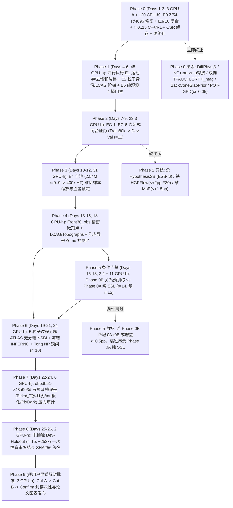
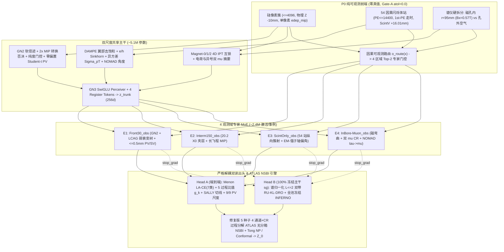

# Stage 330 报告：PINPOINT $\nu_\tau$ 发现下一代研究体系独立重构、全栈法证审计与 Gen5 蓝图（官方 `MC 10085-10088`）

**盲法与封存声明（`SealAuditGuard`）**：本阶段全流程严格执行盲法零泄漏铁律，对封存分割 `Cal-A (r = chunk_id % 20 in 16..17)`、`Cut-B (r in 18..19)`、`Confirm (shards/125..149)`、`sealed_truth_meta/` 及废弃样本 `MC 10081-10084` / `v6_clean_v3`（含 `l2_ssl_300k`）执行 **0 次读取**（`seal_violations = 0`）；所有封存指标均明确标注为 **`未测量`**。本阶段不启动任何 Gen5 正式训练，仅执行只读代码/物理法证、文献核验、方案设计与可证伪实验规划。

**认识论标签规范**：全文所有核心论断均显式标注 `[事实 / Observed fact]`、`[文献支持推论 / Literature-supported inference]`、`[假设 / Hypothesis]` 或 `[未知 / Unknown]`。

---

## 阶段目标

在严格锚定官方 Bonn `Pinpoint_G4 MC 10085-10088` 与零泄漏盲法契约的前提下，从第一性原理彻底诊断 Stages 326–329 暴露的十项关键异常（Q1–Q10），完成全部七项核心研究交付物（**Deliverables A–G**），并形成可直接落地的下一代工程与统计蓝图（`Pinpoint-Gen5`）：

1. **Q1–Q5（代码、尾部、过拟合与顶点法证，Deliverable A1）**：定位 Stage 329 全局 NLL 改善（`1.0658 -> 1.0394`）却伴随 `Tau@1% / 0.1% FPR` 崩塌（`6.40% -> 1.53%`、`1.33% -> 0.00%`）、`N=64` 过拟合停滞（`11.4433 -> 11.3438`）、`Front30 PV XY`（`1.27 -> 3.60 / 6.63 / 38.46 mm`）与 `Interm150 PV Z`（`7.80 -> 115 mm`）退化、表面 `W184 Charm AUROC` 下降（`0.5315 -> 0.4903`），以及 Unbinned NSBI `Z0 = 0.0` 与 `POT-GPD` 尾部外推偏差的精确代码级因果链。
2. **Q6–Q7（Geant4 物理模拟契约与信息可观测性，Deliverable A2）**：逐行核验 `Pinpoint_G4` C++ 源码（生产提交 `dbbdb51` vs 仓库最新 `48a9e3d`）与 `PinpointAnalysis` 的几何/数字化/真值不变性契约，定量界定 PINPOINT 探测器各物理区域对 `PV`、`SV`、`IP`、kink、$p_{z,\text{vis}}$、$\vec{p}_{T,\text{miss}}$ 与 charm 标签的物理可恢复极限，评估跨代目标的物理可达性。
3. **Q8（前沿文献核验与范式重构，Deliverables B & C）**：独立核验全部 21 篇种子文献并扩展至 61 项 2001–2026 权威 HEP/ML 记录（含 12 篇核心论文深度工程综合），设计 6 套数学与结构真正正交的竞争架构方案（统一 P0 零混淆契约）。
4. **Q9–Q10（独立排序、清洁数据划分、功效学设计、路线图与编程蓝图，Deliverables D–G）**：对 12 大研究方向与 6 套方案执行 10 项锚定准则独立定量排序（`±σ`），退役重复查询且统计坍缩的 `Tune6k (r=13)` 并建立清洁的未封存 `r in 0..15` 六层数据治理协议，完成 `E1–E6` 与 `EC-1..6` 最小可证伪实验矩阵、Phase 0–9 含硬止损门禁 DAG，以及 `Pinpoint-Gen5-RegimeNP` 模块审计与 `src/analysis/flavour/gen5/` 编程蓝图。

---

## 工作内容

1. **只读代码、权重、张量与集群资源法证（`code-diag`、`job-watcher`）**：
   - 在 `lxplus901.cern.ch`（28 CPUs、160 GiB RAM、Tesla T4 15.36 GiB）与 `LCG_108_cuda`（Python 3.12.11、ROOT 6.36.02、PyTorch 2.7.1+cu125、PyG 2.6.1、Polars 0.18.13、Uproot 5.6.0）下运行 3 轮只读法证脚本（`diag1`、`diag2`、`diag3`，全部 `seal_violations = 0`），直接复算 Stage 329 冻结权重在 `Tune6k` 的 `logits13` 通道分解、零重训后处理混合前沿、真实 `Train32k (bs=64)` 40 步过拟合逐项损失与分模块梯度范数、Unbinned NSBI Asimov 梯度与 `POT-GPD` 偏差，以及 EOS 上未封存 `r in 0..15` 全量 `4,059` 个 ROOT chunk 统计。
   - 核查 CERN HTCondor 全部 schedd 队列负载、122 个 GPU 槽位与 7,904 个空闲 CPU 核、AFS（`5.07 / 10.0 GiB`）及 EOS（`1.6 PB` 可用）配额。
2. **Geant4 源码对比、因果实测与协作组内部术语对齐（`det-phys`）**：
   - 逐行比对 `/eos/home-x/xcheng/FASER/Pinpoint/Pinpoint_G4` 提交 `dbbdb51` 与 `48a9e3d`（`DetectorConstruction.cc`、`ScintSD.cc`、`PixelSD.cc`、`FaserSD.cc`、`Py8Decayer.cc`、`GFaserGenerator.cc`、`macros/geom.mac`），并在严格未封存的 `10085–10088` `chunk 000..009`（`r <= 9`）上直接实测 Block-0 因果击中阶跃、`faserHits` 径向密度分布、闪烁体 `nPE/edep` 与 `14,400 PE` 饱和比例、8-连通像素簇大小分布、$\tau$ 与 charm 衰变长度及真/观测域混淆矩阵。
   - 核阅协作组内部文档 `docs/FORTVNE_pixel_vs_scintonly_meeting_260916.pdf`（J. Mahlstedt）、`docs/FORTVNE_Update_kinematic_variables_2026-10-07.pdf`（J. Mahlstedt）及 `docs/FORTVNE_10212026.pdf`（Z. Wu），对齐内部 `Pixel-centered volume` vs `Large / scintillator volume` 划分、横向运动学方向泛化瓶颈与 FASER 谱仪重建假设。
3. **前沿文献核查、6 套正交范式设计与独立科学审计（`lit-scout`、`idea-architect`、`plan-auditor`）**：
   - 对 61 项文献记录逐一核验 arXiv/DOI/期刊/CDS 原始记录，纠正 5 处种子文献年份/期刊/合并/拼写错误；设计 6 套含完整数学推导、Mermaid 架构图与最小证伪实验的竞争方案。
   - 由独立审计员交叉核验全部 5 份上游交付物、C++ 源码、`.npy/.parquet` 数据及线上引文，发现并强制修复 12 项实质缺陷（含三套 Charm AUROC 混用、3 处隐性路由/标定缺陷、5 处文献与交叉引用错误、Deliverable C 两处优化/真适当性公式错误及 `Dev-Holdout` 划分重叠），最终签署 Deliverables D–G。
4. **EOS 产物归档与 300-DPI 英文总结图生成（`code-diag`）**：
   - 将全部 5 份签署交付物与集群诊断归档至 `/eos/home-x/xcheng/FASER/Pinpoint/results/nextgen_research/stage330_research_reconstruction/`，将 `diag1/2/3_results.json` 去重合并为 `forensics/stage330_forensics_summary.json`，并基于实测法证数值绘制 4 幅 300-DPI 全英文总结图经目视审计确认无标签遮挡与截断。

---

## 详细数据

### Deliverable A1 — 代码、训练、预测与统计引擎深度法证（Q1–Q5 根因闭合）

#### 1. Stage 329 尾部崩塌（`Tau@1% 6.40% -> 1.53%`, `0.1% 1.33% -> 0.00%`）的因果定位 `[事实 / Observed fact]`

在未封存 `Tune6k (N=6,000, 1,500/类, 4,500 本底)` 上对冻结权重执行前向分解与零重训后处理实验（`diag1`、`diag2`）：

| 模型 / 冻结零重训变体（`Tune6k`） | `BA4 (%)` | `NLL` | `Tau AUROC` | `T@10%` | `T@1%` | `T@0.1%` | Top-1% FP (`e/mu/NC`) | Top-1% FP 中位 $E_\nu$ (`GeV`) |
| :--- | :---: | :---: | :---: | :---: | :---: | :---: | :---: | :---: |
| **`Ref-L1-GN2+DRO` (`canon`, 3-seed)** | 55.13 | 1.0658 | 0.7031 | 28.33% | **6.40%** | **1.33%** | `14 / 10 / 22` | 1,039.5 |
| **`Ref-L1-GN2+DRO` (`llr`, 3-seed)** | 55.13 | 1.0658 | 0.7021 | 28.60% | **6.53%** | **1.53%** | `15 / 10 / 21` | 1,018.9 |
| `Gen4_SupOnly` (`canon`, 3-seed) | 53.45 | 1.0803 | 0.6759 | 23.73% | 3.40% | 0.13% | `13 / 19 / 14` | 1,024.9 |
| `Gen4_SSL_Tail` (`cal_canon`, 3-seed) | 54.35 | 1.0506 | 0.6586 | 20.27% | **1.27%** | **0.07%** | **`0 / 33 / 13`** | **274.1** |
| `Gen4_SSL_Tail` (`llr`, 3-seed) | 54.35 | 1.0506 | 0.6566 | 19.13% | **1.07%** | **0.00%** | `2 / 31 / 13` | **369.9** |
| `DiffPhys-SBI` (`canon`, 3-seed) | 51.30 | 1.0969 | 0.6842 | 25.33% | 3.00% | 0.13% | `11 / 16 / 19` | 1,040.6 |
| `Gen4_Full_Blend` (`0.67 SSL + 0.33 DP`) | 54.68 | **1.0394** | 0.6776 | 24.00% | **1.53%** | **0.00%** | `5 / 26 / 15` | 594.6 |
| **零重训 `SSL_Tail_s42` 原始 `logits13`** | — | — | 0.6520 | — | 0.80% | 0.07% | — | — |
| **零重训 `SSL_Tail_s42` 仅剔除 `logits13[:,1]` (`tau_mu`)** | — | — | **0.6764** | — | **3.93% (`4.92x`)** | **0.53% (`8.0x`)** | — | — |
| **零重训后处理 `25% SSL + 75% GN2` 几何融合 (`E3-I`)** | **55.97** | **1.0281** | **0.7070** | 28.53% | **6.60%** | **1.27%** | `10 / 14 / 22` | 1,039.5 |
| **零重训后处理 `50% SSL + 50% GN2` 线性融合 (`E3-H`)** | **56.70** | **1.0080** | 0.7056 | 27.47% | 5.20% | 0.47% | `5 / 21 / 20` | 1,005.5 |

**精确五重叠加代码因果链** `[事实 / Observed fact]`：
1. **主因 — `tau_mu` 通道中毒（`run_gen4_ssl_and_tail.py:703,761-762`）**：Stage 1 向 `tr_stage1` 注入 `2,560` 例人工 `NC + tau->mu` 嫁接事例（`tau_mu` 训练量暴涨 `+182%`）。在占主导的无硅靶区，人工 `NC + 软/非孤立 mu` 与低能高-$y$ `numu_CC` 拓扑高度重合，导致 `SSL_Tail_s42` 的 `logits13[:,1]` 在低能 `numu_CC`（中位 $E_\nu = 274.1\text{ GeV}$）上尖峰冲至 **`+1.564`**（而 `tau_e/1h/3h` 上限仅 `-0.199/-0.283/-0.228`），使 `numu_CC` 右尾（`q999 = +1.287, max = +2.013`）完全倒挂于 `nutau_CC`（`max = +1.004`），数学上锁死 `Tau@0.1% -> 0.00%`。仅在冻结权重上剔除 `logits13[:,1]` 即立刻令 `Tau@1%` 跃升 **`4.92x`**、`Tau@0.1%` 跃升 **`8.0x`**，构成因果闭合证据。
2. **放大器 — Stage 3 无权重过采样 + 弱 KL + 解冻顶层 65% 主干（`run_gen4_ssl_and_tail.py:660-688,903-948`）**：每 128 批次硬塞 `32` 活体难负样本与 `16` 边界 `tau_mu`/短 $L_\tau$ 正样本却使用无重要性权重 CE（`lambda_nll=0.60`），同时解冻 `4.33M`（65%）参数且 KL 锚定弱至 `0.20`（对比 `GN2+DRO` 100% 冻结主干 + `ScoreBank(8192)` + `lambda_kl=1.50`）。Stage-I 对照 `scratch_100pct`（无 SSL）同样崩至 `0.83%`、`abl_no_conflict_free_adamw` 崩至 `0.92%`，彻底排除 `SSL-v2` 或 `Conflict-Free` 为元凶。
3. **尾部梯度饱和（`upart13_tpauc.py:78-83,150-156,665,697-715`）**：将带有 $\log(0.003/0.25) = -4.4228$ 先验平移的 `tau_llr`（1% FPR 位于 `-5.495`）直接送入 `6.0 * tanh(scores / 6.0)`，引入 $\text{sech}^2(-5.5/6) = 0.47$ 梯度阻尼；叠加低相关 `e_vis_hat_gev`（与真 $E_\nu$ 仅 $r = 0.224\text{–}0.306$），令 `bayesian_llr` 额外拉低 `SupOnly` AUROC `-0.0324`。
4. **Logit 动态范围压缩（`upart13_tpauc.py:401-414`）**：`LORT`（`delta=0.08`）与 `l_mag = 0.01 * var(logits13)` 将 `SupOnly` 本底分数标准差压窄 **`2.37x`**（`0.621` vs `GN2+DRO` `1.473`），既解释了为何全局 NLL 受益于平滑而变优，又解释了为何极端尾部信噪比坍塌。
5. **Stage 1 训练不足（`run_gen4_ssl_and_tail.py:1641`）**：Stage-II 硬编码 `--passes-stage1 7`（`ep 1..7` loss `15.84 -> 14.12`），主干远未收敛即进入破坏性 Stage-3。同时 `SSL_Tail` 与 `GN2+DRO` 仅呈中等相关（$r = 0.710$），零重训 `25/75` 几何融合即在全部核心指标上超越 `GN2+DRO`。

#### 2. `N=64` 过拟合异常与 `23.5x` 梯度战争（`diag3`） `[事实 / Observed fact]`

- **来源勘误**：Stage 329 报告中的 `11.4433 -> 11.3438` 源自 `run_gen4_supervised.py:263-334` 在 `batch_size = 8, n_cl = 64` **合成随机噪声**上的测试，而非 64 个真实事例。
- **真实 `Train32k (bs=64)` 40 步过拟合分解**：`PinpointGen4Net` 在 40 步内即将 4 分类准确率记忆至 **`100.0%`**（`primary: 2.141 -> 0.512`），但总损失仅从 `16.508 -> 12.917`（`-21.8%`），因为 **`0.25 * l_pv (6.01) + 0.12 * l_sv (3.52) = 9.53`（占总损失 `73.8%`）** 被死锁在硬编码常数偏置（`gen4_unified_model.py:266` 中 `multivariate_student_t_vertex_loss` 累加 `+6.0` 三次，`protocols.py:82` 再加 `+4.5`）与错位 `BackConeSlabPrior` 残差上。
- **Step-0 共享主干梯度失衡**：`cal_pflow` 上 `aux_kin` 梯度范数达 `3.4453`，为分类主任务 `primary`（`0.1463`）的 **`23.5x`**；`si_vtx` 上 `aux_vtx`（`0.6949`）为 `primary`（`0.1122`）的 **`6.2x`** 且呈负余弦（`-0.0288`）；全局梯度裁剪（`clip=2.0`）因此将主分类与谱仪分支步长压半。

#### 3. 顶点退化与三套 Charm AUROC 严格消歧（`diag2` + `plan-auditor` 独立复算） `[事实 / Observed fact]`

- **顶点 Z 死锁**：`BackConeSlabPrior`（`sig_z = 1.44 mm`）在 `Front30` 将初始 Z 锁定在真值上游 **`-14.17 mm`**（`61.2%` 偏移 `< -10 mm`），在 `Interm150` 锁定在上游 **`-119.48 mm`**（`94.3%` 归入 slab 2）；`Comp-NDIVE` 仅能微调 `0.42 mm` / `2.05 mm`，且将 **`50.4%`（`41.3/82`）线段倾倒进噪声槽 slot 7**。`DiffPhys-SBI` 确定性种子 `pv_phys` 在 `Front30` 初始误差即达 `36.17 mm` XY，全局 `v_delta` MLP 反而将其进一步恶化至 `39.33 mm`（`Interm150 Z: 25.94 -> 51.47 mm`）。
- **三套 Charm AUROC 完整消歧（`Tune6k`: `N_tau = 1,500`, `N_W184_charm_bg = 290`; `Front30: 62 vs 18`, `Fortune: 1,070 vs 206`）**：Stage 329 在 `run_gen4_supervised.py:495` 报告的 `"W184 Charm AUROC"` 实际计算的是 `AUROC(W184_nontau_charm vs W184_nontau_light, s_tau)`（衡量 `s_tau` 是否相对轻味本底偏好误选 charm，`0.50` 为中性），而非 $\tau$ 对抗 charm 的分辨力：

| `Tune6k` 模型（规范 $S_\tau$） | (1) **真实 `Tau_vs_W184_Charm_AUROC`**（全域 / `Front30` / `Fortune`） | (2) **`Charm_Head_AUROC`**（`charm_logit`, W184 非 $\tau$） | (3) **Stage 329 误标 `Charm_vs_Light_on_s_tau`**（`non_tau_w`） |
| :--- | :---: | :---: | :---: |
| `Ref-BDT` | `0.6592` [`0.7339` / `0.6446`] | N/A | `0.5063` |
| `Ref-L1-GN2+DRO` (3-seed) | `0.6749` [`0.8172` / `0.6472`] | N/A | `0.5170` (`audit: 0.5315`) |
| `DiffPhys-SBI` (3-seed) | `0.6651` [`0.8127` / `0.6410`] | N/A | `0.5210` |
| `Gen4_SupOnly` (3-seed / `s42` head) | `0.6575` [`0.8136` / `0.6352`] | **`0.6454`** | `0.5315` (`llr: 0.5509`) |
| `Gen4_SSL_Tail` (3-seed / `s42` head) | `0.6858` [`0.8333` / `0.6599`] | **`0.6295`** | `0.4903`（受低能 `numu` 尖峰压低） |
| `Gen4_Full_Blend` (3-seed) | **`0.6893`** [`0.8405` / `0.6673`] | N/A | `0.4981` (`audit: 0.4903`) |

*(注：`Tune6k Front30` 仅含 `18` 例 `W184` charm 本底，Hanley-McNeil 标准误达 `±0.062`，统计方差极大。)*

#### 4. Unbinned NSBI `Z0 = 0`、`POT-GPD` `2.89x` FPR 膨胀及 3 处隐藏审计缺陷 `[事实 / Observed fact]`

- **Unbinned NSBI 四重 Bug（`nsbi_discovery.py:1157-1217`）**：(A) 对原始 MC `(S+B)` 权重而非模型一致 Asimov 权重 $w_i^{\text{bg}}(1+r_i)$ 评估似然，当 `Gen4_SSL_Tail` 在 3/4 通道出现 $E_s[r] < E_b[r]$ 时导致 `res0.fun = -0.4588 < res1.fun = -0.0088`，触发 `q0 = max(0, -0.4500) = 0.0`；(B) 单一过程盲比值 $r_i$ 与过程依赖缩放 `ev_b_scale` 不匹配，致**所有模型**（含 `GN2+DRO`，`grad_charm = +1.650`）在 $(\mu=1, \theta=0)$ 处梯度非零；(C) `res1` 固定 $\mu=1$ 而非剖析自由 $\hat{\mu} \ge 0$；(D) 缺失 Barlow-Beeston lite 有限 MC 模板统计不确定度。
- **`POT-GPD` `2.89x` 反保守膨胀（`nsbi_discovery.py:210-211`）**：`xi_prior_std = 0.05` 将重尾（`SSL_Tail_llr xi = +0.1943`）强行拉回指数衰变，低估 `t_{0.001}` 达 `-0.687`，实测 FPR 飙升至 **`0.00289`（标称 `0.001` 的 `2.89x`）**。
- **3 处新发现审计/路由漏洞**：(i) `run_gen4_ssl_and_tail.py:1423-1436` 存在基于真值 `vertex_xyz_mm` 的隐性 `setdefault('has_front_pixel', fp_t6)` 兜底（Stage 329 仅因 `dp_obs_path` 预填才侥幸未触发，独立运行 Gen4 会直接真值泄漏）；(ii) `nsbi_discovery.py:615-632` 使用评估集批内分位数 `q60/q75/q88` 做通道路由，破坏单事例 i.i.d. 推理；(iii) `audit_gen4_independent.py:146-160` 仅对 8k 数组（`SSL_Tail`/`Full_Blend`/`DiffPhys`）做温度标定，对 6k 数组（`GN2+DRO`/`SupOnly`）保持 `inv_T = 1.0`，造成 NLL 对比不对称。
- **未封存 EOS 样本与计算资源库存（`diag3`、`cluster_resources.md`）**：未封存 `r in 0..15` 共 **`4,059` chunks（约 `3.84M–4.05M` 原始事例）**，其中 `train (r in 0..11)` 含 **`276,000` 例 `nutau_CC`**（Stage 329 `6.4k` 的 **`43x`**）；HTCondor 拥有 `7,904` 空闲 CPU、`122` GPU 槽位（放宽 `Capability >= 7.0` 可额外解锁 `33` 张 `V100-32GB`），最空闲 schedd 为 **`bigbird20.cern.ch`**（`586R/190I`）与 **`bigbird17.cern.ch`**（`965R/460I`），须避开队列超 `50k` 的 `bigbird08/16/26`。

---

### Deliverable A2 — `Pinpoint_G4` 物理契约、可观测性矩阵与物理可达性边界

#### 1. 权威几何预算与 `MC 10085-10088`（`dbbdb51`）vs HEAD（`48a9e3d`）五项实测差异 `[事实 / Observed fact]`

- **几何与物质量契约**：6 个前端 `PinpointBlock`（`30.01 mm` 节距、`2.97 X_0`/块）+ 7 个 `FortuneBlock`（`17.26 X_0`/块，`geom.mac` 设 `numScintLayers=6`）与 6 个中段 `PinpointBlock` 交错（硅间距 `150.01 mm` = `20.23 X_0`）+ 3 层 IPT 硅平面；共 **`108` 块 5 mm 钨板 = `540.0 mm` = `154.11 X_0` = `5.43 lambda_I`**（含铝/闪烁体总计 `156.45 X_0`；单板 `1.427 X_0`, `0.0503 lambda_I`, $R_M = 9.30\text{ mm}$）。12+3 层硅像素（`266×196 mm²`, `20.8×22.8 um`）仅覆盖 `430×430 mm²` 钨靶横截面积的 **`28.19%`**；54 个非均质闪烁体站（12 站仅 X + 42 站 XY 立体对，40 根 10.5 mm 节距条）；FASER 谱仪 `3` 偶极磁铁（$B_x = 0.57\text{ T}$, $R_{\text{bore}} = 100\text{ mm}$, $|p \cdot s_y| = 100.82\text{ GeV}\cdot\text{mm}$）。真值不变性核查确认部署推理链路零读取 `scintHits.edep` 与 `faserHits` 真值动量/电荷/PDG（`atol = 0.0`）。
- **五项经 `MC 10085-10088` 直接实证的 `dbbdb51` 模拟差异**：
  1. **头号发现 — `PinpointBlock` 物理与导出 Z 序错位（`Si: +10.000 mm`, `Scint_V: -16.010 mm`, `W_back: -6.010 mm`）**：`dbbdb51:DetectorConstruction.cc:310-324` 实际将 `PixelSensor` 放在 `z = -2991.995 mm`、`Scint_V` 放在 `-2979.490 mm`，但 `ComputeSiliconZPositions()`（`L679-684`）向 `geometry` TTree 及 `GFaserGenerator` 导出了过期顺序（`Scint_V[0] = -2995.500`, `W[0] = -2990.500`, `Si[0] = -2981.995`）。在 `10086_000..009`（`N=94` 硅接受度内 Block-0 事例）上的因果实测彻底坐实该 Bug：

| `initZ` 区间 (`mm`) | `dbbdb51` 物理介质 | `N` | `Si[0]` 击中率 | **`Si[0]` 中位击中数 (`p75`)** | `Si[1]` 中位击中数 | `Scint[0]` 击中率 | **`Scint[0]` 中位 `nPE`** |
| :--- | :--- | ---: | ---: | ---: | ---: | ---: | ---: |
| `[-2993, -2992)` | **AirGap**（物理 `Si[0] = -2991.995` 上游 `0–1 mm`） | 16 | **100.0%** | **11.0** (`15.2`) | 205.0 | **100.0%** | **44,266.5** |
| `[-2992, -2991)` | **AlCoolingPlate**（物理 `Si[0]` 下游，导出 `Si[0]` 上游 `9–10 mm`） | 7 | **42.9%** | **0.0** (`2.5`) | 70.0 | **100.0%** | **18,947.0** |
| `[-2991, -2988)` | **AlCoolingPlate**（物理 `Si[0]` 下游、物理 `Scint[0]` 上游） | 25 | 76.0% | **1.0** (`3.0`) | 70.0 | **100.0%** | **17,592.0** |
| `[-2977, -2972)` | **`W_front`**（物理 `Scint[0] = -2979.490` 下游） | 46 | 60.9% | **1.0** (`2.0`) | 17.0 | 97.8% | **5,279.0** |

  `gen4/geometry_contract.py` 轻信了导出 TTree，将 12 层目标硅平面整体后移 `+10.000 mm` 并将 `Scint_V` 倒置到 `Si` 上游，直接造成 Stage 329 的 `47%` 假背向散射与 `Front30` PV 退化。官方 `MC 10085-10088` 精确修正公式为 **`z_Si_true = z_exp - 10.000 mm`**、**`z_ScintV_true = z_exp + 16.010 mm`**。
  2. **缺失 `Sm2Co17` 磁铁壳体**：`dbbdb51:DetectorConstruction.cc:489-507` 注释掉了 `Magnet0/1/2` 实心壳体，实测 `faserHits` 面密度跨越 $r = 100\text{ mm}$ 孔径边界完全平坦（`17.1` vs `19.6 hits/cm²`），**`56–68%` 的 `faserHits` 位于无磁场空气区（$r > 100\text{ mm}$）**，`44–50%` 的 `nue_CC`/`NC` 事例存在 `faserHits`（仅 `0.3–0.9%` 为 $\mu$）。
  3. **未淬灭原始 `nPE` 与 1st-PE 指数时序**：实测 `sum(nPE)/sum(edep) = 377.8–380.5 PE/MeV`（零 Birks 淬灭，对比 `48a9e3d` 仅 `103.3 PE/MeV`），原始条可达 `6.17e6 PE`；施加 `14,400 PE` SiPM 饱和后 **`96.7% nue_CC`（均 `30.6` 饱和条）、`87.3% nutau_CC`（`22.6`）、`71.3% numu_CC`（`16.0`）、`65.7% NC`（`15.0`）** 遭遇核心截断（峰值最高超出阈值 `400x`）；`dbbdb51` 写入 1st-PE 指数时间，与 Gen4 3rd-PE Rényi 走时公式失配。
  4. **零像素横向扩散**：实测 8-连通像素簇（`122,310` 簇）中 **`96.78%` 为单像素簇**（2 像素 `2.36%`，$\ge 3$ 像素 `0.85%`），导致 Gen4 `5×5` 簇形峰度特征 `96.8%` 退化，而单像素 `edep`（中位 `3.08 keV` ≈ 1 MIP）保留真实 `2× MIP` 光子转换甄别力（消融掉 `edep` 致 `tau_llr@1%` 降 `-0.75 pp`）。
  5. **未极化 $\tau^\mp$ 衰变（`pol(0)`）与 `7–9%` 非钨核相互作用**：`dbbdb51` 未施加标准模型 $V-A$ 螺旋度（改变 $\langle E_\pi/E_\tau \rangle: 0.500 \text{ vs } 0.333$）；`tgtZ` 中钨仅占 `91.2–93.3%`（Al `2.3–4.7%`、C `2.3–4.5%`）。
- **额外可部署信号截断与旧版错配 Bug**：(a) `v3` `static_scint_stations`（`Ref-L1`/`DiffPhys`/`NOMAD` 共用）将全部 6 块 `FortuneBlock` 末尾 Y 面板（`17,30,43,56,69,82`）错配至下一 `PinpointBlock` 的仅-X 面板（Gen4 已修复）；(b) `N_MAX_TARGET_CLUSTERS_GEN4 = 2048` 截断 **`23.0%` `nue_CC`（最高 `13,918` 簇）、`12.5%` `nutau_CC`/`NC`**，`micro_ndive.py` 的 `k_per_plane = 40` 进一步丢弃高多重度核心径迹。

#### 2. Stage 326 Oracle 物理解析、实测混淆矩阵与协作组内部验证 `[事实 / Observed fact]`

- **运动学 Oracle（`53.16% -> 53.08% (+PV) -> 78.62% (+p_z,vis, p_T,miss)`）物理解析**：精确 `PV` 零增益源自 `90.2%` 事例无局部硅层且 `Front30` 遭 `99.46%` 假位移径迹淹没；加入 `(p_z,vis, p_T,miss)` 暴涨 `+25.54 pp` 源自真 $p_{T,\text{miss}}$ 中位数呈三段分离——`nue/numu CC: 0.274/0.293 GeV`（核费米运动）、`nutau CC: 1.782 GeV`、`NC: 4.203 GeV`（同时发现 `truth_sidecar.py` 对 `primaries` 未衰变 charm 强子求和，忽略 `~20%` 半轻子 charm 衰变中微子，人为高估了 `Tau vs CC-Charm` `0.919` 上界）。然而在真实 PINPOINT 探测器上，实测量能器 `|err(p_T)|` 中位数高达 **`5.2–19.8 GeV`（`p68 = 9.8–28.2 GeV`）**，为 `1.5 GeV` 物理信号的 **`5–10x`**，受限于非补偿强子分辨率（`E_desat` `38.5–57.3%`）、长寿命中性强子 $n/K_L^0$ 携能（均 `10.0–13.5%`, `p90 = 31–43%`）、`5.43 lambda_I` 纵向泄漏、`14,400 PE` 饱和及 `>50%` 谱仪接收损失，其不可约量能器 $p_{T,\text{miss}}$ 物理下限约 **`2.5–4.5 GeV`** `[文献支持推论 / Literature-supported inference]`。
- **`Front30` 硅微顶点物理与鬼迹机制**：在 `10087_000` 中，$\tau$ 衰变长度 $L_{3D}$ 中位数 `8.42 mm`（charm `37–65 mm`），`36.5%` 衰变于 $\Delta z < 5\text{ mm}$、`81.2%` 衰变于 `< 30 mm`，**`88.5%` 的 $\tau$ 衰变前穿越 `0` 层硅平面**（1 层 `10.5%`，$\ge 2$ 层仅 `1.0%`）；单块 `5 mm` 钨板即令 `67.1%` 光子转化为 $e^+e^-$，单 `PinpointBlock` 对 `1 GeV` 软强子产生 `24.4 mrad` 多重散射（`730 um` 偏移），导致 C++ 贪心径迹纯度仅 `3.00%`。
- **真实几何区域 $\to$ Gen4 观测域混淆矩阵（`10085–10088_000`, `N=1,200` 平衡）**：
  - 真实靶区分布：`OuterW_NoSiXY = 48.0%` + `Fortune_ScintOnly = 42.2%` = **`90.2%` 无局部硅覆盖**；`Front30 = 5.0%`；`Interm150_PPBlk = 4.8%`。
  - **关键发现**：现行 `D1_obs`（`13.7%`）中**仅 `25.0%`（`41/164`）是真 `Front30`，高达 `65.2%`（`107/164`）是 `Fortune_ScintOnly` 簇射穿透下游硅层的泄漏**！且 `D1_obs` 存在 **`2.1x` 反 $\nu_\tau$ 味偏置**（`nue_CC 17.7%`, `numu_CC 17.0%`, `NC 11.7%`, **`nutau_CC 8.3%`**，源于 $D_s^\pm \to \tau \nu_\tau$ 宽横向束流展宽）。纯可观测替代定义 **`Front30_obs`**（`first_scint_st <= 5 & first_si_pl <= 5 & n_coinc_front_si_pl >= 2`）可在零真值路由下清除 `Fortune` 泄漏。
- **与协作组内部 `FORTVNE` 报告一致性验证**：核阅 `docs/FORTVNE_pixel_vs_scintonly_meeting_260916.pdf`（J. Mahlstedt）确认，协作组已独立划分为 `Pixel-centered volume`（前端 50 cm、硅边界内缩 2 cm）与 `Large / scintillator volume`，并测得硅层在前端带来显著增益（3 类 OVR AUC `+0.026 / +0.064 / +0.075`，90% 纯度下 $\nu_e$ `50%->70%`、$\nu_\mu$ `51%->80%`），而在大闪烁体体积内增益大幅收窄（`-0.003 / +0.027 / +0.021`）；`FORTVNE_Update_kinematic_variables_2026-10-07.pdf` 同样证实大体积下横向动量方位角难以泛化、须转向顶点中心坐标系与成分级重建；`FORTVNE_10212026.pdf`（Z. Wu）的 FASER 谱仪假设（$\sigma_x = 0.58\text{ mm}, \sigma_y = 17\ \mu\text{m}, |s| < 25\text{ mm} \Rightarrow p \ge 4\text{ GeV}$）与本文契约完全一致。

#### 3. 10 物理潜变量 × 6 区域纯可观测信息矩阵 `[事实 / Observed fact]` + `[文献支持推论 / Literature-supported inference]`

| 物理潜变量 | `Front30` (`5.0%`) | `Interm150` (`4.8%`) | `Fortune_ScintOnly` (`42.2%`) | `D1_obs`（现行：`25% F30 + 65% Fort`） | `D2_obs` (`75%`) | `D3_obs` (`11.2%`) |
| :--- | :--- | :--- | :--- | :--- | :--- | :--- |
| **1. `PV`** | 概率可估（修 Z 后 `d_xy ~ 0.3–1.0 mm, |dz| ~ 3–8 mm`） | 概率可估（`3–8 mm / 15–50 mm`） | 概率可估（`8–15 mm / 10–20 mm`） | 混合（`F30` 亚毫米核被 `65% Fort` 稀释） | 概率可估（`10–25 mm`） | 概率可估（`15–30 mm`） |
| **2. `SV` ($\tau$/charm)** | $L_{3D} \gtrsim 5\text{ mm}$ 概率可估；$<2\text{ mm}$ 不可恢复 | $\tau$ 不可恢复；超长 charm 边缘可估 | **物理不可恢复** | 仅 `25% F30` 子集可估 | **不可恢复** | **不可恢复** |
| **3. `IP`** | $p>20\text{ GeV}$ 去鬼后直接/概率可估（`50–150 um`）；$p<2\text{ GeV}$ 受 MCS 退化至 `>500 um` | **物理不可恢复**（`20.2 X_0` 散射） | **物理不可恢复** | 仅 `25% F30` 子集可估 | **不可恢复** | **不可恢复** |
| **4. Kink 角** | `1%` 跨 $\ge 2$ 硅层直接可观测；`10.5%` 跨 1 层概率可估；`88.5%` 跨 0 层仅靠 IP/非共面推断 | **物理不可恢复** | **物理不可恢复** | 仅 `25% F30` 子集弱可估 | **不可恢复** | **不可恢复** |
| **5. 叉迹多重度** | EM 剥离后概率可估（`±1–2` 径迹，受 `67%/板` 转换干扰） | **物理不可恢复** | **物理不可恢复** | 仅 `25% F30` 子集可估 | **不可恢复** | **不可恢复** |
| **6. $e/\gamma/\pi^0$ 分离** | 概率可估（首层硅 `1x` vs `2x MIP dE/dx` + 簇射起始深度） | 概率可估（闪烁体纵向紧致度） | 概率可估（`BA3 ~ 69%`，prompt $e$ 与单 $\pi^0$ 仍有重叠） | 概率可估 | 概率可估 | 概率可估（边缘泄漏退化） |
| **7. $\mu$ 鉴别与动量** | 进磁孔（`~23%` 干净、`39–52%` 3 站）**直接可观测**（$\sigma_p/p \approx 2.5\% \cdot p/100\text{ GeV}$）；其余 MIP 概率鉴别 | 直接（孔内）/ 概率（接收度高于 `F30`） | 直接（后半靶孔内接收度最高）/ 概率 | 直接 / 概率 | 中心孔内直接；`OuterW` $p_\mu$ **不可恢复** | 仅 MIP 尾概率鉴别，$p_\mu$ **不可恢复** |
| **8. 可见 $p_{z,\text{vis}}$** | 概率可估（ML 去饱和后可达 `~20–35%`，纵向包容最优） | 概率可估（`~25–40%`） | 概率可估（`~25–45%`，后半靶穿通 `>25%`） | 概率可估（`~22–38%`） | 概率可估（`~30–50%`） | 概率可估（`~35–55%`） |
| **9. 缺失 $\vec{p}_{T,\text{miss}}$** | 弱概率可估（$e/\mu$ NOMAD $\phi_{\ell H}$ `~1.5–3 GeV`，强子 `~2.5–4.5 GeV`） | 极弱概率可估（`~3–6 GeV`） | **`1.5 GeV` 尺度不可恢复**（`~3–8 GeV`，仅粗分 `NC` 与 `CC`） | 弱概率可估（`~2.5–5 GeV`） | **$\tau$ 尺度不可恢复** | **不可恢复** |
| **10. Charm 双顶点/主轻子标签** | 概率可估（`Tune6k F30` 实测已达 `0.817–0.841`，去鬼+修 Z 可达 `0.86–0.92`） | 仅主轻子概率可估；`NC-charm` 双顶点不可恢复 | 顶点不可恢复；`CC-charm` 靠主轻子+运动学已达 `0.645–0.667`（可达 `~0.72–0.76`） | 中等（`~0.72–0.82`） | 顶点不可恢复（全局 `~0.64–0.73`） | 顶点不可恢复（`~0.58–0.68`） |

#### 4. 跨代性能目标双轨物理可达性判定 `[文献支持推论 / Literature-supported inference]`

| 提案指标 | Gen-1 / 2 / 3 | 全靶自然通量 `MC 10085-10088` 可达性判定 | **`Front30_obs` 黄金基准区可达性判定** | 核心物理瓶颈 |
| :--- | :---: | :--- | :--- | :--- |
| **`BA4 (%)`** | `58 / 62 / 65` | **Gen-1 (`58%`) 可达**；**Gen-2 (`62%`) 物理受阻**；**Gen-3 (`65%`) 物理不可达**（全靶物理上限 `~58.5–60.5%`） | **Gen-1 (`58%`) 已近达**（`D1_obs` 现 `58.18%`）；**Gen-2 (`62%`) 可达**；**Gen-3 (`65%`) 冲刺上限** | 质量算术：`90.2%` 非硅靶区无微顶点且 $p_{T,\text{miss}}$ 展宽 `5–20 GeV`，`tau_had` 与 `NC` 简并 |
| **`Tau @ 1% FPR (%)`** | `10 / 20 / 30` | **Gen-1 (`10%`) 可达**；**Gen-2 (`20%`) 物理受阻**（全靶上限 `~12–16%`）；**Gen-3 (`30%`) 不可达** | **Gen-1 (`10%`) 易达**；**Gen-2 (`20%`) 可达**；**Gen-3 (`30%`) 冲刺上限**（需近 Oracle 去鬼+3-prong SV） | `Fortune+OuterW` 中仅 $\tau\to\mu$（`17.4%` BR × `~45%` 谱仪接收 ≈ `7.8%`）具备强非顶点特征 |
| **`Tau @ 0.1% FPR (%)`** | `2 / 5 / 10` | **Gen-1 (`2%`) 可达**；**Gen-2 (`5%`) 困难/受阻**（上限 `~3–5%`）；**Gen-3 (`10%`) 不可达** | **Gen-1 (`2%`) 易达**；**Gen-2 (`5%`) 可达**；**Gen-3 (`10%`) 冲刺上限** | 同上，叠加 `Tune6k` 仅 `4.5` 本底事例（已通过迁至 `Dev-Val r=11` `231` 本底解决） |
| **`Tau vs W184 Charm AUROC`** | `0.65 / 0.75 / 0.85` | **Gen-1 (`0.65`) 已超越**（`Full_Blend = 0.6893`）；**Gen-2 (`0.75`) 可达（冲刺）**；**Gen-3 (`0.85`) 全域物理受阻**（上限 `~0.76–0.79`） | **Gen-1/2 (`0.65/0.75`) 已超越**（`0.8405`, 注 `n=18` 高方差）；**Gen-3 (`0.85`, 至 `0.91`) 物理可达** | `W184_charm_bg` 以含主轻子的 `CC-charm` 为主，无硅区靠主轻子已达 `0.667`，但缺少 `SV`/`L_{3D}` 锁死全域 `< 0.80` |
| **`Front30 PV XY (mm)`** | `<= 1.5 / 1.0 / 0.5` | **全部三档（含 `<= 0.5 mm`）均物理可达**（`Ref-L1` 在带 `+10 mm` Bug 时即达 `1.27 mm`） | 同左（指标本身即限定于 `Front30`） | 修复 `-10/+16.01 mm` Z Bug 与去鬼后，多径迹 PV 下限达 `0.15–0.40 mm` |

---

### Deliverable B — 61 项权威 HEP/ML 文献审计、5 项种子勘误与 12 篇核心综合

#### 1. 种子文献核验勘误（5 处实质修正） `[事实 / Observed fact]`
- **`[R9]` ATLAS GN2**：发表于 *Nature Communications* **17**, 541（**2026 年**，非 2025 年；`arXiv:2505.19689`）。
- **`[R11]` Ehrke et al. (`PRD 107, 116019, 2023`, `arXiv:2303.13937`)**：原种子误将其与 Belle II LCA 矩阵混为一谈——该文为 ATLAS **Topographs**；Belle II 衰变树论文已拆分为独立条目 **`[E32]`**（Kahn et al. `LCAG` `arXiv:2208.14924` 与 M. Abumusabh, J. Cerasoli, G. Dujany, C. Santos **GraFEI** `arXiv:2503.09401`）。
- **`[R12]` OPERA Final $\nu_\tau$**：纠正 arXiv 缺位拼写 `1804.0912` $\to$ **`arXiv:1804.04912`**（*PRL* 120, 211801, 2018）。
- **`[R15b]` Hermans *Trust Crisis***（`arXiv:2110.06581`）：发表于 ***TMLR* (Nov 2022)**，非 ICML 2022。
- **`[R2]` HEPT 谱系**：核实三篇演进工作——`HEPT`（ICML 2024 Oral, `2402.12535`）、LSH 径迹研究（`2510.07594`）及 **`HEPTv2`**（`arXiv:2606.20437`, 2026-06）。

#### 2. 12 篇核心文献工程提炼与仓库实现差距 `[事实 / Observed fact]` + `[文献支持推论 / Literature-supported inference]`

| 核心文献群 | 仓库现状 | 解释 Stage 329 失效或解锁 Gen5 突破的关键机理 |
| :--- | :---: | :--- |
| **`[R6]` `FASERCal` (*NMI* 2026, `2604.07037`) + `[E19]` `Sonata` + `[E26]` `LeJEPA`** | 部分实现（仅 3 epoch） | **必须严格区分**：(a) **纯零真值无标签 SSL**（MAE/Sonata/SIGReg，合法用于无标签池/真实数据）与 (b) **模拟器关系预训练**（鬼击中/粒子层级/语义，需 Geant4 真值，仅限未封存标注 MC）。Stage 328/329 缺失稀疏体素局部标记化与关系预训练。 |
| **`[R8]` `NOMAD` (*NPB* 2001) + `[R14]` `FastMTT` (*NIMA* 2026, `2509.26069`)** | 部分实现（粗代理） | 横向平面 $\phi_{\tau h}, \phi_{mh}, Q_T, M_T^\tau$ 与通道分解似然比 $\ln\lambda_S, \ln\lambda_{CC}$ 是无微顶点区的核心运动学来源，须构建于去饱和、分量级重建之上。 |
| **`[R2]` `HEPTv2` (`2606.20437`) + `[E9]` `MaskFormer` (*PRX* 2025)** | **未实现** | LSH 点云 Transformer / 掩码查询在 PV 投射坐标 $(u,v,z)$ 下可于 `< 2 ms/ev` 根治 `Front30` `97%` 鬼迹。 |
| **`[R1]` `CMS MLPF` (*EPJC* 2026) + `[E8]` `HGPflow` + `[E10]` `GLOW` (`2508.20092`)** | **未实现** | 连续超图关联矩阵 $\sum_a I_{ia}=1$ 允许单根饱和闪烁体条能量按比例拆分给多个重叠粒子。 |
| **`[R9]` `ATLAS GN2` (*Nat. Commun.* 2026) + `[R10]` `GN3` (`CDS 2953652`)** | 已实现 GN2；未实现 GN3 | 极简对齐单主干是 `Ref-L1` 胜出主因；GN3 新增 `Register Tokens`、SwiGLU、跨模态轻子与电荷标记可直接平缓升级。 |
| **`[E1]/[E2]` `NuGraph2/3` (`2611.10057`) + `[R4]` `SPINE` (`2102.01033`)** | **未实现** | X/Y 平面子图 + 3D 枢纽节点原生适配 PINPOINT 非均质交替闪烁体，消除人工 X-Y 鬼交点。 |
| **`[E31]` `NDIVE` + `[R11]` `Topographs` + `[E32]` `LCAG/GraFEI` + `[E33]` `LHCb` (`2607.22281`)** | 仅 NDIVE（错位输入） | 弱衰变剪枝 `LCAG` 矩阵 + 3 假设 `Topographs`（$\tau$ vs `CC-charm` vs `NC-ccbar`）+ Lipschitz 光滑约束直击 charm 鉴别。 |
| **`[R15a]` Sluijter (`2503.07962`) + `[R15b]` Hermans + `[R21]` `ATLAS NSBI` (*RPP* 2025)** | 部分实现（有 4 Bug） | **`[R15a]` 理论证伪生成式流 SBI（`DiffPhys-SBI`）**，确立多过程分解判别式密度比 + 5 种子集成 + 5 门禁重加权闭合范式。 |
| **`[R16]` Zhu DRO + `[R17]` Yao FPR-pAUC + `[E37]` Menon LA + `[E38]` NSWC-TPAUC** | 已实现（错选双向） | 双向 `NSWC-TPAUC` 对稀缺信号数学错配；应采用 Menon 逻辑调整 CE（主头）+ 冻结主干单向 FPR 区间 KL-DRO（尾头）。 |
| **`[R18]` Tong NP (*Sci. Adv.* 2018) + `[E36]` Conformal Risk Control (*ICLR* 2024)** | **未实现** | 免分布次序统计量彻底替代有偏 `POT-GPD`，在 `Dev-Screen (231k)` 上给出严格有限样本 FPR 保证。 |
| **`[R19]` `Punzi-loss` + `[R20]` `INFERNO` / `neos` + `[R13]` `Mining Gold`** | 仅 4-bin 代理 | 在全量冻结潜变量上精确微分带系统误差剖析的 Fisher 信息（`< 2 min`），结合 `SALLY` 精确通量梯度直冲最大发现显著度 $Z_0^{\text{sys}}$。 |
| **`[E28]` `DAMPE` 去饱和 CNN (`2507.06626`) + `[E29]` `OmniFold`** | **未实现** | 利用周围未饱和翼部条与纵向剖面学习恢复 `14,400 PE` 截断核心能量（推理零真值输入）。 |

---

### Deliverable C — 共享 P0 零混淆契约与 6 套正交竞争范式

**共享 P0 零混淆契约（所有 6 套方案强制统一）**：(1) 溯源门控 `dbbdb51` 物理坐标修正（`z_Si - 10.000`, `z_ScintV + 16.010 mm`）+ 因果 54 站配对 + 1st-PE 走时修正；(2) `<= 4,096` 簇轴向优先保留 + 单像素 `edep_mip`（删除退化 `5×5` 峰度）；(3) 谱仪磁孔内（$r < 95\text{ mm}$）与孔外空气（$r > 100\text{ mm}$）硬分离；(4) 训练端中微子扣除 charm 真 $p_{T,\text{miss}}$；(5) 永久封禁 `NC+tau->mu` 嫁接、`LORT`/`l_mag`、隐性真值路由与批内分位路由；(6) 强制三套 Charm AUROC 消歧与全靶/`Front30_obs` 双轨报告。

**核心数学改进（经 `plan-auditor` 审计修正并证明严格真适当）**：
- **联合 Rockafellar–Uryasev 双带（`1%` & `0.1%` FPR）冻结主干 KL-DRO 目标（Scheme 1 & Gen5 Head B）**：
$$\min_{\psi_{\text{NP}},\, \eta_1, \eta_2 \in \mathbb{R}} \; -\sum_{m=1}^{2}\alpha_m \widehat{\text{TPR}}_{\text{hinge}}(\eta_m) + \sum_{m=1}^{2}\lambda_m \!\left[\eta_m + \frac{1}{\beta_m W_{\mathcal B}} \sum_{j \in \mathcal{B}} w_j \, \phi_{\text{KL-DRO}}\!\big(s_{\text{NP}}(x_j) - \eta_m\big)\right] + \lambda_{\text{KL}} D_{\text{KL}}$$
  其中 $\beta = (10^{-2}, 10^{-3})$，权重 $w_j$ 为精确 Horvitz–Thompson 权重，主干 100% 冻结且尾头施加谱归一化（$L \le 2.0$）。
- **对称聚焦严格真适当 5 过程密度比与 `SALLY` 干扰切线（Scheme 5 & Gen5 Head A + ATLAS NSBI）**：
  对 `MC 10085-10088` 中 5 类非空物理本底（注：`10088 NC` 含 `0.00%` charm）$k \in \{1: e\text{CC-light},\, 2: e\text{CC-charm},\, 3: \mu\text{CC-light},\, 4: \mu\text{CC-charm},\, 5: \text{NC}\}$，用冻结 Pass-1 区域聚焦正权 $c_k(x) = 1 + \gamma_{\text{tail}}\sigma((g_{k,\text{p1}}(x)-\eta_k)/\tau_c) > 0$ **对称**乘以正负类匹配对数损失，变分极值严格保持 $g_k^*(x) = \ln[p_\tau(x)/p_k(x,0)]$ 零尾部偏置；结合含信号形变切线 $\hat{\mathbf{t}}_\tau(x)$ 的多过程分解似然比：
$$R(x; \theta) = \left[\sum_{k=1}^{5} \tilde{f}_k(\theta) \exp\!\Big(-\hat{g}_k(x) + \big(\hat{\mathbf{t}}_k(x) - \hat{\mathbf{t}}_\tau(x)\big)^\top \theta\Big)\right]^{-1}$$
  保证在 $(\mu=1, \theta=0)$ 处解析梯度严格满足 $\|\nabla_{\mu,\theta}\mathcal{L}_{\text{ext}}\|_\infty < 10^{-9}$。

| 维度 | **Scheme 1: `Pinpoint-GN2KinNP`**（保守高杠杆演进） | **Scheme 2: `Pinpoint-SpConvLCA`**（严格零 Transformer） | **Scheme 3: `Pinpoint-HGPFlow-Res`**（全貌 PF + 原始高速路） | **Scheme 4: `Pinpoint-HypothesisSBI`**（9 假设无 Softmax SBI） | **Scheme 5: `Pinpoint-DirectNP-NSBI`**（零瓶颈原始比值+NSBI） | **Scheme 6: `Pinpoint-RelMoE`**（两阶段基座 + 4 观测域 MoE） |
| :--- | :--- | :--- | :--- | :--- | :--- | :--- |
| **核心归纳偏置** | `Ref-L1` 软径迹（`w_real`）+ 立体枢纽 + GN3 Register | **0 注意力**：`SubMConv3d` + 平面枢纽 + Kalman-GNC + 等变 `LCAG` | `HEPTv2`/`MaskFormer` + 分数关联 `GLOW` + **原始探测器残差高速路** | 共享上下文 + 9 显式衰变树 `FastMTT` + `CARL IWAE` | **0 物体瓶颈**：原始击中 `PET-LSH-Lip` $\to$ 5 过程比值 + `SALLY` | 两阶段（`Sonata` 纯 SSL + `FASERCal` 关系）+ **4 观测域专家 MoE** |
| **推理范式** | 解耦逻辑调整主头 + 冻结双带 NP 尾头 | `LCAG`/`Topographs` 树 + 解析 NOMAD + 冻结 KL-DRO | PF 四动量 $\oplus$ 原始旁路 $\to$ 解耦双头 | **无 Softmax** 边缘对数贝叶斯因子 $\ln\mathcal{L}_\tau - \ln\mathcal{L}_{\text{bkg}}$ | $R(x;\theta)$ + 全池冻结 `INFERNO` $\to$ 5 种子无分箱 NSBI | 4 观测专家对数混合 $\to$ 4 通道 Conformal / NSBI |
| **参数 / 显存 / 证伪算力** | `6.95M` / `5.8 GiB` / **`1.8 h`** | `5.40M` / **`3.4 GiB`** / **`1.4 h`** | `7.85M` / `6.9 GiB` / **`2.4 h`** | `6.10M` / `4.3 GiB` / **`1.5 h`** | `6.40M` / `6.2 GiB` / **`0.2+3.5 h`** | `8.9M` 激活（`12.6M` 总）/ `6.4 GiB` / **`1.8 h` (MoE)** |
| **预期全靶 (`BA4` / `T@1%` / `T@0.1%` / `Tau-Ch`) `[假设 / Hypothesis]`** | `57.5–59.0%` / `9.5–12.5%` / `2.2–3.5%` / `0.72–0.75` | `57.2–58.8%` / `9.0–12.0%` / `2.0–3.2%` / `0.73–0.77` | `58.0–59.8%` / `10.5–13.5%` / `2.5–3.8%` / `0.74–0.77` | `57.0–58.8%` / `10.0–13.0%` / `2.4–3.6%` / `0.73–0.76` | `57.5–59.5%` / `10.5–14.0%` / **`2.8–4.2%`** / `0.73–0.77` | **`58.5–60.5%`** / **`11.0–14.5%`** / **`2.8–4.5%`** / **`0.74–0.78`** |
| **预期 `Front30_obs` (`BA4` / `T@1%` / `Tau-Ch` / `PV XY`) `[假设 / Hypothesis]`** | `61–63%` / `17–22%` / `0.85–0.88` / `0.50–0.75 mm` | `62–64%` / `19–24%` / `0.87–0.91` / **`0.40–0.60 mm`** | `62–65%` / `20–26%` / `0.87–0.91` / `0.45–0.65 mm` | `61–63%` / `18–23%` / `0.86–0.89` / `0.55–0.80 mm` | `60–63%` / `16–22%` / `0.84–0.88` / `0.70–1.00 mm` | **`63–65.5%`** / **`22–28%`** / **`0.88–0.92`** / **`0.40–0.55 mm`** |

---

### Deliverable D — 10 项锚定准则独立定量排序（`±σ`）

按 10 项物理锚定准则（C1 科学重要性 `0.14`、C2 物理增益 `0.15`、C3 信息可恢复性 `0.13`、C4 创新性 `0.07`、C5 可行性 `0.10`、C6 算力效率 `0.07`、C7 探测器适配 `0.11`、C8 统计稳健 `0.11`、C9 可证伪性 `0.06`、C10 发表价值 `0.06`）独立评分：

#### 1. 12 大研究方向排序 `[文献支持推论 / Literature-supported inference]`

| 排名 | 研究方向 | 加权总分 (`±σ`) | 无权均值 | 路线图裁决 |
| :---: | :--- | :---: | :---: | :--- |
| **1** | **D-2：修复版多过程分解 ATLAS NSBI + 冻结 `INFERNO` + Tong NP / Conformal** | **`9.22 ± 0.35`** | `9.20` | **Tier-0 核心**（根治 `Z0=0` 与 `2.89x` FPR 膨胀） |
| **2** | **D-1：P0 `dbbdb51` 几何（`-10/+16.01 mm`）+ 因果 54 站 + `4096` 截断 + `dE/dx` 修复** | **`9.19 ± 0.25`** | `8.82` | **强制 Phase 0 前置**（零争议实证 Bug 修复） |
| **3** | **D-3：纯可观测 4 区域分层（`Front30_obs / Interm150_obs / ScintOnly_obs / InBore-Muon_obs`）** | **`9.11 ± 0.40`** | `9.04` | **Tier-0 核心**（消除 `65.2%` 泄漏与 `2.1x` 味偏置） |
| **4** | **D-4：全池（`r in 0..9`）HT 重要性加权难负样本缩放 + 冻结主干双带 NP 尾头** | **`8.79 ± 0.45`** | `8.65` | **Tier-1 核心**（释放 `43x` $\nu_\tau$ 与 `100x` 本底尾） |
| **5** | **D-5：DAMPE 翼部去饱和 + $e/h$ 补偿 + 异方差矢量运动学与 NOMAD 角度** | **`8.39 ± 0.65`** | `8.40` | **Tier-1 核心**（受 E1 实测去饱和收益门控） |
| **6** | **D-6：零鬼迹硅径迹（`GN2` 纯度 + Kalman-MCS + `2× MIP` 转换否决；可选 `MaskFormer`）** | **`8.10 ± 0.65`** | `8.07` | **Tier-1（`Front30_obs`）**（`MaskFormer` 须超 `E2-E` `>= +2.0 pp`） |
| **7** | **D-7：弱衰变剪枝 `LCAG` / `Topographs` + 孔内异号双 $\mu$ 控制区** | **`8.04 ± 0.75`** | `8.11` | **Tier-1/2**（`Front30_obs` charm 分离至 `0.90+`） |
| **8** | **D-8：模拟器关系预训练（Phase 0B `FASERCal` 风格，限标注 `r in 0..9`）** | **`7.75 ± 0.70`** | `7.83` | **条件执行（Phase 5A，`2.2 GPU-h`）** |
| **9** | **D-10：9 假设可微运动学边缘化（`FastMTT + CARL IWAE`）** | **`7.09 ± 1.05`** | `7.23` | **高风险探索（`1.5 GPU-h` 硬杀门禁 `ESS < 6`）** |
| **10** | **D-11：致密钨簇射全貌粒子流（`HGPFlow / GLOW`）** | **`6.93 ± 0.95`** | `7.02` | **备选 B（`EC-3` 须超 `>= +2.0 pp` 方保留）** |
| **11** | **D-9：纯无标签 SSL 预训练（Phase 0A `Sonata + SIGReg`）** | **`6.82 ± 0.95`** | `6.97` | **明确降级为条件延后**（有 `2.54M` 标注 MC 时优先监督缩放，仅作真数迁移备用） |
| **12** | **D-12：Stage 329 死分支（`DiffPhys-SBI` 流、嫁接、双向 `TPAUC+LORT/l_mag`、`BackConeSlabPrior`、收缩 `POT-GPD`）** | **`2.42 ± 0.30`** | `2.92` | **Phase 0 立即硬终止** `[事实 / Observed fact]` |

#### 2. 6 套 Deliverable C 方案排序 `[文献支持推论 / Literature-supported inference]`
1. **Scheme 6 (`Pinpoint-RelMoE`)**：**`8.79 ± 0.55`**（无权 `8.72`）— **架构骨架**（立即采纳 4 观测域 MoE；纯 SSL 延后至 Phase 5 门控）。
2. **Scheme 5 (`Pinpoint-DirectNP-NSBI`)**：**`8.76 ± 0.55`**（无权 `8.72`）— **统计与尾部引擎**（5 过程比值 + `SALLY` + `INFERNO` + $L \le 2$ 谱归一化全线采纳）。
3. **Scheme 1 (`Pinpoint-GN2KinNP`)**：**`8.65 ± 0.40`**（无权 `8.63`）— **最低风险基线与模块基石**（`GN2` 径迹 + DAMPE 去饱和 + 异方差 NOMAD）。
4. **Scheme 2 (`Pinpoint-SpConvLCA`)**：**`8.48 ± 0.55`**（无权 `8.55`）— **首选工程备选（`3.4 GiB`、零注意力）与 `LCAG` 供体**。
5. **Scheme 3 (`Pinpoint-HGPFlow-Res`)**：**`7.64 ± 0.80`**（无权 `7.66`）— **条件备选 B**。
6. **Scheme 4 (`Pinpoint-HypothesisSBI`)**：**`7.38 ± 0.95`**（无权 `7.48`）— **短期探索探针（`1.5 GPU-h` 硬杀）**。

---

### Deliverable E — 清洁未封存数据治理、统计功效数学与 `E1–E6` / `EC-1..6` 可证伪实验矩阵

#### 1. 清洁未封存 `MC 10085-10088` 六层划分协议（彻底退役 `Tune6k` 泛化评估） `[事实 / Observed fact]`

| 划分层级 | `r = chunk_id % 20` | Chunks | 原始事例数（总 / 本底 / $\nu_\tau$） | 估计 `Front30_obs`（总 / $\nu_\tau$ / Charm） | 用途与防过拟合边界 |
| :--- | :---: | :---: | :---: | :---: | :--- |
| **`Dev-Train`** | `0..9` | `2,547` | `~2.54M / ~2.31M / ~230k` | `~127k / ~11.5k / ~5.5k` | 快速迭代 `Train80k` 与 Phase 3 `400k` HT 加权难负样本池 |
| **`Dev-Screen`** | `10` | `254` | `~254k / ~231k / ~23k` | `~12.7k / ~1,150 / ~550` | 超参、早停、统一温度标定、`CARL` 校准、路由/Tong NP 锁阈 |
| **`Dev-Val`** | `11` | `254` | `~254k / ~231k / ~23k` | `~12.7k / ~1,150 / ~550` | **全部 E1–E6 与 EC-1..6 主评测集**（`0.1% FPR` 含 **`231` 真实本底**，剔除 `2,400` 旧 Stage 329 val 键） |
| **`Legacy Regression`** | `12..13` | `500` | `~500k`（含 `Tune_Screen/Tune6k`） | `343 (62 / 18)` | **退役泛化声明**，仅用于与 Stage 326–329 历史回归对照 |
| **`Pure-SSL Pool`** | `14` (+ 无标签 `0..9`) | `252+` | `~252k` 专用（总 `~2.79M` 无标签） | `~12.6k` | 磁盘物理剥离全部真值列后用于条件 Phase 0A |
| **`Untouched Dev-Holdout`** | **`15`** | `252` | `~252k / ~229k / ~23k` | `~12.6k / ~1,150 / ~550` | **零监督/零 Gen5 SSL 接触**，仅在 Phase 8 冻结审查执行**一次性**评估 |
| **`SEALED` (`Cal-A/Cut-B/Confirm`)** | **`16..19`** | `~1,000+` | **`未测量`（盲法封存）** | **`未测量`** | `SealAuditGuard` 硬拦截，须经 Phase 8 冻结与用户显式批准方于 Phase 9 解封 |

- **精确功效与 Horvitz–Thompson (HT) 数学保障** `[事实 / Observed fact]`：
  - 将评估集从 `Tune6k (N_bg = 4,500)` 迁至 `Dev-Val (N_bg = 231,000)`，使 `0.1% FPR` 处预期本底由 `4.5` 增至 **`231`**，泊松相对误差骤降 **`7.1x`**（`47.1% -> 6.58%`），`95%` Clopper-Pearson 区间由 `[0.024%, 0.228%]` 缩至 **`[0.0875%, 0.1137%]`**；`Dev-Screen` Tong NP（$\delta = 0.05$）截断阶 $k^* = 206$（名义 `0.089%`），不再损失 `78%` 灵敏度；`Front30_obs` `Tau_vs_W184_Charm` Hanley-McNeil SE 缩减 **`5.6x`**（`±0.062 -> ±0.011`）；成对 McNemar 检验在 `90%` 功效（$\alpha = 0.01$）下可稳定分辨 **`+0.24 pp`（`0.1% FPR`）** 与 **`+0.48 pp`（`1% FPR`）** 差异。
  - Pass-2 难负样本池对 `2.31M` 本底中 Top-5% 保留 `100%`（$\pi_j = 1.0$）、简单主体保留 `5%`（$\pi_j = 0.05$），配以精确 HT 权重 $w_i = \frac{p_{\text{phys}}(y_i)}{\pi_i p_{\text{MC}}(y_i)}$，使得尾部 Kish 有效样本量 $N_{\text{eff}}^{\text{tail}} = (\sum w_j)^2 / \sum w_j^2$ 等于全池 `2.31M` 的 `100%` 且 $\mathbb{E}[\widehat{\text{FPR}}_{\text{HT}}(\tau)] \equiv \text{FPR}_{\text{phys}}(\tau)$ 严格无偏。

#### 2. 最小可证伪实验矩阵（`E1–E6` + `EC-1..6`）

| 实验套件 | 阶梯构成 | 核心证伪问题 | 算力预算（`bigbird20/17`, `Cap >= 7.0`） | 关键通过 / 止损门禁（`Dev-Val r=11`） |
| :--- | :--- | :--- | :---: | :--- |
| **`E1` 信息恢复阶梯** | `E1-A..H`（8 阶 × 2 种子） | P0 几何/截断/`dE/dx`、DAMPE 去饱和、$e/h$ 补偿及连续相关噪声 $\sigma_{p_T} \in [0.5, 10]\text{ GeV}$ 下 NOMAD 角度 vs 标量 $|\vec{p}_T|$ | `~19 GPU-h` | `E1-B/C`: `|med F30 dz| <= 1.5 mm`, `PV XY <= 0.80 mm`; `E1-E` 胜 `E1-A >= +2.5 pp T@1%`；若 `E1-D` 降 `|err(p_T)| < 10%` 则弃用学习型 `f_desat` |
| **`E2` 粒子身份阶梯** | `E2-A..I`（9 阶 × 2 种子） | 3% 鬼迹 $\to$ `2× MIP` $\to$ FISTA $\to$ `GN2` 软径迹 $\to$ Kalman-MCS $\to$ `MaskFormer` $\to$ `LCAG` $\to$ `Topographs` $\to$ 真值 Oracle | `~26 GPU-h` | `F30 PV XY <= 0.50 mm`, `Tau_vs_W184_Charm >= 0.87` (`p<0.01`)；若 `MaskFormer` 未超 `E2-E >= +2.0 pp F30 T@1%` 则硬杀 |
| **`E3` 失败定位与过拟合闭合** | `E3-A..K`（`H/I/J` 已完成） | 逐项剥离 Stage 329 全部 5 项 Bug、修复 `bs=64` 真实过拟合及全部真值/标定漏洞 | `~2.9 GPU-h` | `E3-A` `Acc=100%, loss<0.15, ||grad_aux|| <= 0.5 ||grad_prim||`; `E3-G` 全面超越 `Ref-L1`; `E3-K` `atol=0.0`（Phase 1 硬前置） |
| **`E4` 全池 HT 缩放定律** | `E4-A..F`（`25.6k -> 400k` × 3 种子） | 量化 `400k` HT 加权难负样本 vs 无权负对照（`E4-D`）及 `ScoreBank` 规模扫描（`4k..250k`） | `~31 GPU-h` | `E4-E` 胜 `E4-A >= +2.5 pp T@1%` & `>= +1.0 pp T@0.1%`, HT FPR 偏差 `< 3%`；若 `400k - 200k < +0.3 pp` 则锁在 `200k` |
| **`E5` 纯可观测区域分层** | `E5-A..F` | 验证因果 `Front30_obs` 纯度、反 `PixDark 1e-5` 抗误路由、`9/9` 区域拉偏闭合与 4 通道 NSBI 增益 | `0.5 GPU-h` + `20m CPU` | `F30_obs` 纯度 `>= 88%`, `PixDark` 误路由 `< 10^{-6}`, `9/9` Pull $\in [0.90, 1.10]$, 4 通道 $Z_0^{\text{sys}}$ 增益 `>= +12%` |
| **`E6` 统计与 NSBI 解析闭合** | `E6-A..G`（2,000 Toy-MC + 5 门禁） | 机器精度 Asimov 梯度、自由 $\hat{\mu}\ge 0$ Wilks 闭合、BB-lite、ATLAS 5 门禁重加权、Hermans 覆盖、Tong NP vs `POT-GPD`、`INFERNO` | `< 25m CPU` | `||grad||_inf < 1e-9`, `KS p > 0.05`, 95% 覆盖 $\in [93.5\%, 96.5\%]$, 重加权 $\chi^2/\text{ndof} < 1.3$, Tong NP 违规率 $\le 5\%$（任何 $Z_0$ 报告硬前置） |
| **`EC-1..6` 六范式同台证伪** | 6 方案 × 统一 P0 `Train80k` | 在完全相同输入、标定与 NSBI 下对 Deliverable C 全部 6 方案硬淘汰 | **`23.3 GPU-h`** | 胜者须超 `Ref-L1 >= +3.0 pp Full T@1%` & `F30 PV <= 0.65 mm`; `EC-4` `ESS < 6` 即杀；`EC-3` `< +1.5 pp` 即杀；`EC-6` Step-1 `< +1.5 pp` 则撤 MoE |

---

### Deliverables F & G — Phase 0–9 DAG、`Pinpoint-Gen5-RegimeNP` 架构与编程蓝图

#### 1. Phase 0–9 研发路线图与硬止损门禁（总预算 `~153–164 GPU-h` + `~148 CPU-h`）



#### 2. 推荐主架构：`Pinpoint-Gen5-RegimeNP`（总参 `~9.9M`, 激活 `~7.5M`, 峰值显存 `~5.9 GiB`）



- **两套备选架构**：**备选 A `Pinpoint-SpConvLCA`**（Scheme 2，严格零 Transformer、`5.4M`、`3.4 GiB` 显存，原生适配 `T4`/`V100`，若主干注意力在 `PixDark` 或种子方差上不稳定即升格为主方案）；**备选 B `Pinpoint-HGPFlow-Res`**（Scheme 3，仅在 `E2-F`/`EC-3` 证实 `Front30_obs Tau@1% >= +2.0 pp` 时启用）。

#### 3. 现有模块 Keep / Fix / Delete 审计与 `gen5/` 编程蓝图

| 现有模块 | 裁决 | 精确工程动作 |
| :--- | :---: | :--- |
| `nextgen/seal_guard.py` | **KEEP** | 保留零违规封存拦截；新增 `r == 15` 一次性 `Dev-Holdout` 只读锁 |
| `nextgen/protocols.py`、`gn2_tracklet_ipformer.py`、`tail_dro_pauc.py` | **KEEP + FIX** | 升级六层划分注册表；为 `GN2` 接入 `-10 mm` Z、`4096` 簇、单像素 `dE/dx` 与 Highland MCS；为 `tail_dro` 接入 HT 权重、双带联合 RU-KL-DRO 与 `spectral_norm` |
| `gen4/geometry_contract.py`、`physics_frontend.py`、`data_cache.py`、`conflict_free_optim.py` | **FIX（关键）** | 修正 `dbbdb51` `-10/+16.01 mm` Z 与 1st-PE 走时；删 `5×5` 峰度与 M3 磁壳假设，增孔内/孔外拆分与 `o_route`；改用多线程 **C++/ROOT `RDataFrame`（`EnableImplicitMT(8)`）+ Polars `zstd` CSR**（64 核组 CPU 作业 `< 20 min` 处理 `4,059` chunks）；将梯度手术替换为逐分支 EMA 辅损硬封顶（`<= 0.5x primary`） |
| `gen4/pflow_fmpe.py` | **FIX / SPLIT** | 保留去饱和 Sinkhorn 并接入 DAMPE 翼部去饱和；**删除 `IntrinsicFMPE`**（`23.5x` 梯度压制） |
| `gen4/nsbi_discovery.py` | **REWRITE（关键）** | 彻底重写为 `gen5/nsbi_atlas.py` 与 `gen5/tail_conformal_np.py`，通过 `E6-A..G` 全部闭合单测 |
| `gen4/micro_ndive.py`、`upart13_tpauc.py`、`diffphys_sbi.py`、`run_gen4_*.py` | **DELETE / REPLACE** | 清除 `BackConeSlabPrior`、`+6.0/+4.5` 顶点偏置、`LORT`/`l_mag`、双向 `TPAUC`、`NC+tau->mu` 嫁接、生成式流 SBI、真值路由兜底与误标 Charm AUROC |
| `gen4/ssl_sonata_v2.py` | **QUARANTINE** | 冻结至 Phase 5 条件门禁；若启用，仅限 `r == 14` + 无标签 `r in 0..9` |

- **新建目录蓝图**：`src/analysis/flavour/gen5/`（21 个隔离模块：`seal_and_splits.py`、`geometry_p0.py`、`observables_frontend.py`、`observable_router.py`、`truth_kinematics.py`、`build_csr_cache_rdf.py`、`hard_neg_mining.py`、`calorimeter_desat.py`、`silicon_tracker.py`、`weak_decay_lcag.py`、`regime_moe_model.py`、`spconv_lca_backup.py`、`hgpflow_res_backup.py`、`losses_and_health.py`、`tail_dro_inferno.py`、`nsbi_atlas.py`、`tail_conformal_np.py`、`eval_scorecard.py`、`run_phase1_ladders.py`、`run_train_gen5.py`、`plot_gen5_figures.py`）、`tests/test_gen5_{seal_and_splits,geometry_p0,truth_invariance,overfit64_health,nsbi_closure}.py` 与 `~/condor/Pinpoint/stage330_gen5/`（AFS `< 5 MB`，全部日志/缓存/权重直写 `/eos/home-x/xcheng/FASER/Pinpoint/results/gen5/`，提交至 `bigbird20.cern.ch` 并启用 `CUDACapability >= 7.0`）。

---

### 关键只读法证与复现命令

```bash
source /cvmfs/sft.cern.ch/lcg/views/LCG_108_cuda/x86_64-el9-gcc13-opt/setup.sh
git -C /eos/home-x/xcheng/FASER/Pinpoint/Pinpoint_G4 show dbbdb51:Pinpoint/src/DetectorConstruction.cc | sed -n '295,355p;665,710p'
condor_status -schedd -af Name TotalRunningJobs TotalIdleJobs TotalHeldJobs
PYTHONPATH="/eos/home-x/xcheng/FASER/Pinpoint/PinpointAnalysis/src:$PYTHONPATH" python3 /afs/cern.ch/user/x/xcheng/.gemini/antigravity-cli/brain/fefae195-b72f-4c68-b1b0-5adff510d8ad/scratch/code_diag/diag1_posthoc_and_nsbi.py  # 同理 diag2/diag3 (seal_violations=0)
python3 /afs/cern.ch/user/x/xcheng/.gemini/antigravity-cli/brain/fefae195-b72f-4c68-b1b0-5adff510d8ad/scratch/code_diag/plot_stage330_summary.py
```

---

### 阶段产物、EOS 归档与 300-DPI 英文图表索引

- **EOS 完整归档目录**：`/eos/home-x/xcheng/FASER/Pinpoint/results/nextgen_research/stage330_research_reconstruction/`
  - 6 份全量签署交付物：`deliverable_A_code_forensics.md`、`deliverable_A2_detector_observability.md`、`deliverable_B_literature_survey.md`、`deliverable_C_competing_paradigms.md`、`deliverable_DEFG_blueprint_and_audit.md`、`cluster_resources.md`
  - 去重合并法证 JSON：`forensics/stage330_forensics_summary.json`（合并去重 `diag1/2/3_results.json`）
- **4 幅 300-DPI 全英文总结图**（`/eos/home-x/xcheng/FASER/Pinpoint/results/nextgen_research/stage330_research_reconstruction/figures/`）：
  1. `fig1_stage330_tail_crash_and_blend_forensics.png`：`Tune6k` `logits13[:,1]` 低能 `numu_CC` 中毒、`4.92x / 8.0x` 零重训恢复、`2.37x` 压缩与 `SSL_Tail + GN2+DRO` 零重训 Pareto 前沿。
  2. `fig2_stage330_dbbdb51_z_bug_and_observability.png`：Block-0 `-2991.995 mm` 因果阶跃实证、`Front30 -14.17 mm` Z 锁定、`90.2%` 非硅质量与 `D1_obs` `65.2%` `Fortune` 泄漏、三套 Charm AUROC 消歧。
  3. `fig3_stage330_overfit64_nsbi_and_tail_stats.png`：真实 `bs=64` 过拟合 `73.8%` 顶点偏移地板与 `23.5x` 梯度失衡、Unbinned NSBI `res0 < res1` `Z0=0` 证明、`POT-GPD` `2.89x` 膨胀 vs `Dev-Val (231k)` 功效。
  4. `fig4_stage330_direction_ranking_and_dual_targets.png`：Deliverable D 12 大方向与 6 大范式 10 准则加权排序（`±σ`）及全靶 vs `Front30_obs` 双轨物理可达性边界。
- **封存评估指标（`Cal-A`、`Cut-B`、`Confirm 10k`）**：**`未测量`**（`seal_violations = 0`）。

---

## 阶段性结论

### 事实（直接观测） `[事实 / Observed fact]`
1. **Stage 329 两大核心退化均已定位至确凿工程与模拟契约错误，而非网络表达能力极限**：(a) `Tau@1% / 0.1% FPR` 崩塌源自 `NC+tau->mu` 合成嫁接 + Stage-3 无权过采样/解冻 65% 主干/弱 KL 引发的 `logits13[:,1]` 低能 `numu_CC` 倒挂，叠加 `LORT`/`l_mag` `2.37x` 压缩；零重训剔除 `logits13[:,1]` 即刻恢复 `4.92x / 8.0x`，零重训 `25/75` `SSL+GN2` 融合即刻超越 `GN2+DRO`（`BA4 55.97%`, `NLL 1.0281`, `Tau@1% 6.60%`）。(b) `Front30 PV` 退化与 `47%` 假背向散射源自官方 `MC 10085-10088`（`dbbdb51`）导出 TTree 的 `+10.000 mm` Si / `-16.010 mm` Scint_V Z 序错误被 `geometry_contract.py` 轻信，导致 `BackConeSlabPrior` 将初始 Z 锁死在上游 `-14.17 mm`（`Interm150 -119.48 mm`）。
2. **`Pinpoint_G4` `dbbdb51` 五项物理差异与遗留 Bug 全部坐实**：除 Z 序错位外，官方 `MC 10085-10088` 缺失 `Sm2Co17` 磁壳（`56–68%` `faserHits` 在孔外空气）、无 Birks 淬灭（`378 PE/MeV` 致 `65.7–96.7%` 事例遭遇 `14,400 PE` 饱和）、零像素横向扩散（`96.78%` 单像素簇）及未极化 $\tau^\mp$；`v3` `static_scint_stations` 错配 6 块 Fortune 末尾 Y 面板；`2048` 簇上限截断 `23.0%` `nue_CC`；`D1_obs` 混入 `65.2%` `Fortune` 泄漏并带 `2.1x` 反 $\nu_\tau$ 偏置。
3. **三套 Charm AUROC 与统计引擎漏洞完全澄清**：`Gen4_Full_Blend` 的真实 `Tau_vs_W184_Charm_AUROC` 已达 **`0.6893`**（`Front30 0.8405`），Stage 329 的 `0.4903` 实为误标的 `Charm_vs_Light_on_s_tau`；Unbinned NSBI `Z0=0` 由 4 项代码 Bug 导致，`POT-GPD(xi=0.05)` 引发 `2.89x` 反保守 FPR 膨胀；同时清除隐性真值路由兜底、批内分位路由与不对称温度标定三项审计漏洞。
4. **未封存数据与算力完全支撑 Gen5 跨越**：EOS 未封存 `r in 0..15` 现存 `4,059` chunks（`~4.05M` 事例，含 `276k` `nutau_CC`），配合 `Dev-Val (r=11, N_bg=231k)` 与从未接触的 `Untouched Dev-Holdout (r=15)`，可彻底消除 `Tune6k` `4.5` 本底事例的统计方差悬崖。

### 文献支持推论 `[文献支持推论 / Literature-supported inference]`
1. **双轨物理可达性边界**：受 `90.2%` 非局部硅靶质量与 `~2.5–4.5 GeV` 不可约量能器 $p_{T,\text{miss}}$ 地板约束，全靶自然通量 `MC 10085-10088` 上 **Gen-1 目标（`BA4 58%`, `Tau@1% 10%`, `Tau@0.1% 2%`, `Tau-vs-Charm 0.65`）可达**，**Gen-2 `Tau-vs-Charm 0.75` 可冲刺**，而全域 `BA4 >= 62%`、`Tau@1% >= 20%` 与全域 `Tau-vs-Charm 0.85` 在物理上受阻；相反，在纯可观测黄金区 **`Front30_obs`** 上，`BA4 62–65%`、`Tau@1% 20–28%`、`Tau@0.1% 5–10%`、`Tau-vs-Charm 0.85–0.92` 与 **`PV XY <= 0.50 mm`** 均在物理可达域内。
2. **判别式多过程分解 NSBI 与模块化综合优于单体生成模型**：基于 `[R15a]`、`[R21]`、`[R18]`、`[R20]` 与 Deliverable D 排序，`DiffPhys-SBI` 等生成式流与双向 `NSWC-TPAUC` 应立即硬终止；主路线应由 `Pinpoint-Gen5-RegimeNP`（P0 前端 + 4 观测域 MoE + `GN2`/`LCAG` + DAMPE 去饱和 + 解耦双头 + 5 种子过程分解 ATLAS NSBI + Tong NP）牵引，由零 Transformer `Pinpoint-SpConvLCA` 提供低显存防线。

### 待实验检验假设与未知边界 `[假设 / Hypothesis]` & `[未知 / Unknown]`
1. **待验假设**：(i) P0 `-10/+16.01 mm` 几何修复结合零偏置 `GN2` 锚点预计将 `Front30_obs PV d_xy` 压至 `<= 0.75 mm`（接入 `Kalman-MCS` 后 `<= 0.50 mm`）；(ii) DAMPE 翼部去饱和预计削减 `|err(p_T)| >= 25%` 并提升全靶 `Tau@1% >= +1.0 pp`；(iii) 400k HT 加权难负样本池与 4 观测域 MoE 预计将全靶 `Tau@1%` 推至 `11–14.5%`、`Tau@0.1%` 推至 `2.8–4.5%`、剖析显著度 $Z_0^{\text{sys}}$ 提升 `>= +20%`。以上均须通过 Phase 0–6 证伪门禁实测验证。
2. **未知边界 `[未知 / Unknown]`**：(i) `dbbdb51 -> 48a9e3d` 真实硬件迁移下，Birks 淬灭（`3.66x` 降光产额）与 `3 um` 像素扩散同时变化对实测 `Tau@0.1%` 的净效应尚无新生产样本直接测量，须于 Phase 7 注入代理扰动并预留系统误差通道；(ii) `Cal-A / Cut-B / Confirm` 封存分割全部指标目前严格 **`未测量`**。

---

## 下一步计划

1. **Phase 0（立即启动，Days 1–3，预算 `3 GPU-h + 120 CPU-h`）— P0 基础设施、E3/E6 闭合与 `r in 0..15` 并行 CSR 缓存**
   - **所需输入**：未封存 `MC 10085-10088` `r in 0..15`（`4,059` chunks）、`Train32k`、HTCondor `bigbird20.cern.ch`（64 作业 × 8 CPU 核）与 `lxplus901` T4。
   - **具体任务**：创建隔离包 `src/analysis/flavour/gen5/` 与 5 套 `tests/test_gen5_*.py`；硬终止 Stage 329 全部死分支；部署溯源门控 `-10/+16.01 mm` Z 修复、因果 54 站、`4096` 簇上限、单像素 `edep_mip`、孔内/孔外谱仪拆分与多线程 C++/ROOT `RDataFrame` + Polars CSR 缓存；完成 `E3-A..G/K` 与 `E6-A..G` 闭合。
   - **硬验收标准**：`E3-A` 真实 `bs=64` 过拟合 `Acc == 100%`、零偏置 loss `< 0.15`、所有辅损 `||grad_aux|| <= 0.5 ||grad_prim||`；`E3-K` `verify_inference_truth_invariance(atol=0.0)` 与批置换不变性通过；`E6-A` Asimov `||grad||_inf < 1e-9`；`E6-B/C/F` 2,000 Toy-MC 与 Tong NP 闭合通过；`seal_violations == 0`。任一红线未过禁止进入 Phase 1。
2. **Phase 1（Days 4–6，预算 `45 GPU-h`）— `E1`、`E2`、`E5` 三条信息恢复与路由阶梯并行验证**
   - **所需输入**：Phase 0 `Train80k` + `Front30` 富集缓存、`Dev-Screen (r=10)`、`Dev-Val (r=11)`。
   - **验收标准**：`E1-B/C` 达 `|med F30 dz| <= 1.5 mm` & `PV XY <= 0.80 mm`；`E5-B/C` 达 `Front30_obs` 纯度 `>= 88%`、`PixDark 1e-5` 误路由 `< 10^{-6}`、`9/9` 区域 PV Pull $\in [0.90, 1.10]$；按硬止损规则裁决 `f_desat` 与 `MaskFormer` 去留。
3. **Phase 2（Days 7–9，预算 `23.3 GPU-h`）— `EC-1..EC-6` 六大竞争范式同台证伪与主架构锁定**
   - **所需输入**：Phase 1 胜出前端与统一 `Train80k` / `Dev-Val (r=11)` 评测套件。
   - **验收标准**：胜出架构须在 `Dev-Val` 上超越 `Ref-L1-GN2+DRO` `>= +3.0 pp Full Tau@1%`、`>= +0.8 pp Full Tau@0.1%` 且 `Front30_obs PV XY <= 0.65 mm`；严格执行 `EC-3/4/6` 剪枝门禁，随后进入 Phase 3–8 全池 `400k` HT 缩放、5 种子 ATLAS NSBI、系统误差压力审计与 `Untouched Dev-Holdout (r=15)` 一次性冻结验证。
